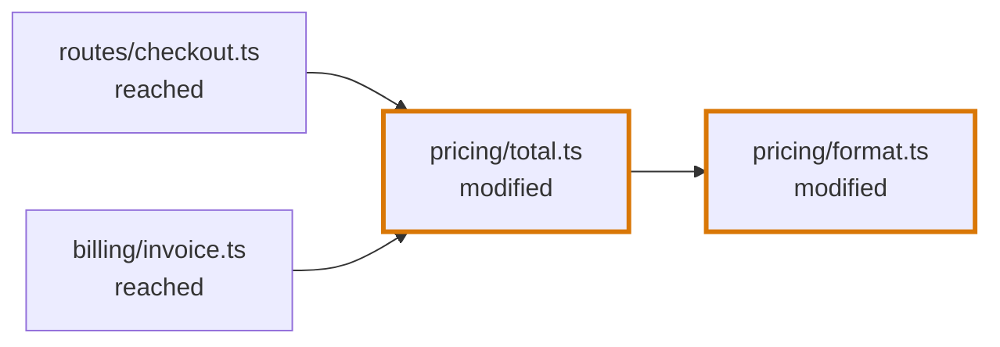
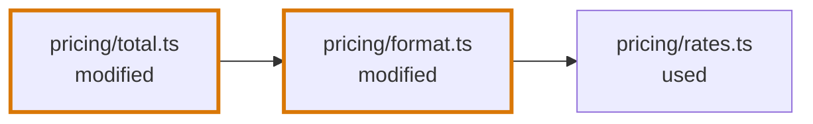
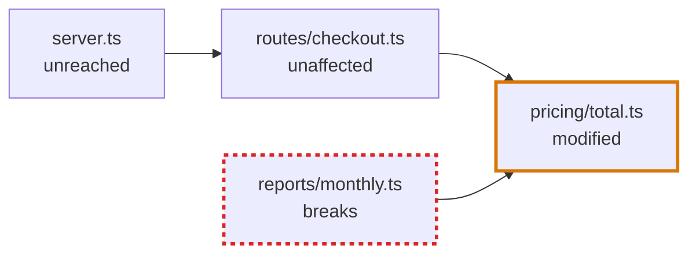

# Blast Diagram

## Definition

The Blast Diagram shows the files a change is connected to, and what the change does to the ones it did not touch. Where the [Trace Diagram](trace-diagram.md) follows the paths that lead to a change and stops there, the Blast Diagram shows what lies around the change. It answers the reviewer's second question: did the author forget something?

It has two views. The export bound, which the rest of this definition describes, is the view the diagram is named after and the one that is assessed. The import bound shows what the change itself uses. See [Two views](#two-views).

The export bound holds the files of the segment's change, and the files that use what changed in them: the files the diff did not touch, and the changed files of other entry segments on the way to them. A file of the shared segment is only in the Blast Diagram of the shared segment: the diagram of an entry segment stops at it. See [Segments](codegraph/segments.md#when-a-segment-has-a-blast-diagram). A file that uses nothing that changed is not in the diagram, even when it imports a changed file.

A pull request changes `formatPrice` in `format.ts` and `totalOf` in `total.ts`. In the diagrams of this entry a thick border marks a file of the change, and an arrow runs from the file that uses to the file that is used:

`checkout.ts` and `invoice.ts` use `totalOf`, so the change can affect them. Two kinds of file are left out:

- `calendar.ts` imports `format.ts` and uses only `formatDate`, which did not change;
- `rates.ts` is imported by `format.ts`. The change uses it, so the change cannot affect it.

## Two views

The diagram has two views, switched with two buttons of the Review Navigator, Export bound (E) and Import bound (Q):

| View | What it traces | Its files |
|---|---|---|
| **Export bound** | The root blocks around the change, and who uses them, and who uses those | The files of the change and the files that use it |
| **Import bound** | The root blocks around the change, and what they use, and what those use | The files of the change and the files it uses |

Both start from the same blocks: the root block around each change of the segment, which is the block a change is in or the outermost block around it. With the example above, the import bound is:

Everything this entry says about reached files, impact types and assessment is about the export bound. In the import bound a file the diff did not touch is a **used file**: the change relies on it and cannot affect it, so it has no impact type, no impact reason and nothing to assess. It is drawn plain, and its panel says so in one fixed sentence. A file is a node once in each view, however many uses lead to it.

The import bound follows every use of a root block, so a change inside a block that uses much, such as the list of an application's routes, draws everything under it.

The diagram opens on the export bound. When no file but those of the segment's change is in the export bound, nothing uses the change, and the diagram opens on the import bound.

The import bound is stored with the diagram, as `importBound` of the `blastDiagram`: its own nodes and edges. A Flight Plan built before the import bound existed has none, and its diagram has the export bound alone, with no buttons, until it is regenerated.

## When a segment has one

A Blast Diagram is drawn only where the answer to "did the author forget something?" could be yes: where code the author did not touch depends on code the author changed.

| The segment | Has a Blast Diagram |
|---|---|
| The only segment of the review | Always |
| The shared segment | Always |
| An entry segment, in a review with several | Only when a block of a file the diff did not touch uses one of the segment's changed blocks, directly or through other blocks |

See [Segments](codegraph/segments.md#when-a-segment-has-a-blast-diagram).

## Nodes

A node is one file. A declaration is never a node.

| File | What it stands for |
|---|---|
| **Added file** | A file the diff added |
| **Modified file** | A file the diff modified |
| **Deleted file** | A file the diff deleted |
| **Reached file** | A file the diff did not touch that uses a changed block, directly or through other blocks. The change can affect it. Using is tested per block: importing a changed file is not enough. |
| **Unreached file** | A file the diff did not touch that uses the change only through a file the change stops at. |
| **Used file** | In the import bound only: a file the diff did not touch that a root block around a change uses, directly or through other root blocks. The change cannot affect it. |

A file is drawn larger the more files of the diagram it is connected to. Its label is its file name, with as many folders in front as it takes to tell it from the other files. A folder's entry file, such as `index.ts`, always carries its folder.

## Edges

An edge is one use, drawn as an arrow from the file that uses to the file that is used. Only uses between two files of the diagram are drawn.

## What a reached file says

A reached file states an **impact type**, and an **impact reason** when the change breaks it or changes what it does. A file of the change states neither: it is the change.

| Impact type | Meaning |
|---|---|
| `breaks` | The file's logic no longer holds against the changed code, and the compiler does not say so: an assumption about a value, an order or a default, an error that is now thrown or no longer thrown, a case the author did not handle. |
| `behaviour-changes` | The file still works, and now does something different that the change does not mention. |
| `unaffected` | The change reaches the file, and nothing it does is different. |

A type error is never the reason for an impact type, because a type checker reports it.

The **impact reason** is one or two sentences a reviewer can check against the code, with a [CodeLink](review-artifact.md#codelink) to the place that carries the change. It says what the author did not account for. Only a file that breaks or changes behaviour has one. An unaffected file has none: the page says the same sentence for every unaffected file.

A reached file nobody has assessed has no impact type, which is different from `unaffected`.

**An `unaffected` file stops the change.** The files that use the change only through it are unreached, and need no assessment.

`server.ts` uses the change only through `checkout.ts`, which the agent assessed as `unaffected`, so `server.ts` is unreached. `monthly.ts` uses the change directly and states its own impact type.

## What the diagram draws

The diagram draws the files of a view and the uses between them in columns, read from left to right. Every arrow points to the right:

- a file is at the left of every file it uses, so a chain of uses runs across the board: in `a.ts → b.ts → c.ts`, `a.ts` is in the first column, `b.ts` in the second and `c.ts` in the third;
- a file is as far right as its longest chain puts it, so a file that many files use, directly and through others, is at the right of all of them;
- in a column, a file is beside the files it is joined to in the columns next to it, so that arrows cross as little as they can.

In the export bound the files that use the change are at the left and the change is at the right. In the import bound the change is at the left and what it uses is at the right. Two files that use each other are drawn with one arrow pointing left.

The reviewer has no control over this.

Only a file of the change, a file that breaks and a file whose behaviour changes carry a mark of their own. An unaffected file, an unassessed file and an unreached file are drawn alike, as plain files, and the counts above the diagram say how many are unaffected and how many are not assessed.

Selecting a file shows which of these it is, with its impact reason or one fixed sentence for an unaffected, an unassessed or an unreached file, then the files of the diagram that use it and the files of the diagram it uses. A file that has a File Section in the Code Walkthrough links to it.

On the author's page, a file the change reaches and a file that has an impact type also have "Edit impact". It turns what the panel says about the file into a form: the impact type, with "Not assessed" to take an assessment back, and the impact reason in the text editor when the type is `breaks` or `behaviour-changes`. Nothing else in the diagram can be edited: not its files, not its arrows, and not a file of the change.

## Who writes what

| Part | Written by |
|---|---|
| Which files exist and how they connect | The codegraph: the export bound from the blocks that use a changed block, the import bound from the blocks the root blocks around a change use |
| Which files are added, modified or deleted | The diff |
| Which files are reached | Derived from the uses and the impact types |
| Impact types and impact reasons | The agent, or the author on their own Flight Plan |

Whether a segment has a Blast Diagram is decided by the codegraph. See "When a segment has one".

A file with no impact can be [assessed on demand](agent-conversation.md#write-up-on-demand) from its side panel; while the agent assesses it, the file carries `isBeingWritten` in the page data. A file of the change has no impact to assess.

On the page the side panel of a file nobody assessed shows what the page data says of it, then "This file has no write-up yet." and Write up (G), which asks the agent for that file (`{ kind: "blast-file", segmentId, path }`, the segment the page shows); G is also in the Review Navigator while the panel is open. While the agent assesses the file the panel says so with the ring spinning, and offers nothing. The panel of a file of the change offers no write-up.
