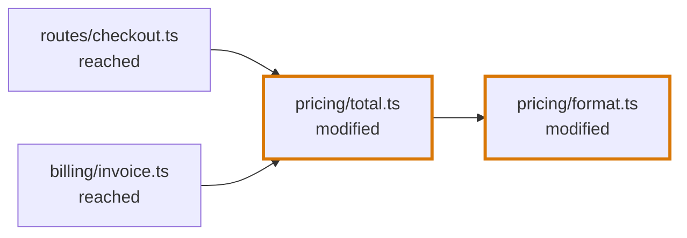
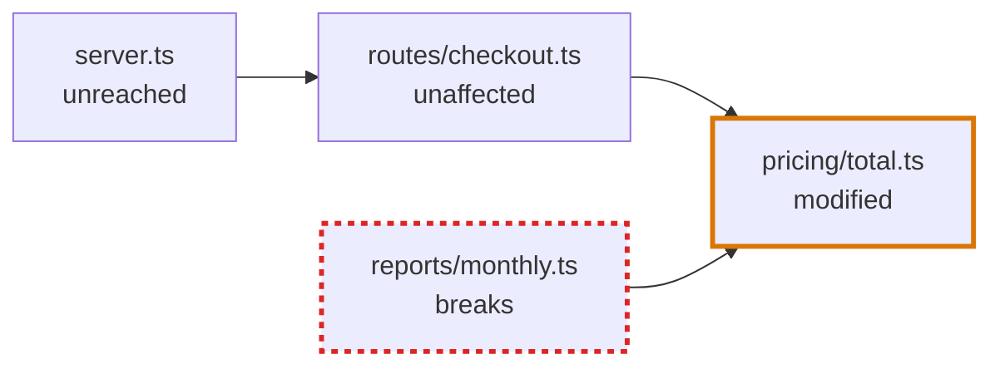

# Blast Diagram

## Definition

The Blast Diagram shows the files a change is connected to, and what the change does to the ones it did not touch. Where the [Journey Flow Diagram](journey-flow-diagram.md) follows the paths that lead to a change and stops there, the Blast Diagram shows what lies around the change. It answers the reviewer's second question: did the author forget something?

It holds the files of the segment's change, and the files that use what changed in them: the files the diff did not touch, and the changed files of other segments on the way to them. A file that uses nothing that changed is not in the diagram, even when it imports a changed file.

A pull request changes `formatPrice` in `format.ts` and `totalOf` in `total.ts`. In the diagrams of this entry a thick border marks a file of the change, and an arrow runs from the file that uses to the file that is used:

`checkout.ts` and `invoice.ts` use `totalOf`, so the change can affect them. Two kinds of file are left out:

- `calendar.ts` imports `format.ts` and uses only `formatDate`, which did not change;
- `rates.ts` is imported by `format.ts`. The change uses it, so the change cannot affect it.

## When a segment has one

A Blast Diagram is drawn only where the answer to "did the author forget something?" could be yes: where code the author did not touch depends on code the author changed.

| The segment | Has a Blast Diagram |
|---|---|
| The only segment of the review | Always |
| The shared segment | Always |
| An entry segment, in a review with several | Only when a block of a file the diff did not touch uses one of the segment's changed blocks, directly or through other blocks |

See [Segments](codegraph/segments.md#when-a-segment-has-a-blast-diagram).

## Nodes

A node is one file. A declaration is never a node.

| File | What it stands for |
|---|---|
| **Added file** | A file the diff added |
| **Modified file** | A file the diff modified |
| **Deleted file** | A file the diff deleted |
| **Reached file** | A file the diff did not touch that uses a changed block, directly or through other blocks. The change can affect it. Using is tested per block: importing a changed file is not enough. |
| **Unreached file** | A file the diff did not touch that uses the change only through a file the change stops at. |

A file is drawn larger the more files of the diagram it is connected to. Its label is its file name, with as many folders in front as it takes to tell it from the other files. A folder's entry file, such as `index.ts`, always carries its folder.

## Edges

An edge is one use, drawn as an arrow from the file that uses to the file that is used. Only uses between two files of the diagram are drawn.

## What a reached file says

A reached file states an **impact type**, and an **impact reason** when the change breaks it or changes what it does. A file of the change states neither: it is the change.

| Impact type | Meaning |
|---|---|
| `breaks` | The file's logic no longer holds against the changed code, and the compiler does not say so: an assumption about a value, an order or a default, an error that is now thrown or no longer thrown, a case the author did not handle. |
| `behaviour-changes` | The file still works, and now does something different that the change does not mention. |
| `unaffected` | The change reaches the file, and nothing it does is different. |

A type error is never the reason for an impact type, because a type checker reports it.

The **impact reason** is one or two sentences a reviewer can check against the code, with a [CodeLink](review-artifact.md#codelink) to the place that carries the change. It says what the author did not account for. Only a file that breaks or changes behaviour has one. An unaffected file has none: the page says the same sentence for every unaffected file.

A reached file nobody has assessed has no impact type, which is different from `unaffected`.

**An `unaffected` file stops the change.** The files that use the change only through it are unreached, and need no assessment.

`server.ts` uses the change only through `checkout.ts`, which the agent assessed as `unaffected`, so `server.ts` is unreached. `monthly.ts` uses the change directly and states its own impact type.

## What the diagram draws

The diagram draws the files of the change, the files that use it, and the uses between them. The change is at the centre:

- the files of the change are innermost, and among them a file is closer to the centre the deeper it is among them: in `a.ts → b.ts → c.ts`, `c.ts` is at the centre, `b.ts` around it and `a.ts` around that;
- a file the diff did not touch is further out the more uses lie between it and the change.

The reviewer has no control over this.

Only a file of the change, a file that breaks and a file whose behaviour changes carry a mark of their own. An unaffected file, an unassessed file and an unreached file are drawn alike, as plain files, and the counts above the diagram say how many are unaffected and how many are not assessed.

Selecting a file shows which of these it is, with its impact reason or one fixed sentence for an unaffected, an unassessed or an unreached file, then the files of the diagram that use it and the files of the diagram it uses. A file that has a File Section in the Code Walkthrough links to it.

## Who writes what

| Part | Written by |
|---|---|
| Which files exist and how they connect | The codegraph, from the blocks that use a changed block |
| Which files are added, modified or deleted | The diff |
| Which files are reached | Derived from the uses and the impact types |
| Impact types and impact reasons | The agent |

Whether a segment has a Blast Diagram is decided by the codegraph. See "When a segment has one".
