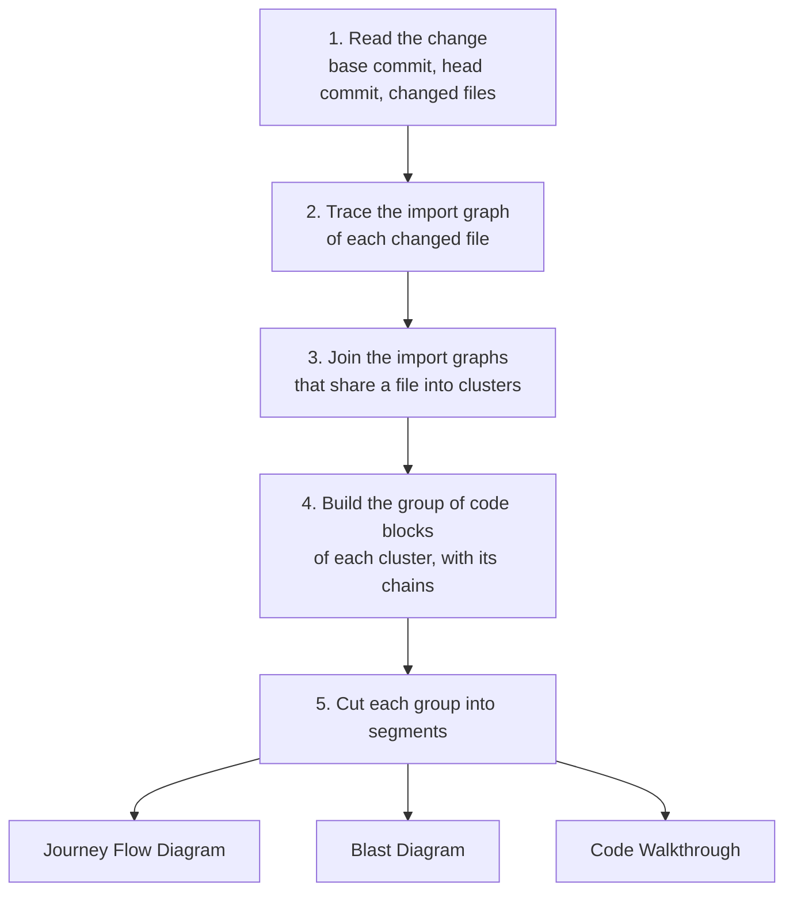
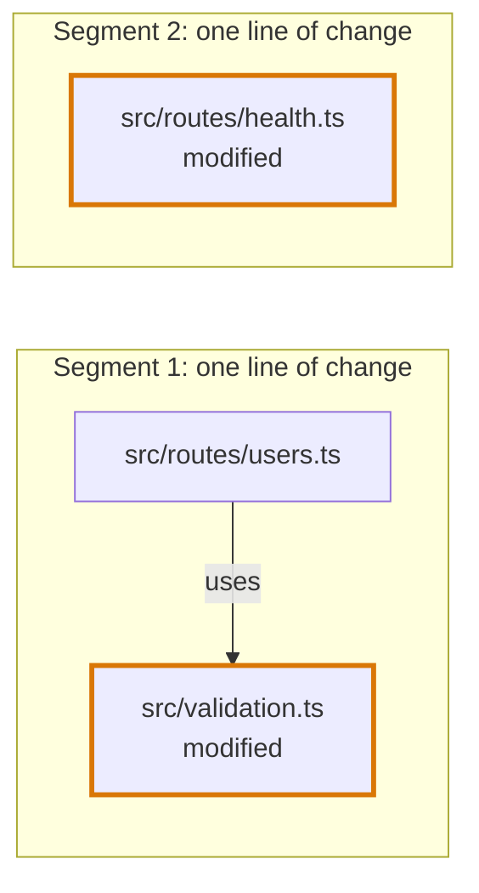

# Codegraph

## Definition

The codegraph is Flight Plan's map of how a change connects to the rest of the code. For a branch or a pull request it works out four things, in this order:

- **Which files belong together.** The files that import a changed file and the files it imports, joined into groups that share a file.
- **What each file is made of.** The code blocks of every file of a group: each piece a changed line can belong to, what it uses and what uses it, and which blocks the diff touched.
- **What leads to the changed code.** From what starts a path, through the blocks it runs, to each changed block: a chain.
- **The structure of a review.** The segments of each group, with the Journey Flow Diagram, the Blast Diagram and the Code Walkthrough of each.

Flight Plan builds the codegraph from the syntax trees of the files themselves, read straight from git. It needs no language server, no prebuilt index and no checked-out working tree.

## How this entry is split

This page is the overview. Each mechanism and each language has a page of its own:

| Page | What it holds |
|---|---|
| [Import graph](codegraph/import-graph.md) | How the files of a change are found and grouped: the trace in both directions, searching for importers, clusters |
| [Code blocks](codegraph/code-blocks.md) | The shapes: the group, a file, a code block, the stored form |
| [Block types](codegraph/block-types.md) | What each type of block is, and what counts as a hook and as an effect |
| [Symbols](codegraph/symbols.md) | How a block refers to what it uses, and where a value comes from |
| [Chains](codegraph/chains.md) | How a change is placed in a block and traced to what starts it |
| [Segments](codegraph/segments.md) | Entry segments and the shared segment, and when a segment has a Blast Diagram |
| [Catalogue](codegraph/catalogue.md) | What a call into a library means: routes, pages, events, effects, and which files are tests |
| [AST graph](codegraph/ast-graph.md) | The syntax of one file, read from the same parse as its code blocks: names and their uses, syntax sites and statements |
| [TypeScript](codegraph/languages/typescript.md) | What an import, a declaration and a use are in a `.ts` file, and how its imports resolve |
| [JavaScript and JSX](codegraph/languages/jsx.md) | What elements add: components, handlers, props, hooks, contexts and routes |
| [Python](codegraph/languages/python.md) | Module roots, relative imports, names that are bound instead of declared, and what each statement is as a block |
| [Vue](codegraph/languages/vue.md) | A file of three languages: script blocks, a template and its expressions, read as one component |

## One way a change is drawn

Every change is drawn from code blocks, whatever language it is written in: its segments are cut from the group, its Journey Flow Diagram is drawn from chains, and its Blast Diagram and its Code Walkthrough are read from the blocks.

| A cluster | Segments | Journey Flow Diagram | Blast Diagram | Code Walkthrough |
|---|---|---|---|---|
| TypeScript, JavaScript, JSX, Vue, Python, and files no language reads | Cut from each group: entry segments and the shared segment | From chains | The files that use a changed block | One waypoint per changed block at the root of a file, or per method |

The diagrams the codegraph produces have entries of their own: [Journey Flow Diagram](journey-flow-diagram.md), [Blast Diagram](blast-diagram.md) and [Code Walkthrough](code-walkthrough.md).

## Why it exists

A review artifact is only worth trusting if its structure is right. The Journey Flow Diagram and the Blast Diagram make claims about the code: this function uses that one, and this change reaches these places. If an agent drew those diagrams from reading the code, it could miss a user or invent a connection, and a reviewer would have no way to tell. Reading enough files to find every user would also cost the agent a large number of tokens on every review.

The codegraph splits the work in two. **Structure is derived**: Flight Plan computes who uses what, directly from the code, so the same change always gives the same structure. **Prose is authored**: the agent explains what the structure means, such as why a path matters or what could break along it. Neither side writes the other's half, so an agent cannot restructure a diagram and the codegraph never makes up an explanation.

Two more properties follow from that goal:

- **It works on any machine with git.** Files, file lists and searches are read from commits through a git adapter, so there is nothing to install, no index to build and no worktree to clean up.
- **Its cost follows the size of the change, not the size of the repository.** It reads only the changed files, the files a search says might import them and prove to, and the files they import.

## Terms

| Term | Meaning |
|---|---|
| **Change** | The lines a branch or a pull request changes, between its base commit and its head commit. |
| **Import graph** | For one changed file, the files that import it and the files it imports, directly or through other files, each with the files it imports and is imported by. |
| **Cluster** | The import graphs that share a file, joined into one. A cluster is one connected part of one language. |
| **Group** | The files of a cluster without its tests and stories, split again where only they joined it. A changed file no cluster holds is a group of its own. See [The group](codegraph/code-blocks.md#the-group). |
| **Code block** | One piece of a file a changed line can belong to: a function, a condition, a render, an event. See [Code blocks](codegraph/code-blocks.md). |
| **Diff block** | The innermost block around a change. |
| **Symbol** | One use of a name a block does not declare itself, with what the name leads to. See [Symbols](codegraph/symbols.md). |
| **Chain** | A path from the block that starts it, through the blocks it runs, to a changed block. See [Chains](codegraph/chains.md). |
| **Segment** | One part of a review: an entry segment, which is one line of change, or the shared segment. See [Segments](codegraph/segments.md). |

## The pipeline



| Step | What happens | Described in |
|---|---|---|
| 1. Read the change | The base commit, the head commit and the changed files between them are read once, each file with its patch and whether it was added, modified or deleted | [Import graph](codegraph/import-graph.md) |
| 2. Trace the import graph | For each changed file, the files that import it and the files it imports, followed through other files until nothing new is reached | [The trace of one file](codegraph/import-graph.md#the-trace-of-one-file) |
| 3. Join into clusters | Two import graphs that share a file are one cluster | [Clusters](codegraph/import-graph.md#clusters) |
| 4. Build the groups | The tests and the stories are taken out of each cluster, every file is read into code blocks, each change is placed in its innermost block, and the chains that lead to a change are traced | [How a group is built](codegraph/code-blocks.md#how-a-group-is-built) |
| 5. Cut into segments | Each group is cut into its entry segments and its shared segment, and each segment gets its diagrams and its Code Walkthrough | [Segments](codegraph/segments.md) |

## An example, end to end

A pull request changes one line of `validateFirstname` and one line of an unrelated health route.

```ts
// src/validation.ts
export function validateFirstname(name: string) {
  if (name.length < 3) {                // the changed line
    throw new Error("First name must be at least 3 characters")
  }
}

// src/routes/users.ts
import { validateFirstname } from "../validation"

export const createUser = (body: UserBody) => {
  validateFirstname(body.firstname)
  return saveUser(body)
}

// src/routes/health.ts
export const getHealth = () => ({ status: "ok", version })   // the changed line
```



| Step | Result |
|---|---|
| Import graph | `validation.ts` is imported by `routes/users.ts`. `routes/health.ts` shares no file with either. |
| Clusters | Two: `validation.ts` with `routes/users.ts`, and `routes/health.ts` alone. |
| Groups | Two. In the first, the change lies in the `condition` block of `validateFirstname`. In the second, in the `function` block `getHealth`. |
| Chains | `createUser` calls `validateFirstname`, so the chain is `createUser`, `validateFirstname`, the `condition`. Nothing calls `createUser`, so it is the top. |
| Segments | Two entry segments. The first has a Blast Diagram, since `routes/users.ts` was not changed and uses the change. The second has none: nothing uses `getHealth`. |

## Output

`buildBranchCodegraph` returns the segments of a change:

```ts
interface Codegraph {
  segments: CodegraphSegment[]
}

interface CodegraphSegment {
  title: string | null
  kind: "entry" | "shared"
  importGraph: ImportGraphFile[]
  journeyFlowDiagram: JourneyFlow | null
  blastRadiusDiagram: Blast | null
  codeWalkthrough: LinkedCodeWalkthrough
  codeReferences: FileCodeReferences[]
}
```

| Field | What it holds |
|---|---|
| `title` | `null` until a consumer writes it |
| `kind` | Whether the segment is one line of change or the shared segment |
| `importGraph` | The changed files of the segment, and the files of its group the diff did not touch. A deleted file of a cluster is with the first segment of that cluster. |
| `journeyFlowDiagram` | `null` for the shared segment, and for a segment in which nothing that runs changed |
| `blastRadiusDiagram` | `null` for an entry segment nothing outside the change uses. See [When a segment has a Blast Diagram](codegraph/segments.md#when-a-segment-has-a-blast-diagram). |

A waypoint of the codegraph carries more than the stored one: its line `range`, a `category` (`function`, `class`, `method`, `variable`, `import`, `type`, `statement` or `file`), and the id of the Journey Flow Diagram node it belongs to, `null` when the diagram has no node for it.

## Language support

| Language | Files | Import graph | Code blocks | Drawn from |
|---|---|---|---|---|
| [TypeScript](codegraph/languages/typescript.md) | `.ts`, `.mts`, `.cts` | yes | yes | Code blocks and chains |
| [JavaScript and JSX](codegraph/languages/jsx.md) | `.tsx`, `.jsx`, `.js`, `.mjs`, `.cjs` | yes | yes | Code blocks and chains |
| [Python](codegraph/languages/python.md) | `.py`, `.pyi` | yes | yes | Code blocks and chains |
| [Vue](codegraph/languages/vue.md) | `.vue` | yes | yes | Code blocks and chains |
| Any other file, such as a migration or a stylesheet | | no | One `file` block when the diff changed it | A segment of its own, with one waypoint |

A language is plugged into three places:

- **A reader of the import graph** reads and resolves the imports of a file, and gives the patterns an importer would contain. TypeScript, JavaScript, JSX and Vue share one reader, so a `.vue` file and the `.ts` file it imports are in one cluster. Python has its own, so a cluster never holds both a script file and a Python file.
- **A language of the code blocks** reads the blocks and the uses of a file. TypeScript and JSX share one, Python has one, and Vue has one that reads its script with the TypeScript one.
- **A reader of the AST graph** reads the declarations, the names, the syntax sites and the statements of a file, from the tree its code blocks are read from. The code blocks resolve names with its readers, and the diagrams read the inside of a node from what it gives.

## Consumers

What reads a segment, and what it takes from the codegraph:

| Consumer | What the codegraph gives it | What is left to write |
|---|---|---|
| [Journey Flow Diagram](journey-flow-diagram.md) | Its nodes with their blocks, the nodes inside a node, the trigger labels and the edges, drawn from the chains of the group that lead to a change of the segment | The label and the description of each node, and the label of each trigger label |
| [Blast Diagram](blast-diagram.md) | One node per file of the segment's change and per file that uses a changed block, and one edge per use between two of them. Which files the change reaches is derived, never stored. | The `impactType` and the `impactReason` of each file the change did not touch, both `null` from the codegraph |
| [Code Walkthrough](code-walkthrough.md) | One File Section per changed file of the segment and one waypoint per changed block at the root of a file: a function, a class, a variable, an import, a type or a statement, the method when the change is inside a class, and the whole file when no language reads it. Each waypoint names the Journey Flow Diagram node it belongs to. | The reading of each waypoint |

### Who calls it

`tools/playground-fixtures` runs `buildBranchCodegraph` against whole repositories and keeps the results as snapshots, which the app shows as fixture reviews in a development build.

A review requested in the app is built by `buildScaffold`, which makes the File Sections and the waypoints from the diff and gives the segment no Journey Flow Diagram and no Blast Diagram.

An agent's tools can fill in labels and explanations on existing nodes. They have no field for adding, moving or removing a node, and none for saying whether a segment has a diagram. The codegraph owns the structure, and the agent owns the prose.

## Where it lives in the code

The codegraph is the `packages/codegraph` package, and the backend imports it as `@flightplan/codegraph`. The shapes it reads and writes are in `packages/configurations`.

The entry point is `buildBranchCodegraph` in `src/index.ts`. The work runs in this order:

| Stage | Where |
|---|---|
| Trace and cluster the import graph | `src/import-graph/`, see [Import graph](codegraph/import-graph.md#where-it-lives-in-the-code) |
| Build the group of code blocks of each cluster, with its chains | `src/code-blocks/` |
| Cut a group into segments, and find the files a change reaches | `src/code-blocks/segments.ts` |
| Read what a call into a library means | `src/catalogue/` |
| Trace the Journey Flow Diagram of a segment from its chains | `src/journey-flow-diagram/chain-facts.ts`, `scope.ts` and `index.ts` |
| Build the Blast Diagram of a segment from the blocks that use its change | `src/blast-radius-diagram/from-blocks.ts` |
| Derive which files of a Blast Diagram the change reaches | `src/blast/assessment.ts` |
| Build the Code Walkthrough of a segment from its diff blocks | `src/code-walkthrough/from-blocks.ts` |
| Read the names, the syntax sites and the statements of a file | `src/ast-graph/` |
| Draw the import graph of a deleted file as its Blast Diagram | `src/blast-radius-diagram/index.ts` |

The same package holds the builders that turn a stored review artifact into what the review page renders, in `src/journey/`, `src/blast/`, `src/walkthrough/`, `src/code/` and `src/prose/`, and the builder of a first review artifact in `src/scaffold/`.

Each `__tests__/` folder holds a test for each rule of the code beside it. The cases that run the whole pipeline over a repository are in `tools/playground-fixtures`.
