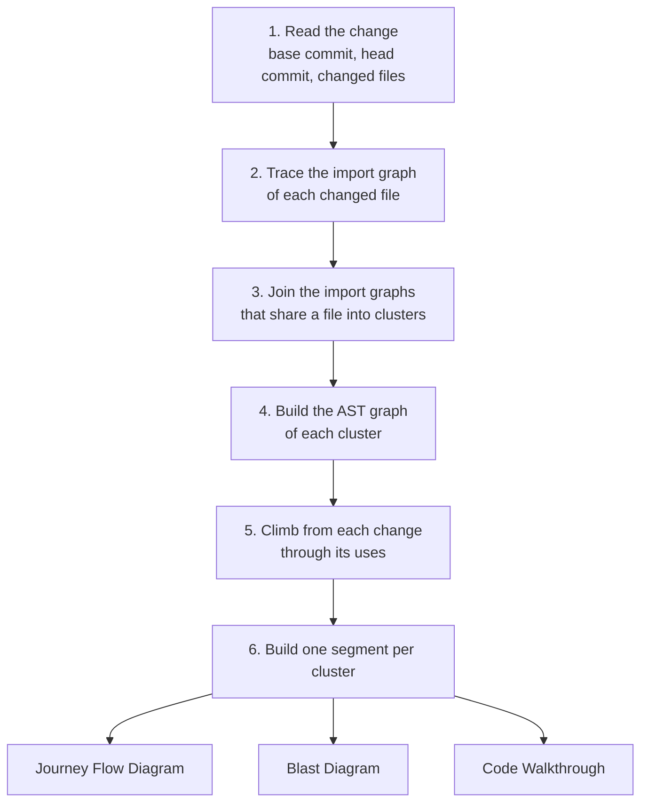
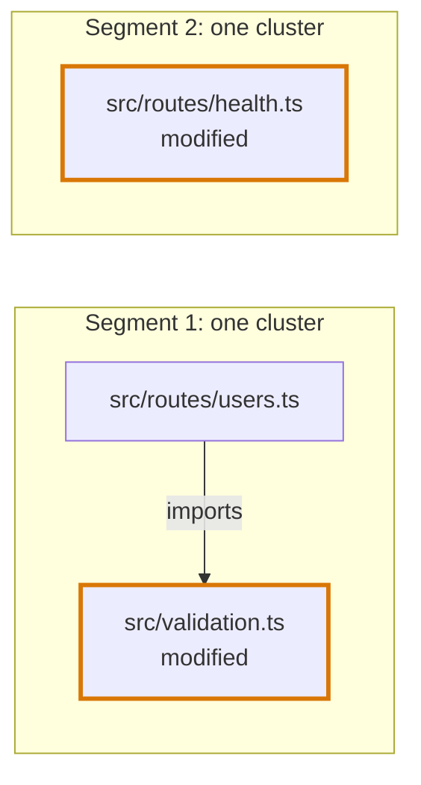
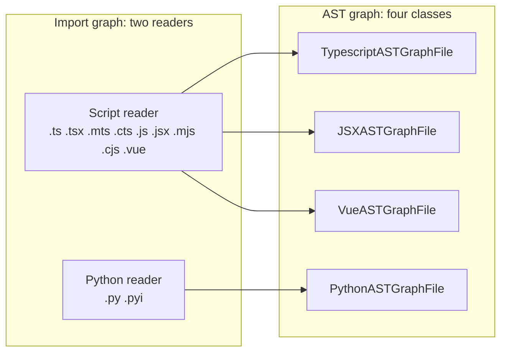

# Codegraph

## Definition

The codegraph is Flight Plan's map of how a change connects to the rest of the code. For a branch or a pull request it works out four things, in this order:

- **Which files belong together.** The files that import a changed file and the files it imports, joined into groups that share a file.
- **What each file declares and uses.** The functions, classes and values of every file of a group, where each name is used, and which of them the diff touched.
- **Who uses the changed code.** From each changed declaration, every declaration that uses it, and the ones that use those, up to code nothing else uses.
- **The structure of a review.** One segment per group, with its Journey Flow Diagram, its Blast Diagram and its Code Walkthrough.

Flight Plan builds the codegraph from the syntax trees of the files themselves, read straight from git. It needs no language server, no prebuilt index and no checked-out working tree.

## How this entry is split

This page is the overview. Each mechanism and each language has a page of its own:

| Page | What it holds |
|---|---|
| [Import graph](codegraph/import-graph.md) | How the files of a change are found and grouped: the trace in both directions, searching for importers, clusters |
| [AST graph](codegraph/ast-graph.md) | How the files of a group are read: encapsulations, names and their uses, where a changed line belongs, the climb through uses |
| [TypeScript](codegraph/languages/typescript.md) | What an import, an encapsulation and a use are in a `.ts` file, and how its imports resolve |
| [JavaScript and JSX](codegraph/languages/jsx.md) | What elements add: components, handlers, props, hooks, contexts, routes, and the UI card |
| [Python](codegraph/languages/python.md) | Module roots, relative imports and names that are bound instead of declared |
| [Vue](codegraph/languages/vue.md) | A file of three languages: script blocks, a template and its expressions, traced like a JSX component |

The diagrams the codegraph produces have entries of their own: [Journey Flow Diagram](journey-flow-diagram.md), [Blast Diagram](blast-diagram.md) and [Code Walkthrough](code-walkthrough.md).

## Why it exists

A review artifact is only worth trusting if its structure is right. The Journey Flow Diagram and the Blast Diagram make claims about the code: this function uses that one, and this change reaches these places. If an agent drew those diagrams from reading the code, it could miss a user or invent a connection, and a reviewer would have no way to tell. Reading enough files to find every user would also cost the agent a large number of tokens on every review.

The codegraph splits the work in two. **Structure is derived**: Flight Plan computes who uses what, directly from the code, so the same change always gives the same structure. **Prose is authored**: the agent explains what the structure means, such as why a path matters or what could break along it. Neither side writes the other's half, so an agent cannot restructure a diagram and the codegraph never makes up an explanation.

Two more properties follow from that goal:

- **It works on any machine with git.** Files, file lists and searches are read from commits through a git adapter, so there is nothing to install, no index to build and no worktree to clean up.
- **Its cost follows the size of the change, not the size of the repository.** It reads only the changed files, the files a search says might import them and prove to, and the files they import.

## Terms

| Term | Meaning |
|---|---|
| **Change** | The lines a branch or a pull request changes, between its base commit and its head commit. |
| **Import graph** | For one changed file, the files that import it and the files it imports, directly or through other files, each with the files it imports and is imported by. |
| **Cluster** | The import graphs that share a file, joined into one. A cluster is one connected part of one language, and it becomes one segment. |
| **Encapsulation** | Something a changed line can belong to. At the root of a file: a function, a class, a variable, an enum, a namespace or a default export. Below the root: a function, a class, a method, or a variable, field or member of a declared object that holds a function or a class. |
| **Root encapsulation** | An encapsulation at the top level of a file. |
| **AST graph** | The files of one cluster, parsed. Each file lists its root encapsulations, its variables, its imports, its exports and every use of a name. |
| **Diff location** | A range of changed lines with the root encapsulation it lies in and the nearest encapsulation that holds it. |
| **Loose statement** | A top-level statement that no root encapsulation shares a line with: an import, a type, an interface or a bare call. |
| **Use** | A place where a name is read, called, rendered or handed over. A use belongs to the declaration its name resolves to. |
| **Caller** | The nearest encapsulation that holds a use of another encapsulation. |
| **Usage tree** | A changed encapsulation with its callers, and their callers, as far as they go. |
| **Segment** | What the codegraph returns for one cluster: its import graph, its AST graph, its Journey Flow Diagram, its Blast Diagram and its Code Walkthrough. |

## The pipeline



| Step | What happens | Described in |
|---|---|---|
| 1. Read the change | The base commit, the head commit and the changed files between them are read once, each file with its patch and whether it was added, modified or deleted | [Import graph](codegraph/import-graph.md) |
| 2. Trace the import graph | For each changed file, the files that import it and the files it imports, followed through other files until nothing new is reached | [The trace of one file](codegraph/import-graph.md#the-trace-of-one-file) |
| 3. Join into clusters | Two import graphs that share a file are one cluster, and one segment of the review | [Clusters](codegraph/import-graph.md#clusters) |
| 4. Build the AST graph | Every file of a cluster is parsed once and asked what it declares and uses. Each changed line is placed in the encapsulation it belongs to | [AST graph](codegraph/ast-graph.md) |
| 5. Climb through uses | From a changed encapsulation, the nearest encapsulation that holds each use is a caller, and the climb carries on from each caller | [The climb through uses](codegraph/ast-graph.md#the-climb-through-uses) |
| 6. Build the segment | The Journey Flow Diagram, the Blast Diagram and the Code Walkthrough of the cluster. A segment in which no code that runs changed has no Journey Flow Diagram | "Consumers" below |

## An example, end to end

A pull request changes one line of `validateFirstname` and one line of an unrelated health route.

```ts
// src/validation.ts
export function validateFirstname(name: string) {
  if (name.length < 3) {                // the changed line
    throw new Error("First name must be at least 3 characters")
  }
}

// src/routes/users.ts
import { validateFirstname } from "../validation"

export const createUser = (body: UserBody) => {
  validateFirstname(body.firstname)
  return saveUser(body)
}

// src/routes/health.ts
export const getHealth = () => ({ status: "ok", version })   // the changed line
```



| Step | Result |
|---|---|
| Import graph | `validation.ts` is imported by `routes/users.ts`. `routes/health.ts` shares no file with either. |
| Clusters | Two: `validation.ts` with `routes/users.ts`, and `routes/health.ts` alone. |
| AST graph | The changed line of `validation.ts` lies in `validateFirstname`. The changed line of `health.ts` lies in `getHealth`. |
| Climb | `validateFirstname` is used in `createUser`, so `createUser` is its caller. |
| Segments | Two, each with a Journey Flow Diagram, a Blast Diagram and a Code Walkthrough of its own. |

## Output

`buildBranchCodegraph` returns the segments of a change:

```ts
interface Codegraph {
  segments: CodegraphSegment[]
}

interface CodegraphSegment {
  title: string | null
  importGraph: ImportGraphFile[]
  astGraph: ASTCodeGroupGraph
  journeyFlowDiagram: JourneyFlow | null
  blastRadiusDiagram: Blast
  codeWalkthrough: LinkedCodeWalkthrough
}
```

`title` is `null` until a consumer writes it.

A waypoint of the codegraph carries more than the stored one: its line `range`, a `category` read from the syntax tree (`function`, `class`, `method`, `variable`, `import`, `type` or `statement`), and the id of the Journey Flow Diagram node it belongs to, `null` when the diagram has no node for it.

## Language support

| Language | Files | Import graph | AST graph | Journey Flow Diagram |
|---|---|---|---|---|
| [TypeScript](codegraph/languages/typescript.md) | `.ts`, `.mts`, `.cts` | yes | yes | calls, entry points and traced lines |
| [JavaScript and JSX](codegraph/languages/jsx.md) | `.tsx`, `.jsx`, `.js`, `.mjs`, `.cjs` | yes | yes | the same, with handlers, components, contexts and routes |
| [Python](codegraph/languages/python.md) | `.py`, `.pyi` | yes | yes | plain call edges, no traced lines, few named entry points |
| [Vue](codegraph/languages/vue.md) | `.vue` | yes | yes | the same as JSX, read from the template and the script blocks |

A language is two parts, and each part plugs into one mechanism:



- **A reader of the import graph** reads and resolves the imports of a file, and gives the patterns an importer would contain. TypeScript, JavaScript, JSX and Vue share one reader, so a `.vue` file and the `.ts` file it imports are in one cluster. Python has its own, so a cluster never holds both a script file and a Python file.
- **A class of the AST graph** reads the encapsulations, variables, imports, exports and uses from a parsed tree.

## Consumers

What reads a segment, and what it takes from the codegraph:

| Consumer | What the codegraph gives it | What is left to write |
|---|---|---|
| [Journey Flow Diagram](journey-flow-diagram.md) | Its nodes, its edges, its entry points, what is folded, the traced lines and the code views. It is not built from the usage trees: it has a trace of its own over the same files. | The label and the description of each node |
| [Blast Diagram](blast-diagram.md) | One node per file of the import graph, with its `diffType`, and one edge per entry of a file's `importsTo`. Which files the change reaches is derived, never stored. | The `impactType` and the `impactReason` of each file the change did not touch, both `null` from the codegraph |
| [Code Walkthrough](code-walkthrough.md) | One File Section per file with changes and one waypoint per changed declaration: the function a change is in, the method when the function is inside a class, or a loose statement. Each waypoint names the Journey Flow Diagram node it belongs to. | The reading of each waypoint |

### Who calls it

`tools/playground-fixtures` runs `buildBranchCodegraph` against whole repositories and keeps the results as snapshots, which the app shows as fixture reviews in a development build.

A review requested in the app is built by `buildScaffold`, which makes the File Sections and the waypoints from the diff and gives the segment no Journey Flow Diagram and no Blast Diagram.

An agent's tools can fill in labels and explanations on existing nodes. They have no field for adding, moving or removing a node, and none for saying whether a segment has a diagram. The codegraph owns the structure, and the agent owns the prose.

## Where it lives in the code

The codegraph is the `packages/codegraph` package, and the backend imports it as `@flightplan/codegraph`. The shapes it reads and writes are in `packages/configurations`.

The entry point is `buildBranchCodegraph` in `src/index.ts`. The work runs in this order:

| Stage | Where |
|---|---|
| Trace and cluster the import graph | `src/import-graph/`, see [Import graph](codegraph/import-graph.md#where-it-lives-in-the-code) |
| Parse the files of a cluster and climb through uses | `src/ast-graph/`, see [AST graph](codegraph/ast-graph.md#where-it-lives-in-the-code) |
| Read the changed lines of each file from its patch | `src/diff-lines.ts` |
| Trace the Journey Flow Diagram of a cluster | `src/journey-flow-diagram/` |
| Build the Blast Diagram of a cluster from its import graph | `src/blast-radius-diagram/` |
| Derive which files of a Blast Diagram the change reaches | `src/blast/assessment.ts` |
| Build the Code Walkthrough of a cluster | `src/code-walkthrough/` |

The same package holds the builders that turn a stored review artifact into what the review page renders, in `src/journey/`, `src/blast/`, `src/walkthrough/`, `src/code/` and `src/prose/`, and the builder of a first review artifact in `src/scaffold/`.

Each `__tests__/` folder holds a test for each rule of the code beside it. The cases that run the whole pipeline over a repository are in `tools/playground-fixtures`.
