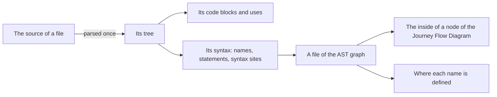
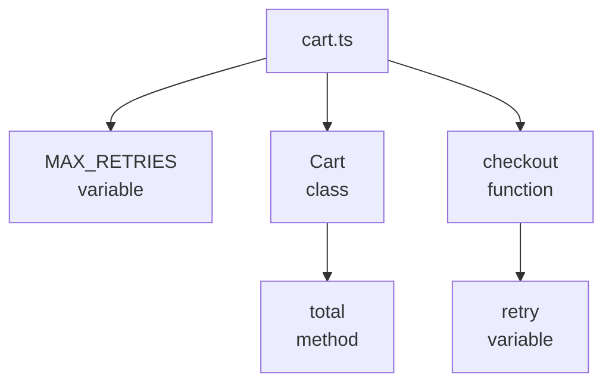

# AST graph

## Definition

The AST graph is the syntax of one file, as lists: what the file declares, where each name is used, its statements, and which declaration a changed line belongs to. Where the [import graph](import-graph.md) says which files belong together and the [code blocks](code-blocks.md) say what a change runs through, the AST graph says what is inside a node of a diagram.

A file is parsed once. The language that reads its [code blocks](code-blocks.md) reads its syntax from the same tree, and the group keeps the syntax of each file beside its blocks.



## The syntax of a file

**The syntax is read by the language, and asked through one class.** A language gives a file's syntax as nine lists. `ASTGraphFile` holds them with the changed lines of the file and answers every question about them, so the diagrams work the same way over TypeScript, Python and Vue.

**A file is built once.** Everything is read from the tree, and nothing changes it afterwards. A file no language reads has no syntax. The syntax of a file is read when a diagram first asks for it, so a group that is only stored never reads it.

| List | What it gives |
|---|---|
| Source lines | The text of the file, by line |
| Root encapsulations | The encapsulations at the top level of the file, with the encapsulations nested in them |
| Variables | Every name the file declares, with its scope |
| Import variables | Every name the file imports, with the file it comes from |
| References | Every use of a name |
| Export aliases | The names a declaration is exported under |
| Re-exports | The names the file hands on from another file |
| Syntax sites | The attributes, arguments, callees, members, elements and functions the Journey Flow Diagram reads |
| Statements | The statements of the file, nested with their branches |

How each of these is read differs by language. See [TypeScript](languages/typescript.md#ast-graph), [JavaScript and JSX](languages/jsx.md#ast-graph), [Python](languages/python.md#ast-graph) and [Vue](languages/vue.md#ast-graph).

## Encapsulations

An encapsulation is something a changed line can belong to.

| Where | What counts |
|---|---|
| At the root of a file | A function, a class, a variable, an enum, a namespace or a default export |
| Below the root | A function, a class, a method, or a variable, field or member of a declared object that holds a function or a class |

```ts
export const MAX_RETRIES = 5                      // root: variable

export class Cart {                               // root: class
  total() {                                       //   nested: method
    return this.lines.reduce(sum, 0)
  }
}

export function checkout(cart: Cart) {            // root: function
  const retry = () => submit(cart)                //   nested: variable that holds a function
  return retry()
}
```



Types, declarations marked `declare`, overload signatures and the members of an object handed to a call or to an element are not encapsulations.

## Names and their uses

**A name is resolved once per space.** A declaration and a use each live in the value space, the type space or both, so `const Cart` and `type Cart` in one scope stay apart. A class, an enum, a namespace and an import are in both spaces.

**A use belongs to the declaration of its name with the nearest scope.** A different variable with the same name is not a use.

```ts
const total = priceOf(cart)             // a use of the imported priceOf

const format = (priceOf: number) => {
  return priceOf.toFixed(2)             // not a use: this priceOf is the parameter
}
```

## Where a changed line belongs

The changed lines of a file come from its patch:

- An added or a changed line is a changed line.
- Lines that were only removed count as a change on the line before them.
- A deleted file has no changed lines.

They become diff locations. A diff location is a range of changed lines with two encapsulations: the root encapsulation it lies in, and the nearest encapsulation that holds it.

```ts
export function checkout(cart: Cart) {
  const retry = () => {
    return submit(cart, { attempts: 3 })          // the changed line
  }
  return retry()
}
```

| Field of the diff location | Value |
|---|---|
| The changed lines | Line 3 |
| The root encapsulation | `checkout` |
| The nearest encapsulation | `retry` |

Two rules place the lines:

- **A location belongs to one root encapsulation.** A range that spans several, such as the whole of a new file, is split into one location per root encapsulation and cut to its lines.
- **Changed lines outside every root encapsulation have no location.** An import, a type or a bare call at the root of a file is placed by its [code block](code-blocks.md), which gives it its waypoint.

## Where a name is defined

The AST graph also answers where a name comes from, for the code the Journey Flow Diagram and the Code Walkthrough show:

| The name | Its definition |
|---|---|
| Declared in the file | The lines of its root encapsulation, or of the narrowest import, type or declaration statement that holds it |
| A parameter | Its own line |
| Imported from a file of the group | The lines the file it comes from exports it by, followed through re-exports |
| Imported from a library, through a namespace import, or from a file outside the group | Its import statement |

A root encapsulation is known to an importer by its own name and by every alias it is exported under, and a file hands an imported name on through its re-exports:

| The export | The name an importer knows |
|---|---|
| `export default function priceOf` | `default` |
| `export { priceOf as price }` | `price` |
| `export { a as b } from "./a"` | `b` |
| `export * from "./a"` | Every name of `./a` but `default` |
| `export * as ns from "./a"` | `ns` |

A method is not a variable, so nothing uses it by its own name: its uses are the uses of its class.

## Where it lives in the code

| Part | Where |
|---|---|
| The class that holds the syntax of a file and answers questions about it, and where the changed lines are placed | `src/ast-graph/languages/base.ts` |
| One folder per language, with the reader of a file's syntax in `index.ts` | `src/ast-graph/languages/<language>/` |
| The shape of the syntax of a file, `FileSyntax` | `src/ast-graph/types.ts` |
| Where the syntax is read with the blocks, and kept beside the group | `src/code-blocks/languages/`, `src/code-blocks/build-group.ts` |
| Where a name is defined, and the files of a group from their syntax | `src/ast-graph/definition.ts` |
| Every parse, with one parser per grammar and the compiled queries | `src/ast-graph/parser.ts` |
| Walking a tree with a cursor | `src/ast-graph/walk-tree.ts` |
