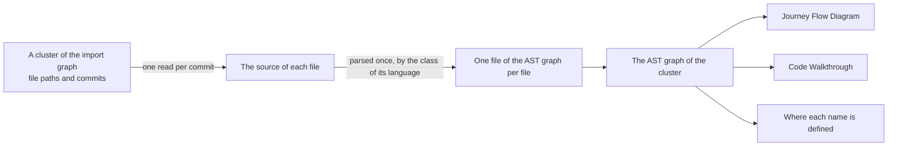
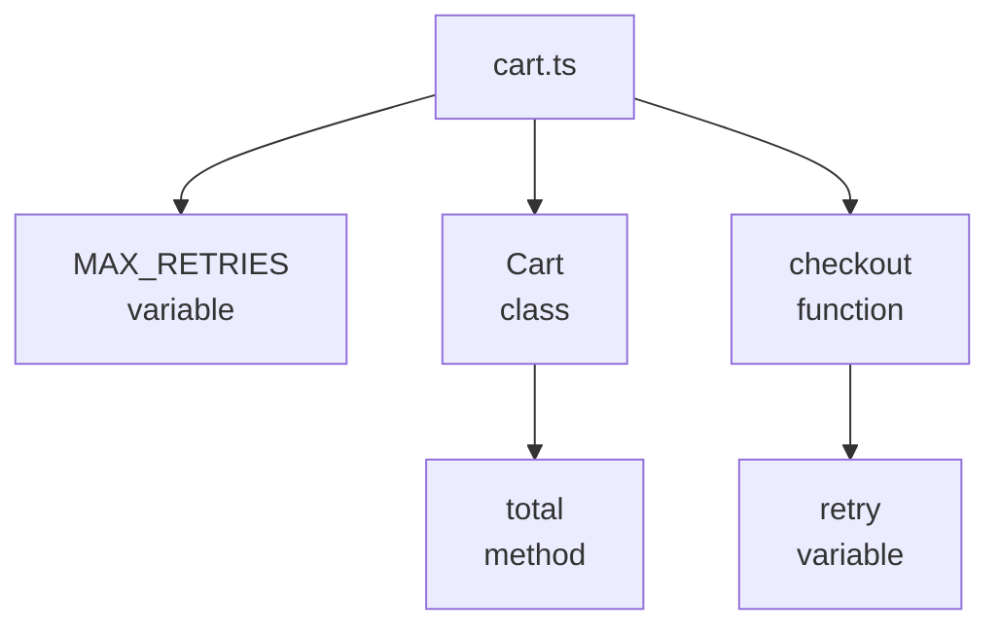
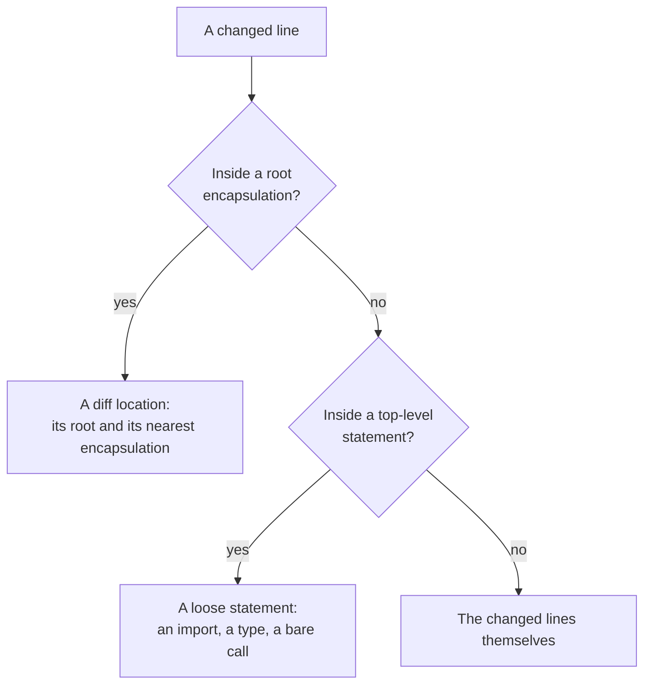
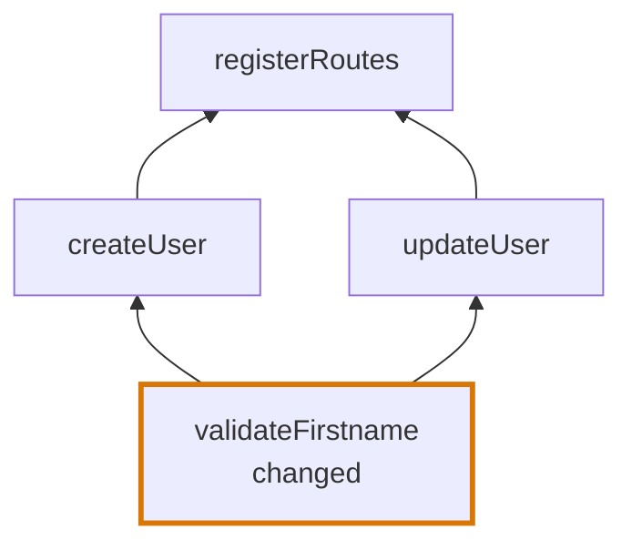
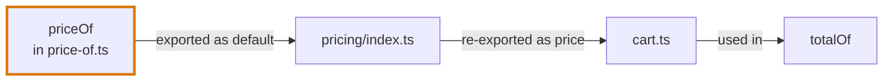
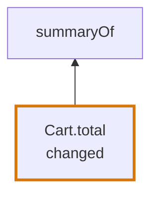

# AST graph

## Definition

The AST graph is the second mechanism of the [codegraph](../codegraph.md). Where the [import graph](import-graph.md) says which files belong together, the AST graph says what is inside them: what each file declares, where each name is used, and which declaration a changed line belongs to.

An AST graph is the files of one cluster of the import graph, parsed. One cluster gives one AST graph, and one segment of the review.



## The group and its files

The AST graph has two levels, and each has one job:

| Level | What it is | What it knows |
|---|---|---|
| **The group** | Every file of one cluster | Which files there are. It asks them questions and joins their answers. |
| **A file** | One parsed file | Everything about its own syntax: what it declares, exports, imports and uses. |

**The group never reads syntax.** What a name is, who exports it and who uses it are answered by the files. This is what keeps the languages apart: the group works the same way over TypeScript, Python and Vue, because only a file knows its language.

**A file is built once.** It is parsed with the grammar of its language, everything is read from the tree, and nothing changes it afterwards. A file no language reads is left out of the group.

Each file is asked for eight things:

| Extraction | What it gives |
|---|---|
| Root encapsulations | The encapsulations at the top level of the file, with the encapsulations nested in them |
| Variables | Every name the file declares, with its scope |
| Import variables | Every name the file imports, with the file it comes from |
| References | Every use of a name |
| Export aliases | The names a declaration is exported under |
| Re-exports | The names the file hands on from another file |
| Syntax sites | The attributes, arguments, callees, members, elements and functions the Journey Flow Diagram reads |
| Statements | The statements of the file, nested with their branches, which give the traced lines |

How each of these is read differs by language. See [TypeScript](languages/typescript.md#ast-graph), [JavaScript and JSX](languages/jsx.md#ast-graph), [Python](languages/python.md#ast-graph) and [Vue](languages/vue.md#ast-graph).

## Encapsulations

An encapsulation is something a changed line can belong to.

| Where | What counts |
|---|---|
| At the root of a file | A function, a class, a variable, an enum, a namespace or a default export |
| Below the root | A function, a class, a method, or a variable, field or member of a declared object that holds a function or a class |

```ts
export const MAX_RETRIES = 5                      // root: variable

export class Cart {                               // root: class
  total() {                                       //   nested: method
    return this.lines.reduce(sum, 0)
  }
}

export function checkout(cart: Cart) {            // root: function
  const retry = () => submit(cart)                //   nested: variable that holds a function
  return retry()
}
```



Types, declarations marked `declare`, overload signatures and the members of an object handed to a call or to an element are not encapsulations.

## Names and their uses

**A name is resolved once per space.** A declaration and a use each live in the value space, the type space or both, so `const Cart` and `type Cart` in one scope stay apart. A class, an enum, a namespace and an import are in both spaces.

**A use belongs to the declaration of its name with the nearest scope.** A different variable with the same name is not a use.

```ts
const total = priceOf(cart)             // a use of the imported priceOf

const format = (priceOf: number) => {
  return priceOf.toFixed(2)             // not a use: this priceOf is the parameter
}
```

## Where a changed line belongs

The changed lines of a file come from its patch:

- An added or a changed line is a changed line.
- Lines that were only removed count as a change on the line before them.
- A deleted file has no changed lines.

They become diff locations. A diff location is a range of changed lines with two encapsulations: the root encapsulation it lies in, and the nearest encapsulation that holds it.

```ts
export function checkout(cart: Cart) {
  const retry = () => {
    return submit(cart, { attempts: 3 })          // the changed line
  }
  return retry()
}
```

| Field of the diff location | Value |
|---|---|
| The changed lines | Line 3 |
| The root encapsulation | `checkout` |
| The nearest encapsulation | `retry` |

Three rules place the lines:

- **A location belongs to one root encapsulation.** A range that spans several, such as the whole of a new file, is split into one location per root encapsulation and cut to its lines.
- **Changed lines outside every root encapsulation have no location.** They are loose.
- **A changed file is never without a place.** When its changed lines are in no encapsulation and no statement at all, the changed lines themselves are kept.



### Loose statements

A top-level statement that no root encapsulation shares a line with is loose: an import, a type, an interface or a bare call.

```ts
import { rateLimit } from "./rate-limit"          // loose: an import

interface Options { perMinute: number }           // loose: a type

const app = createApp()                           // not loose: a root encapsulation

app.use(rateLimit({ perMinute: 60 }))             // loose: a bare call
```

A loose statement the diff touches is named after the names it declares, or `Lines 3–5` when it declares none, and that name is its waypoint in the Code Walkthrough. Loose statements that follow each other are joined into one. A change outside every encapsulation is not climbed from.

## The climb through uses

From a changed encapsulation the codegraph finds every use of it:

- the uses of its name in its own file;
- the uses in every file of the cluster that imports it, by any name the file exports it under.

The nearest encapsulation that holds a use is a caller. The codegraph then climbs from each caller the same way.

```ts
// validation.ts
export function validateFirstname(name: string) {
  if (name.length < 3) {                // the changed line
    throw new Error("First name must be at least 3 characters")
  }
}

// routes/users.ts
import { validateFirstname } from "../validation"

export const createUser = (body: UserBody) => {
  validateFirstname(body.firstname)
  return saveUser(body)
}

export const updateUser = (id: string, body: UserBody) => {
  validateFirstname(body.firstname)
  return patchUser(id, body)
}

// server.ts
import { createUser, updateUser } from "./routes/users"

export const registerRoutes = (router: Router) => {
  router.post("/users", createUser)
  router.patch("/users/:id", updateUser)
}
```



The result is a usage tree. It is inverted: its root is the changed encapsulation, and its callers grow toward the code nothing else uses.

The rules of the climb:

- **A caller is listed once**, at its first use.
- **The climb never enters an encapsulation that is already on the path**, so recursion ends.
- **A use outside every encapsulation gives no caller.** The climb ends there.
- **A use in a type counts.** The climb follows every use of a name, so a function that only names a changed type in its signature is a caller of that type. The Journey Flow Diagram's own trace is narrower: there a use in a type, an import or an export list is not a use.

### A name is followed through exports

A root encapsulation is known to an importer by its own name and by every alias it is exported under. A file hands an imported name on under the names it exports that import by, and through its re-exports.

```ts
// pricing/price-of.ts
export default function priceOf(item: Item) { ... }       // the changed function

// pricing/index.ts
export { default as price } from "./price-of"

// cart.ts
import { price } from "./pricing"

export const totalOf = (cart: Cart) => cart.lines.map(price)
```



`totalOf` is a caller of `priceOf`, though the name `priceOf` never appears in `cart.ts`.

| The export | The name an importer knows |
|---|---|
| `export default function priceOf` | `default` |
| `export { priceOf as price }` | `price` |
| `export { a as b } from "./a"` | `b` |
| `export * from "./a"` | Every name of `./a` but `default` |
| `export * as ns from "./a"` | `ns` |

A namespace import counts as a use of a symbol only in a file that imports the symbol's own file, not one that reaches it through a re-export.

### An encapsulation without a name of its own

A method is not a variable, so nothing uses it by its own name. Its uses are the uses of its class, and its node is named `Class.method`.

```ts
export class Cart {
  total() {                             // the changed method: Cart.total
    return this.lines.reduce(sum, 0)
  }
}

export const summaryOf = (cart: Cart) => `${cart.total()} due`
```



## A usage tree

```ts
interface DiagramNode {
  id: { file: string; line: number }
  code: {
    file: string
    name: string                // "priceOf", "Cart.total"
    definedAt: SourceRange
    enclosingRange: SourceRange
  }
  calledAt?: SourceRange        // where this node uses the node below it
  via?: "call" | "value"
  callers: DiagramNode[]
}
```

## Where a name is defined

The AST graph also answers where a name comes from, for the code views of the Journey Flow Diagram and for the Code Walkthrough:

| The name | Its definition |
|---|---|
| Declared in the file | The lines of its root encapsulation, or of the narrowest import, type or declaration statement that holds it |
| A parameter | Its own line |
| Imported from a file of the group | The lines the file it comes from exports it by, followed through re-exports |
| Imported from a library, through a namespace import, or from a file outside the group | Its import statement |

## Where it lives in the code

| Part | Where |
|---|---|
| The group, and the one read of its sources | `src/ast-graph/ast-code-group-graph.ts` |
| What every file has in common, and where the changed lines are placed | `src/ast-graph/languages/base.ts` |
| Picking the class of a file from its extension | `src/ast-graph/languages/create-ast-graph-file.ts` |
| One folder per language, with the class in `index.ts` | `src/ast-graph/languages/<language>/` |
| The climb through uses | `src/ast-graph/trace-deep-usage.ts` |
| Where a name is defined | `src/ast-graph/definition.ts` |
| Every parse, with one parser per grammar and the compiled queries | `src/ast-graph/parser.ts` |
| Walking a tree with a cursor | `src/ast-graph/walk-tree.ts` |
