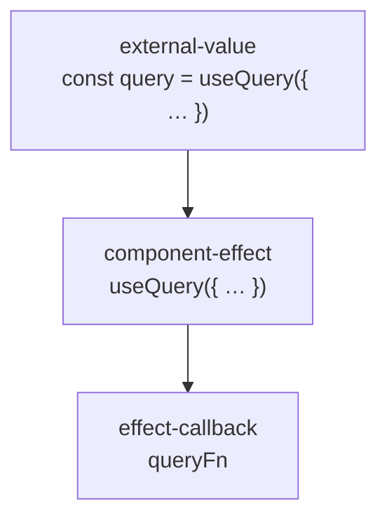

# Block types

The types of a [code block](code-blocks.md), and the rules that decide the less obvious ones.

## The types

```ts
type CodeBlockType =
  | "function"
  | "method"
  | "hook"
  | "component"
  | "class"
  | "root-variable"
  | "root-statement"
  | "type-declaration"
  | "import"
  | "file"
  | "condition"
  | "switch"
  | "switch-case"
  | "loop"
  | "try-catch"
  | "throw"
  | "effect"
  | "component-effect"
  | "effect-callback"
  | "code-event"
  | "route"
  | "resolver"
  | "middleware"
  | "render"
  | "render-condition"
  | "render-loop"
  | "render-event"
  | "render-root"
  | "state"
  | "derived"
  | "data"
  | "data-fetch"
  | "cache"
  | "auth"
  | "request"
  | "navigation"
  | "publish"
  | "validation"
  | "config"
  | "feature-flag"
  | "storage"
  | "telemetry"
  | "transaction"
  | "external-value"
  | "root-argument-value"
  | "variable"
  | "property"
  | "deleted"
```

| Type | What it is | Example |
|---|---|---|
| `function` | A function block. A named and an anonymous function are the same here, and so are an exported and an unexported one. | `const priceOf = (item) => { … }`, `export const useOrders = () => { … }` |
| `hook` | A function whose name starts with `use` and a capital letter. See "What counts as a hook". | `const useOrders = () => { … }` |
| `component` | A function that returns markup, or a variable that holds markup, at the root of a file or inside another function. In Vue it is the component of a file. See "What counts as a component". | `const Cart = () => <ul>…</ul>`, `const emptyState = <EmptyWarning />`, `Cart.vue` |
| `class` | A class block | `class Cart { … }` |
| `method` | A function that is a member of a class. It is named after its class and itself. | `findAll` in `class OrdersService { findAll() { … } }`, named `OrdersService.findAll` |
| `root-variable` | A value at the root of a file that is not a function, a class or markup, exported or not | `const MAX_RETRIES = 5`, `export const STATUSES = ["open", "paid"]` |
| `root-statement` | A statement at the root of a file that is not a declaration | `app.use(rateLimit({ perMinute: 60 }))` |
| `type-declaration` | An `interface` or a `type`, and in Python a `type` alias or a class of `TypedDict` or `Protocol`. Nothing that runs is different when it changes, so the Journey Flow Diagram does not trace it. | `interface User { … }`, `type Status = "open" \| "paid"`, `class Order(TypedDict): …` |
| `import` | An import statement. The Journey Flow Diagram does not trace it. | `import { rateLimit } from "./rate-limit"` |
| `file` | The whole of a file no language reads. It is one block, with no blocks inside it and no symbols. | `migrations/0042_add_status.sql`, `schema.prisma`, `orders.module.css` |
| `condition` | A condition block, including a ternary | `if (isPending) { … }`, `a ? b : c` |
| `switch` | A `switch` statement | `switch (status) { … }` |
| `switch-case` | One case of a `switch` | `case "paid": …` |
| `loop` | A loop | `for`, `while`, `do … while` |
| `try-catch` | A `try` statement with its `catch` and `finally` | `try { … } catch { … }` |
| `throw` | A statement that raises an error | `throw new Conflict()`, `raise ValueError(…)` |
| `call` | A statement below the root of a file that is a call and no other block. It is named after what is called, when that is a name or a member of one. A call that is the value of a declaration, that is returned, or that is the body of an arrow function is none: it is part of the block around it. | `saveUser(user)`, `await event.preventDefault()`, `items.forEach((item) => { … })` |
| `effect` | A function invocation that is handed a callback, as an argument or as a property of an options object, anywhere but directly in the body of a component or a hook: in a function, in a handler, at the top of a file. See "What counts as an effect". | `setTimeout(() => { … }, 500)` in a handler, `create((set) => ({ … }))` at the top of a file |
| `component-effect` | The same invocation directly in the body of a component or of a hook. It is a type of its own because the Journey Flow Diagram draws it differently. | `useEffect(() => { … })`, `useSomeHook({ ...someArgs, callback: () => { … } })`, `watchEffect(() => { … })` |
| `effect-callback` | One callback of an effect, named after its option key, or after its position when it is passed directly. It is a block whether the callback is written in place or passed by name. A function written in place is a `function` block inside it, or a `component` block when it returns markup. A callback whose key starts with `on` is a `code-event` instead. | `mutationFn: removeUser` in `useMutation({ … })`, a block named `mutationFn` |
| `state` | A declaration that holds state: a value that is kept between runs and that makes what reads it run again when it changes. See "What counts as state". | `const [status, setStatus] = useState("open")`, `const count = ref(0)` |
| `data` | A call that writes data at its source, or one the code does not say reads: through an ORM or with a raw SQL statement. See "What counts as data, cache and auth". | `prisma.user.create({ … })`, `pool.query(statement)` |
| `data-fetch` | A call that retrieves data from a source outside the code: a `GET` request, a GraphQL query, a stream of server-sent events or a read of a database. See "What counts as a data-fetch". | `fetch("/api/users")`, `useQuery(USERS)`, `new EventSource("/api/events")`, `prisma.user.findMany()` |
| `cache` | A call that reads, writes or clears a cache, or that wraps a function so its result is cached | `redis.get(key)`, `redis.set(key, value)`, `cache(loadUser)` |
| `auth` | A call that checks who the caller is, or what they may do | `getServerSession()`, `passport.authenticate("jwt")` |
| `derived` | A declaration whose value is computed from state, and computed again when that state changes | `const total = useMemo(() => totalOf(items), [items])`, `const total = computed(() => …)` |
| `request` | An outgoing call to a server that is not a `data-fetch`: one that sends something, or whose method the code does not write out | `fetch("/api/users", { method: "POST" })`, `axios.post("/orders", order)` |
| `navigation` | Code that sends the user to a page | `navigate("/cart")`, `router.push("/cart")`, `redirect("/login")` |
| `publish` | Code that emits an event or puts a job on a queue | `bus.emit("order-paid", order)`, `queue.add("send-receipt", order)` |
| `validation` | A schema, or a call that checks a value against one | `z.object({ email: z.string() })`, `schema.parse(body)` |
| `config` | A read of an environment variable or of a configuration value | `process.env.API_URL`, `config.get("db.host")` |
| `feature-flag` | A read of a feature flag: a value that is switched from outside the code, per user or per environment | `flags.isEnabled("new-checkout")`, `useFlag("new-checkout")` |
| `storage` | A read or a write of what the browser keeps for the user | `localStorage.setItem("draft", text)`, `Cookies.get("session")` |
| `telemetry` | Logging, analytics or error reporting | `logger.info(…)`, `track("order-placed")`, `Sentry.captureException(error)` |
| `transaction` | A call that runs its callback inside a database transaction | `prisma.$transaction(async (tx) => { … })` |
| `middleware` | The registration of code that runs on a request before its route | `app.use(requireSession)` |
| `external-value` | A variable declaration whose value comes from outside the root block | `const x = someUtilFunctionOutside()` |
| `root-argument-value` | An argument of the root function or class. Each argument is a block of its own, and so is each member read from an argument that is not taken apart. | `x` and `y` in `function ABComponent({ x, y }) { … }`, two blocks. `props` and `onSave` in `function SaveButton(props) { … props.onSave … }`, two blocks, `onSave` under `props` |
| `variable` | A name declared below the root of a file that is no other block: a local declaration, a name a loop or a `catch` binds, and an argument of a function that is not at the root. See "What counts as a variable, a property and a deleted block". | `const label = "Apply"` in a function, `item` in `for (const item of items)`, `code` in `const send = (code) => { … }` inside a component |
| `property` | A key of an object or of a Python dictionary whose value is no function, at any depth, and a field or an attribute of a class that is no function | `promo: null` in `create(() => ({ promo: null }))`, `count = 2` in `class Order { count = 2 }`, `limit = 3` in a Python class, `self.count = 0` in a method of one, `"retries": 3` in a dictionary |
| `deleted` | Code that was taken out and that stood as code of its own. It has no width: it sits where the code was. | A function, a comment or a statement taken out at the root of a file, a method taken out of a class |
| `code-event` | A callback registered to run when something happens later, outside markup: a listener, a subscription, or a callback of an effect whose key starts with `on` and a capital letter | `document.addEventListener("keydown", onKey)`, `bus.on("order-paid", sendReceipt)`, `store.subscribe(() => { … })`, `onSuccess: () => refetch()` in `useMutation({ … })` |
| `route` | The registration of a handler for a request. What registers one differs by framework, so it is recognised by a pattern of the [catalogue](catalogue.md). | `router.post("/users", createUser)` |
| `resolver` | The registration of a handler for a field of a GraphQL schema. Like a route, it is recognised by a pattern of the [catalogue](catalogue.md). | `users` in `resolvers: { Query: { users: () => … } }`, `builder.queryField("users", …)` |
| `render-root` | The markup of a component. In JSX it is the markup a function returns, through a `return` statement or as the body of an arrow function, or the markup a variable holds, so a component with two `return` statements has two. An `if` around a `return` is still a `condition`, with the `render-root` inside it. In Vue it is the template, so a file has one, and a `v-if` or a `v-for` at its root is a `render-condition` or a `render-loop` inside it. | `return <UserList />`, the `return <EmptyWarning />` in `if (isEmpty) return <EmptyWarning />`, `<UserList />` in `const Home = () => <UserList />`, and `<template>…</template>` |
| `render` | Markup | `<div>hello!</div>`, `<Container>Hello</Container>` |
| `render-condition` | Markup rendered under a condition | `{isEmpty && <EmptyWarning />}`, `v-if` |
| `render-loop` | Markup rendered once per item | `{items.map((item) => <Row />)}`, `v-for` |
| `render-event` | An event inside JSX or a Vue template | `<button onClick={someFunc} />`, `@click="someFunc"` |

## What counts as a hook

A name that starts with `use` and a capital letter is taken to be a hook, when it is used inside a function. The name is a standard everywhere hooks are used, so inside a function it is taken as given: nothing is followed to prove it, and no list of hooks is kept.

Outside every function nothing is assumed. A hook is only ever called from a component or from another hook, so a call named `use…` at the root of a file is not a hook call, whatever it is named.

| Code | A hook |
|---|---|
| `const orders = useOrders()` in the body of `OrdersPage` | Yes |
| `useRef`, `useEffect`, `useMemo` called in the body of a component or of a hook | Yes, by the same rule |
| `const client = useClient()` at the root of a file | No. It is an ordinary call. |
| `const loadOrders = () => { … }` | No. It is a `function`. |

A function of the repository with such a name is a `hook` block: `const useCustomHook = () => { … }`.

```ts
const client = useClient()                        // at the root of a file: not assumed to be a hook

const useOrders = () => {                         // a hook block
  const [status, setStatus] = useState("open")    // inside a function: a hook
  return useQuery({ queryKey: ["orders", status], queryFn: fetchOrders })
}
```

## What counts as a component

A `component` block is a function that returns markup, or a variable that holds markup. The syntax decides it: the markup has to be written in the `return`, in the body of the arrow function or as the value of the variable. The name is not read, and no call is followed to see what it returns.

| Code | A `component` block |
|---|---|
| `const Cart = () => <ul>…</ul>`, `function Cart() { return <ul>…</ul> }` | Yes. A function that returns markup. |
| `function Cart() { if (isEmpty) return null; return <ul>…</ul> }` | Yes. One `return` with markup is enough. |
| `const emptyState = <EmptyWarning />` | Yes. A variable that holds markup. |
| `const renderLine = (line) => <CartLine line={line} />` in the body of `Cart` | Yes. It is a block inside `Cart`. |
| `const heading = <h1>Cart</h1>` in the body of `Cart` | Yes. It is a block inside `Cart`. |
| `memo(() => <ul>…</ul>)`, `forwardRef((props, ref) => <button ref={ref} />)` | Yes, the function that is handed over. The declaration that keeps the result of the call is not. |
| `Cart.vue`, a Vue file | Yes. One for the file, spanning its setup script and its template, and named after the file. |
| `const renderLine = (line) => <CartLine line={line} />` in the `<script setup lang="tsx">` of `Cart.vue` | Yes. JSX in a Vue script is read like JSX in any other file, so it is a block inside the component of the file. |
| `lines.map((line) => <CartLine line={line} />)` in markup | No. A function written in markup is rendered in place, and is part of the `render-loop`. |
| `const useOrders = () => { … return <OrderList /> }` | No. A `hook`: the name decides first. |
| `const Cart = () => renderLines()` | No. A `function`: what `renderLines` returns is not followed. |
| `const priceOf = (item) => item.price` | No. A `function`. |

**Every component of a file is found, at any depth.** A component at the root of a file is a root block. A function that returns markup or a variable that holds markup inside another function is a `component` block too, inside the block around it.

**A component has a `render-root`.** The markup a function returns and the markup a variable holds are each a `render-root` inside the `component` block. The template is the `render-root` of a Vue component.

```tsx
const emptyState = <EmptyWarning />

const Cart = ({ lines }) => {
  const renderLine = (line) => <CartLine key={line.id} line={line} />
  const heading = <h1>Cart</h1>

  if (lines.length === 0) return emptyState

  return (
    <section>
      {heading}
      {lines.map(renderLine)}
    </section>
  )
}
```

| Block | Type | Inside |
|---|---|---|
| `emptyState` | `component` | The root of the file |
| `Cart` | `component` | The root of the file |
| `renderLine` | `component` | `Cart` |
| `heading` | `component` | `Cart` |

## What counts as state

A `state` block is a declaration whose value is made by a call the [catalogue](catalogue.md#a-call-that-makes-state) names as making state. What makes state differs by library, so no rule of the code decides it.

| Code | A `state` block |
|---|---|
| `const [status, setStatus] = useState("open")` | Yes. `useState` from `react` makes state. |
| `const count = ref(0)`, `const form = reactive({ … })` | Yes. `ref` and `reactive` from `vue` make state. |
| `export const useCartStore = create((set) => ({ … }))` | Yes. `create` from `zustand` makes state. |
| `const status = useOrderFilterStore(selectStatus)` | Yes. What `create` of `zustand` makes is state again when it is called, so a declaration that reads a store is state, like the store itself. The catalogue says so through the origin of `useOrderFilterStore`, also when the store is in another file. |
| `const users = useUsers()` | No. It is an `external-value`, unless the catalogue names `useUsers`. |

Without a catalogue entry the declaration is an `external-value`, as before. When the call that makes the state is handed a callback, such as `useState(() => readDraft())`, the effect is a block inside the `state` block, as it is inside an `external-value`.

State is kept apart from other values because it is often where the data of a path starts: an event writes it, and a render or an effect reads it.

```tsx
const OrdersPage = () => {
  const [status, setStatus] = useState("open")            // a state block

  return (
    <>
      <button onClick={() => setStatus("paid")}>Paid</button>     // writes the state
      <OrderList status={status} />                               // reads the state
    </>
  )
}
```

## What counts as data, cache and auth

A `data` block, a `cache` block and an `auth` block are calls, as an effect is. The [catalogue](catalogue.md#a-call-that-is-a-data-a-cache-or-an-auth-block) names the calls, since what reads a database, a cache or a session differs by library. A call no pattern names is not a block: it stays lines of the block around it.

| Code | Block |
|---|---|
| `prisma.order.create({ data: order })` | `data` |
| `await pool.query("select * from orders")` | `data` |
| `prisma.order.findMany({ where: { userId } })` | `data-fetch` |
| `await redis.get(cacheKey)`, `await redis.set(cacheKey, value)` | `cache` |
| `queryClient.invalidateQueries({ queryKey: ["orders"] })` | `cache` |
| `const session = await getServerSession()` | An `external-value`, with an `auth` block inside it |

A declaration that keeps the result of such a call is an `external-value` with the block inside it, the same way it holds an effect.

**A cache is kept apart from data.** A cache can be stale and its source cannot, so a change that touches one and not the other is worth seeing.

```ts
export const loadOrders = async (userId) => {
  const session = await getServerSession()                              // external-value, with an auth block inside
  if (!session) return []

  const cached = await redis.get(`orders:${userId}`)                    // external-value, with a cache block inside
  if (cached) return JSON.parse(cached)

  const orders = await prisma.order.findMany({ where: { userId } })     // external-value, with a data-fetch block inside
  await redis.set(`orders:${userId}`, JSON.stringify(orders))           // a cache block
  return orders
}
```

**The type follows the call, not the client.** One client can do several things. A Redis client is a cache when it reads and writes keys, and an event when it subscribes to a channel, so each method has a pattern of its own.

| Call on a Redis client | Block |
|---|---|
| `redis.get(key)`, `redis.set(key, value)`, `redis.del(key)`, `redis.expire(key, 60)` | `cache` |
| `redis.subscribe("orders", onOrder)` | `code-event` |

**A call that wraps a function is a `cache` block with the function inside it.** `cache(loadUser)` and `unstable_cache(loadUser, ["user"])` are handed a callback, so the callback is an `effect-callback` block inside the `cache` block.

## What counts as a data-fetch

A `data-fetch` block is a call that retrieves data from a source outside the code. It is a type of its own because it is where the data of a path comes in: what a component shows, or what a handler answers with, starts there.

| Code | A `data-fetch` block | Why |
|---|---|---|
| `fetch("/api/users")`, `fetch("/api/users", { method: "GET" })` | Yes | A request that names no method is a `GET` |
| `axios.get("/orders")`, `requests.get(url)` | Yes | A pattern of the [catalogue](catalogue.md#a-call-that-retrieves-data) with the method `GET` |
| `useQuery(USERS)`, `useSWR("/api/users", fetcher)`, `trpc.users.query()` | Yes | A pattern names a GraphQL query, or a hook that loads |
| `new EventSource("/api/events")` | Yes | A stream of server-sent events only brings data in |
| `prisma.order.findMany()`, `User.objects.filter(…)`, `db.select()` | Yes | A pattern names a read of a database |
| `fetch("/api/users", { method: "POST" })`, `axios.post(…)` | No. A `request`. | It sends something |
| `fetch(url, init)`, `fetch(url, { ...init })`, `fetch(url, { method })` | No. A `request`. | The method is not written out in the call |
| `prisma.order.create(…)`, `useMutation(ADD_USER)` | No. A `data` and a `request`. | They write |
| `pool.query(statement)`, `cursor.execute(sql)` | No. A `data`. | One call sends a read and a write alike |
| `redis.get(key)` | No. A `cache`. | A cache can be stale, and its source cannot |

**Only what the call itself says counts.** A method is read when it is a text in the options of the call, in any case: `"get"` is `GET`. A method that is a name, options that are a name and options that spread another object could each hold any method, so the call stays a `request`.

A declaration that keeps the result of such a call is an `external-value` with the `data-fetch` block inside it, as it is for a `data` block.

```ts
export const loadOrders = async (userId) => {
  const response = await fetch(`/api/orders?user=${userId}`)                  // external-value, with a data-fetch block inside
  return response.json()
}

export const saveOrder = (order) =>
  fetch("/api/orders", { method: "POST", body: JSON.stringify(order) })       // a request block
```

## What counts as a variable, a property and a deleted block

**A variable is a name declared below the root that no other type claims.** A declaration at the root of a file is a `root-variable`. Below the root, a declaration that keeps a function, a class, markup, state or the result of a call from outside is the block of that type, and every other one is a `variable`. An argument of the root function or class is a `root-argument-value`, and an argument of any function below it is a `variable`.

| Code | Block |
|---|---|
| `const label = "Apply"` in a function | `variable` |
| `const [first, second] = items` | One `variable`, named after the first name, that both names lead to |
| `for (const item of items)`, `catch (error)` | A `variable` inside the `loop` or the `try-catch` |
| `(code) => …` handed to a call inside a component | A `variable` `code` inside the function |
| `const attempts = MAX`, where `MAX` is declared at the root | An `external-value`, as before |
| `declare const VERSION: string` | No block of its own. It is inside the `type-declaration`. |

**A property is a key that holds a value.** A key whose value is a function is the `function` block of that function, and a callback of an effect is its `effect-callback`. Every other key of an object is a `property`, named after the key, with the properties of an object it holds inside it. A field of a class is a `property` named after the class and itself, like a method.

| Code | Block |
|---|---|
| `promo: null` in an object | `property` `promo` |
| `count = 2` in a TypeScript class `Order` | `property` `Order.count` |
| `this.count = 0` in a method of that class, where the class declares no `count` | `property` `Order.count`, where the member is first set. A later `this.count = …` is a use of it. |
| `limit = 3` in the body of a Python class `Order` | `property` `Order.limit` |
| `self.count = 0` in a method of that class | `property` `Order.count`, where the attribute is first set. A later `self.count = …` is a use of it, and so is one of an attribute the body of the class already sets. |
| `"retries": 3` in a Python dictionary | `property` `retries`. A key that is not written as text, such as `LIMIT: 2`, is no block. |

A use of a member leads to the property of that name, the way it leads to a function: `state.promo` leads to `promo`, `api.users.limit` to `limit` under `users`, `self.count` to `Order.count`, and `CONFIG["db"]["host"]` and `CONFIG.get("db").get("host")` to `host` under `db`. A member read through `this` or `self` that the class does not declare leads to the class it extends, and to the member of that name there. See [Symbols](symbols.md).

**A deleted block is code a change took out that could stand alone.** Lines that were only removed leave nothing in the new file to hold them, so the block has no width and sits at the line that took their place.

| What was taken out | Where | The block |
|---|---|---|
| Anything that reads as code of its own: a declaration, a statement, a comment, blank lines | At the root of a file, outside every block | A `deleted` block at the root, named after what it declared, if anything |
| A declaration: a function, a method, a field, a local declaration | Inside a block | A `deleted` block inside that block |
| A statement, a comment or blank lines | Inside a block | None. The change belongs to the block. |
| A decorator, on one line or several, with or without comments beside it | Above what it decorated | None. The change belongs to the block it decorated. |
| A declaration with its decorators | Anywhere a declaration makes a block | One `deleted` block, named after the declaration |
| Lines that do not read as code of their own, such as the first line of an `if` | Anywhere | None. The change belongs to the block around it, or to the block that follows it at the root. |
| Anything | In a file no language reads | None. The change belongs to the `file` block. |

The lines are read with the language of the file, without their indentation, and as members of a class when they were taken out of one. A deleted block has no symbols and nothing uses it, and no chain passes through it.

**A deleted block at the root of a file keeps the type of what was taken out.** The lines are read again as a file of their own, with the reader of the file's language, and the type of their first root block is the block's `deletedType`: `function`, `component`, `hook`, `class`, `root-variable`, `type-declaration`, `import` and the others, decided as they are for code that is still there. Lines that make no block of a type, such as a comment, leave it out, and so does a deleted block inside another block.

## Who names a block

A type is decided by the code where the syntax says it, and by the [catalogue](catalogue.md) where it depends on a library.

| Decided by | Types |
|---|---|
| The syntax | `function`, `method`, `component`, `class`, `root-variable`, `root-statement`, `type-declaration`, `import`, `file`, `condition`, `switch`, `switch-case`, `loop`, `try-catch`, `throw`, the five `render` types, `external-value`, `root-argument-value`, `variable`, `property` |
| The lines a change took out | `deleted` |
| A name, by convention | `hook`, and a `code-event` from a key that starts with `on` |
| The shape of a call | `effect`, `component-effect`, `effect-callback` |
| A global of the platform, a closed list like the timers | `config` for `process.env` and `import.meta.env`, `storage` for `localStorage`, `sessionStorage`, `document.cookie` and `indexedDB`, `telemetry` for `console`, `data-fetch` or `request` for `fetch`, by its method, `data-fetch` for `EventSource` |
| A pattern of the catalogue | `state`, `derived`, `data`, `data-fetch`, `cache`, `auth`, `request`, `navigation`, `publish`, `validation`, `config`, `feature-flag`, `storage`, `telemetry`, `transaction`, `route`, `resolver`, `middleware` |

A call a pattern would name, in a repository with no pattern for it, is not a block. Its lines belong to the block around it.

## Blocks that pair across a boundary

Four types have a counterpart on the other side of a boundary the code does not cross by a call. When both sides write the same thing out in the code, the two blocks are a pair.

| Block | Its counterpart | Paired by | Example |
|---|---|---|---|
| `request` | A `route` | Method and path | `fetch("/api/users", { method: "POST" })` and `router.post("/api/users", createUser)` |
| `data-fetch` | A `route` | The method `GET` and the path, when it is a request | `fetch("/api/users")` and `router.get("/api/users", listUsers)` |
| `navigation` | A page | Path | `navigate("/cart")` and the page at `/cart` |
| `publish` | A `code-event` | The name of the event | `bus.emit("order-paid")` and `bus.on("order-paid", sendReceipt)` |

The method, the path and the name of the event are in the [`catalogue`](code-blocks.md#what-the-catalogue-leaves-on-a-block) field of each block. A path or a name that is built while the code runs, such as `fetch(baseUrl + "/users")`, is not written out, and the block has no pair.

A pair is how a chain crosses the boundary. See [A chain across a boundary](chains.md#a-chain-across-a-boundary).

## What counts as an effect

A call that is handed a callback is an effect, with one exclusion: a call to one of the language's own collection and promise methods is not.

| Call | An effect |
|---|---|
| `useEffect(() => { … })`, `useQuery({ queryFn })` | Yes |
| `trpc.users.list.useQuery()`, `api.useGetUsersQuery()`, `form.handleSubmit(onSubmit)` | Yes. A method of a value counts. |
| `setTimeout`, `setInterval`, `queueMicrotask`, `requestAnimationFrame` | Yes |
| `items.map(…)`, `filter`, `forEach`, `reduce`, `find`, `some`, `every`, `flatMap`, `sort` | No |
| `promise.then(…)`, `catch`, `finally` | No |

The excluded methods are a closed list that belongs to the language, like the four timers. In Python they are `map`, `filter`, `sorted`, `min`, `max` and `reduce`, and the methods `map`, `filter`, `reduce` and `sort`. See [Python](languages/python.md#code-blocks).

**A call that provides a value is no effect.** A call a [catalogue](catalogue.md) pattern names with `provides` is handed a value, also where that value is a function: `provide(themeKey, { toggleTheme })` of Vue is no block, and `toggleTheme` is a `value` use of the block around the call. The function is reached from the component that [reads the value](symbols.md#where-a-value-comes-from).

**A callback passed by name counts.** `useEffect(syncCart, [cart])` and `mutationFn: removeUser` are callbacks when the name leads to a `function` block, when the key starts with `on`, or when the [catalogue](catalogue.md) names that slot.

**Where the effect is decides its type.** Directly in the body of a component or of a hook it is a `component-effect`. Anywhere else it is an `effect`, also in the attribute of an event: `handleSubmit(onSubmit)` in `<form onSubmit={handleSubmit(onSubmit)}>` runs with the event, so it is an `effect` of the `render-event`. An effect in a hook runs with the component that calls the hook, so moving an effect into a hook does not change its type.

```tsx
const useOrders = () => {
  useEffect(() => { track("orders-viewed") }, [])     // component-effect: in the body of a hook
}

const OrdersPage = () => {
  useOrders()
  useEffect(() => { document.title = "Orders" }, [])  // component-effect: in the body of a component

  const handleSave = () => {
    setTimeout(() => save(), 500)                     // effect: it is in a handler, and runs on the click
  }

  return <button onClick={handleSave}>Save</button>
}
```

**Some effects start a chain, and have a type of their own.** They are recognised by the name of the method:

| Call | Type | Recognised by |
|---|---|---|
| `document.addEventListener("keydown", onKey)`, `bus.on("order-paid", fn)`, `emitter.once(…)`, `store.subscribe(fn)` | `code-event` | The method: `addEventListener`, `on`, `once`, `addListener`, `subscribe` |
| `router.post("/users", createUser)` | `route` | A pattern of the [catalogue](catalogue.md) |
| `builder.queryField("users", …)` | `resolver` | A pattern of the [catalogue](catalogue.md) |

**`on` is the fallback for an event.** A callback of an effect whose key starts with `on` and a capital letter, such as `onSuccess` or `onError`, is a `code-event`, unless the [catalogue](catalogue.md) says otherwise.

## A declaration that keeps the result of an effect

A block has one type. A declaration whose value is a call that is handed a callback fits two, `external-value` and `effect`, so it is two blocks, one inside the other: the declaration is the `external-value`, and the call is an `effect` inside it, or a `component-effect` when the declaration is directly in the body of a component or a hook.

```ts
const query = useQuery({ queryKey: ["users"], queryFn: fetchUsers })
```



The range of the `external-value` is the whole declaration, and the range of the `effect` is the call only. A use of `query` leads to the declaration, and the child of the declaration says its value came from an effect.

| Code | Blocks |
|---|---|
| `const users = useUsers()` | An `external-value`, with nothing inside it |
| `useEffect(() => { sync() }, [])` in a component | A `component-effect`, with nothing around it |
| `const { mutate } = useMutation({ mutationFn: removeUser })` in a component | An `external-value` with a `component-effect` inside it |

