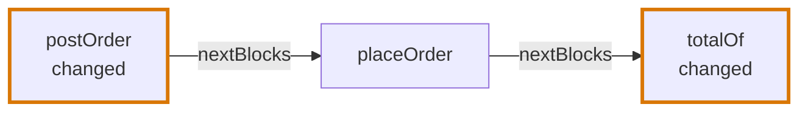
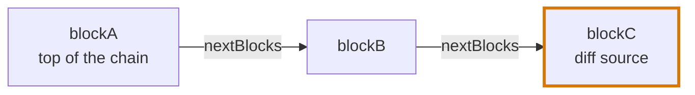
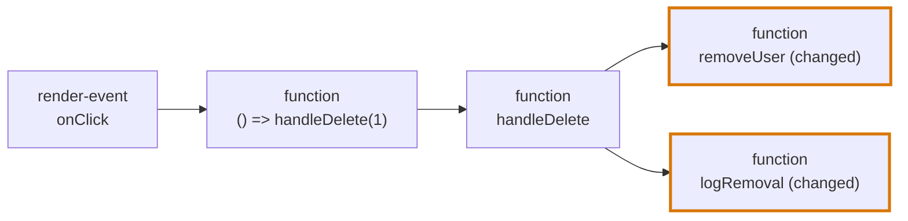
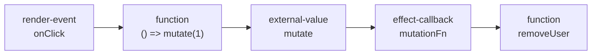
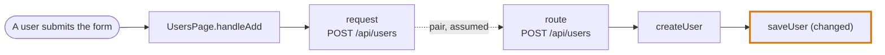
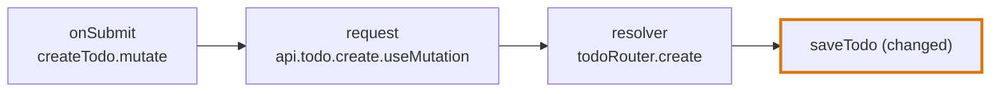

# Chains

How a change is placed in a [code block](code-blocks.md), and how it is traced from there to what starts it.

## The diff blocks

A change is a range with a start and an end, each a line and a column, so it can point at part of a line. **The diff block of a change is the innermost block that contains its range.** `diffBlocks` holds only that block, not every block around it. There is no tie-break: two blocks on one line are two blocks with two ranges.

```tsx
    <button onClick={() => remove(id)} disabled={isBusy ? true : false} />
```

On line 13 of a file, the blocks of this line are:

| Block | The text it covers | Range |
|---|---|---|
| `render` | `<button … />` | 13:5 to 13:75 |
| `render-event` | `onClick={() => remove(id)}` | 13:13 to 13:39 |
| `function` | `() => remove(id)` | 13:22 to 13:38 |
| `condition` | `isBusy ? true : false` | 13:50 to 13:71 |

A diff that changes `remove(id)` to `removeItem(id)` has the range 13:28 to 13:38. The innermost block that contains it is the `function`, so that is the one diff block. The `condition` is not one, though it is on the same line.

A range that crosses the edge of a block marks each innermost block it touches.

**Only the diff block carries the range.** The blocks around it have `null` in `lineOfCodeDiffs` and no diff of that change in `diffs`, so that field answers one question and `diffSources` the other:

| Question | Answered by |
|---|---|
| Was this block changed itself? | `lineOfCodeDiffs` is not `null` |
| Is a change inside it, or reachable from it? | `diffSources` is not empty |

```ts
function check() {
  const a = 1
  if (b > 2) {          // the only change
    notify()
  }
}
```

The `condition` has the range and is the diff block. `check` has `null`, and its `diffSources` holds the `condition`. Had the change been on `const a = 1`, the `variable` block `a` would be the diff block.

**Every changed range has a diff block**, in every file that is not ignored. No change is outside every block: a statement at the root of a file is a `root-statement`, a type is a `type-declaration`, an import is an `import` and a directive such as `"use client"` is a `directive`. The last three are never traced by the Trace Diagram. They are blocks so that the Code Walkthrough always has a block for its waypoint, and so that a change with no diff block cannot happen.

**A change of a variable, a property or an argument is a change of the block that holds it, for the chains.** The diff block is the `variable`, the `property` or the `root-argument-value`, and the diff source a chain leads to is the block around it. A chain passes through a variable and a property to what they call, as it passes through any block nested in a block that runs. A `deleted` block is never traced, like a type and an import.

## Where the range of a change comes from

A patch gives the old and the new text of every changed line. The columns come from comparing the two:

| In the patch | The range of the change | The type of the diff |
|---|---|---|
| A run of removed lines directly followed by the same number of added lines | The lines are paired in order. What a pair shares at its start and at its end is unchanged, and what is left in the middle of the new line is the change. | `modified` |
| A line that is only added | The whole line | `added` |
| Lines that were only removed | A position with no width, where they were | `deleted` |
| Any other run, such as two lines removed and five added | The whole of each added line | `modified` |

A block keeps each of its changes as a diff in `diffs`, with this type and this range. A range that is cut at the edge of a block keeps its type in every part.

## The diffs of a block

`diffs` holds two things: the changes of the block itself, and the places where the block uses a block that was changed.

| Type | What it says | Its range |
|---|---|---|
| `added`, `modified`, `deleted` | The block was changed itself. These are the changes of `lineOfCodeDiffs`. | The range of the change |
| `affected` | The block uses a block with a change inside it, such as a function it calls. Nothing in the block itself needs to have changed. | Where the block uses it |

```ts
// src/pricing.ts
export function priceOf(item) {
  if (item.held > 0) {
    return 0                              // a change
  }
  return item.price
}

// src/cart.ts
export function totalOf(items) {
  return items.map((item) => priceOf(item))
}
```

The `condition` in `priceOf` has a `modified` diff. The callback in `totalOf` has an `affected` diff at `priceOf`, where it calls it.

| Rule | What follows |
|---|---|
| The used block has a change when it, or a block inside it, has an `added`, `modified` or `deleted` diff written inside its own range | A call to `priceOf` is affected though the change is in the `condition` inside it. A comment changed above `priceOf` belongs to `priceOf`, and does not affect the blocks that use it. |
| An `affected` diff makes no other block affected | A block that calls `totalOf` is not affected by the change in `priceOf`. `diffSources` says what a block leads to through several steps. |
| The used block is outside the using block: neither the block itself, nor a block around it, nor a block written inside it | A function that calls itself is not affected, and neither is a block that uses the function it is in. A method that calls a changed method of its class is, and so is a block of a component that uses a changed function of that component. |
| A member that leads to a block is used, not the whole it is read from | `api.save()` is affected by a change in `save`, and `api.load()` beside it is not. `state.promo` is affected by a change of the key `promo`, and `state.items` is not. A member that leads to no block counts as a use of the whole. |
| A read of an argument is not a use of a changed block | A `root-argument-value` block never makes its readers affected |
| Any kind of use counts: a call, a render, a value, a read and a type | A function whose signature names a changed type is affected |
| The diff belongs to the innermost block around the use | The callback has it, and `totalOf` around it has none |
| An affected block is not a diff block | `lineOfCodeDiffs`, `diffBlocks` and the chains are the same with and without it |
| A block can have both | A changed line that also calls a changed function gives the block a diff of each |
| One use gives one diff | Two calls of a changed function give two, each with its own range. Where two symbols of one expression lead to the same block, as the call and the key of `CONFIG.get("retries")` do, the wider one gives the diff. |
| A read that leads to a member is preferred over one of the same name that leads to none | `CONFIG.get("retries")` is a use of `retries`, not of all of `CONFIG` |

A local name, an argument and a key are blocks, a `variable` or a `property`, so a change to one affects the blocks that read it. Code that was taken out is a `deleted` block that nothing uses, so it affects no block.

**The files are visited from the top.** The blocks are marked file by file, starting at the `rootASTGraphs` and following the imports down, each file once. A used block is asked whether it has a change when a block that uses it is visited, and the answer is kept for the next block that asks. Files that import each other in a loop that nothing else imports are under no root, so the walk starts again at each file it has not visited, in the order of the group.

When the comparison leaves nothing in the middle of the new line, because text was only taken out of it, the change is a position with no width, and it belongs to the innermost block around that position.

## A chain

A chain runs from a block, through the blocks it runs, to a block that has a change, a diff source. It is a linked list: each block of it holds the next in `nextBlocks`.

A chain does not stop at the first change it meets. It runs to the last changed block of each path, so a changed block can be in the middle of a chain and lead on to another:



`postOrder` is a diff source and has `placeOrder` in `nextBlocks`. `totalOf` is the last change of the path and has none. The `diffSources` of `postOrder` is `[postOrder, totalOf]`.



The `diffChains` of a group holds one entry per chain, the block at its top: here `blockA`, and never `blockB` or `blockC` beside it. See [The group](code-blocks.md#the-group).

**Being on a chain does not mean the block itself was changed.** Only the diff source was. Every block of the chain says which diff sources it leads to, in its own `diffSources`: here `blockA.diffSources` and `blockB.diffSources` are both `[blockC]`. It is a list because a chain can lead to several.

**A chain that splits is still one chain.** Where a block runs two blocks that each lead to a change, it has both in `nextBlocks`, and the top is one entry of the group. A second entry is a second top.

```tsx
// users-page.tsx
const UsersPage = () => {
  const handleDelete = (id) => {
    removeUser(id)
    logRemoval(id)
  }

  return <button onClick={() => handleDelete(1)}>Delete</button>
}

// users.ts
export const removeUser = (id) => {
  return api.delete(`/users/${id}`)       // a change
}

// audit.ts
export const logRemoval = (id) => {
  audit.write("user-removed", id)         // a change
}
```



Nothing in `users-page.tsx` changed. The `render-event` is the top of the chain all the same, so it is the one entry of the group's `diffChains`. The chain splits at `handleDelete`, whose `nextBlocks` holds `removeUser` and `logRemoval`, and that is still one chain. The `diffSources` of the `render-event` itself, the diff sources it leads to, is `[removeUser, logRemoval]`.

**`nextBlocks` does not depend on the chain it is read from.** It is the blocks this block runs that lead to a change, the same from every top. A block two chains pass through is one object with one `nextBlocks`, which is why a chain that splits, or two chains that meet, need no second entry.

## What a chain steps through

A chain is traced the way a debugger steps: from a block to what runs next when that block runs. A step is taken only where the code is run, never where it is only named.

| From a block | A step of the chain | Why |
|---|---|---|
| A symbol of the use `call` or `render` | Yes, to the block it leads to | The block runs it |
| A symbol of the use `value` or `read` that names a function, a hook or a component | No. The chain carries on from the block the value is `handedTo`. | Handing a function over does not run it. It runs later, where it is called. |
| A symbol of any use but `type` that names a value: a `root-variable`, a `state` or an `external-value` | Yes, to the block of that value | A value has no "later". Using it in any way is a read of it. |
| A [mount](code-blocks.md#the-routes-below-a-mount) that names a router, such as `controllers: [UsersController]` or `imports: [UsersModule]` of a NestJS module | Yes, from the mount to the router: a class that routes are registered on, or that a mount is written in | Mounting a router registers its routes when the app starts. A router that is a value, as `router` in `app.include_router(router)`, is reached by the row above. |
| A route handler whose framework fills a class of the repository from the request: a parameter of a NestJS handler decorated with `@Body()`, `@Query()` or `@Param()` of `@nestjs/common`, a parameter of a FastAPI handler typed by a pydantic model, and a pydantic model a FastAPI handler names itself, as `response_model=ItemRead` of its decorator | Yes, from the handler to the class | The framework builds the class from the request, or the response from the model, each time the handler runs. A parameter of a type of the language, a pipe, a FastAPI parameter with a `Depends(…)` in it and a type anywhere else take no step. |
| A property decorated with `@Validate(NamesDiffer)` of `class-validator` | Yes, from the property to the constraint `NamesDiffer` | class-validator creates the constraint and calls its `validate()` when it checks the class the property is on. |
| A constructor parameter decorated with `@InjectRepository(User)` of `@nestjs/typeorm` | Yes, from the constructor to the entity `User` | The class reads and writes rows of that entity through the repository it is injected with. `TypeOrmModule.forFeature([User])` only registers the repository, and a mount steps only to routers. |
| An effect a function returns, such as `return useQuery({ … })` | Yes, from the function | The function runs the call, and its caller keeps the result |
| A symbol of the use `type` | No, but to an annotated alias (`isAnnotatedAlias`), such as `CurrentUser` in `user: CurrentUser` | Nothing runs. What an alias's `Annotated[…]` holds is used where the alias names the type, as if written there. |
| A parameter whose type names an annotated alias | Yes, from the function | The calls the alias holds in place run when the function is called, as `Depends(current_user)` does for FastAPI |
| A call of an argument, or of a member of one, such as `onSave()` or `props.onSave()` | Yes, to the `root-argument-value` block, and on to what each place hands it, through `handedFrom` | Handing a value over is not a step. Calling the block that received it is where the chain picks it back up. |
| An argument that is only read, such as `id` in `save({ id })` or `initialTitle` in `useState(initialTitle)` | No step on to what it was handed | Nothing is run. The place that hands the value over, such as `<EditForm id={todo.id} />`, is the one that reads `todo`, so no chain leads from a component back to the component that renders it. |
| A block nested inside it that runs with it, such as a `condition` or a `loop` | Yes | A debugger steps into it |
| The function written in place as the handler of an event, or as a callback of an effect | Yes, from that event or that callback | It is what runs when the event fires or the callback is called |
| An event, or a `component-effect` that keeps no result, inside it | No. Each starts a chain of its own. | It runs later: when the event fires, when the effect runs |
| A declaration inside it that keeps the result of a call handed a callback, such as `const query = useQuery({ … })` | Yes, to the call. Not to its callbacks. | The call is made when the block runs. Its callbacks run where the result is used. |
| A function passed by name to a method of a list or of a promise, such as `items.map(priceOf)` or `load().then(save)` | Yes, to that function | The method runs it where it is passed |
| An `effect` inside it, such as `setTimeout(() => save(), 500)` in a handler or `set((state) => …)` in an action of a store | Yes, and from the effect to its callbacks | The call is made when the block runs. Only an effect directly in the body of a component or of a hook waits for the render. |
| A callback inside it that runs in place (`catalogue.runs` is `in-place`) with no effect around it, such as the type `Pagination` handed to the empty `Depends()` of `Annotated[Pagination, Depends()]` | Yes | It runs where it is written |
| A function declared inside it under a name | No. The chain reaches the function from the place that calls it. | Declaring a function does not run it |
| A function with no name written in place inside it, such as the callback of `lines.map((line) => …)` | Yes. Assumed. | It is handed to a call the block makes |

```tsx
// review-page.tsx
const ReviewPage = () => <SaveButton onSave={saveReview} />

// save-button.tsx
function SaveButton({ onSave }) {
  return <button onClick={onSave}>Save</button>
}
```

With a change in `saveReview`, the chain starts at the `onClick` of `SaveButton`, since the click is what runs it. The render of `ReviewPage` only hands `saveReview` over, so it is not on the chain, and its `render-root` is not an entry of the group's `diffChains`.

```ts
// config.ts
export const MAX_RETRIES = 5                    // changed

// fetch-orders.ts
export const fetchOrders = () => retry(loadOrders, MAX_RETRIES)
```

`fetchOrders` leads to `MAX_RETRIES`, and the chain carries on up to what runs `fetchOrders`. `<Select options={STATUSES} />` leads to a changed `STATUSES` the same way, though the element only passes it along. A changed constant is the top of a chain only when nothing reads it.

## A chain through a kept result

A declaration that keeps the result of a call handed a callback, such as `const { mutate } = useMutation({ … })`, is reached from the blocks that use the result. From the declaration the chain steps to the callbacks of the effect inside it.

The call itself runs with the block that holds the declaration: the body of `UsersPage` steps to `useMutation({ … })`, so a change in the options of the call is reached from the render of the component. A declaration at the root of a file has no body around it, so a use of its result steps to the call too: a use of `useCartStore` reaches `create((set) => …)`.

```tsx
const { mutate } = useMutation({ mutationFn: removeUser, onSuccess: () => refetch() })
return <button onClick={() => mutate(1)}>Delete</button>
```



| The callback | Reached from |
|---|---|
| It is a `code-event`, such as `onSuccess` | Nothing on the chain. It starts a chain of its own. |
| Any other callback, whatever the [catalogue](catalogue.md) says of when it runs | Where the result is used: a call of it in a handler reaches the callbacks from that handler, and a use of it in the body or the markup reaches them from the component. Assumed. |

What the catalogue says of a callback, `kept`, `effect` or `in-place`, is kept on its block in `catalogue.runs`. It does not change where the chain reaches it: a selector that runs in place, as in `useCartStore((state) => state.addItem)`, names the action that the result runs later, and reaching it from the render would say a page visit runs the action.

An effect that keeps no result, such as `useEffect(() => { … })`, is the top of its own chain, and the chain steps from it to its callbacks.

**A call written in the handler of an event runs with the event.** In `<form onSubmit={handleSubmit(onSubmit)}>` the call `handleSubmit(onSubmit)` is an `effect` of the `render-event`, not a `component-effect`: the chain is the `onSubmit` event, the call, its callback, then `onSubmit`.

**A component wrapped in a call is a kept result.** `export const Button = forwardRef((props, ref) => <button />)` is a declaration that keeps the result of a call handed a callback. A render of `<Button />` steps to the declaration `Button`, then to the function inside the wrapper, which has the `render-root` and is the component. No wrapper is listed: `memo`, `forwardRef`, `observer` and `styled` are the same shape.

**Being kept follows the value through `return`.** A hook that returns an effect keeps no result itself: its caller does.

```tsx
const useOrders = () => {
  return useQuery({ queryKey: ["orders"], queryFn: fetchOrders })
}

const OrdersPage = () => {
  const orders = useOrders()
  return <OrderList orders={orders.data} />
}
```

The chain is `OrdersPage`, the declaration `orders`, `useOrders`, the effect it returns, the callback `queryFn`, then `fetchOrders`.

## A chain and state

A chain does not pass through state. A write of state is not a step to what reads it: a debugger does not step from `setStatus("paid")` into the list that renders `status`. A change in the handler has the click as its top, and a change in the list has the render as its top.

## A chain across a boundary

A chain stops where the code hands over to something it does not call: a request to a server, a move to another page, an event on a bus. Where the block at that point has a [pair](block-types.md#blocks-that-pair-across-a-boundary), the chain carries on from its counterpart.



A step across a pair is assumed, not proven: two blocks that write the same path are taken to be the two ends of one request, and nothing in the code says so.

**A call on a tRPC client steps to the procedure it names.** A `request` or a `data-fetch` the catalogue reads on a client of `@trpc/react-query` or `@trpc/client`, such as `api.todo.create.useMutation(…)` or `client.todo.create.mutate(…)`, names its procedure by its path: the keys before the method, `todo.create`. The chain steps from the call to that procedure, from the router the client is made with, `createTRPCReact<AppRouter>()` through `type AppRouter = typeof appRouter`, or, when the client names no router, from every router no other router joins. Each key is a key of the router, or of a router it joins, as `todo: todoRouter` in `appRouter`. A path that names no procedure takes no step.

```ts
// server/api/routers/todo.ts
export const todoRouter = createTRPCRouter({ create: publicProcedure.mutation(({ input }) => saveTodo(input)) })

// server/api/root.ts
export const appRouter = createTRPCRouter({ todo: todoRouter })
export type AppRouter = typeof appRouter

// trpc/react.tsx
export const api = createTRPCReact<AppRouter>()

// add-todo-form.tsx
const createTodo = api.todo.create.useMutation({ onSuccess: () => setTitle("") })
```



## A chain the loading of a file starts

A statement at the root of a file runs once, when the file is loaded. It is the top of its chain, an entry of the group's `diffChains`. This holds in every language and needs no pattern.

```ts
// server.ts
const app = createApp()

app.use(rateLimit({ perMinute: 60 }))      // a root-statement
```

With a change in `rateLimit`, the chain is the `root-statement`, then `rateLimit`.

## A chain a route table starts

A page a route table names is the top of its chain at the slot that names it. The [catalogue](catalogue.md) says which property of a route is a page: `element`, `Component`, `loader` and `lazy` of React Router. Each is an `effect-callback` block that keeps the path of its route in `catalogue.path`, and an element written in such a slot is a `render`, as it is in a `render-root`.

```tsx
export const router = createBrowserRouter([
  { path: "/cart", element: <CartPage /> },
  { path: "/account", lazy: async () => ({ Component: (await import("./account")).AccountPage }) },
])
```

With a change in `CartPage`, the chain is the slot `element`, the `render` of `CartPage`, then `CartPage`, and what starts it is a visit of `/cart`. A change in the function of `lazy` has the slot `lazy` as its top, started by a visit of `/account`.

## A chain that nothing starts

A chain can end, going up, at a block that is not an event, an effect, a render or a statement at the root of a file: a function that is declared and never called, or an export nothing uses. That block is the top of its chain, and the code does not say what runs it. A component nothing renders is the exception: a page visit starts it. See [The group](code-blocks.md#the-group).

```tsx
const UsersPage = () => {
  const exportAll = () => {             // declared, and nothing calls it
    downloadCsv(users)
  }
  …
}
```

With a change in `downloadCsv`, the chain is `exportAll → downloadCsv`. Its top is `exportAll`. It is an entry of the group's `diffChains` like any other top, and its type, a `function`, is what says nothing starts it.
