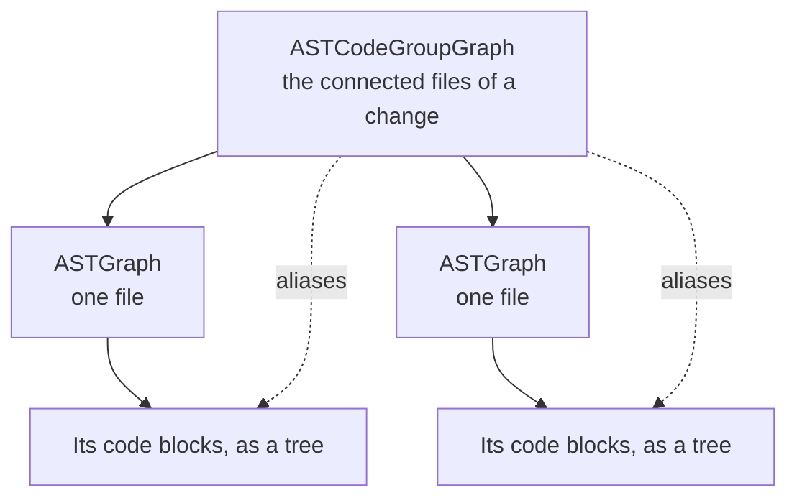
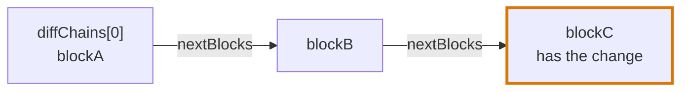
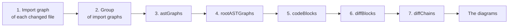

# Code blocks

## Definition

A code block is one piece of a file that a changed line can belong to: a function, a condition, a loop, a render, an event. The code blocks of a file form a tree.

Code blocks are held at two levels. An AST graph holds the blocks of one file, and an AST code group graph holds the AST graphs of the connected files of a change, with the blocks of all of them gathered into lists. The [segments](segments.md) of a review are cut from one group.



## The pages of the model

| Page | What it holds |
|---|---|
| This page | The shapes: the group, a file, a code block, the stored form, and the files that are ignored |
| [Block types](block-types.md) | What each type of block is, and what counts as a hook and as an effect |
| [Symbols](symbols.md) | How a block refers to what it uses: where, how, what it is handed to, and where a value comes from |
| [Chains](chains.md) | How a change is placed in a block and traced to what starts it |
| [Segments](segments.md) | How the changes of a review are split, and when a segment has a Blast Diagram |
| [Catalogue](catalogue.md) | What a call into a library means, as patterns |

## The group

```ts
type DiffKind =
  | "ui"
  | "state"
  | "effect"
  | "event"
  | "route"
  | "data"
  | "data-fetch"
  | "auth"
  | "type"
  | "file"
  | "logic"

interface ASTCodeGroupGraph {
  astGraphs: ASTGraph[]
  rootASTGraphs: ASTGraph[]
  codeBlocks: CodeBlock[]
  diffBlocks: CodeBlock[]
  diffContains: DiffKind[]
  chainContains: DiffKind[]
  diffChains: CodeBlock[]
}
```

| Field | What it holds |
|---|---|
| `astGraphs` | The AST graph of every file of the group |
| `rootASTGraphs` | The AST graphs of `astGraphs` at the top of the group: a file that no other file of the group imports, such as `routes.tsx` or the entry file of the app |
| `codeBlocks` | Every block of every file, as one flat list |
| `diffBlocks` | Every diff block of every file, as one flat list: the innermost block around each change |
| `diffContains` | What kinds of change the diff of the group holds, each kind once. See "What the diff contains". |
| `chainContains` | What kinds of block the chains of the group pass through, each kind once. See "What the chains contain". |
| `diffChains` | The chains that lead to a change, one entry per chain: the block at the top of it. See [A chain](chains.md#a-chain). |

**`codeBlocks` and `diffBlocks` are flat, not chained.** They are every block that was found, and every block that was changed, in no order that means anything and with no link between two entries. They are the `codeBlocks` and the `diffBlocks` of the files, gathered. `diffChains` is the one list that is chained.

| List | Chained | An entry is |
|---|---|---|
| `codeBlocks` | No | A block |
| `diffBlocks` | No | A block that has a change |
| `diffChains` | Yes | The top of a chain that leads to a change |

### What the diff contains

`diffContains` says, in a few words, what the changes of the group are made of. It is read before anything is traced, so that what is built next can take the right path without looking at every block again. The Journey Flow Diagram is built differently when the diff has changes to the interface, and `diffContains` says so at once.

It is worked out from `diffBlocks` alone: the type of each diff block and of the blocks around it.

Its values are the ten of `DiffKind`, and no other: a value that is not one of them does not compile.

| Value | The diff has a change in |
|---|---|
| `ui` | Markup, or a component: a `render-root`, `render`, `render-condition`, `render-loop` or `render-event` block, a `component` block, or any block inside one |
| `state` | A `state` or a `derived` block |
| `effect` | An `effect`, a `component-effect` or an `effect-callback` block |
| `event` | A `code-event` block |
| `route` | A `route`, a `resolver` or a `middleware` block |
| `data` | A `data`, a `data-fetch`, a `cache` or a `transaction` block |
| `auth` | An `auth` block |
| `type` | A `type-declaration` block |
| `file` | A `file` block: a file no language reads |
| `logic` | Any other block: a function, a method, a condition, a loop |

A diff can hold several: a change to a component and to the function it calls gives `["ui", "logic"]`. A group whose diff has no `ui` holds no change to the interface, and the Journey Flow Diagram needs none of what it builds for components.

### What the chains contain

`chainContains` says what the blocks on the chains are made of, with the same ten values. It is filled when the chains are traced, from every block a chain passes through, changed or not.

```tsx
// users-page.tsx, not changed
const UsersPage = () => <UserList users={loadUsers()} />

// load-users.ts
export const loadUsers = () => { … }      // the only change
```

| Field | Filled | Holds here | Answers |
|---|---|---|---|
| `diffContains` | Before any chain is traced, from the changed blocks | `["logic"]` | What changed |
| `chainContains` | With the chains, from the blocks they pass through | `["ui", "logic"]` | What the journey has to draw |

When `diffContains` holds only `type` and `file`, nothing that runs changed: no chain is traced, and `chainContains` and `diffChains` are empty.

The group has no list per type of block. A block says what it is in its `type`, so the events, the effects or the state of a group are `codeBlocks` read by type.

**An entry of `diffChains` is a whole chain, not one block of it.** A chain is a linked list: its top is the entry, and each block leads to the next through `nextBlocks`, down to the last block of the path that has a change. A changed block in the middle of a chain leads on like any other. The blocks further down a chain are never entries of their own.



`blockA` is in `diffChains`. `blockB` and `blockC` are not: they are reached from `blockA`.

A second entry is a second chain, and there is one only where the code has a second top: another event, another effect, another render, another statement at the root of a file, or a block nothing starts. A chain that splits further down is still one entry. The block where it splits has two blocks in `nextBlocks`.

What kind of start a chain has is read from its top:

| The top of the chain is | What starts it |
|---|---|
| A `render-event` | A user action |
| A `code-event` | A user action for a listener of `addEventListener`, an event bus for a subscription, and the callback itself, such as `onSuccess`, for a callback of an effect |
| A `component-effect` | The effect running |
| An `effect-callback` the [catalogue](catalogue.md) says runs as a page, such as `element` of a route | A visit of the path of that route |
| A component that nothing in the repository renders | A page visit |
| A `route`, a `resolver` or a `middleware`, or a callback the catalogue says runs as one | A request |
| A callback the catalogue says runs as a job or a command | That job or command |
| A `root-statement` | The app starts |
| Anything else, such as a function nothing calls | Not used yet: the code does not say what runs it |

A component is a root block that is, or wraps, a `component` block. A `render-root` is never a top itself, since its function steps into it.

Every block in these lists is the same object as in the AST graph of its file: an alias, not a shallow copy and not a clone. A block carries its `astGraph`, so the file of any block in a list of the group can be found from the block itself.

## Files no language reads

A changed file no language reads, such as a migration, a schema, a stylesheet or a JSON file, has an AST graph with one block of the type `file` that spans the whole file. It has no symbols and nothing uses it, so no test of the [segments](segments.md) places it: it is in the shared segment of the change, or a segment of its own when the change has none, and the Code Walkthrough has a block for its waypoint. A file of that kind the diff did not change is not in the group.

## Files that are ignored

Test files and story files are never part of a review artifact, so they are never part of a group. A file the [catalogue](catalogue.md#files-that-are-ignored) names as a test or a story has no AST graph and no blocks, whether the diff changed it or not. The catalogue names them with file patterns that say `isIgnored`: `**/*.test.*`, `**/*.spec.*`, `**/*.stories.*` and `**/__tests__/**` for JavaScript, and `**/test_*.py`, `**/*_test.py` and `**/conftest.py` for Python.

| Because a test or a story is ignored | It follows that |
|---|---|
| It has no blocks | A change in it has no diff block, and no waypoint in the Code Walkthrough |
| It is not a user | A function its page and its test use is used from one place, when segments are found |
| It hands nothing over | A value a story hands to a component is not an origin of that value |
| It is not a top of a chain | No journey starts in a test |

## A file

```ts
interface ASTGraph {
  codeBlocks: CodeBlock[]
  rootBlocks: CodeBlock[]
  diffBlocks: CodeBlock[]
  diffContains: DiffKind[]
  renderRootBlocks?: CodeBlock[]
  externalSymbols: CodeBlockSymbol[]
  externalBlocks: CodeBlock[]
  exports: Map<string, CodeBlock | SourceRange>
}
```

| Field | What it holds |
|---|---|
| `codeBlocks` | Every code block of the file |
| `rootBlocks` | The blocks at the top level of the file |
| `diffBlocks` | The nearest block around each change. See [The diff blocks](chains.md#the-diff-blocks). |
| `diffContains` | What kinds of change the diff of this file holds, by the same rule as the `diffContains` of the group. A file the diff did not touch has none. |
| `renderRootBlocks` | The `render-root` blocks of the file. A file without markup has none. |
| `externalSymbols` | Every outer symbol of the file's blocks that comes from outside the file: the `external-variable`, `external-block` and `unopened-import` symbols |
| `externalBlocks` | The blocks of other files that the blocks of this file use: what the `external-block` symbols point at, once each |
| `exports` | Every name the file exports, with what that name leads to: a block, or the range of a variable that is not a block. See "The names a file exports". |

`rootBlocks`, `diffBlocks` and `renderRootBlocks` hold the same objects as `codeBlocks`, `externalSymbols` holds the same objects as the `outerSymbols` of the blocks, and `externalBlocks` holds blocks of other AST graphs. They are aliases, not shallow copies and not clones.

```ts
// page.tsx
import { useQuery } from "@tanstack/react-query"
import { someUtilFunction } from "./utils"

const Page = () => {
  const x = someUtilFunction()
  const query = useQuery({ queryKey: ["users"], queryFn: fetchUsers })
}
```

| Of `page.tsx` | Holds |
|---|---|
| `externalSymbols` | The `external-block` symbol of `someUtilFunction`, and the `unopened-import` symbol of `useQuery` |
| `externalBlocks` | The `function` block `someUtilFunction` of `utils.ts` |

### The names a file exports

A block is not always exported under its own name, and a file can export what another file declares. `exports` is the table that turns an import into a block: first the file, then the name.

```ts
// pricing/price-of.ts
export default function priceOf(item) { … }

// pricing/index.ts
export { default as price } from "./price-of"
export { default as tax } from "./tax-of"

// cart.ts
import { price } from "./pricing"
```

| File | `exports` |
|---|---|
| `pricing/price-of.ts` | `default` → the block `priceOf` |
| `pricing/index.ts` | `price` → the block `priceOf`, and `tax` → the block `taxOf` |

`price` in `cart.ts` is looked up in the `exports` of `pricing/index.ts`, and becomes a symbol that points at the block `priceOf`. `export * from "./price-of"` adds every name of that file but `default`.

`exports` and `exportedBy` are the two directions of one fact: `exports` leads from a file and a name to a block, and `exportedBy` from a block to the files that export it.

## A code block

```ts
interface Position {
  line: number
  column: number
}

interface SourceRange {
  start: Position
  end: Position
}

interface CodeBlockCatalogue {
  specifier: string | null
  name: string
  runs: "route" | "resolver" | "page" | "middleware" | "job" | "command" | "event" | "effect" | "in-place" | "kept" | null
  path: string | null
  method: string | null
  event: string | null
  certainty: "proven" | "assumed"
}

interface CodeBlock {
  id: string
  name?: string
  type: CodeBlockType
  deletedType?: CodeBlockType
  lineOfCodeRangeReference: SourceRange[]
  parentBlock: CodeBlock | null // alias not a shallow or clone
  childrenBlocks: CodeBlock[] // aliases not a shallow or clone
  isRoot: boolean
  isExported: boolean
  exportedBy: ASTGraph[] // aliases not a shallow or clone
  lineOfCodeDiffs: SourceRange[] | null
  diffs: CodeBlockDiff[]
  diffSources: CodeBlock[] // aliases not a shallow or clone
  outerSymbols: CodeBlockSymbol[]
  usedBy: CodeBlock[] // aliases not a shallow or clone
  nextBlocks: CodeBlock[] // aliases not a shallow or clone
  handedFrom: CodeBlockSymbol[] // aliases not a shallow or clone
  astGraph: ASTGraph // alias not a shallow or clone
  catalogue: CodeBlockCatalogue | null
}
```

| Field | What it holds |
|---|---|
| `id` | The file path, the type and the start of the block, such as `src/pages/users-page.tsx#function@12:1`. It is derived, never invented. |
| `name` | The name of the block, when it has one. An anonymous function or a condition has none. |
| `type` | What kind of block it is. See [Block types](block-types.md). |
| `deletedType` | On a `deleted` block at the root of a file, the type of what was taken out, read with the language of the file. Left out on every other block. See [Block types](block-types.md#what-counts-as-a-variable-a-property-and-a-deleted-block). |
| `lineOfCodeRangeReference` | The ranges the block spans, each from a line and a column to a line and a column |
| `parentBlock` | The block that holds it, or `null` at the root of the file |
| `childrenBlocks` | The blocks directly inside it |
| `isRoot` | Whether it sits at the top level of the file |
| `isExported` | Whether the file exports it. Being exported is a fact about a block, not a type: a function, a class and a root variable can each be exported or not. |
| `exportedBy` | The AST graph of every file that exports the block: its own file, and each file that re-exports it, such as an `index.ts`. Empty when `isExported` is `false`. |
| `lineOfCodeDiffs` | The ranges of the changes that belong to the block itself: those it is the innermost block around. `null` for every other block, including a block around a diff block. A block with ranges here is a diff block. |
| `diffs` | What a change does to the block, each as a diff with a `type` and a `range`. The changes of `lineOfCodeDiffs` are here as `added`, `modified` or `deleted`. A use of a block with a change is here as `affected`. Empty on a block with neither. See [The diffs of a block](chains.md#the-diffs-of-a-block). |
| `diffSources` | The diff sources the block leads to: every block with a change on a chain that starts at this block. A diff source lists itself. Empty when no chain from the block leads to a change. |
| `nextBlocks` | The next blocks of the chain this block is on: the blocks it runs that lead to a change. One block on a chain that does not split, several where it splits, and none on the last changed block of a path or on a block that is on no chain. |
| `outerSymbols` | The names the block uses that are declared outside its own scope, one entry per use. See [Symbols](symbols.md). |
| `handedFrom` | The symbols that are handed to this block: every symbol whose `handedTo` is this block. It is the reverse of `handedTo`, as `usedBy` is the reverse of `outerSymbols`. |
| `usedBy` | The blocks that have this block in their `outerSymbols`. It is the reverse of `outerSymbols`, filled once when the group is built, so that climbing from a block to what uses it is a lookup. |
| `astGraph` | The AST graph of the file the block is in, an alias, so the file can be found from any block |
| `catalogue` | What the [catalogue](catalogue.md) says about the block, or `null` when no pattern matched it. See "What the catalogue leaves on a block". |

## What the catalogue leaves on a block

When a pattern of the [catalogue](catalogue.md) matches a block, the block keeps what the pattern said, in `catalogue`. It is `null` on every block no pattern matched, which is every block of a repository with no catalogue.

| Field | What it holds |
|---|---|
| `specifier` | The library the pattern belongs to, or `null` for a convention of the repository |
| `name` | The name the pattern matched: an export, or a method |
| `runs` | When the callback runs, for a block that is a slot of a pattern. `null` for any other block. |
| `path` | The path of a route, a page, a request, a data-fetch or a navigation, or the field of a resolver such as `Query.users`, when the pattern says where it is and it is written in the code |
| `method` | The method of a route, of a request or of a data-fetch that is a request |
| `event` | The name of the event, the channel or the queue of a `publish` or a `code-event` block |
| `certainty` | `proven` when the pattern matched through an import and a known version. `assumed` when the version of the library is not known and the shape of the call picked the pattern. |

| Code | Block | Its `catalogue` |
|---|---|---|
| `mutationFn: removeUser` in `useMutation({ … })` | `effect-callback` | `@tanstack/react-query`, `useMutation`, `runs: "kept"` |
| `select: (data) => data.items` in `useQuery({ … })` | `effect-callback` | `@tanstack/react-query`, `useQuery`, `runs: "in-place"` |
| `router.post("/users", createUser)` | `route` | `express`, `post`, `runs: "route"`, `path: "/users"`, `method: "post"` |
| `prisma.order.findMany({ … })` | `data-fetch` | `@prisma/client`, `findMany` |
| `builder.queryField("users", …)` | `resolver` | `@pothos/core`, `queryField`, `runs: "resolver"`, `path: "Query.users"` |
| `useFlag("new-checkout")` | `feature-flag` | `@unleash/proxy-client-react`, `useFlag` |
| `useEffect(() => { … })` with no pattern for `react` | `component-effect` | `null` |

The type of a block says what it is. `catalogue` says what the type alone does not: two `effect-callback` blocks can differ in when they run, and a `route` block needs its path.

## The stored form

In memory every reference is an alias, so a block leads back to itself through its parent, its file and the blocks that use it. That cannot be written as JSON, and one block would carry the whole group with it. The stored form is the same data with every reference replaced by an id:

| In memory | In the stored form |
|---|---|
| `parentBlock` | `parentBlockId`, or `null` |
| `childrenBlocks` | `childrenBlockIds` |
| `usedBy` | `usedByIds` |
| `nextBlocks` | `nextBlockIds` |
| `diffSources` | `diffSourceIds` |
| `exportedBy` | `exportedByFilePaths` |
| `astGraph` | `filePath` |
| `codeBlocks`, `diffBlocks` and `diffChains` of a group | Lists of block ids |
| `astGraphs` and `rootASTGraphs` of a group | Lists of file paths |
| `codeBlocks`, `rootBlocks`, `diffBlocks` and `renderRootBlocks` of an AST graph | Lists of block ids |
| `externalBlocks` of an AST graph | `externalBlockIds` |
| `exports` of an AST graph | Each name with a block id, or a range |
| `codeBlockReference` of a symbol | `codeBlockId` |
| `astGraph` of an `external-variable` symbol | `filePath` |
| `handedTo` and `member.block` of a symbol | An id, or `null` |

One function turns a group into its stored form. Snapshots and comparisons between two runs read only that form. A `.flightplan` file holds the group in memory instead, with every alias kept: see [The `.flightplan` file](../data-storage.md#the-flightplan-file).

## How a group is built

A group is built in seven steps, in this order. Each step reads only what the steps before it made, and the diagrams are built from the finished group.



| Step | Makes | From |
|---|---|---|
| 1. The import graph | For each changed file, the files that import it and the files it imports | Git, at the commits of the change. See [Import graph](import-graph.md). |
| 2. The group of import graphs | The import graphs that share a file, joined: the files of one group | Step 1 |
| 3. `astGraphs` | One AST graph per file of the group, parsed once by its language. The same parse gives the [syntax](ast-graph.md) of the file, which the group keeps beside its stored form. | The files of step 2 |
| 4. `rootASTGraphs` | The AST graphs no other file of the group imports | Step 3 and the imports of step 1 |
| 5. `codeBlocks` | Every block of every file, with its type, its range and what it refers to: `outerSymbols`, `usedBy`, `handedTo`, `handedFrom`, and the `exports` of each file | Step 3 |
| 6. `diffBlocks` | The innermost block around each change, with its `lineOfCodeDiffs` and its `diffs`, the `affected` diffs of the blocks that use it, and `diffContains`, read from those blocks | Step 5 and the ranges of the changes |
| 7. `diffChains` | `nextBlocks` and `diffSources` on each block, the top of each chain on the group, and `chainContains` | Steps 5 and 6 |

Steps 5 and 6 make the two flat lists, and step 7 the chains: a chain cannot be traced before every block and every changed block is known.

The references between blocks are part of step 5, and they need two passes of their own: every block is created first, and the references are filled in after, since a block can only point at a block that exists.

From the finished group the diagrams are built: the [segments](segments.md), then the Journey Flow Diagram, the Blast Diagram and the Code Walkthrough of each.

Nothing outside that function sees a block before it is complete, and nothing changes a group afterwards.
