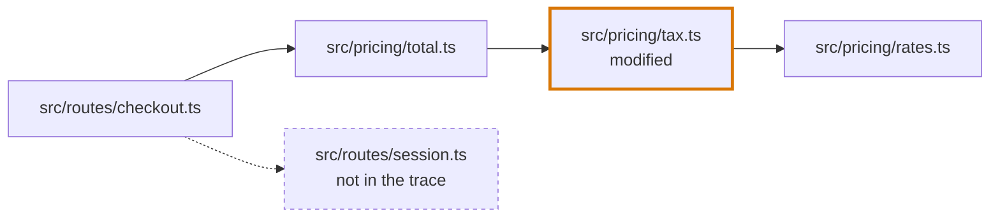
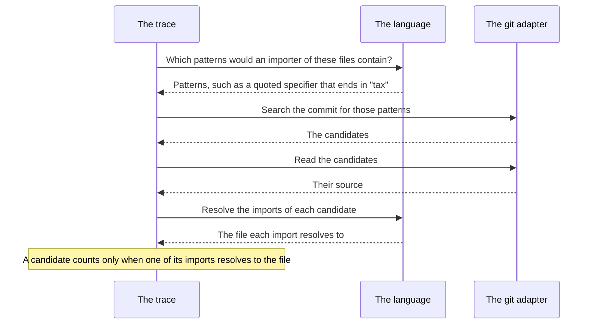
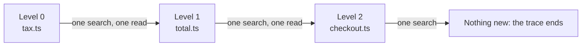
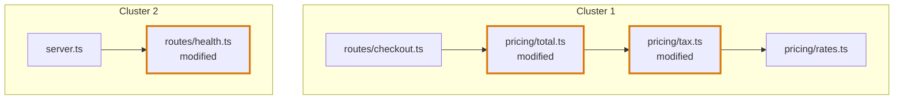

# Import graph

## Definition

The import graph is the first mechanism of the [codegraph](../codegraph.md). It answers one question about a changed file: which files import it, and which files does it import?

It groups files, and nothing more. It never looks inside a function: it reads the import statements of a file, resolves each to a file of the repository, and stops there. What a file declares and uses is the work of the [AST graph](ast-graph.md).

Every file, file list and search comes from a commit, through the git adapter. Nothing is read from a working tree.

## The trace of one file

For each changed file the codegraph traces two things, and follows both through other files until nothing new is reached:

- **the files that import it**, and the files that import those;
- **the files it imports**, and the files those import.

The two directions are followed separately. A file that an importer imports is not in the trace unless it also lies on one of the two directions.

```ts
// src/pricing/tax.ts          the changed file
import { RATES } from "./rates"

// src/pricing/total.ts
import { taxOf } from "./tax"

// src/routes/checkout.ts
import { totalOf } from "../pricing/total"
import { sessionOf } from "./session"
```



An arrow runs from the file that imports to the file that is imported.

| File | Why it is in the trace |
|---|---|
| `src/pricing/total.ts` | It imports the changed file |
| `src/routes/checkout.ts` | It imports a file that imports the changed file |
| `src/pricing/rates.ts` | The changed file imports it |
| `src/routes/session.ts` | It is not: `checkout.ts` imports it, and it neither imports the change nor is imported by it |

Once the files of the trace are known, every import between two of them is recorded, whichever direction found them. If `checkout.ts` also imported `rates.ts`, that import would be an edge of the trace.

### Which commit a file is read at

| The file | Read at |
|---|---|
| Added or modified | The head commit |
| Not changed | The head commit |
| Deleted | The base commit, where it still exists |

A file no language reads has no import graph.

## An importer is searched for, then proven

Finding what a file imports is cheap: read the file. Finding what imports a file is not, since any file of the repository could. The codegraph never reads the whole repository to find out. It searches first and proves second.



- **The search is wide on purpose.** A pattern matches by name, so a file that imports another `tax` module, or one that only mentions the name in a string, is a candidate too.
- **The proof is exact.** A candidate counts only when one of its imports resolves to the file. The others are dropped.
- **A dynamic `import()` call is not an import.**

With the files above, the search for importers of `src/pricing/tax.ts` could return three candidates:

| Candidate | Its import | Counts |
|---|---|---|
| `src/pricing/total.ts` | `"./tax"` resolves to `src/pricing/tax.ts` | Yes |
| `src/billing/invoice.ts` | `"./tax"` resolves to `src/billing/tax.ts` | No |
| `src/pricing/labels.ts` | No import: `"tax"` is only a string in it | No |

What a pattern looks like, and how a specifier resolves, differs by language. See [TypeScript](languages/typescript.md#import-graph), [Python](languages/python.md#import-graph) and [Vue](languages/vue.md#import-graph).

## Reading in batches

The trace moves one level at a time, and asks git once per level, never once per file:

- one search for the importers of every file of a level;
- one read for the files of a level.



The change itself is read once for the whole pull request: the base commit, the head commit, the changed files and the file list of each commit.

## Clusters

Two import graphs that share a file are one cluster. A cluster is therefore every changed file that is connected to another through imports, with the files between them.



A pull request changes `tax.ts`, `total.ts` and `health.ts`:

- The import graph of `tax.ts` and the import graph of `total.ts` both hold `tax.ts`, `total.ts` and `checkout.ts`, so they are one cluster.
- The import graph of `health.ts` shares no file with them, so it is a cluster of its own.

The rules of joining:

- **A file appears once in a cluster.** When two import graphs hold the same file, its `importedBy` and its `importsTo` are joined.
- **Joining carries on.** An import graph that shares a file with two clusters joins them into one.
- **A cluster is one connected part of one language.** TypeScript, JavaScript, JSX and Vue files are read by one reader and can share a cluster. A Python file cannot be in a cluster with them, because no import of one resolves to the other.
- **A cluster is cut into the segments** of the review: one per line of change, and one shared segment for the changed files several lines have in common. See [Segments](segments.md).

## A file of the import graph

```ts
interface ImportGraphFile {
  filePath: string
  gitSha: string                            // the commit the file was read at
  diffType: "modified" | "added" | "deleted" | null
  importedBy: string[]                      // files of the trace that import it
  importsTo: string[]                       // files of the trace it imports
  importedFilePaths: Map<string, string>    // each import specifier → the file it resolves to
}
```

`importedFilePaths` holds every import of the file, whether the imported file is in the trace or not. `importsTo` lists only the files inside the trace.

For `src/routes/checkout.ts` above:

| Field | Value |
|---|---|
| `diffType` | `null`, the diff did not touch it |
| `importedBy` | none |
| `importsTo` | `src/pricing/total.ts` |
| `importedFilePaths` | `"../pricing/total"` → `src/pricing/total.ts`, and `"./session"` → `src/routes/session.ts` |

`session.ts` is in `importedFilePaths` and not in `importsTo`, because it is outside the trace.

## What reads the import graph

| Reader | What it takes |
|---|---|
| [AST graph](ast-graph.md) | The files of a cluster, to parse them, and `importedFilePaths`, to know which file an imported name comes from |
| [Blast Diagram](../blast-diagram.md) | Every file as a node and every entry of `importsTo` as an edge. It reads nothing else. |

## Where it lives in the code

| Part | Where |
|---|---|
| Reading a change once: commits, changed files, file lists | `src/import-graph/import-graph-context.ts` |
| Tracing one file in both directions | `src/import-graph/trace-import-graph.ts` |
| Reading and searching a commit in batches | `src/import-graph/repository-snapshot.ts` |
| Joining import graphs into clusters | `src/import-graph/cluster-import-graphs.ts` |
| The reader of each language: its imports, its resolver, its importer patterns | `src/import-graph/languages/` |
