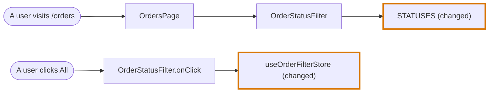
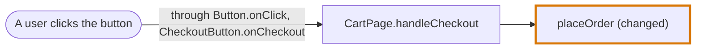
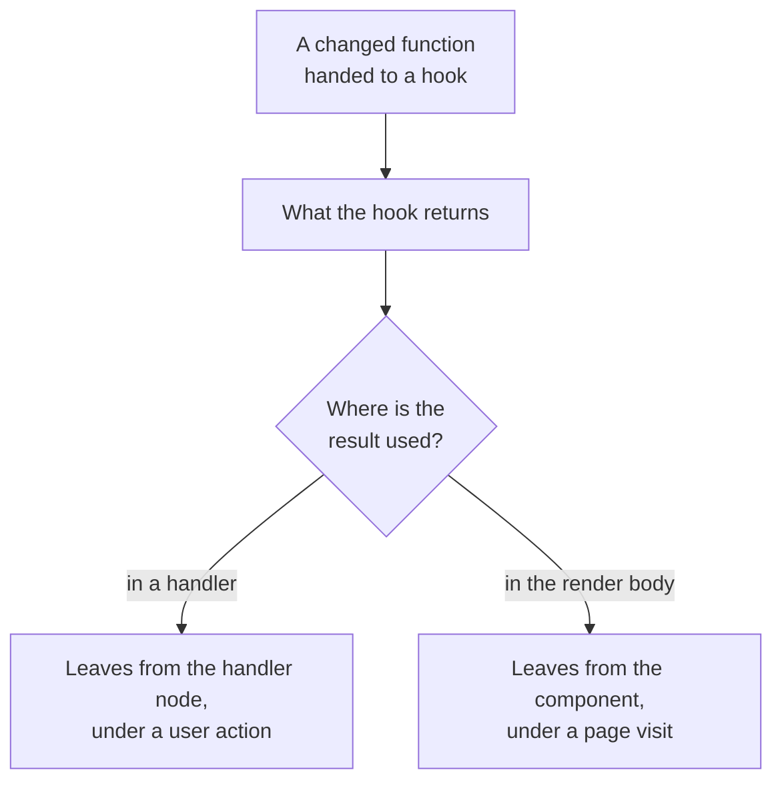
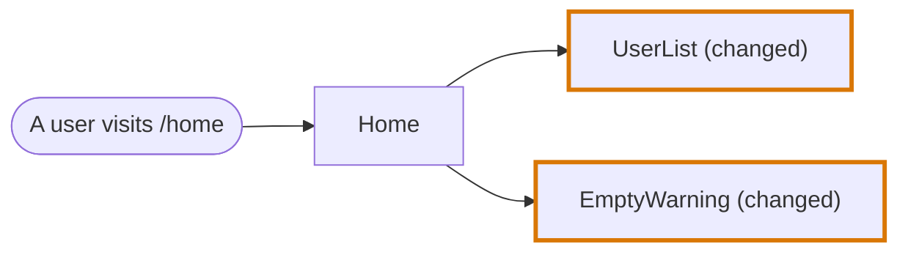
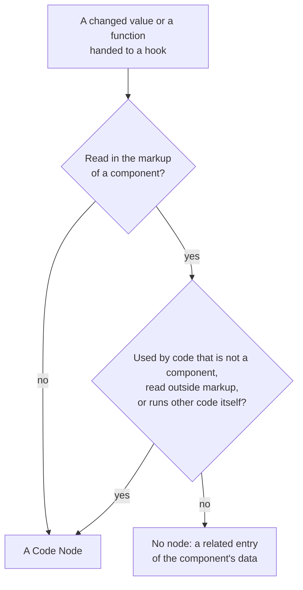
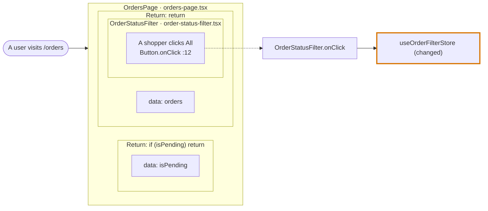

# JavaScript and JSX in the codegraph

How the [codegraph](../../codegraph.md) reads a JavaScript or a JSX file. This page holds what is particular to the language. The mechanisms themselves are in [Import graph](../import-graph.md) and [AST graph](../ast-graph.md).

| | |
|---|---|
| **Files** | `.tsx`, `.jsx`, `.js`, `.mjs`, `.cjs` |
| **Grammar** | tree-sitter `tsx` |
| **Reader of the import graph** | The script reader, shared with [TypeScript](typescript.md) and [Vue](vue.md) |
| **Reader of the AST graph** | `readJsxSyntax` |
| **Language of the code blocks** | `languages/typescript/`, with the `tsx` grammar |
| **Journey Flow Diagram** | Drawn from chains: calls, entry points and traced lines, with handlers, effects, components, contexts and routes |

JSX is TypeScript with elements. Everything in [TypeScript](typescript.md) holds for a JSX file, and this page lists what elements add. A [Vue](vue.md#journey-flow-diagram) component is traced by the same rules, said by its template. Most of it is in the Journey Flow Diagram, because an element says things no call does: it has handlers, it renders other components, it hands a value to a context, and a route names it as a page.

In the diagrams of this page a rounded node is an Entry Point Node and a thick border marks a changed node.

## Import graph

A JSX file is read by the script reader, so everything in [TypeScript: Import graph](typescript.md#import-graph) holds: what counts as an import, how a specifier resolves, and the patterns an importer would contain. Elements add nothing to it.

## AST graph

`readJsxSyntax` reuses the TypeScript readers and adds the element rules.

| In the markup | A use |
|---|---|
| `<CartLine />`, an element whose name starts with a capital | Of `CartLine`, counted once, at its opening tag |
| `<Form.Field />`, a member element | Of `Form` |
| `<div>`, a lowercase element | No |
| `<svg:rect>`, a namespaced element | No |
| `onClick` in `<button onClick={save}>`, an attribute name | No. `save` inside it is a use. |

```tsx
const Cart = ({ lines }) => (
  <ul>
    {lines.map((line) => (
      <CartLine key={line.id} line={line} onRemove={removeLine} />
    ))}
  </ul>
)
```

`Cart` holds a use of `CartLine` and a use of `removeLine`. It holds none of `ul`, `key`, `line` the attribute, or `onRemove`.

A JSX file also gives the Journey Flow Diagram four kinds of syntax site a TypeScript file does not have:

| Syntax site | What it marks | What it produces |
|---|---|---|
| `attribute` | An attribute of an element, with the element and whether it is built in | Handler nodes and user actions |
| `element` | An element | Renders, and the elements of traced lines |
| `markup` | A stretch of markup | The data of a component |
| `page` | A component named by a route, with its path | Page visits |

Nothing in the trace asks whether a file holds JSX. A file with these sites is traced through them, and a file without them is traced by its calls alone.

## Journey Flow Diagram

See [Journey Flow Diagram](../../journey-flow-diagram.md) for the rules every language shares. The rest of this page is what JSX adds to them.

### A component has a render node and a node for each handler

A component is one Code Node for what it renders. A page visit leads to it, and the components it renders hang from it.

A user action does not lead to that node. It leads to a Code Node for the handler the event runs, and an effect of the component that keeps no result has a node of its own in the same way, named after what it calls: `ThemeProvider.useEffect`, under the entry point "useEffect runs".

The handler node:

- **What it covers.** The handler attribute on the element, such as `onClick={…}`, and every function declared in the component that runs at it.
- **Its name.** The component and the handler: `CartLine.handleRemove`. A function written in place takes the name of the attribute: `OrderStatusFilter.onClick`. Two buttons of one component are two nodes.
- **Its edges.** What the handler calls leaves from the handler node. What the render body calls leaves from the component.
- **Whether it is changed.** It is changed when a changed line is inside it. The component is changed only when a changed line is outside its handlers.
- **A listener.** A function handed to `addEventListener` inside a component gets the same kind of node, named after the event: `Shortcuts.keydown`.



### A handler that is a prop belongs to the component that hands it over

When the element's handler runs a prop, the handler node is the function of the component that passed the prop in. The edge from the entry point lists the element's own handler and the props between.



A prop on a component is followed into that component, to where the prop is run, whether the component reads it from its parameter, takes it apart in its body (`const { onSave } = props`) or keeps it in a variable of its own.

### A function handed to a hook is reached where the hook's result is used

When the changed function is handed to a hook or another higher-order function, the code around it does not say when it runs. The chain reaches it from each place that uses what the hook returns: see [A chain through a kept result](../chains.md#a-chain-through-a-kept-result). A result used in a handler leaves from that handler's node, under a user action. A result read in the render body leaves from the component, under a page visit. Such an edge is a value the chain assumes, not a call it can prove. A callback that runs on an event of the library, such as `onSuccess`, is not reached that way: it has an entry point and a node of its own, `ProfileForm.onSuccess`.



### A function handed to a context is followed to the components that read it

A function given to a `Provider` as its value is reached from the components that read the context with `useContext` or `use`, and takes its entry point there, the same way as the result of a hook. A reader that takes one member of the context value is on the path only when that member is the one provided: see [Where a value comes from](../symbols.md#where-a-value-comes-from). The edge arrives at the component that renders the provider. When no component reads it, the function is a top of its own, under "Not used yet".

### A page takes the route it is rendered at

A component that a route table names starts its path at the visit of that route, named with its whole path and the paths above it: "A user visits /shop/cart". The [catalogue](../catalogue.md) says which property of a route names a page: `element`, `Component`, `loader` and `lazy` of React Router, at any depth of `children`. A component nothing renders starts at "A user visits the page".

### The entry points JSX adds

| The top of the path | Entry Point Node |
|---|---|
| A page or route component that nothing renders | A user visits the page |
| A slot of a route table the catalogue names as a page | A user visits that route |
| A handler on a built-in element, such as `onClick` or `onSubmit` | A user action |
| An `on…` prop on a component the group cannot open, such as a button of a component library | A user action. The chain starts on that prop |
| An effect of a component that keeps no result | That effect runs |
| A callback of an effect that runs on an event, such as `onSuccess` | Reached through that callback |

### Rendering logic

In a component, what is rendered is part of the trace. A component often renders one thing or another depending on a condition, or renders something once per item of a list, and the diagram shows that.

- **A component rendered under a condition or in a loop is a node like any other.** No edge says which condition. The conditional or the loop is in the traced lines of the component that renders it.
- **A branch that renders only built-in elements is traced lines, not a node.** A warning written in place as `<p>No users yet</p>` belongs to the component that renders it. It appears in that component's traced lines, under the conditional it sits in.
- **A component with several return statements lists them as its returns.** See "The returns of a component".

A path through a branch is drawn under the same rule as any other: it is drawn when it leads to changed code.

```tsx
// home.tsx
const Home = () => {
  const users = useUsers()

  if (users.length === 0) return <EmptyWarning />     // rendered if there is no user

  return <UserList users={users} />                   // rendered otherwise
}
```

With changes inside both `UserList` and `EmptyWarning`:



In the traced lines of a JSX node an element is a unit like a statement. See [Traced lines](../../journey-flow-diagram.md#traced-lines).

### The returns of a component

A component that has two or more `return` statements of its own carries them as its `returns`, in source order. A component with one return has none, and neither has any node that is not a component.

A return of its own is a `return` statement of the component's body, at any depth of its conditionals, loops and `try` blocks. A `return` inside a function declared in the component, inside a callback or inside markup is not one. A ternary or an `&&` inside one return does not split it.

```tsx
const OrdersPage = () => {
  const { data: orders, isPending, isError } = useOrders(status)
  if (isPending) return <p>Loading your orders…</p>     // a return
  if (isError) return <p>Your orders could not be loaded.</p>     // a return
  return (                                               // a return
    <section>
      <OrderStatusFilter />
      {orders.length === 0 ? <p>No orders to show.</p> : <ul>…</ul>}
    </section>
  )
}
```

| Field of a return | What it holds |
|---|---|
| `id` | The id of the component, then `#return@` and the line the return starts on |
| `statement` | The source of its first line up to and including `return`, such as `if (isPending) return` or `return` |
| `reference` | Its first and its last line |
| `changeType`, `isAdded` | `diff` when a changed line is on the return and `none` otherwise, and whether every line of it is new |
| `tracedLines` | The lines stepped through from the top of the component up to the end of this return |
| `renderedNodeIds` | The nodes of the components this return renders, in the order it renders them |
| `label`, `description` | Written by the agent. Until the label is written the page shows the `statement`, marked as a draft. |

A user action and a `data` entry of the component belong to the return whose lines they are on.

### Events and data of a component

A Code Node of the category `ui` carries two more lists. Every other node has both empty.

| List | What it holds | Named |
|---|---|---|
| `events` | Every callback the component hands over in its markup, and every event it listens to with `addEventListener` | `<element>.<attribute>`, such as `button.onClick` or `CheckoutButton.onCheckout`; `<target>.<event>`, such as `window.keydown` |
| `data` | Every variable the component's markup reads that is defined outside the markup | The variable, such as `items` or `status` |

Each entry is `{ name, changeType, reference }`. `reference` is the first and the last line the entry is on. An entry of `events` also has `nodeId`: the id of the handler node that event leads to, or `null` when the diagram draws no handler node for it. An entry is listed once for each place it is on, in the order of the lines.

`changeType` says how the entry stands to the diff:

| `changeType` | Meaning | Example |
|---|---|---|
| `diff` | A changed line is on the entry's own lines | The line of `onClick={handleRemove}` was edited |
| `related` | The entry's lines are untouched, and a changed line is on what the entry is linked to inside the component: a function declared in the component that the event hands over, or the declaration of the variable | `onClick={handleRemove}` is untouched and a line of `handleRemove` changed; `{total}` is untouched and `const total = ...` changed |
| `none` | Neither | `onClick={handleEdit}` where `handleEdit` is untouched |

The link is followed one step and never leaves the component, with one exception: a variable is also `related` when it is a changed value that has no node of its own, as described below. An event whose untouched handler calls a changed function of another file is `none`: that link is a path of the diagram.

An attribute is a callback when its name starts with `on` and a capital letter, when a function is written in place as its value, or when its value is a function declared in the component. A function that is an argument of a call inside the attribute, such as the one in `value={items.filter((item) => item.inStock)}`, does not make it a callback.

`data` holds only variables defined outside the markup: a variable the markup declares itself, such as `product` in `products.map((product) => ...)`, is left out. It also leaves out the names of the components rendered, the functions the markup calls by name, such as `formatPrice` in `{formatPrice(total)}`, and everything inside a callback attribute. The object of a method call stays: `products` in `products.map(...)` is data.

```tsx
const CartSummary = ({ items }) => {
  const total = totalOf(items)
  const handleRemove = (id) => removeItem(id)

  return (
    <section>
      <p>{formatPrice(total)}</p>
      {items.map((item) => (
        <button key={item.id} onClick={() => handleRemove(item.id)}>Remove</button>
      ))}
    </section>
  )
}
```

| List | Entries | Left out |
|---|---|---|
| `events` | `button.onClick` | |
| `data` | `total`, `items` | `formatPrice`, a function the markup calls. `item`, declared by the markup. `handleRemove`, inside a callback attribute. |

The codegraph writes both lists. The agent reads them and cannot write them.

A Code Node of the category `ui` also carries `states`, `dataFetches`, `hooks` and `effects`, read from the [code blocks](../code-blocks.md) of the same change. Each entry is `{ name, changeType, reference }`, and only what leads to a change is listed: `diff` when a changed line is on the entry's own lines, `related` when a chain from it leads to a change elsewhere. An entry of `dataFetches` or of `effects` also has `nodeId`: the id of the effect node it has in the diagram, or `null`.

| List | What it holds | Named |
|---|---|---|
| `states` | Every `state` and `derived` block directly in the body of the component. A declaration that reads a store, such as `const status = useOrderFilterStore(selectStatus)`, is state. | The first name it declares, such as `status` |
| `dataFetches` | Every entry that would be a hook or an effect, and every other declaration that keeps the result of a call, whose chain holds a `data-fetch` block: the block itself, a block inside it, or a block a chain from it passes through or holds | What it calls, such as `useOrders` or `loadUsers` |
| `hooks` | Every declaration directly in the body that keeps the result of a call whose name starts with `use` and a capital letter, and is neither state nor a data fetch | The hook, such as `useTheme` |
| `effects` | Every `component-effect` directly in the body that keeps no result and is no data fetch | What it calls, such as `useEffect` |

An entry is in one list only: what fetches data is a data fetch, whatever else it is.

A name the body calls more than once is numbered in the order the calls are written: `useEffect (1)`, `useEffect (2)`. The number counts every call of that name in the component, so a component whose second effect alone leads to a change lists `useEffect (2)`.

#### A value read in the markup is data, not a node

A value that a component reads in its markup, such as a constant `STATUSES` in `{STATUSES.map(...)}`, has no Code Node. It is an entry of the component's `data`, and when the diff changed the value, the entry is `related`.

- This holds for a value: a constant, an array, an object. A function the markup calls keeps its node.
- It also holds for a function handed to a hook when a component reads the hook's result in its markup, such as `selectStatus` in `const status = useOrderFilterStore(selectStatus)` with `{status}` in the markup. The entry is the variable that keeps the result, `status`. Other components that read the result of the same function in their body do not bring the node back.
- A value or such a function keeps its node when code that is not a component uses it too, when a component only reads it outside its markup, or when it runs other code itself.
- A handler node that led only to a value with no node is not drawn, and neither is its user action.
- When the only change of a diagram is such a value, the diagram is still drawn: the paths end at the components that read it, and the diagram is named after them.



### The UI card

On the page, the components of a diagram are not drawn as a card each. Every top-most component, usually a page, gets one **UI card**, and each component it renders, at any depth, is a frame inside the frame of what renders it. The card's header names the top-most component and its file.

A sketch of one card, for a page with two returns that renders a filter:



| Part of the card | What it shows |
|---|---|
| A frame | One component: its label, "Added" or "Modified", and its data |
| A return frame | One return of a component that has several: its label, "Added" or "Modified" when the diff touched that return, the data read on its lines, the user actions on its lines and a frame for each component it renders |
| A component header | The name and the file of a component that another component renders, above its frame or its return frames |
| The state line | The names in `states` of a component, once each. It sits above the data line of the component's frame, or under its header when it has several returns or is rendered by another component. |
| The data line | The names in `data`, once each. A changed component lists all of them, an unchanged one only those that are `diff` or `related`. Past six names the rest is counted. |
| A row of a data fetch, a hook or an effect | One entry of `dataFetches`, `hooks` or `effects`. The first line is its name, such as `useOrders`. The second line is its kind and its line, such as `Data fetch :8`. Choosing the row opens the component. |
| A trigger row | An entry point inside that component: a user action, or an effect that has a node of its own. The first line is the label of the Entry Point Node, such as `A shopper clicks "All"` or `useEffect runs`. The second line is the event that catches it, or the effect, and its line, such as `Button.onClick :12`. |

The rows of a component are stacked in one order: its data fetches, its hooks, its effects, then its user actions. A data fetch or an effect is a trigger row when it has a node in the diagram, and a plain row when it has none.

How the card connects to the rest of the diagram:

- **A user action has no sign of its own.** Its Entry Point Node is drawn as the trigger row, inside the component it happens in. Choosing the row opens that entry point.
- **The line to an event node starts at the trigger row.** It leaves the right edge of the card at the height of the row, with a dotted lead-in from the row to the edge.
- **Only an event with an event node gets a row.** An event of `events` whose `nodeId` is `null` is not drawn.
- **A render between two components is not a line.** The frame inside the frame says it.
- **Every other line attaches at a row.** A page visit arrives at the left edge at the row of the component it opens, and a call to a hook, a store or a function leaves the right edge at the row of the component that makes it.
- **A component with several returns is drawn as its returns.** It has no frame with a label of its own. Its return frames are stacked in source order, and a component is drawn inside every return that renders it. Every return is drawn, touched by the diff or not.
- **A top-most component with several returns and a state line or a row of its own gets a header of its own** under the card's header, to hold them.
- **The top-most component with several returns uses the card's header.** Its return frames sit directly in the card, its lines attach at the header, and choosing the header opens the component.
- **A component that another component renders gets a header of its own.** The header is a frame with the component's name and file. Inside it sits the component's frame, or one return frame per return when it has several. Its lines attach at that header, and choosing the header opens the component.
- **Choosing a return frame opens that return**: its label, its description and its code views.
- **Two top-most components are two cards.** A component rendered by both is drawn inside each, and a line that starts at it starts at each.
- **An event node whose component is not on the diagram** gets a card with one frame, named after the component, so that its trigger has a row.

A page visit, an API call, a command and the other entry points stay signs outside the card.

## Examples

See [Journey Flow Diagram examples in JSX](../../journey-flow-diagram/examples-jsx.md).

## Where it lives in the code

| Part | Where |
|---|---|
| The class of the AST graph | `src/ast-graph/languages/jsx/index.ts` |
| The element rules of a use | `src/ast-graph/languages/jsx/references.ts` |
| The element sites | `src/ast-graph/languages/jsx/syntax-sites.ts` |
| The blocks, the uses and the markup of a file | `src/code-blocks/languages/typescript/` |
| Where a value comes from: a prop, a context, a member | `src/code-blocks/link-references.ts`, `src/code-blocks/value-origins.ts` |
| The events and the data of a component | `src/journey-flow-diagram/traced-names.ts` |
| The state, the data fetches, the hooks and the effects of a component | `src/code-blocks/component-parts.ts` |
| The edges and the entry points of a diagram, from chains | `src/journey-flow-diagram/chain-facts.ts` |
| The returns of a component | `src/journey-flow-diagram/component-returns.ts` |
| The UI cards of the page | `src/journey/ui-cards.ts` |
