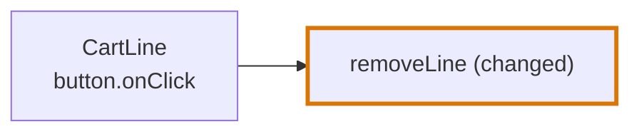

# JavaScript and JSX in the codegraph

How the [codegraph](../../codegraph.md) reads a JavaScript or a JSX file. This page holds what is particular to the language. The mechanisms themselves are in [Import graph](../import-graph.md) and [AST graph](../ast-graph.md).

| | |
|---|---|
| **Files** | `.tsx`, `.jsx`, `.js`, `.mjs`, `.cjs` |
| **Grammar** | tree-sitter `tsx` |
| **Reader of the import graph** | The script reader, shared with [TypeScript](typescript.md) and [Vue](vue.md) |
| **Reader of the AST graph** | `readJsxSyntax` |
| **Language of the code blocks** | `languages/typescript/`, with the `tsx` grammar |
| **Journey Flow Diagram** | Drawn from chains: a node per component, with the components it renders inside it and its handlers and data fetches as trigger labels, and a node per handler and effect of a component |

JSX is TypeScript with elements. Everything in [TypeScript](typescript.md) holds for a JSX file, and this page lists what elements add. A [Vue](vue.md) component is traced by the same rules, said by its template. An element says things no call does: it has handlers, it renders other components, it hands a value to a context, and a route names it as a page.

In the diagrams of this page a thick border marks a changed node.

## Import graph

A JSX file is read by the script reader, so everything in [TypeScript: Import graph](typescript.md#import-graph) holds: what counts as an import, how a specifier resolves, and the patterns an importer would contain. Elements add nothing to it.

## AST graph

`readJsxSyntax` reuses the TypeScript readers and adds the element rules.

| In the markup | A use |
|---|---|
| `<CartLine />`, an element whose name starts with a capital | Of `CartLine`, counted once, at its opening tag |
| `<Form.Field />`, a member element | Of `Form` |
| `<div>`, a lowercase element | No |
| `<svg:rect>`, a namespaced element | No |
| `onClick` in `<button onClick={save}>`, an attribute name | No. `save` inside it is a use. |

```tsx
const Cart = ({ lines }) => (
  <ul>
    {lines.map((line) => (
      <CartLine key={line.id} line={line} onRemove={removeLine} />
    ))}
  </ul>
)
```

`Cart` holds a use of `CartLine` and a use of `removeLine`. It holds none of `ul`, `key`, `line` the attribute, or `onRemove`.

A JSX file also has four kinds of syntax site a TypeScript file does not have:

| Syntax site | What it marks |
|---|---|
| `attribute` | An attribute of an element, with the element and whether it is built in |
| `element` | An element |
| `markup` | A stretch of markup |
| `page` | A component named by a route, with its path |

## Journey Flow Diagram

See [Journey Flow Diagram](../../journey-flow-diagram.md) for the rules every language shares. A JSX file is traced by its chains, like any other file, and its blocks say what the diagram draws.

| In the code | In the diagram |
|---|---|
| A component | A node of the type `component` |
| A component another component renders | A child of the node of the component that renders it |
| A handler on an element, such as `onClick={handleRemove}` | A `render-event` block of its component's node and one of its trigger labels, and a node of the type `render-event` with an edge from the component. An arrow function written in the attribute is part of that node. |
| A function the component declares for a handler | A block of the component's node, listed as a step. The edge of the handler that calls it goes on to what the function runs. |
| An effect in the body of the component, such as `useEffect(() => { … })` | A node of the type `component-effect`, with a node per callback it is handed |
| The markup, a declaration, and a condition or a loop on the way to the `return` | Blocks of the component's node. The render is one unit, and markup has no row. |
| A prop a handler is passed through, such as `onSave` of `<SaveButton onSave={saveReview} />` | A `root-argument-value` block of the node of the component that takes it. The chain passes through it, and it is no node. |
| A data fetch in the body of the component | A `data-fetch` block of its node, and one of its trigger labels. |
| A hook of the repository the component calls | A node of the type `hook`, with an edge from the component |
| A variable that holds markup, or a function that returns markup, inside the component | A `component` block of the component's node. Among components, only one at the top level of a file is a node. |
| A route table that names the component as a page | A node of the type of the table, such as `root-variable`, with an edge to the component |

```tsx
// cart-page.tsx
export const CartPage = () => <CartLine onRemove={removeLine} />

// cart-line.tsx
export const CartLine = ({ onRemove }) => <button onClick={onRemove}>Remove</button>

// cart.ts
export const removeLine = () => { … }                 // diff
```



The click starts the chain, so the path starts at `CartLine`: its `render-event` is the top, the prop `onRemove` is a block the chain passes through, and `removeLine` is the changed node. `CartPage` is not on the chain. Rendering `CartLine` does not run the handler.

## Where it lives in the code

| Part | Where |
|---|---|
| The class of the AST graph | `src/ast-graph/languages/jsx/index.ts` |
| The element rules of a use | `src/ast-graph/languages/jsx/references.ts` |
| The element sites | `src/ast-graph/languages/jsx/syntax-sites.ts` |
| The blocks, the uses and the markup of a file | `src/code-blocks/languages/typescript/` |
| Where a value comes from: a prop, a context, a member | `src/code-blocks/link-references.ts`, `src/code-blocks/value-origins.ts` |
| The nodes, the edges, the children and the trigger labels of a diagram, from chains | `src/journey-flow-diagram/index.ts` |
| The band the page receives | `src/journey/build.ts` |
| Placing the nodes on the page | `packages/ui/src/lib/journey-layout.ts` |
