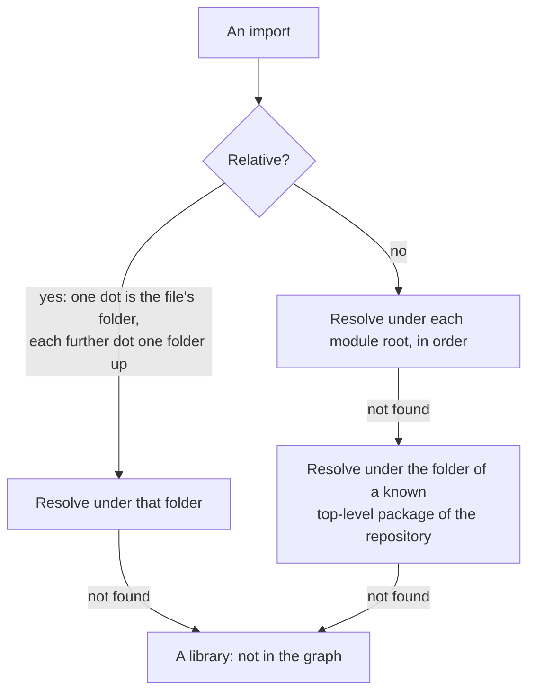
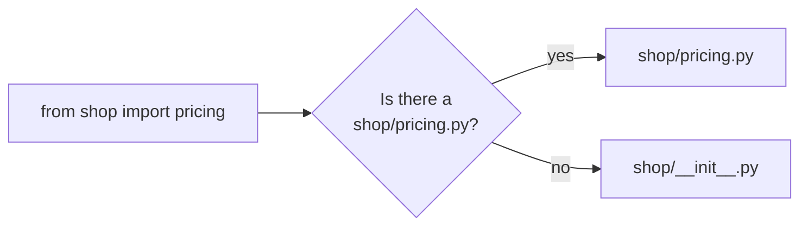
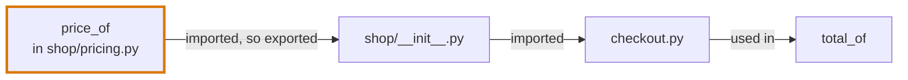
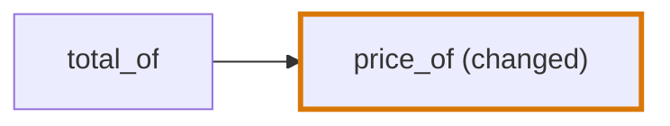

# Python in the codegraph

How the [codegraph](../../codegraph.md) reads a Python file. This page holds what is particular to the language. The mechanisms themselves are in [Import graph](../import-graph.md) and [AST graph](../ast-graph.md).

| | |
|---|---|
| **Files** | `.py`, `.pyi` |
| **Grammar** | tree-sitter `python` |
| **Reader of the import graph** | The Python reader. A Python file is never in a cluster with a script file. |
| **Reader of the AST graph** | `readPythonSyntax` |
| **Journey Flow Diagram** | A node per function, class and statement at the root of a file, joined by calls |

## Import graph

### What counts as an import

Every `import` and `from … import` statement of a file, at any depth.

| Written as | Module | Level | Imported name | Named in the graph |
|---|---|---|---|---|
| `import shop.tax` | `shop.tax` | 0 | none | `shop.tax` |
| `import shop.tax as tax` | `shop.tax` | 0 | none | `shop.tax` |
| `from shop.pricing import price_of` | `shop.pricing` | 0 | `price_of` | `shop.pricing:price_of` |
| `from . import tax` | none | 1 | `tax` | `.:tax` |
| `from ..rates import RATES` | `rates` | 2 | `RATES` | `..rates:RATES` |
| `from shop.pricing import *` | `shop.pricing` | 0 | `*` | `shop.pricing:*` |

The last column is the specifier a file of the import graph keeps in `importedFilePaths`: the module as written, then `:` and the name taken from it.

### How a module resolves

A relative import is resolved from the folder of the file. An absolute import is tried under each module root in turn.



**The module roots of a file** come from the nearest project file above it: `pyproject.toml`, `setup.cfg` or `setup.py`.

| The project file | Module roots, in order |
|---|---|
| Declares a `src` layout | Its folder's `src`, then the root of the repository |
| Declares none | Its folder, then the root of the repository |
| There is no project file | Every folder named `src` above the file, then the root of the repository |

A `src` layout is declared by `package-dir = { "" = "src" }` under `[tool.setuptools]`, by a Poetry package with `from = "src"`, by `package_dir` in the `[options]` of `setup.cfg`, or by `package_dir={"": "src"}` or `where="src"` in `setup.py`.

**Under a root, a module is a file or a package:**

| Looking for `shop.pricing` under `src` | Found as |
|---|---|
| `src/shop/pricing.py` or `src/shop/pricing.pyi` | The module |
| `src/shop/pricing/__init__.py` or `__init__.pyi` | The package |

Every folder on the way must be a package: a folder with an `__init__` file, or any folder that holds files.

**An imported name may be a module.** `from shop import pricing` could take the name `pricing` from `shop/__init__.py`, or it could be the module `shop/pricing.py`. The module is tried first:



### The patterns an importer would contain

To find the importers of a file, the reader gives the search these patterns. See [An importer is searched for, then proven](../import-graph.md#an-importer-is-searched-for-then-proven).

| For the file | A candidate contains | Such as |
|---|---|---|
| `shop/tax.py` | An import line that names the module | `import shop.tax`, `from .tax import rate`, `from shop import tax` |
| `shop/pricing/__init__.py` | An import line that names the package's folder | `from shop import pricing`, `import shop.pricing` |
| Any file | An import from its package that carries on over several lines | `from shop.pricing import (` |
| Any file | A relative import that carries on over several lines, or any relative import when the file is an `__init__` | `from . import (`, `from .. import tax` |

## AST graph

### Python binds names, it does not declare them

Python has no declaration statement. A name comes into being wherever it is bound: a `def`, a `class`, a parameter, an assignment target, a loop, `with`, `except`, `:=`, a `match` capture, a type parameter or an import.

**The first binding of a name in a scope is its declaration. A later binding of that name in that scope is a use.**

```python
total = 0                 # the declaration of total

for line in cart.lines:   # the declaration of line
    total = total + line  # a use of total, bound again, and a use of line
```

### Scopes

| A scope | Not a scope |
|---|---|
| The body of a function or a lambda | An `if`, a `for`, a `with` or a `try` block |
| A comprehension | |
| The file | |

- **There is no block scope.** A name bound inside an `if` belongs to the function around it.
- **`global` and `nonlocal` move a binding** to the scope they name.
- **What a class body binds is neither a variable nor a use**, because a method cannot see it.

```python
class Cart:
    tax_rate = 0.2                    # bound in the class body: not a variable

    def total(self):
        return self.net * tax_rate    # not a use of the line above: a method cannot see it
```

### Imports and exports

- **Every import of a name is kept** when its first binding is an import, so `import shop.tax` and `import shop.pricing` both count, though both bind `shop`.
- **A file exports every name it imports.** There is no export statement, so a name a file imports can be imported from that file by another.
- **An import of a name that resolved to a module** has the imported name `*`: in `from shop import pricing`, `pricing` stands for the whole of `shop/pricing.py`. When it resolved to the package that defines it, the imported name is `pricing`.

```python
# shop/__init__.py
from shop.pricing import price_of        # shop now exports price_of

# checkout.py
from shop import price_of                # reaches shop/pricing.py through shop/__init__.py

def total_of(cart):
    return sum(price_of(line) for line in cart.lines)
```



## Code blocks

A Python file is read into [code blocks](../code-blocks.md) by its statements.

| In the file | Block |
|---|---|
| `import shop.tax`, `from shop import tax`, at the root | `import` |
| `def price_of(line):`, at any depth | `function`, from its first decorator to its last line |
| `def total(self):` in the body of a class | `method`, named `Cart.total` |
| `class Cart:` | `class` |
| `RATE = 0.2` at the root | `root-variable`, named after the first name it binds |
| `double = lambda value: value * 2` | `function`, named `double` |
| A `lambda` written in place | `function`, with no name |
| `type Price = int` | `type-declaration` |
| Any other statement at the root: a call, an `if`, a `with` | `root-statement`, with the block the statement is inside it |
| `if`, a conditional expression | `condition` |
| `match`, `case` | `switch`, `switch-case` |
| `for`, `while` | `loop` |
| `try` | `try-catch` |
| `raise` | `throw` |
| A name below the root that keeps what an import or a name of the root gives, `rate = RATE * 2` | `external-value` |
| An argument of a function at the root, or of a method of a class at the root, without `self` and `cls` | `root-argument-value`, with one more for each member read from it, `line.price` |
| A call a [catalogue](../catalogue.md) pattern names | The type the pattern makes, with a callback it names as an `effect-callback` or a `code-event` |

A `with` statement, a name bound in the body of a class and a plain local are no blocks: their lines belong to the block around them. A docstring is no statement.

**A decorator can name what its function is.** A function under `@app.get("/users")` of Flask carries the route of that pattern, and the decorator of its class gives the prefix of the path.

| In the file | A use, as |
|---|---|
| `price_of(line)`, `@cached` | `call` |
| `line.price` | `read`, with the member `price` |
| `sorted(lines, key=price_of)` | `value`, handed to the argument at that position, or of that name |
| `def total_of(cart: Cart)` | `type` |
| `pricing.price_of(line)`, where `pricing` is a module of the repository | A `call` of what that module binds as `price_of` |
| `self.price_of(line)`, `cls.empty()` in a method | A `call` of the method of that name of the class around it, and a `value` of it where it is not called |
| `self.tax()` in a method of `class Cart(Taxed)`, where `Cart` declares no `tax` | A `call` of `Taxed`, with the member `tax` |

**A method called on `self` is followed to the method.** `self` and `cls` are the receiver of a method, so a member of one that names a method the class itself declares is a use of that method, and a chain steps from the method that calls to the method it calls.

**A method the class inherits is followed through its bases.** A member that is called and names no method of the class is a use of each class the class names as a base, with that member. The member is the method of that name of the base, or of the nearest base of that base that declares it, so `self.tax()` in `class Cart(Taxed)` leads to `Taxed.tax`, in the same file or in another file of the group. A method of an object a class makes is found the same way: after `cart = Cart()`, `cart.tax()` leads to `Taxed.tax`. A member that is only read, such as the attribute `self.rate`, is no use of a base, and a called member no class on the way declares is not followed.

**A file exports every name its root binds, and every name it imports**, so `from shop import price_of` reaches `shop/pricing.py` through `shop/__init__.py`.

## Journey Flow Diagram

A Python file is traced by its calls, like a [TypeScript](typescript.md#journey-flow-diagram) file. A function at the root of a file is one node of the type `function`, and a method is a block of the node of its class.

| The top of the path | The node it is in |
|---|---|
| A function a catalogue pattern names as a route, such as one under `@app.get("/total")` | The `function` node of that function |
| A statement at the root of a file | Its own `root-statement` node |
| A function nothing calls | The `function` node of that function |

```python
# pricing.py
def price_of(line):                      # diff
    ...

# checkout.py
def total_of(cart):
    return sum(price_of(line) for line in cart.lines)
```



## Where it lives in the code

| Part | Where |
|---|---|
| Reading the imports of a file, and naming each | `src/import-graph/languages/python-specifiers.ts` |
| The module roots and the known packages | `src/import-graph/languages/python-module-roots.ts` |
| Resolving a module | `src/import-graph/languages/python-resolve.ts` |
| The patterns of an importer | `src/import-graph/languages/python-importer-patterns.ts` |
| The class of the AST graph | `src/ast-graph/languages/python/index.ts` |
| Bindings and scopes | `bindings.ts` and `scopes.ts` in the same folder |
| The blocks and the uses of a file | `src/code-blocks/languages/python/`: `outline.ts`, `blocks.ts`, `uses.ts` |
