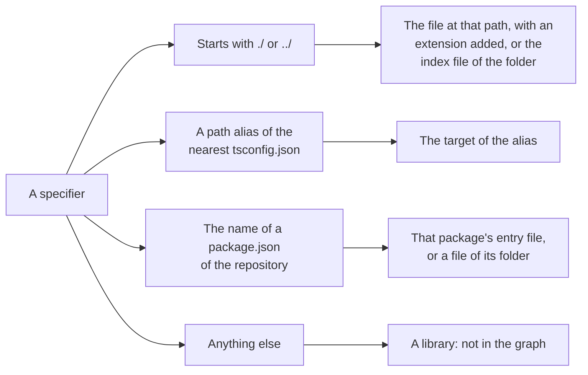

# TypeScript in the codegraph

How the [codegraph](../../codegraph.md) reads a TypeScript file. This page holds what is particular to the language. The mechanisms themselves are in [Import graph](../import-graph.md) and [AST graph](../ast-graph.md).

| | |
|---|---|
| **Files** | `.ts`, `.mts`, `.cts` |
| **Grammar** | tree-sitter `typescript` |
| **Reader of the import graph** | The script reader, shared with [JavaScript and JSX](jsx.md) and [Vue](vue.md) |
| **Class of the AST graph** | `TypescriptASTGraphFile` |
| **Journey Flow Diagram** | Calls, entry points and traced lines |

## Import graph

### What counts as an import

| Written as | An import |
|---|---|
| `import { taxOf } from "./tax"` | Yes |
| `import type { Rate } from "./rates"` | Yes |
| `export { taxOf } from "./tax"`, `export * from "./tax"` | Yes |
| `import tax = require("./tax")` | Yes |
| `require("./tax")`, with a plain string or a template with no `${}` in it | Yes |
| `` require(`./locales/${name}`) `` | No, the file is not known until the code runs |
| `type Rate = import("./rates").Rate` | Yes, an `import()` in a type is resolved by the compiler |
| `const tax = await import("./tax")` | No, a dynamic `import()` call is not an import |
| `/// <reference path="./globals.d.ts" />` | Yes |

### How a specifier resolves

A specifier is resolved against the file list of the commit, never against a disk. What it resolves to depends on how it is written:



| Specifier | Resolves to | Rule |
|---|---|---|
| `"./tax"` | `src/pricing/tax.ts` | An extension is added |
| `"./tax.js"` | `src/pricing/tax.ts` | An emitted extension stands for its source: `.js` for `.ts` or `.tsx`, `.mjs` for `.mts`, `.cjs` for `.cts`, `.jsx` for `.tsx` |
| `"./pricing"` | `src/pricing/index.ts` | A folder stands for its `index` file |
| `"@/pricing/tax"` | `src/pricing/tax.ts` | A `paths` entry of the nearest `tsconfig.json`, followed through `extends` |
| `"@shop/pricing"` | `packages/pricing/src/index.ts` | The name of a `package.json` of the repository: the entry its manifest names, or the `index` file of the package folder or of its `src` folder |
| `"@shop/pricing/tax"` | `packages/pricing/tax.ts` | A path below the name of a package is a path below its folder |
| `"react"` | Nothing | A library has no file in the repository |

Only an import that resolves to a script file of the repository is in the graph. A file never imports itself.

### The patterns an importer would contain

To find the importers of a file, the reader gives the search these patterns. See [An importer is searched for, then proven](../import-graph.md#an-importer-is-searched-for-then-proven).

| For the file | A candidate contains | Such as |
|---|---|---|
| `src/pricing/tax.ts` | A quoted specifier that ends in the file's name, with or without an extension | `"./tax"`, `'../pricing/tax.js'` |
| `src/pricing/index.ts` | A quoted specifier that ends in the folder's name | `"./pricing"`, `"../pricing/"` |
| `src/pricing/index.ts` | A specifier that is only `.` or `..` | `from "."`, `from ".."` |
| A file of the package `@shop/pricing` | The package's name at the start of a specifier, or its folder's name at the end of one | `"@shop/pricing"`, `"@shop/pricing/tax"` |
| A file that a `paths` alias without a wildcard points at | The alias | `"@pricing"` |

## AST graph

### Encapsulations

| Code | Encapsulation |
|---|---|
| `function priceOf() {}`, `const priceOf = () => {}` at the root | A root function |
| `class Cart {}` at the root | A root class, with a nested encapsulation per method |
| `const MAX_RETRIES = 5` at the root | A root variable |
| `enum Status {}`, `namespace Shop {}` at the root | A root encapsulation |
| `export default …` | A root encapsulation, known to importers as `default` |
| A function, a class or a method inside another encapsulation | A nested encapsulation |
| A variable, a field or a member of a declared object that holds a function or a class | A nested encapsulation |
| `type Cart = …`, `interface Cart {}` | Not an encapsulation |
| `declare function priceOf(): number`, an overload signature | Not an encapsulation |
| A member of an object handed to a call, such as `create({ onSave() {} })` | Not an encapsulation |

```ts
export const cartStore = {
  items: [] as Item[],                  // not an encapsulation: it holds no function
  addItem(item: Item) {                 // a nested encapsulation: it holds a function
    this.items.push(item)
  },
}
```

### Names

- **Two spaces.** `const Cart` lives in the value space and `type Cart` in the type space, so one scope can hold both and a use finds the right one. A class, an enum, a namespace and an import live in both.
- **Exports.** A declaration is known by its own name and by every alias it is exported under. See [A name is followed through exports](../ast-graph.md#a-name-is-followed-through-exports).
- **Each extraction asks the tree for the node types it reads**, with a tree-sitter query, and does not visit the other nodes.

## Journey Flow Diagram

A TypeScript file is traced by its calls. A function in it is one Code Node. See [Journey Flow Diagram](../../journey-flow-diagram.md) for the rules every language shares.

### What ends a path

| The top of the path | Entry Point Node |
|---|---|
| A route registration, such as `router.post("/users", createUser)` | An API call, named with its method and path |
| A subscription: `on`, `once`, `addListener`, `subscribe` | Reached through an event bus |
| A function handed to `addEventListener` | A user action, named after the event and what listens for it |
| A job, a command or `main` | That job or command |
| The top level of a file | The app starts |
| An export that nothing uses | Not used yet |

```ts
// routes/users.ts
router.post("/users", createUser)

// createUser.ts
const createUser = async (request) => {
  const user = parseUser(request.body)
  await sendWelcome(user)                             // diff
  return save(user)
}
```


### What a file gives the trace

| From the syntax | Used for |
|---|---|
| Callees, arguments and members | Whether a use is a call, a value handed over or a member taken from its holder |
| Functions and kept values | Following a function handed to a call through the result that is kept |
| Statements, nested with their branches | The traced lines of a node |

**A change inside a member is traced through the uses that take that member.** A changed action of a store, or any member without a declaration of its own, is followed only through the uses of its holder that name it, such as `useCartStore((state) => state.addItem)`, and then through what keeps the result. When no use names the member, every use of the holder counts.

## Examples

See [Journey Flow Diagram examples in TypeScript](../../journey-flow-diagram/examples-typescript.md).

## Where it lives in the code

| Part | Where |
|---|---|
| Reading the import specifiers of a file | `src/import-graph/languages/typescript-specifiers.ts` |
| Resolving a specifier | `src/import-graph/languages/typescript-resolve.ts` |
| The patterns of an importer | `src/import-graph/languages/typescript-importer-patterns.ts` |
| The class of the AST graph | `src/ast-graph/languages/typescript/index.ts` |
| One module per extraction | `encapsulations.ts`, `declarations.ts`, `imports.ts`, `references.ts`, `exports.ts`, `syntax-sites.ts` and `statements.ts` in the same folder |
