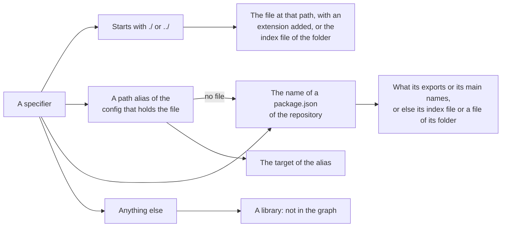
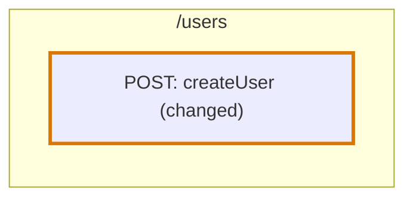

# TypeScript in the codegraph

How the [codegraph](../../codegraph.md) reads a TypeScript file. This page holds what is particular to the language. The mechanisms themselves are in [Import graph](../import-graph.md) and [AST graph](../ast-graph.md).

| | |
|---|---|
| **Files** | `.ts`, `.mts`, `.cts` |
| **Grammar** | tree-sitter `typescript` |
| **Reader of the import graph** | The script reader, shared with [JavaScript and JSX](jsx.md) and [Vue](vue.md) |
| **Reader of the AST graph** | `readTypescriptSyntax` |
| **Trace Diagram** | A node per function, class, constant and statement at the top level of a file, joined by calls |

## Import graph

### What counts as an import

| Written as | An import |
|---|---|
| `import { taxOf } from "./tax"` | Yes |
| `import type { Rate } from "./rates"` | Yes |
| `export { taxOf } from "./tax"`, `export * from "./tax"` | Yes |
| `import tax = require("./tax")` | Yes |
| `require("./tax")`, with a plain string or a template with no `${}` in it | Yes |
| `` require(`./locales/${name}`) `` | No, the file is not known until the code runs |
| `type Rate = import("./rates").Rate` | Yes, an `import()` in a type is resolved by the compiler |
| `const tax = await import("./tax")` | No, a dynamic `import()` call is not an import |
| `/// <reference path="./globals.d.ts" />` | Yes |
| `declare module "./tax" { … }` in a file that imports or exports | Yes, it augments that module. In a file that does neither, no: it declares a module of that name. |
| `/** @typedef {import("./rates").Rate} Rate */`, `/** @import { Rate } from "./rates" */` in a JavaScript file | Yes, the compiler reads the types of JSDoc in JavaScript. In a TypeScript file, no. |

### How a specifier resolves

A specifier is resolved against the file list of the commit, never against a disk, in the order the compiler follows:



**The config that holds a file** is the nearest `tsconfig.json` above it, or the `jsconfig.json` of that folder when there is no `tsconfig.json`. When that config holds no file, as the `tsconfig.json` of a Vite project does with `"files": []`, the config is the one its `references` name whose `files` or `include` hold the file, followed through the references they name in turn. `files`, `include` and `exclude` are inherited through `extends`, and with neither `files` nor `include` a config holds every file of its folder.

| Config | Written | Holds |
|---|---|---|
| `apps/web/tsconfig.json` | `{ "files": [], "references": [{ "path": "./tsconfig.node.json" }, { "path": "./tsconfig.app.json" }] }` | No file |
| `apps/web/tsconfig.app.json` | `{ "include": ["src/**/*.ts", "src/**/*.vue"], "compilerOptions": { "paths": { "@/*": ["./src/*"] } } }` | `src/main.ts` and `src/App.vue`, so their `@/…` use its paths |

**A package of the repository is read as if it were installed.** Its name leads into the folder of its `package.json`, which the compiler would reach through `node_modules`: the subpaths its `exports` names, with the conditions `source`, `types`, `import`, `require` and `default`, or its `main` when it has no `exports`. When nothing is found that way, as when `exports` names build output the repository does not hold, the name stands for the `index` file of the package folder or of its `src` folder, and a path below the name for a path below the folder. A `paths` entry always comes first, so `@shop/ui/Button` follows `"@shop/ui/*": ["./packages/ui/src/components/*"]` even when `packages/ui/package.json` is named `@shop/ui`.

| Specifier | Resolves to | Rule |
|---|---|---|
| `"./tax"` | `src/pricing/tax.ts` | An extension is added |
| `"./tax.js"` | `src/pricing/tax.ts` | An emitted extension stands for its source: `.js` for `.ts` or `.tsx`, `.mjs` for `.mts`, `.cjs` for `.cts`, `.jsx` for `.tsx` |
| `"./pricing"` | `src/pricing/index.ts` | A folder stands for its `index` file |
| `"@/pricing/tax"` | `src/pricing/tax.ts` | A `paths` entry of the config that holds the file, followed through `extends` |
| `"@shop/pricing"` | `packages/pricing/src/index.ts` | The name of a `package.json` of the repository: the entry its `exports` or its `main` names, or the `index` file of the package folder or of its `src` folder |
| `"@shop/pricing/tax"` | `packages/pricing/src/tax.ts` | A subpath the `exports` of the package names, as `"./tax": "./src/tax.ts"` or `"./*": "./src/*.ts"` |
| `"@shop/pricing/lib/tax"` | `packages/pricing/lib/tax.ts` | Without `exports`, or with none that leads to a file, a path below the name of a package is a path below its folder |
| `"react"` | Nothing | A library has no file in the repository |

Only an import that resolves to a script file of the repository is in the graph. A file never imports itself.

### The patterns an importer would contain

To find the importers of a file, the reader gives the search these patterns. See [An importer is searched for, then proven](../import-graph.md#an-importer-is-searched-for-then-proven).

| For the file | A candidate contains | Such as |
|---|---|---|
| `src/pricing/tax.ts` | A quoted specifier that ends in the file's name, with or without an extension | `"./tax"`, `'../pricing/tax.js'` |
| `src/pricing/index.ts` | A quoted specifier that ends in the folder's name | `"./pricing"`, `"../pricing/"` |
| `src/pricing/index.ts` | A specifier that is only `.` or `..` | `from "."`, `from ".."` |
| A file of the package `@shop/pricing` | The package's name at the start of a specifier, or its folder's name at the end of one | `"@shop/pricing"`, `"@shop/pricing/tax"` |
| A file that a `paths` alias without a wildcard points at | The alias | `"@pricing"` |

## AST graph

### Encapsulations

| Code | Encapsulation |
|---|---|
| `function priceOf() {}`, `const priceOf = () => {}` at the root | A root function |
| `class Cart {}` at the root | A root class, with a nested encapsulation per method |
| `const MAX_RETRIES = 5` at the root | A root variable |
| `enum Status {}`, `namespace Shop {}` at the root | A root encapsulation |
| `export default …` | A root encapsulation, known to importers as `default` |
| A function, a class or a method inside another encapsulation | A nested encapsulation |
| A variable, a field or a member of a declared object that holds a function or a class | A nested encapsulation |
| `type Cart = …`, `interface Cart {}` | Not an encapsulation |
| `declare function priceOf(): number`, an overload signature | Not an encapsulation |
| A member of an object handed to a call, such as `create({ onSave() {} })` | Not an encapsulation |

```ts
export const cartStore = {
  items: [] as Item[],                  // not an encapsulation: it holds no function
  addItem(item: Item) {                 // a nested encapsulation: it holds a function
    this.items.push(item)
  },
}
```

### Names

- **Two spaces.** `const Cart` lives in the value space and `type Cart` in the type space, so one scope can hold both and a use finds the right one. A class, an enum, a namespace and an import live in both.
- **Exports.** A declaration is known by its own name and by every alias it is exported under. See [Where a name is defined](../ast-graph.md#where-a-name-is-defined).
- **Each extraction asks the tree for the node types it reads**, with a tree-sitter query, and does not visit the other nodes.

## Trace Diagram

A TypeScript file is traced by its calls. A function at the top level of a file is one node of the type `function`, a class with a method one node of the type `class` that holds a node for each of its methods, and a constant that is not [plain](../../trace-diagram.md#plain-code) one node of the type `root-variable`. Each is one node, whatever is written inside it: an effect, a callback handed to one and a subscription inside a function or a constant are part of that node: the calls inside them are rows of a [function card](../../trace-diagram/function-card.md#rows), and in a constant they are rows of their own. Only a call the [catalogue](../catalogue.md#a-call-that-is-a-node-of-its-own) says is a node of its own is one, such as a procedure of a tRPC router, the cards inside a Redux slice as the [state card](../../trace-diagram/libraries/redux.md) says, and a function a function returns, drawn inside it as the [function card](../../trace-diagram/function-card.md#returning-a-function) says. Any other function inside a function, and a condition or a loop of a function, are part of their node: its function card lists the calls inside them, each with a line to the node of the block of another root block it runs. See [Trace Diagram](../../trace-diagram.md) for the rules every language shares.

**What a decorator writes is inside what it decorates.** The call `@UseGuards(AuthGuard)` and the object of `@Module({ controllers: […] })` are blocks of the class they decorate, and a decorator of a method is a block of the method, though the decorators stand before the declaration in the file.

A path starts at the top of a chain, and the top is a block of a node like any other:

| The top of the path | The node it is in |
|---|---|
| A route registration, such as `router.post("/users", createUser)` | The [route card](../../trace-diagram/route-card.md) of its path, with `createUser` as the handler inside it |
| A decorated method of a controller, such as `@Get(":id")` of NestJS | The route card of its path, with the method inside it, as [NestJS](../../trace-diagram/libraries/nestjs.md) says |
| A subscription: `on`, `once`, `addListener`, `subscribe` | The node of the root block that holds it, with the `code-event` as a trigger label. In a component the subscription is a `code-event` node of its own too. |
| A statement at the top level of a file | Its own `root-statement` node |
| A function nothing calls | The `function` node of that function |

```ts
// routes/users.ts
router.post("/users", createUser)

// createUser.ts
const createUser = async (request) => {
  const user = parseUser(request.body)
  await sendWelcome(user)                             // diff
  return save(user)
}
```



**A change inside a member is traced through the uses that take that member.** A changed action of a store, or any member without a declaration of its own, is followed only through the uses of its holder that name it, such as `useCartStore((state) => state.addItem)`, and then through what keeps the result. When no use names the member, every use of the holder counts.

## Where it lives in the code

| Part | Where |
|---|---|
| Reading the import specifiers of a file | `src/import-graph/languages/typescript-specifiers.ts` |
| Resolving a specifier | `src/import-graph/languages/typescript-resolve.ts` |
| The patterns of an importer | `src/import-graph/languages/typescript-importer-patterns.ts` |
| The class of the AST graph | `src/ast-graph/languages/typescript/index.ts` |
| One module per extraction | `encapsulations.ts`, `declarations.ts`, `imports.ts`, `references.ts`, `exports.ts`, `syntax-sites.ts` and `statements.ts` in the same folder |
