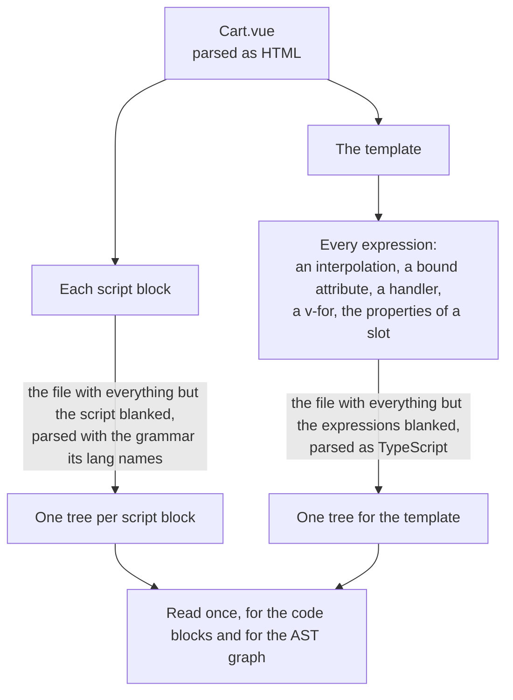

# Vue in the codegraph

How the [codegraph](../../codegraph.md) reads a Vue single-file component. This page holds what is particular to the language. The mechanisms themselves are in [Import graph](../import-graph.md) and [AST graph](../ast-graph.md).

| | |
|---|---|
| **Files** | `.vue` |
| **Grammar** | tree-sitter `html` for the file, then `typescript` or `tsx` for each script block and each template expression |
| **Reader of the import graph** | The script reader, shared with [TypeScript](typescript.md) and [JavaScript and JSX](jsx.md) |
| **Reader of the AST graph** | `readVueSyntax` |
| **Trace Diagram** | The same as [JavaScript and JSX](jsx.md#trace-diagram): the component of a file is a `component` node, the components its template renders are inside it, and a listener of the template is a trigger label and a node of its own, like an effect of the setup script |

## A Vue file is three languages

```vue
<script setup lang="ts">
import { priceOf } from "./pricing"
import CartLine from "./CartLine.vue"

const lines = useCartLines()
</script>

<template>
  <CartLine v-for="line in lines" :key="line.id" :price="priceOf(line)" />
</template>
```



A Vue file is parsed once. Each script block and the expressions of the template are parsed as the whole file with everything else blanked, so every line and column a tree gives is a line and column of `Cart.vue`. The code blocks and the AST graph read the same trees. The names a `v-for` or the properties of a slot declare are read from where they are written in that tree, and are seen inside their element only.

| Part | Where |
|---|---|
| Finding the script blocks of a file for the import graph | `src/import-graph/languages/vue-script.ts` |
| The reader of the AST graph | `src/ast-graph/languages/vue/index.ts` |
| Parsing a file once: its script blocks and the expressions of its template | `parsed.ts`, `blanked.ts` |
| Finding the script blocks and the template | `sfc.ts` in the same folder |
| Reading a script block | `script.ts` |
| The expressions of the template, written where they stand | `expressions.ts` |
| The names the expressions declare and use | `template.ts` |
| A place inside a node of the template | `snippet.ts` |
| The tags and the attributes of the template: a listener, a bound attribute, a directive | `markup.ts` |
| The syntax sites of a file: attributes, elements, markup, and the sites of the script and of each expression | `syntax-sites.ts` |
| The statements of a file, and the returns of the template | `statements.ts` |
| The blocks and the uses of a file | `src/code-blocks/languages/vue/index.ts` |
| The script blocks, the component and its name | `sfc.ts` in the same folder |
| The elements of the template as blocks | `template-blocks.ts` |
| The uses the expressions of the template make | `template-uses.ts` |
| The props and the events of a component | `component-arguments.ts` |
| The methods, the computed values, the data, the props and the events of a script without setup | `options.ts` |
