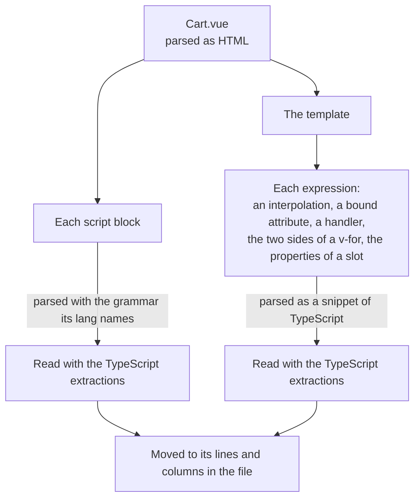
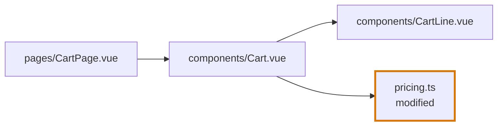
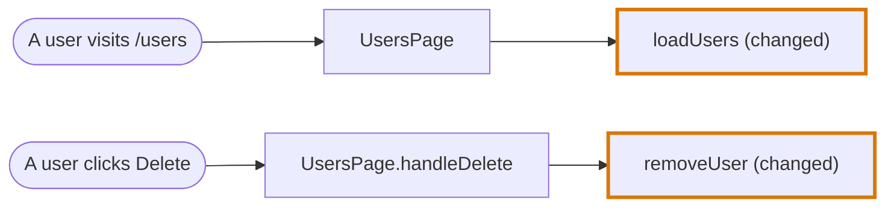
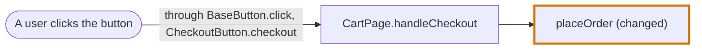

# Vue in the codegraph

How the [codegraph](../../codegraph.md) reads a Vue single-file component. This page holds what is particular to the language. The mechanisms themselves are in [Import graph](../import-graph.md) and [AST graph](../ast-graph.md).

| | |
|---|---|
| **Files** | `.vue` |
| **Grammar** | tree-sitter `html` for the file, then `typescript` or `tsx` for each script block and each template expression |
| **Reader of the import graph** | The script reader, shared with [TypeScript](typescript.md) and [JavaScript and JSX](jsx.md) |
| **Class of the AST graph** | `VueASTGraphFile` |
| **Journey Flow Diagram** | The same as [JavaScript and JSX](jsx.md): calls, entry points and traced lines, with handlers, components, provided values and routes |

## A Vue file is three languages

```vue
<script setup lang="ts">
import { priceOf } from "./pricing"
import CartLine from "./CartLine.vue"

const lines = useCartLines()
</script>

<template>
  <CartLine v-for="line in lines" :key="line.id" :price="priceOf(line)" />
</template>
```



What a script block or a snippet finds is moved to its lines and columns in the whole file, so a use inside a template expression points at the right place in `Cart.vue`.

## Import graph

A Vue file is read by the script reader, so everything in [TypeScript: Import graph](typescript.md#import-graph) holds: what counts as an import, how a specifier resolves, and the patterns an importer would contain.

What a Vue file adds:

| Rule | Example |
|---|---|
| The imports of every script block are the imports of the file | The imports of `<script>` and of `<script setup>` together |
| A script block is parsed as TypeScript when its `lang` is `ts`, and with the `tsx` grammar otherwise | `<script setup lang="ts">` |
| The `src` of a script block is an import | `<script src="./cart.ts">` imports `./cart.ts` |
| An importer names the file with its extension | `import Cart from "./Cart.vue"` |

Because the reader is shared, a Vue file and the script files it imports are in one cluster:



## AST graph

### A Vue component is the default export

| Part of the file | In the AST graph |
|---|---|
| A `<script setup>` block | A root encapsulation named `default` |
| The template | A root encapsulation named `default` |
| A file that does not export a default | Declares the variable `default` |

So a default import of the file by another file, such as `import Cart from "./Cart.vue"`, leads to the script and to the template.

An object handed to `defineComponent` is the one case where the members of an object handed to a call are encapsulations.

### What the template can see

| Declared in | Seen by the template |
|---|---|
| The top level of a `<script setup>` block | Yes |
| The top level of a `<script>` block without `setup` | No |
| A `v-for` variable, a slot property | Inside its element only |

```vue
<template>
  <li v-for="line in lines">           <!-- line is declared here, lines is a use -->
    {{ priceOf(line) }}                <!-- a use of priceOf, and of the line above -->
  </li>
  <p>{{ line }}</p>                    <!-- not a use of that line: it is outside the element -->
</template>
```

### What is a use in a template

| In the template | A use of |
|---|---|
| `<CartLine />`, a capitalised tag | `CartLine` |
| `<cart-line />`, a tag with dashes | `CartLine` |
| `<Form.Field />`, a member tag | `Form` |
| `v-focus` | `vFocus` |
| `{{ priceOf(line) }}`, `:price="priceOf(line)"`, `@click="remove(line)"` | The names in the expression |
| `<div>`, `<li>`, a built-in tag | Nothing |

## Journey Flow Diagram

**A Vue component is traced like a JSX component.** Every rule of [JavaScript and JSX: Journey Flow Diagram](jsx.md#journey-flow-diagram) holds for a Vue file: a component has a render node and a node for each handler, a handler that is handed over belongs to the component that hands it over, a function handed to a composable is followed through its result, a provided value is followed to the components that inject it, a page takes its route, and a component lists its events, its data and its returns. Only the syntax that says these things differs.

In the diagrams of this page a rounded node is an Entry Point Node and a thick border marks a changed node.

### What says it in Vue

| What the trace reads | In JSX | In Vue |
|---|---|---|
| A handler on an element | `onClick={save}` | `@click="save"`, `v-on:click="save"` |
| A handler written in place | `onClick={() => remove(id)}` | `@click="remove(id)"` |
| A callback handed to a component | `<SaveButton onSave={save} />` | `<SaveButton @save="save" />`, or a function prop `:on-save="save"` |
| Where a component runs what it was handed | `props.onSave()` | `emit("save")` with `defineEmits`, `$emit("save")` in the template, or `props.onSave()` |
| A component rendered by another | `<CartLine />` | `<CartLine />`, `<cart-line />` |
| A render under a condition or in a loop | `cond && <A />`, `items.map(...)` | `v-if`, `v-else-if`, `v-else`, `v-show`, `v-for` |
| The render body | The body of the component function | The top level of `<script setup>`, or `setup()`, and the template |
| A function declared in the component | A function inside the component function | A function at the top level of `<script setup>`, or a member of `methods` |
| A hook | `useOrders()` | A composable, `useOrders()` |
| A value handed to the components below | `<SaveContext.Provider value={save}>` | `provide(saveKey, save)` |
| A component that reads it | `useContext(SaveContext)` | `inject(saveKey)` |
| A page named by a route | `element` or `component` beside a `path`, a `<Route>`, a file route | `component` beside a `path` in a route record, a file route |
| A listener | `addEventListener` in the component | `addEventListener` in the component, such as in `onMounted` |
| The returns of a component | Its `return` statements | The branches of a `v-if`, `v-else-if`, `v-else` chain at the root of the template |

### A component has a render node and a node for each handler

A Vue component is one Code Node for what it renders, named after its file: `Cart.vue` is `Cart`. A page visit leads to it, and the components its template renders hang from it. Its category is `ui`.

A user action leads to a Code Node for the handler the event runs, of the category `event`:

- **What it covers.** The handler attribute on the element, such as `@click="…"`, and every function declared in the component that runs at it.
- **Its name.** The component and the handler: `CartLine.handleRemove`. An expression written in place takes the name of the event: `OrderStatusFilter.click`. Two buttons of one component are two nodes.
- **Its edges.** What the handler calls leaves from the handler node. What the top level of the script and the template call leaves from the component.
- **Whether it is changed.** It is changed when a changed line is inside it. The component is changed only when a changed line is outside its handlers.

```vue
<!-- UsersPage.vue -->
<script setup lang="ts">
const users = loadUsers()                 // runs when the page renders

const handleDelete = (id: string) => {
  removeUser(id)                          // runs when the button is clicked
}
</script>

<template>
  <button @click="handleDelete(users[0].id)">Delete</button>
</template>
```

With both `loadUsers` and `removeUser` changed:



### An emitted event belongs to the component that listens for it

An emitted event is to Vue what a callback prop is to JSX. When the element's handler emits, the handler node is the function of the component that listens for the event. The edge from the entry point lists the element's own handler and the events between. A component that only emits an event on is folded, like a component that only passes a prop on.



### The entry points Vue adds

| The top of the path | Entry Point Node |
|---|---|
| A page or route component that nothing renders | A user visits the page |
| A component that is the `component` of a route record, or a file route | A user visits that route |
| A handler on a built-in element, such as `@click` or `@submit` | A user action |
| An event listened for on a component the trace cannot open, such as a button of a component library | A user action. The trace ends on that event |
| A provided value no component injects | Reached through a context |

### Rendering logic and returns

- **A component rendered under `v-if` or in a `v-for` is a node like any other.** The directive is in the traced lines of the component that renders it.
- **A branch that renders only built-in elements is traced lines, not a node.**
- **A template whose root is a `v-if` chain lists its branches as its returns**, in source order, each with the fields of [a return](jsx.md#the-returns-of-a-component). Its `statement` is the directive: `v-if="isPending"`, `v-else`. A template with one root that has no such chain has no returns.

```vue
<template>
  <p v-if="isPending">Loading your orders…</p>                <!-- a return -->
  <p v-else-if="isError">Your orders could not be loaded.</p>  <!-- a return -->
  <section v-else>                                             <!-- a return -->
    <OrderStatusFilter />
  </section>
</template>
```

In the traced lines of a Vue node an element of the template is a unit like a statement, and the statements of the script are stepped through as in TypeScript. See [Traced lines](../../journey-flow-diagram.md#traced-lines).

### Events and data of a component

A Vue component lists its `events` and its `data` as [a JSX component does](jsx.md#events-and-data-of-a-component), with the same fields and the same `changeType`.

| List | What it holds | Named |
|---|---|---|
| `events` | Every handler the template gives an element or a component, and every event the component listens to with `addEventListener` | `<element>.<event>`, such as `button.click` or `CheckoutButton.checkout`; `<target>.<event>`, such as `window.keydown` |
| `data` | Every variable the template reads that is defined outside the template | The variable, such as `items` or `status` |

`data` leaves out a `v-for` variable and a slot property, the names of the components rendered, the functions the template calls by name and everything inside a handler. A value the template reads has no Code Node, under the rules of [A value read in the markup is data, not a node](jsx.md#a-value-read-in-the-markup-is-data-not-a-node).

```vue
<script setup lang="ts">
const props = defineProps<{ items: Item[] }>()
const total = totalOf(props.items)
const handleRemove = (id: string) => removeItem(id)
</script>

<template>
  <section>
    <p>{{ formatPrice(total) }}</p>
    <button v-for="item in items" :key="item.id" @click="handleRemove(item.id)">Remove</button>
  </section>
</template>
```

| List | Entries | Left out |
|---|---|---|
| `events` | `button.click` | |
| `data` | `total`, `items` | `formatPrice`, a function the template calls. `item`, declared by the `v-for`. `handleRemove`, inside a handler. |

### The UI card

On the page a Vue component is drawn in a [UI card](jsx.md#the-ui-card) like a JSX component: a frame per component, a return frame per branch of a root `v-if` chain, a data line and a trigger row per user action.

## Examples

See [Journey Flow Diagram examples in Vue](../../journey-flow-diagram/examples-vue.md).

## Where it lives in the code

| Part | Where |
|---|---|
| Finding the script blocks of a file for the import graph | `src/import-graph/languages/vue-script.ts` |
| The class of the AST graph | `src/ast-graph/languages/vue/index.ts` |
| Finding the script blocks and the template | `sfc.ts` in the same folder |
| Reading a script block | `script.ts` |
| Reading the expressions of the template | `template.ts` |
| Moving what a snippet found to its place in the file | `snippet.ts` |
