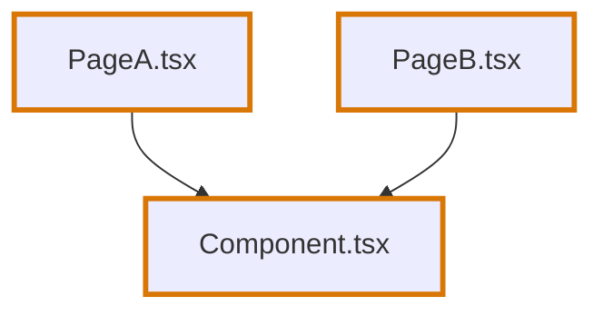
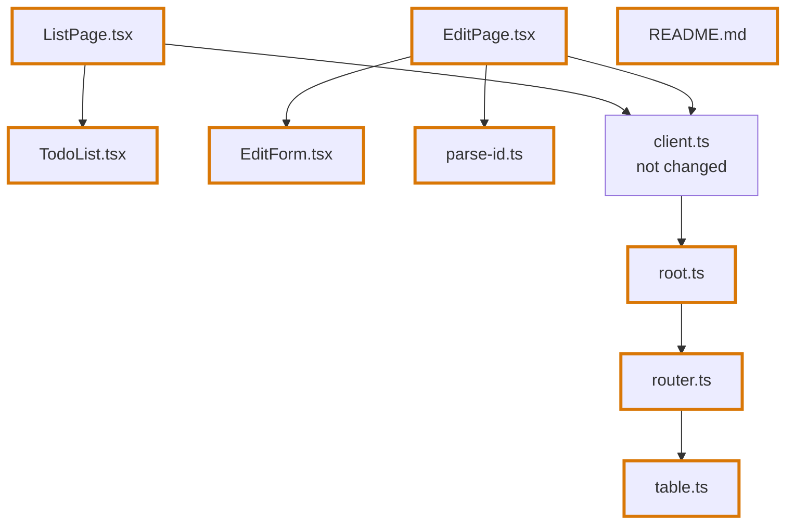
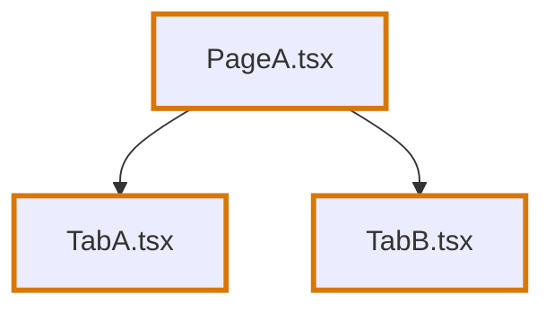
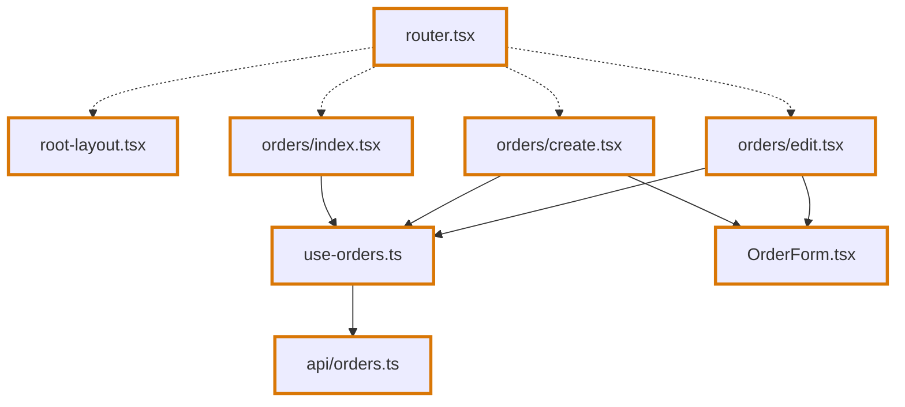
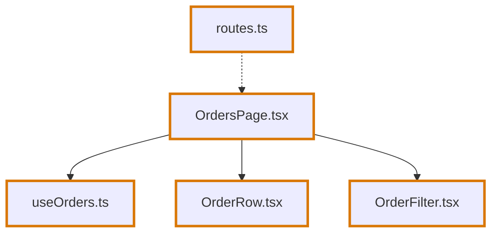
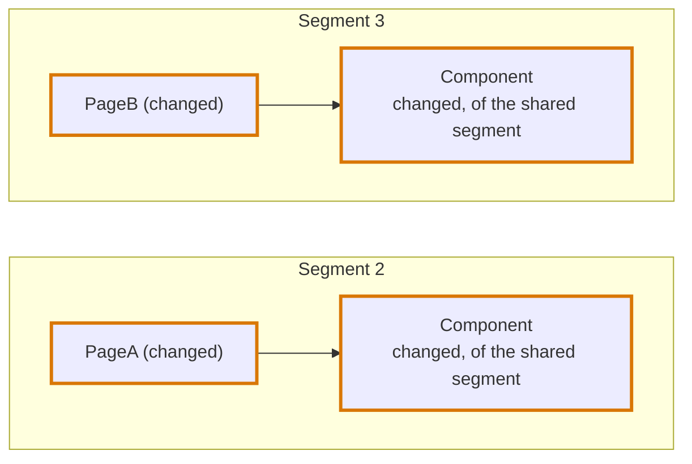
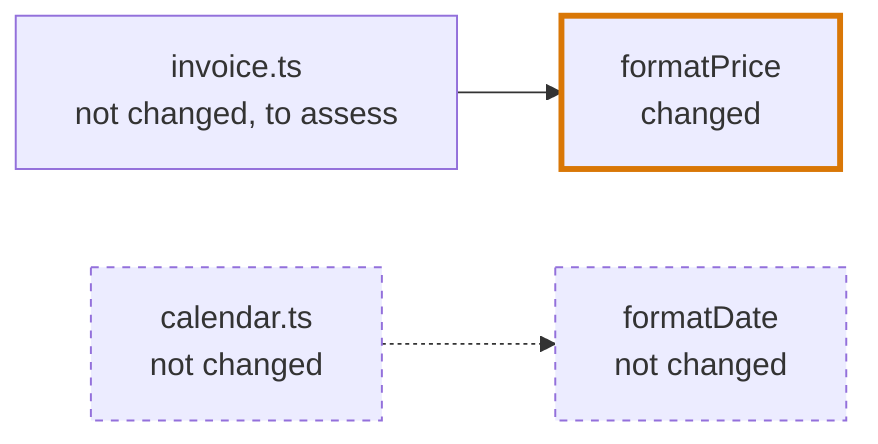

# Segments

## Definition

A segment is one part of a review. A change is split into segments so that each can be read on its own.

There are two kinds:

| Segment | What it holds | Trace Diagram | Blast Diagram | Code Walkthrough |
|---|---|---|---|---|
| **Entry segment** | One line of change: a changed file and the changed files only it leads to, such as a page with its parts | Yes | Only when something outside the change uses it | Its own files |
| **Shared segment** | The changed files that several lines of change have in common: routes, shared components, hooks, functions, types, and the changed files no language reads | Yes, of the shared files alone | Always | The shared files |

A shared file is reviewed once, in the shared segment. An entry segment draws it in its Trace Diagram, and leaves it out of its Blast Diagram and its Code Walkthrough. The Trace Diagram of the shared segment draws the shared files and no line of change of an entry segment, so no line is drawn twice.

A change has at most one shared segment. A file is in exactly one segment.

**A shared segment is only there beside a line of change.** When every changed file of a group passes a test below and no file is left for an entry segment, such as a lone function two pages use, those files are one entry segment, with a Trace Diagram. A file no language reads is a segment of its own when the change has no shared segment.

Every file of every segment is in the same [AST code group graph](code-blocks.md#the-group), shared or not, because a trace has to pass through shared code to be traced.

## Which segment a file belongs to

The test is made per file, over the whole file, whichever of its lines changed. One file uses another when it imports it and uses a name from it. A use either runs what it names, as a call, a render and a read of a value do, or hands it over: it names a function, a hook, a component or a class without running it, as a route table names its pages. Writing the element of a component where no component, hook or function runs it, as `element: <OrdersPage />` in a route table, hands the component over too: the router renders it later. An element in the markup of a component runs it.

| Test | A changed file is shared when | Such as |
|---|---|---|
| **Used from several places** | Two or more files use it | A component two pages render, a hook two components call, a type two files name |
| **Where the change is handed out** | It hands over two or more lines of change that it does not run | A route table that names two changed pages |
| **Around the lines** | It is the layout of a route whose child routes hold other pages: a route element beside `children` | `RootLayout` in `{ path: "/", element: <RootLayout />, children: [...] }` |
| **Where lines of change meet** | Two or more lines of change lead to it, through any files | A router two changed pages call through one unchanged client |
| **Nothing reads it** | No language reads it, and the change has a shared segment | A `README.md`, a migration |

A changed file that passes no test is on a line of change. A line starts at a changed file that no other file on a line leads to, and holds every changed file that only it leads to. Each line is an entry segment, so a page is one segment with the parts it runs, however many.

Four details of the tests:

- **A line runs through files that are not part of it**, unchanged or shared. A page that calls an unchanged client, which reads a changed router, leads to that router.
- **A file that runs what it names keeps it.** A page that renders two changed tabs is one line with both. Only a file that hands two lines over, without running either, is where the change is handed out, and no line runs through what it hands over.
- **A file that hands one line over is on that line.** A route table that names one changed page is in the segment of that page.
- **A file that was not changed is in no segment and joins nothing.** Two changed pages that both render an unchanged `Button` are two segments.

A test or a story is never read. A changed one is one `file` block classified `test`, drawn in the shared segment as any file no language reads is, and a test is never a user of a file. A function that one page and its test use is used from one place. See [Test files](classifications.md#test-files).

## Examples

A thick border marks a changed file. An arrow runs from a file to a file it uses, and a dotted arrow to a file it hands over.

### A component two pages use



| Segment | Files | Why |
|---|---|---|
| 1, shared | `Component.tsx` | Two files use it |
| 2 | `PageA.tsx` | A line of its own |
| 3 | `PageB.tsx` | A line of its own |

The same holds when the shared file is a function, a hook or a type.

### Two pages that call one router



| Segment | Files | Why |
|---|---|---|
| 1, shared | `root.ts`, `table.ts` | Two files use each: `root.ts` is also read by a second unchanged client, `table.ts` by the database module |
| 1, shared | `router.ts` | One file uses it, and both pages lead to it |
| 1, shared | `README.md` | No language reads it |
| 2 | `EditPage.tsx`, `EditForm.tsx`, `parse-id.ts` | One line: the page and the two parts it runs |
| 3 | `ListPage.tsx`, `TodoList.tsx` | One line |

Each page has a trace of its own, and both draw the router and the table as shared.

### A page that renders two tabs



| Segment | Files | Why |
|---|---|---|
| 1 | `PageA.tsx`, `TabA.tsx`, `TabB.tsx` | One line: the page renders both tabs |

### Routes, pages and their components


| Segment | Files | Why |
|---|---|---|
| 1, shared | `routes.ts` | It hands over two lines: `pageA`, and `componentB` through the unchanged `pageB` |
| 1, shared | `componentC.tsx`, `types.ts` | Two files use each |
| 2 | `pageA.tsx`, `componentA.tsx` | One line |
| 3 | `componentB.tsx` | A line of its own. `pageB.tsx` was not changed, so it is in no segment. |

`routes.ts` only added `pageA`, and it is shared all the same: the test looks at the whole file.

### Three pages under one layout



| Segment | Files | Why |
|---|---|---|
| 1, shared | `router.tsx` | It hands over three lines: each `element: <Page />` is handed over, not run |
| 1, shared | `root-layout.tsx` | It is the layout of the route whose `children` hold the pages |
| 1, shared | `use-orders.ts`, `OrderForm.tsx` | Two or more files use each |
| 1, shared | `api/orders.ts` | Three lines lead to it, through `use-orders.ts` |
| 2 | `orders/create.tsx` | A line of its own |
| 3 | `orders/edit.tsx` | A line of its own |
| 4 | `orders/index.tsx` | A line of its own |

The trace of each page starts at the router, which shows the route of that page only.

### A new page with its parts



| Segment | Files |
|---|---|
| 1 | `routes.ts`, `OrdersPage.tsx`, `useOrders.ts`, `OrderRow.tsx`, `OrderFilter.tsx` |

The route table hands one line over, so it is on that line, and the page runs its three parts. A new page is one segment and one trace.

## What a trace draws

An entry segment has the Trace Diagram of its own line of change, and of no other. The diagram draws the shared changes the line passes through, above it or below it, as changed nodes that say they are shared: `isShared` on the node, and `Shared · Modified` or `Shared · Added` on the page. They are reviewed in the shared segment, so they are not in the Code Walkthrough of the entry segment. The shared segment has a Trace Diagram of its own: the paths that lead to a shared change without passing through a changed file of an entry segment. It stops at the shared files, and never goes on into a line of change.

| Example | Segment | Its trace |
|---|---|---|
| A component two pages use | 1, shared | `Component` |
| | 2 | `PageA → Component` |
| | 3 | `PageB → Component` |
| Two pages that call one router | 1, shared | `client → root → router → table` |
| | 2 | `EditPage → EditForm`, `EditPage → parse-id`, and `EditPage → client → root → router → table` |
| | 3 | `ListPage → TodoList`, and `ListPage → client → root → router → table` |
| A page that renders two tabs | 1 | `PageA → TabA`, and `PageA → TabB` |
| Routes, pages and their components | 1, shared | `routes`, and `pageB → componentC`, through the unchanged `pageB` |
| | 2 | `pageA → componentA`, and `pageA → componentC` |
| | 3 | `pageB → componentB`, and `pageB → componentC` |



**A shared file that hands over other lines is drawn with this line's part of it only.** A route table above a page draws the route of that page, and none of the routes of the pages of other segments: a root block outside the segment that holds a block leading only to the change of another line keeps only the blocks the line passes through.

**A trace draws every changed block its chains pass through, shared or not.** A file that runs a line is drawn above it. A route table that only names its pages, as `[pageA, pageB]`, is not: handing a component over is no step of a [chain](chains.md#what-a-chain-steps-through), so the trace of a page starts at the page, and the route table is drawn in the trace of the shared segment. A route table the [catalogue](catalogue.md) reads, such as `createBrowserRouter`, is drawn above the page: its route elements are slots that run their page, so they are steps of the chain.

A type is in no trace. It is never traced, since nothing that runs is different.

## When a segment has a Blast Diagram

A Blast Diagram is there to answer one question: did the author forget something? It is drawn only where the answer could be yes, which is where code the author did not touch depends on code the author changed.

| The segment | Has a Blast Diagram |
|---|---|
| The only segment of the review | Always |
| The shared segment | Always. What several places use is where a change is most likely to reach code the author did not look at. |
| An entry segment, in a review with several | Only when a block of a file the diff did not touch uses one of the segment's changed blocks, directly or through other blocks, without passing through a file of the shared segment |

A page usually has none: nothing uses it but the code that was changed with it. A function, a hook or a component that unchanged code uses has one.

An entry segment that draws none still keeps the Blast Diagram it would have had, as `hiddenBlastDiagram`: its changed files, and under `importBound` the files they use. Segments shown in their own sections never draw it. With [segments off](../review-artifact.md#segments-off) the review is one segment, so its Blast Diagram joins it with the others, and covers every file of the change.

**Using is tested per block, not per file.** A file that imports a changed file and uses only what did not change in it is not in the diagram.

```ts
// format.ts
export const formatPrice = (cents) => { … }      // changed
export const formatDate = (date) => { … }        // not changed

// invoice.ts, not changed
import { formatPrice } from "./format"           // uses a changed block: in the diagram

// calendar.ts, not changed
import { formatDate } from "./format"            // uses nothing that changed: not in the diagram
```



**A changed file of another entry segment that uses the change is drawn too**, as a file of the change, so that an untouched file that reaches the change through it stays joined to it.

**A file of the shared segment is never in the Blast Diagram of an entry segment**, and neither is a file that uses the change only through it. The search for users stops at a shared file: what lies beyond it is in the Blast Diagram of the shared segment. A page that only `routes.ts` uses has no Blast Diagram when `routes.ts` is shared, even though the untouched `main.tsx` uses `routes.ts`.

**A deleted file is with the first segment of its cluster.** It has no blocks, so no test places it. Its Blast Diagram holds the deleted file and the files that imported it.

**Finding a user does not mean it is affected.** A file that uses a changed block is drawn, and the agent says whether the change breaks it, changes what it does or leaves it as it was. See [Blast Diagram](../blast-diagram.md#what-a-reached-file-says).

With the example "Routes, pages and their components":

| Segment | Blast Diagram | Why |
|---|---|---|
| 1, shared | Yes | It is the shared segment |
| 2, `pageA.tsx` and `componentA.tsx` | No | `componentA` is used by `pageA`, and `pageA` by `routes.ts`. Both users were changed. |
| 3, `componentB.tsx` | Yes | `pageB.tsx` uses it and was not changed |
