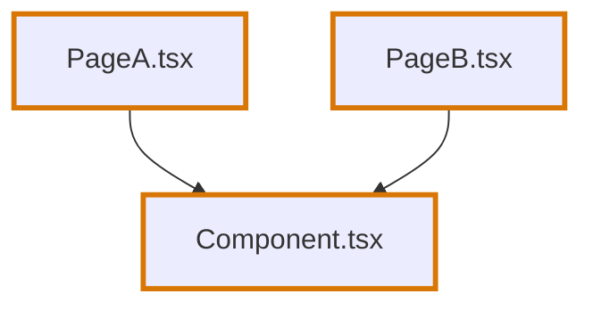
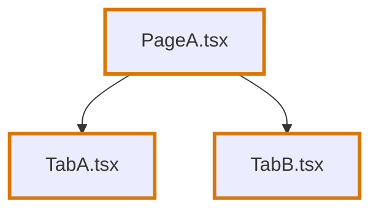
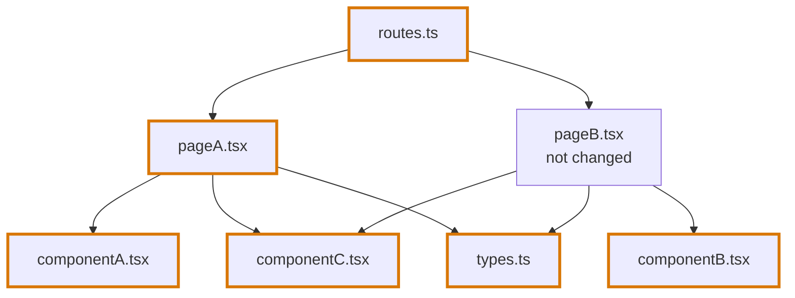
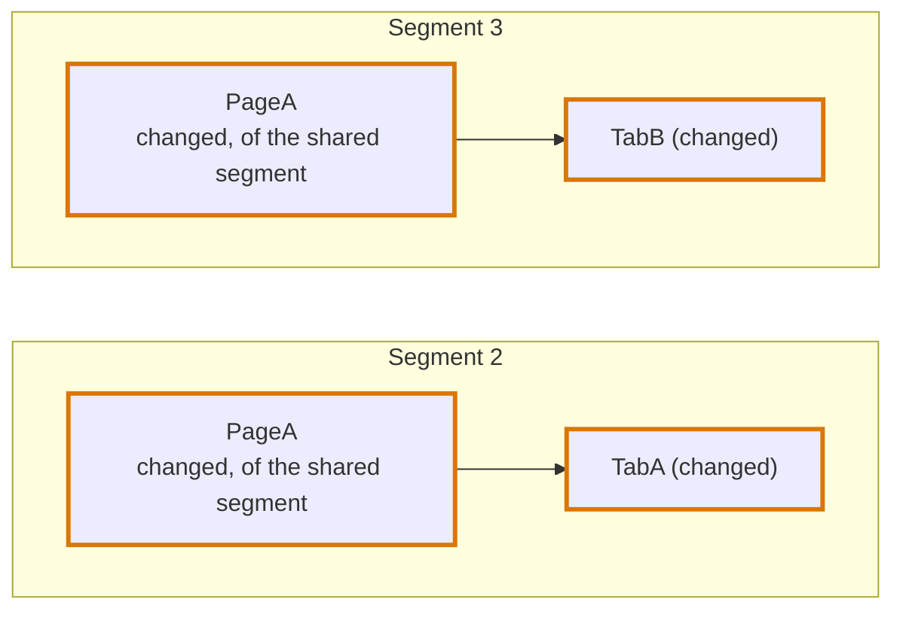
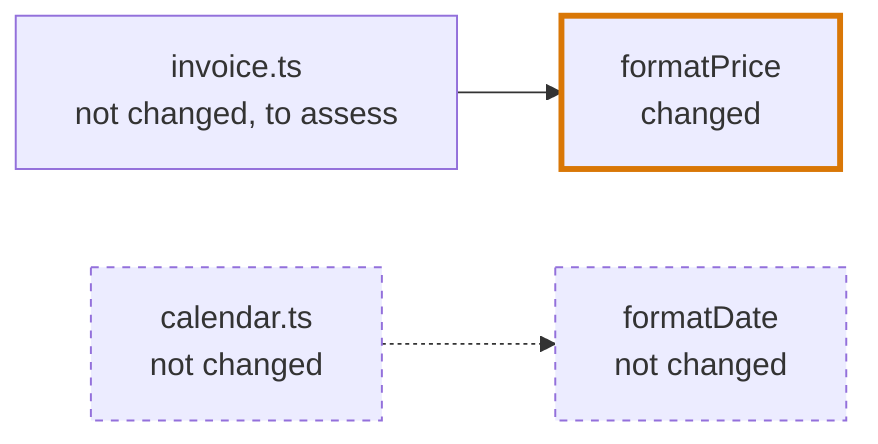

# Segments

## Definition

A segment is one part of a review. A change is split into segments so that each can be read on its own.

There are two kinds:

| Segment | What it holds | Journey Flow Diagram | Blast Diagram | Code Walkthrough |
|---|---|---|---|---|
| **Entry segment** | One line of change: changed files that lead from one to the next | Yes | Only when something outside the change uses it | Its own files |
| **Shared segment** | The changed files that several lines of change have in common: routes, shared components, hooks, functions, types | None | Always | The shared files |

A change has at most one shared segment. A file is in exactly one segment.

**A shared segment is only there beside a line of change.** When every changed file of a group passes a test below and no file is left for an entry segment, such as a lone function two pages use, those files are one entry segment, with a Journey Flow Diagram.

Every file of every segment is in the same [AST code group graph](code-blocks.md#the-group), shared or not, because a journey has to pass through shared code to be traced.

## Which segment a file belongs to

The test is made per file, over the whole file, whichever of its lines changed. One file uses another when it imports it and uses a name from it. Rendering a component, calling a function, handing a value over and naming a type are all uses: the rule does not tell them apart.

| Test | A changed file is shared when | Such as |
|---|---|---|
| **Used from several places** | Two or more files use it | A component two pages render, a hook two components call, a type two files name |
| **Where the change branches** | It leads to two or more separate lines of change below it | A route table that leads to two changed pages, a page that renders two changed tabs |

A changed file that passes neither test joins the one line of change it is on, and that line is an entry segment.

Three details of the tests:

- **A shared file is not a line of change.** A page that uses one changed component of its own and one shared component leads to one line of change, not two.
- **A line of change runs through files that are not part of it**, unchanged or shared. A route table that uses an unchanged page, which uses a changed component, leads to that component.
- **A file that was not changed is in no segment and joins nothing.** Two changed pages that both render an unchanged `Button` are two segments.

Test files and story files are ignored. They are in no segment, they are never a user of a file, and nothing of them is in a review artifact. A function that one page and its test use is used from one place. See [Files that are ignored](code-blocks.md#files-that-are-ignored).

## Examples

A thick border marks a changed file. An arrow runs from a file to a file it uses.

### A component two pages use



| Segment | Files | Why |
|---|---|---|
| 1, shared | `Component.tsx` | Two files use it |
| 2 | `PageA.tsx` | A line of its own |
| 3 | `PageB.tsx` | A line of its own |

The same holds when the shared file is a function, a hook or a type.

### A page that renders two tabs



| Segment | Files | Why |
|---|---|---|
| 1, shared | `PageA.tsx` | It leads to two separate lines of change |
| 2 | `TabA.tsx` | A line of its own |
| 3 | `TabB.tsx` | A line of its own |

### Routes, pages and their components



| Segment | Files | Why |
|---|---|---|
| 1, shared | `routes.ts` | It leads to two lines: `pageA` with `componentA`, and `componentB` through the unchanged `pageB` |
| 1, shared | `componentC.tsx`, `types.ts` | Two files use each |
| 2 | `pageA.tsx`, `componentA.tsx` | One line. `componentC` and `types` are shared, so `pageA` leads to `componentA` only. |
| 3 | `componentB.tsx` | A line of its own. `pageB.tsx` was not changed, so it is in no segment. |

`routes.ts` only added `pageA`, and it is shared all the same: the test looks at the whole file.

### A new page with its parts

The rule does not know a tab from any other part of a page, so a page with several changed parts of its own is where the change branches.


| Segment | Files |
|---|---|
| 1, shared | `OrdersPage.tsx`, and `routes.ts`, which leads to the same three lines through it |
| 2 | `useOrders.ts` |
| 3 | `OrderRow.tsx` |
| 4 | `OrderFilter.tsx` |

Each of the three journeys starts at `routes` and `OrdersPage`, drawn as shared: `routes → OrdersPage → useOrders`, and the same for the other two.

## What a journey draws

An entry segment has the Journey Flow Diagram of its own line of change, and of no other. The diagram draws the shared changes the line passes through, above it or below it, as changed nodes that say they are shared: `isShared` on the node, and `Shared · Modified` or `Shared · Added` on the page. They are reviewed in the shared segment, so they are not in the Code Walkthrough of the entry segment. A path that leads only to a shared change is in no diagram: the shared segment has none.

| Example | Segment | Its journey |
|---|---|---|
| A component two pages use | 2 | `PageA → Component` |
| | 3 | `PageB → Component` |
| A page that renders two tabs | 2 | `PageA → TabA` |
| | 3 | `PageA → TabB` |
| Routes, pages and their components | 2 | `routes → pageA → componentA`, and `pageA → componentC` |
| | 3 | `routes → pageB → componentB`, and `pageB → componentC` |



**A journey leaves no file out because of what kind of file it is.** `routes.ts` is drawn in the journeys it leads to, although it is shared. Nothing in the code says for certain whether a file is a route table or a component that renders several components, so there is no rule that tries to tell them apart and omit one: a journey draws every changed block it passes through.

A type is in no journey. It is never traced, since nothing that runs is different.

## When a segment has a Blast Diagram

A Blast Diagram is there to answer one question: did the author forget something? It is drawn only where the answer could be yes, which is where code the author did not touch depends on code the author changed.

| The segment | Has a Blast Diagram |
|---|---|
| The only segment of the review | Always |
| The shared segment | Always. What several places use is where a change is most likely to reach code the author did not look at. |
| An entry segment, in a review with several | Only when a block of a file the diff did not touch uses one of the segment's changed blocks, directly or through other blocks |

A page usually has none: nothing uses it but the code that was changed with it. A function, a hook or a component that unchanged code uses has one.

**Using is tested per block, not per file.** A file that imports a changed file and uses only what did not change in it is not in the diagram.

```ts
// format.ts
export const formatPrice = (cents) => { … }      // changed
export const formatDate = (date) => { … }        // not changed

// invoice.ts, not changed
import { formatPrice } from "./format"           // uses a changed block: in the diagram

// calendar.ts, not changed
import { formatDate } from "./format"            // uses nothing that changed: not in the diagram
```



**A changed file of another segment that uses the change is drawn too**, as a file of the change, so that an untouched file that reaches the change through it stays joined to it.

**A deleted file is with the first segment of its cluster.** It has no blocks, so no test places it. Its Blast Diagram holds the deleted file and the files that imported it.

**Finding a user does not mean it is affected.** A file that uses a changed block is drawn, and the agent says whether the change breaks it, changes what it does or leaves it as it was. See [Blast Diagram](../blast-diagram.md#what-a-reached-file-says).

With the example "Routes, pages and their components":

| Segment | Blast Diagram | Why |
|---|---|---|
| 1, shared | Yes | It is the shared segment |
| 2, `pageA.tsx` and `componentA.tsx` | No | `componentA` is used by `pageA`, and `pageA` by `routes.ts`. Both users were changed. |
| 3, `componentB.tsx` | Yes | `pageB.tsx` uses it and was not changed |
