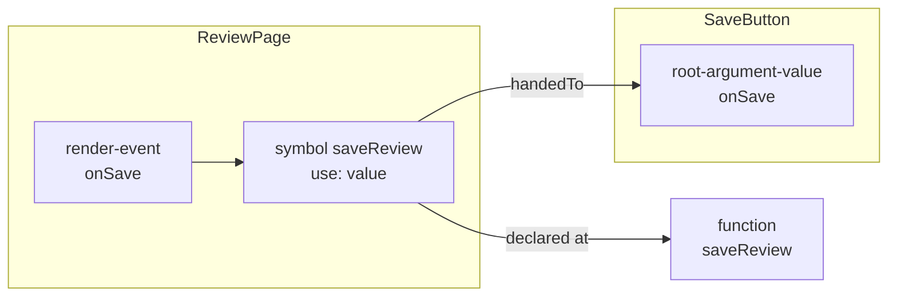
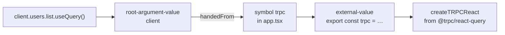

# Symbols

How a [code block](code-blocks.md) refers to what it uses.

## Outer symbols

An outer symbol is a name a block uses that leads somewhere a chain or a value can be followed to, with where that name comes from. That is a name declared outside the block, and also a name that is itself a block, wherever it is declared: an argument of the function, a function declared in it, a declaration that keeps a value from outside. Only a plain local that is not a block is left out.

A symbol belongs to the innermost block around the use.

```ts
import { removeUser } from "./users"

const MAX = 3

const handleDelete = (id) => {
  const label = "user"                // a variable block
  const attempts = MAX                // an external-value block. MAX is an outer symbol of it.
  removeUser(id, attempts, label)     // removeUser, id, attempts and label are outer symbols.
}
```

| Name | An outer symbol of | Why |
|---|---|---|
| `MAX` | The `external-value` block `attempts` | It is declared outside that block |
| `removeUser` | `handleDelete` | It is declared outside the function |
| `id` | `handleDelete` | It is a `root-argument-value` block. What a parent hands to it is followed through this symbol. |
| `attempts` | `handleDelete` | It is an `external-value` block. Where its value comes from is followed through this symbol. |
| `label` | `handleDelete` | It is a `variable` block. A change to it affects the blocks that read it. |

```ts
type SymbolUse = "call" | "render" | "value" | "read" | "type"

interface SymbolMember {
  path: string[]
  block: CodeBlock | null // alias not a shallow or clone
}

type CodeBlockSymbol = {
  usedAt: SourceRange
  use: SymbolUse
  handedTo?: CodeBlock | null // alias not a shallow or clone
  member?: SymbolMember
  binding?: string
} & (
  | { type: "internal-variable"; lineOfCodeReference: SourceRange }
  | { type: "internal-code-block"; codeBlockReference: CodeBlock }
  | { type: "external-variable"; lineOfCodeReference: SourceRange; astGraph: ASTGraph }
  | { type: "external-block"; codeBlockReference: CodeBlock }
  | { type: "unopened-import"; specifier: string; importedName: string; isLibrary: boolean }
)
```

| Type | The name comes from |
|---|---|
| `internal-variable` | A name of the same file that is no block, such as one a `declare` statement says exists |
| `internal-code-block` | Another code block of the same file |
| `external-variable` | A variable of another file, with the AST graph of that file |
| `external-block` | A code block of another file. Its file is the `astGraph` of that block. |
| `unopened-import` | An import the group cannot open: a library, or a file of the repository outside the cluster |

## Where and how a name is used

A symbol is one use of a name, not one name. A name a block uses twice is two symbols. Each says where the use is and what kind of use it is:

| Field | What it holds |
|---|---|
| `usedAt` | The range of the use inside the block |
| `use` | What the block does with the name |

| `use` | The block | Example |
|---|---|---|
| `call` | Runs it | `save()` |
| `render` | Renders it as an element, inside markup a function returns | `<SaveButton />` in a `render-root` |
| `value` | Hands it over without running it | `onSave={save}`, `{ mutationFn: save }` |
| `read` | Takes a member from it without running it | `query.data`, `props.label` |
| `type` | Names it as a type. Nothing runs, so the Trace Diagram does not follow it, but it is an edge of the Blast Diagram. A name inside a call in a Python annotation is no type: the call runs. | `user: User` in a signature |

```tsx
const Page = () => {
  save()                                        // a symbol of the use "call"
  return <SaveButton onSave={save} />           // a symbol of the use "value"
}
```

**A call inside a Python annotation is read as code, not as a type.** In `user: Annotated[User, Depends(current_user)]`, `Annotated` and `User` are `type`, `Depends` is a `call` and `current_user` a `value` handed to it. A call of the metadata of `Annotated` that is written with no argument is handed the annotated type as its first argument: `Annotated[Pagination, Depends()]` hands `Pagination` to `Depends`, as `Depends(Pagination)` would.

An element counts as rendered only inside a `render-root`. An element anywhere else, in an object, an array or an argument, is a `value`: building the element does not run the component. So `{ path: "/orders", element: <OrdersPage /> }` in a route table hands `OrdersPage` over, and `OrdersPage` is a component nothing renders.

The two uses of `save` are two symbols of `Page`. The first means `Page` runs `save` while it renders. The second means it does not: `SaveButton` runs it later.

## What a handed-over value is handed to

A symbol of the use `value` says which block receives it, as `handedTo`. A symbol of the use `read` that is handed on, such as `onSave={props.onSave}`, says it too. The binding is made once, when the group is built.

```tsx
// review-page.tsx
const ReviewPage = () => <SaveButton onSave={saveReview} />

// save-button.tsx
function SaveButton({ onSave }) {
  return <button onClick={onSave}>Save</button>
}
```



| The value is handed to | `handedTo` |
|---|---|
| A component of the repository | The `root-argument-value` block of that prop, whether the component takes its argument apart or reads `props.onSave` |
| A component or a function of a library | `null`. Nothing in the repository receives it. |
| An effect | No `handedTo` is needed: the symbol is inside the `effect-callback` block of its key, and the name of that block says what it was handed as |

The name a value is handed under is never kept on the symbol. It is the name of the block that holds the symbol: the `render-event` block `onSave`, or the `effect-callback` block `mutationFn`.

## Which member is taken

A symbol that reaches a member of a name says which member, as `member`. The path is always there, since it is written in the code: one name for `props.onSave`, several for `trpc.users.list.useQuery`. The block is there when the member is a block of the repository.

`use` and `member` are independent. `use` says what the block does with what it reaches, and `member` says which part of the name it reaches. A member that is called has the use `call`, a member that is rendered has the use `render`, and a member that is only taken has the use `read`.

| Code | `use` | `member.path` |
|---|---|---|
| `props.onSave()` | `call` | `["onSave"]` |
| `<props.Icon />` | `render` | `["Icon"]` |
| `query.data`, `onClick={props.onSave}` | `read` | `["data"]`, `["onSave"]` |

| Code | `member.path` | `member.block` |
|---|---|---|
| `state.addItem` in `useCartStore((state) => state.addItem)` | `["addItem"]` | The `function` block of that action, when the store is in the repository. The symbol names `useCartStore`: the argument of a callback handed to a call is taken to be what that call's name holds. Assumed. |
| `cart.addItem` after `const cart = useCartStore()`, where the store is written as a function that declares `addItem` and returns it | `["addItem"]` | The `function` block of that name declared inside the store. A value a call of a variable hands back is taken to hold what that variable declares. Assumed. |
| `api.remove()`, with `const api = { remove() { … } }` | `["remove"]` | The `function` block `remove` |
| `cart.tax()` after `cart = Cart()`, and `self.tax()` in a method of a Python class that declares no `tax` | `["tax"]` | The `method` block of that name of the class, or of the nearest class it names as a base that declares it: `extends Taxed` in TypeScript, `class Cart(Taxed)` in Python |
| `this.tax()` and `this.rate` in a method of a TypeScript class, and `super.tax()` | none when the class declares `tax`: the symbol names that `method` block itself. `["tax"]` when it does not, or through `super`: the symbol names the class it extends. | The `method` block `tax` of the class it extends, when that class declares it. A `this` inside a function with a receiver of its own is no use. |
| `api.users.remove()`, with `const api = { users: { remove() { … } }, orders: { remove() { … } } }` | `["users", "remove"]` | The `function` block `remove` written under `users` |
| `remove` from `const { orders: { remove } } = api` | `["orders", "remove"]` | The `function` block `remove` written under `orders` |
| `actions.reset()`, with `const actions = { reset: clearCart }` or `{ reset }` | `["reset"]` | The block the key names: `clearCart`, or the function `reset` |
| `mailer.send()`, with `const mailer = new Mailer()` | `["send"]` | The `method` block `Mailer.send` |
| `this.users.findAll()`, with `constructor(private readonly users: UsersService)`, or a property `users: UsersService` | `["findAll"]`: the symbol names the parameter or the property | The `method` block `findAll` of the class the member is typed as, or of the nearest class it names as a base that declares it. A parameter of the constructor marked `private`, `protected`, `public` or `readonly` is a member of the class, as a property is. |
| `props.onSave` | `["onSave"]` | The `root-argument-value` block `onSave` |
| `query.data` | `["data"]` | `null` |
| `trpc.users.list.useQuery()` | `["users", "list", "useQuery"]` | `null` |

**A member is looked up by its whole path.** A function written in an object has the keys it is written under, `users.remove`, and a name written as the value of a key, or in short as `{ reset }`, has that key. The member is the block whose keys are the start of the path, the longest that fits. A name taken apart more than one level deep carries every key it was taken through. What an object spreads from another, `{ ...defaults }`, is looked up in that other value with the same path.

## Which name of a declaration is imported

**A symbol that reaches a declaration of several names through an import keeps the name it imports, as `binding`.** `export const { useGetTodosQuery, useAddTodoMutation } = todosApi` is one block, named after its first name. A file that imports `useAddTodoMutation` reaches that block, and its symbol says `binding: "useAddTodoMutation"`, so what it calls is named after the name it imports. A symbol that reaches a declaration of one name, or the first name of several, has no `binding`.

## Where a value comes from

The origin of a value is found by following it back, one step at a time, until it reaches something that makes a value: a call, a function, a library.

| The value is | Followed back to |
|---|---|
| A variable that is declared | What the declaration gives it |
| A name taken apart from another, or a member kept under a name | The same member of what it was taken from. A use of `toggleTheme` from `const { toggleTheme } = useTheme()` is a symbol of that declaration with the `member.path` `["toggleTheme"]`. |
| A `root-argument-value` block | Every symbol in its `handedFrom`: what each place that uses the block hands it |
| The result of calling a function of the repository | What that function returns |
| A value an object holds under a key | The name written under that key, or the function written there |
| The result of making an instance of a class of the repository | The methods of that class |
| A value read from a context or injected | Every value provided under the same key. The [catalogue](catalogue.md) says which call provides and which reads. For React, a root variable made by `createContext` is a context, and the values handed to `<Context.Provider>` or `<Context>` are what it provides. |

**A context is read only where its pattern says so.** A value leads to what a context provides when a call the catalogue names as a reader, such as `useContext` or `use` of React and `inject` of Vue, is handed the context at the place the pattern's `reads.keyAt` names. Naming a context anywhere else, as in `describe(ThemeContext)`, leads to the context and no further.

**An element that reads a context hands what it provides to the function written inside it.** `<ThemeContext.Consumer>{(theme) => <button onClick={theme.toggleTheme} />}</ThemeContext.Consumer>` reads the context because the pattern of `Consumer` says `reads`. A member the function takes from its first argument, `theme.toggleTheme`, is a use of the context under the name of the element, with the path `Consumer.toggleTheme`, and it leads to the function provided under `toggleTheme`. An element the catalogue does not name as a reader leads nowhere.

**What a context provides is read from the place its pattern names.** `provides.valueAt` of the pattern says where the value is written: the `value` attribute of `<ThemeContext.Provider>`, or the second argument of `provide(key, value)`. A value named in another attribute of the same element is not provided. A value written in place, `value={{ theme, toggleTheme }}`, provides each name under its key.

```tsx
// utils/trpc.ts
export const trpc = createTRPCReact<AppRouter>()

// app.tsx
const App = () => <UsersPage client={trpc} />

// users-page.tsx
const UsersPage = ({ client }) => {
  const users = client.users.list.useQuery()
}
```



`client` is an argument, so it is followed to what `App` hands it, `trpc`, then to the declaration of `trpc`, then to the call that made it.

```tsx
// theme.tsx
const ThemeContext = createContext(null)

export function ThemeProvider({ children }) {
  const value = useMemo(() => ({ theme, toggleTheme: () => flip() }), [theme])
  return <ThemeContext.Provider value={value}>{children}</ThemeContext.Provider>
}

export function useTheme() {
  return useContext(ThemeContext)
}

// toggle.tsx
const { toggleTheme } = useTheme()
```

`toggleTheme` is followed to the declaration, to the call of `useTheme`, to the context it reads, to the `value` the provider hands it, and to the function `toggleTheme` inside that value. That function is the `member.block` of every use of `toggleTheme`, so `onClick={toggleTheme}` leads straight to it.

A value can have several origins, since a component can be used in several places. Each is followed, and each keeps the place it came through, so there is nothing to settle between them: what a value is depends on the path it arrived by.

| The component is used as | The origin of `client` on that path |
|---|---|
| `<UsersPage client={trpc} />` in `app.tsx` | The call to `createTRPCReact` |
| `<UsersPage client={restClient} />` in `legacy-app.tsx` | The object `restClient` |

A chain that comes through `app.tsx` reads `client.users.list.useQuery()` as a call on a tRPC client. A chain that comes through `legacy-app.tsx` does not. A value already followed is not followed again. The following stops with no origin at an argument of a block that nothing in the repository hands a value to.

## A name the group cannot open

A name imported from a library has no AST graph, and neither has a name imported from a file of the repository that is outside the cluster. Its symbol keeps what the import statement says:

| Import | `specifier` | `importedName` | `isLibrary` |
|---|---|---|---|
| `import { useQuery } from "@tanstack/react-query"` | `@tanstack/react-query` | `useQuery` | `true` |
| `import { useQuery as useQ } from "@tanstack/react-query"` | `@tanstack/react-query` | `useQuery` | `true` |
| `import React from "react"`, then `React.useEffect(…)` | `react` | `default`, with the use `call` and the `member.path` `["useEffect"]` | `true` |
| `import { formatDate } from "../../shared/dates"` | `../../shared/dates` | `formatDate` | `false` |

`importedName` is the name in the file it comes from, not the local one, so an alias still matches the [catalogue](catalogue.md). `isLibrary` is `false` for a file of the repository the cluster does not hold.

A global such as `setTimeout` or `document` is neither declared nor imported, so it is not an outer symbol.

