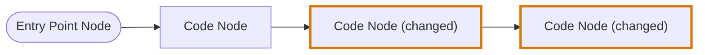
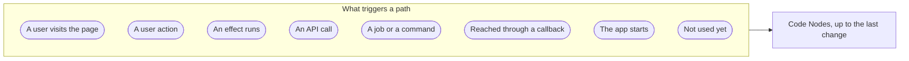
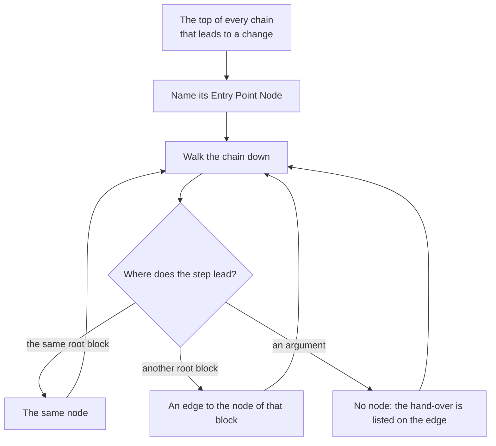
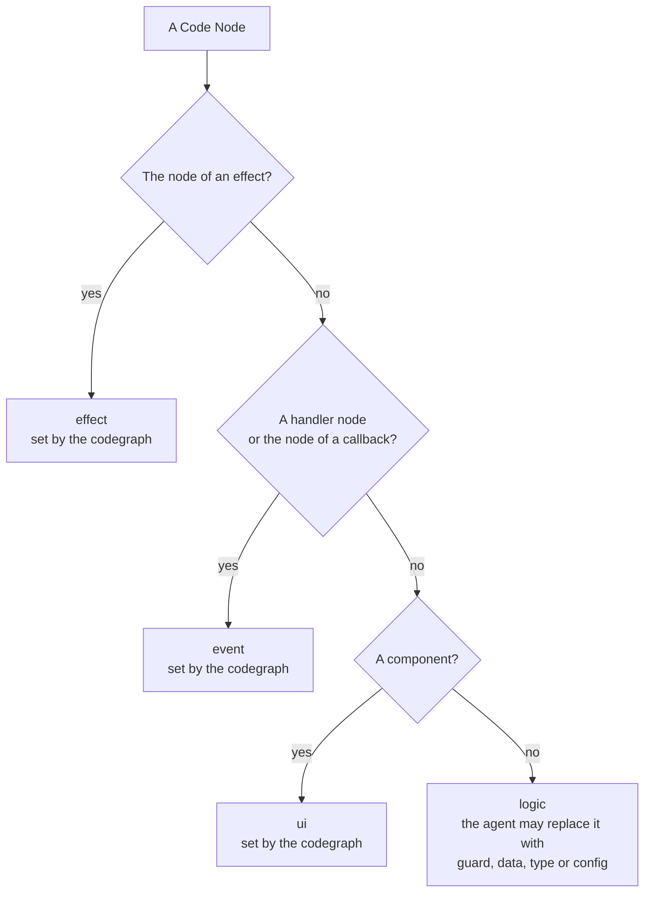

# Journey Flow Diagram

## Definition

The Journey Flow Diagram shows how execution reaches a change. It answers the reviewer's first question about any change: when does this code run, and what leads to it?

The Journey Flow Diagram reads like a debugging trace of the change. It is drawn in the order the code runs, from what triggers it to the changed code:

Every path starts at an Entry Point Node and ends at changed code. The diagram does not continue past the last change on a path; what a change affects afterwards is shown by the [Blast Diagram](blast-diagram.md).

In the diagrams of this entry a rounded node is an Entry Point Node and a thick border marks a changed node.

## How this entry is split

This page holds the rules every language shares. What a language adds, and the examples, have pages of their own:

| Page | What it holds |
|---|---|
| [JavaScript and JSX](codegraph/languages/jsx.md#journey-flow-diagram) | Components and handler nodes, props, hooks, contexts, routes, rendering logic, the returns, the events and the data of a component, and the UI card |
| [TypeScript](codegraph/languages/typescript.md#journey-flow-diagram) | The entry points of code without elements: an API call, an event bus, a command, the start of the app |
| [Vue](codegraph/languages/vue.md#journey-flow-diagram) | The same as JSX, said by a template: `@click`, emitted events, `provide` and `inject`, `v-if` and `v-for` |
| [Python](codegraph/languages/python.md#journey-flow-diagram) | Calls, routes and traced lines |
| [Examples in TypeScript](journey-flow-diagram/examples-typescript.md) | Seven examples of paths through plain functions |
| [Examples in JSX](journey-flow-diagram/examples-jsx.md) | Thirteen examples of paths through components |
| [Examples in Vue](journey-flow-diagram/examples-vue.md) | Six of the JSX examples, written as Vue components |

The diagram is drawn by the [codegraph](codegraph.md), from the [chains](codegraph/chains.md) of one group of [code blocks](codegraph/code-blocks.md) that lead to a change of one [segment](codegraph/segments.md).

## Nodes

| Node | What it stands for |
|---|---|
| **Entry Point Node** | What triggers a path from outside the code. It has no code of its own. Every path has one. |
| **Code Node** | Code on a path. It is never a single line. |

A Code Node is one of three things:

| Code Node | What it stands for | Named |
|---|---|---|
| A block at the root of a file | A top-level function, component, hook, class or module-level value. A change inside a nested block belongs to the node of the root block that holds it. | `OrderStatusFilter` |
| A handler | The code a user action runs in a component. See [JavaScript and JSX](codegraph/languages/jsx.md#a-component-has-a-render-node-and-a-node-for-each-handler) and [Vue](codegraph/languages/vue.md#a-component-has-a-render-node-and-a-node-for-each-handler). | `OrderStatusFilter.onClick`, `CartLine.handleRemove` |
| An effect | An effect of a component that keeps no result: the call and what it runs | `ThemeProvider.useEffect` |
| A callback | A callback of an effect that runs on an event of its library, or a function declared in a component that nothing calls | `ProfileForm.onSuccess`, `UsersPage.exportAll` |
| The top level of a file | The changed bare statements of a file. See "Changes outside any block". | `top level` |

A Code Node has no role such as head or tail. It carries one fact from the diff: it is **changed** or it is not. That fact is stored as `changeType`: `diff` for a changed node, `related` for an unchanged node, which is on the diagram only because it leads to changed code. A traced line keeps a plain `isChanged`. The events and the data listed on a component say more than that about each entry: see [Events and data of a component](codegraph/languages/jsx.md#events-and-data-of-a-component). A change can sit anywhere on a path, and a path can hold several.

## Entry points

The Entry Point Node is named after the top of the [chain](codegraph/chains.md):

| The top of the chain | Entry Point Node | Trigger |
|---|---|---|
| A slot of a route table that names a page, such as `element`, `Component` or `lazy` | A user visits that path | `page-visit` |
| A component that nothing renders | A user visits the page | `page-visit` |
| A handler on a built-in element, such as `onClick` or `onSubmit` | A user action | `user-action` |
| An `on…` prop on a component the group cannot open, such as a button of a component library | A user action. The chain starts on that prop | `user-action` |
| A function handed to `addEventListener` | A user action, named after the event and what listens for it | `user-action` |
| An effect of a component that keeps no result, such as `useEffect` | That effect runs | `effect` |
| A callback of an effect that runs on an event, such as `onSuccess`, or a subscription to an event bus | Reached through that callback, or through an event bus | `boundary` |
| A route, a resolver or a middleware the [catalogue](codegraph/catalogue.md) names, or a root function named after a method, such as `POST` | An API call, named with its method and its path | `api-call` |
| A job or a command the catalogue names, or a root function named `main` | That job or command | `command` |
| A statement at the root of a file | The app starts | `app-start` |
| Anything else, such as a function nothing calls | Not used yet | `unused` |

An Entry Point Node carries where its chain starts: the file, the line and its source, the event, what the user acts on, and the library when the chain starts on a component from outside the repository. The agent reads it to write the label.

**A start that is not changed has no node of its own.** A route table that names a page, a route registration and a statement at the root of a file are where a chain starts. When the diff did not touch them, the entry point leads straight to the first code they run: a visit of `/cart` leads to `CartPage`. When the diff changed them, they are a changed Code Node on the path: a visit of `/orders` leads to the changed `router`, then to `OrdersPage`.

## How the diagram is built

The diagram is built from the chains of one group: the changed files that import each other, with everything they import and everything that imports them. A change in files that share no import with the group is in a group, and a diagram, of its own.

1. **Take every chain that leads to a change.** The group lists the top of each. See [A chain](codegraph/chains.md#a-chain).
2. **Name the trigger.** The top of each chain gets its Entry Point Node from the table above.
3. **Walk each chain down.** A step that stays in the same root block stays in the same node. A step into another root block is an edge to the node of that block. A step through an argument is no node: handing a value over runs nothing.
4. **Give each user action, each effect and each callback its node.** See [JavaScript and JSX](codegraph/languages/jsx.md#a-component-has-a-render-node-and-a-node-for-each-handler).
5. **Merge the paths.** A Code Node appears once, however many paths cross it. Every path is drawn, however many there are.
6. **Keep the paths of the segment.** In a group cut into several [segments](codegraph/segments.md), the diagram of an entry segment keeps the paths that lead to a change of its own files, and the shared changes those paths pass through.
7. **Add the traced lines.** See below.
8. **Set the category, and list the events, the data, the state, the data fetches, the hooks and the effects of each component.** See "Node categories" and [Events and data of a component](codegraph/languages/jsx.md#events-and-data-of-a-component).
9. **Leave out what nothing joins.** An Entry Point Node is drawn only when it leads to a Code Node, and a Code Node only when an edge or a trigger joins it. A component whose only change is in what a user action runs is not drawn: the handler node is.

A chain ends at the last changed block of its path, so a path ends at its last change.

**Nothing is folded.** A function that only wraps a call, such as `(user) => addUser(user)`, is a node on the path like any other. A value handed through a prop is the one thing that is not a node: `<SaveButton onSave={onSave} />` runs nothing, so the props a handler passed through are listed on the edge as its `through`.

## One trace for every language

The chains are traced the same way in every language the code blocks read. A file is traced differently only because of what its blocks are.

| Language | What its blocks add to the chains |
|---|---|
| [TypeScript](codegraph/languages/typescript.md#journey-flow-diagram) | Calls, values handed over, effects and their callbacks, listeners and subscriptions, and what the catalogue names: routes, jobs, data fetches |
| [JavaScript and JSX](codegraph/languages/jsx.md#journey-flow-diagram) | The same, and what an element says: it has events, a component renders other components, a value is handed to a context, a route table names a page |
| [Python](codegraph/languages/python.md#journey-flow-diagram) | Calls, values handed over by position or by keyword, and what the catalogue names: a route a decorator registers, a command |
| [Vue](codegraph/languages/vue.md#journey-flow-diagram) | What JSX adds, said by a template: a listener is an event, a tag renders a component, an emitted event runs the handler of the component that listens for it |

A file without elements has no events, renders, contexts or pages, so a function in it is one node and its entry point is an API call, a command, an event bus, the start of the app or "Not used yet".

## Changes outside any block

A changed line at the top level of a file is in an `import`, a `type-declaration` or a `root-statement` block. What happens to it depends on which:

| The changed line | In the diagram |
|---|---|
| An import | No node. When the imported name matters, its use is changed too, inside a block, and that is traced. |
| A type or an interface | No node. Nothing that runs is different. |
| A bare statement, such as `app.use(rateLimit())`, `initAnalytics()` or a route registration like `router.post("/users", createUser)` | A Code Node for the top level of that file, marked as changed. Its traced lines are the changed statements. |

A module-level value such as `export const MAX_RETRIES = 5` is a `root-variable` block, so it is a Code Node like any other and the chain of every block that reads it leads to it.

## Traced lines

A Code Node carries its traced lines: the lines of that node the path goes through, in order, as a debugger would step through them.

- **For a changed node**, they run up to its changed lines.
- **For a node the diff did not touch**, they run up to where the path leaves it for the next node.
- **For the node of a handler**, they are what the action runs: the element the user acts on, and the handler declared in the component that the element names. Two buttons of one component are two nodes with different traced lines.

An import and a type run nothing, so neither is a traced line.

Traced lines are how the inside of a node is shown without more nodes: a branch, a loop or a `.map` of a component is lines of that component, not a node of its own. An edge carries no lines.

Traced lines are lines of the source, with their line numbers, and the lines the diff touched are marked:

- A statement on the way is listed with every line it spans, so a `return (` shows the whole element it returns.
- A branch or a loop the path does not go into is listed by its first line only, without its body.
- A function declared inside the node is listed by its first line, and its body follows only when the path goes through it.
- An element is a unit like a statement. The traced lines step into the elements above the hand-over, lists the elements rendered before it, and stops at it: the elements after it and the closing tags are left out.
- Nothing that runs after the hand-over, or after the changed lines, is listed.

A Python file gives its statements by its own syntax, and a Vue file gives the statements of its script and the elements of its template, so their nodes have traced lines too.

## Code views

A Code Node, and each return of a component, carries its code views: the code a reviewer reads beside it. A code view names a file, the lines to show and the exact places to mark on them.

| Node | Code views |
|---|---|
| A component | **Data**: where each value its markup reads is declared, with a mark on the name. A value declared in another file has a view of its own. **Event**: each callback attribute and listener, from the line its element starts on to the end of the attribute, with the handler the component declares for it and a mark on the attribute. Several events share one view. **Render**: its `return` statements. |
| A return of a component | The **Data** and the **Event** on its lines, then **Render**: that return. |
| The node of a handler | **Event**: the element, the attribute with a mark on it, and the handler it runs. |
| Any other node | **Declaration**: its whole root block, or the changed statements of the top level of a file. |

A view with nothing in it is left out, so a component that reads no value has no Data view.

**On the page.** Choosing a node opens a side panel with its description, then its code views in the order above. Each view shows its lines as the Code Walkthrough shows them, with the removed lines of the diff, and stands the box of the waypoint that explains those lines above them: its title, its position, its reviewed toggle and, when opened, its reading. Lines between two parts of a view are one row that says how many are hidden. A view of a file the change did not touch is read from the head commit and says so.

**Looking a name up.** In every code view and in the Code Walkthrough, a name whose definition is not on the lines shown is underlined, and hovering it shows the definition: the declaration of a function, a component, a variable, a type or an interface in the file that declares it, followed through re-exports. For `data?.children` only `data` is looked up. A name from a library shows its import statement and is not followed.

## When there is no diagram

A change that touches only types, interfaces or import lines changes nothing that runs, so it has no Journey Flow Diagram.

## Node categories

Each Code Node has a visual category, chosen by one test: would a reviewer scanning the board want this told apart at a glance?

| Category | Code |
|---|---|
| `guard` | A validator, gate, permission check or schema check: code whose job is to refuse |
| `logic` | A function or method that transforms. The default. |
| `data` | A query, repository, migration or cache access |
| `type` | An interface, type alias, schema or enum |
| `ui` | A JSX or a Vue component, and nothing else |
| `event` | The handler node of a user action, and the node of a callback |
| `effect` | The node of an effect of a component, and nothing else |
| `config` | A constant, flag, environment setting or build setting |

The codegraph gives `ui` to every component, which is a root declaration with a capitalised name, or a default export, that holds JSX markup, or a Vue file with a template. It gives `event` to every handler node, such as `OrderStatusFilter.onClick` or `Shortcuts.keydown`, and to the node of a callback, such as `ProfileForm.onSuccess`. It gives `effect` to the node of an effect of a component, such as `ThemeProvider.useEffect`. It gives `logic` to every other node: a function, the top level of a file, and a constant that holds markup such as a route table. `ui`, `event` and `effect` belong to the codegraph: the agent cannot give any of them to a node, and cannot replace one on a node that has it. The agent can replace `logic` with `guard`, `data`, `type` or `config`.

## Edges

An edge joins two nodes in the order the code runs:

- From an **Entry Point Node** to a **Code Node**: the trigger. It is not code. A user action arrives at the node of the handler it runs, never at the component.
- Between two **Code Nodes**: the left one runs the right one, by calling it, rendering it or running a function handed to it. The props a handed function passed through are listed on the edge.

An edge stores its `kind` (`trigger`, `call`, `value`, `data`), its `certainty` (`proven`, `assumed`) and its `through`. The agent reads them. It does not store the condition a component is rendered under.

**On the page every edge is the same line.** There is one line style, a straight arrow from the left node to the right one, and no line carries a label. A line is never curved: it runs level where it can, and a node is placed level with the port or the node it is connected to, so the nodes of a column follow the order of what leads to them. The kind, the certainty and the hand-overs of an edge are not drawn.

On the page the components of a diagram are grouped into UI cards. See [The UI card](codegraph/languages/jsx.md#the-ui-card).

## Who writes what

| Part | Written by |
|---|---|
| Which Code Nodes exist, where they are in the code, how they connect and their traced lines | The codegraph |
| The events, the data, the state, the data fetches, the hooks and the effects of a component, with the `changeType` and the lines of each | The codegraph |
| The code views of a node and of a return, and where each name in them is defined | The codegraph |
| The returns of a component, with the statement, the lines, the `changeType` and the rendered nodes of each | The codegraph |
| Which nodes are changed | The diff |
| The kind of each Entry Point Node | The codegraph, from the top of the path |
| Each node's category | The codegraph: `ui` for a component, `event` for a handler node or the node of a callback, `effect` for the node of an effect, `logic` for any other node. The agent replaces `logic` where it is wrong, and cannot write or replace `ui`, `event` or `effect`. |
| Each node's label and description | The agent. Until the agent writes it, a label is the declaration's own name, marked as a draft. A description tells the journey that reaches the node from its Entry Point, not the change. |
| The label and the description of each return of a component | The agent. Until the agent writes it, a label is the return's statement, marked as a draft. |

The agent cannot add, remove or move a Code Node.
