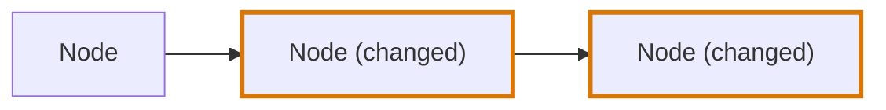
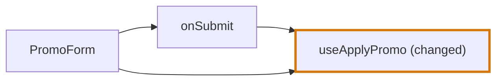
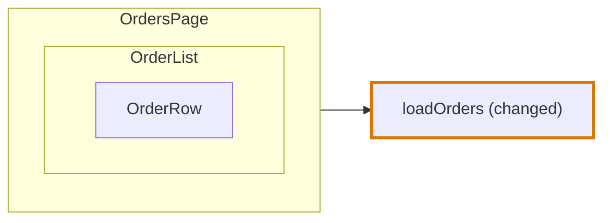

# Journey Flow Diagram

## Definition

The Journey Flow Diagram shows how execution reaches a change. It answers the reviewer's first question about any change: when does this code run, and what leads to it?

The Journey Flow Diagram reads like a debugging trace of the change. It is drawn in the order the code runs, from the code that starts a path to the changed code:



Every path starts at a node nothing leads to and ends at changed code. The diagram does not continue past the last change on a path; what a change affects afterwards is shown by the [Blast Diagram](blast-diagram.md).

In the diagrams of this entry a thick border marks a changed node.

The diagram is drawn by the [codegraph](codegraph.md), from the [chains](codegraph/chains.md) of one group of [code blocks](codegraph/code-blocks.md) that lead to a change of one [segment](codegraph/segments.md).

## The shape

```ts
interface JourneyFlowDiagram {
  astCodeGroup: ASTCodeGroupGraph
  importGraphGroup: ImportGraphGroup
  journeyNodes: JourneyNode[]
  journeyNodeEdges: JourneyNodeEdge[]
}

interface JourneyNode {
  id: string
  type: CodeBlockType
  label: string | null
  description: string | null
  codeBlocks: CodeBlock[]
  diffCodeBlocks: CodeBlock[]
  children: JourneyNode[]
  triggerLabels: TriggerLabel[]
  blockLabels: BlockLabel[]
}

interface TriggerLabel {
  label: string | null
  codeBlock: CodeBlock
}

interface BlockLabel {
  label: string | null
  codeBlock: CodeBlock
}

interface JourneyNodeEdge {
  id: string
  from: string
  to: string
}
```

| Field | What it holds |
|---|---|
| `astCodeGroup` | The [group](codegraph/code-blocks.md#the-group) the diagram is drawn from. An alias, not a copy. |
| `importGraphGroup` | The files of the [import graph](codegraph/import-graph.md) that are in that group. An alias. |
| `journeyNodes` | The nodes at the top level of the diagram. A node inside another is in its `children`, not here. |
| `journeyNodeEdges` | Every edge of the diagram, between nodes at any depth |
| `id` of a node | The id of the block the node stands for, such as `src/pricing.ts#function@3:1`, or `src/pricing.ts#condition@5:3` for a block inside a function |
| `type` | The [type](codegraph/block-types.md) of the block the node stands for |
| `label`, `description` | What the agent writes. `null` until it is written. |
| `codeBlocks` | The blocks of the node: the block it stands for first, then the blocks inside it that a chain passes through or that have a change, in the order they are written, down to the blocks that have a node of their own. Such a block is the last one listed on its way down: what is inside it is in its own node. Each is the same object as in `astCodeGroup`. |
| `diffCodeBlocks` | The blocks of `codeBlocks` that have a change. A node with none is only on the way to a change. |
| `children` | The nodes compressed into this one |
| `triggerLabels` | The blocks of the node an agent writes a line about, each with that line |
| `blockLabels` | The listed blocks of the node, its arguments, state, hooks, effects and steps, each with the label an agent writes about it. `null` until it is written. |
| `from`, `to` of an edge | The ids of two nodes: the first runs the second |

A node has no position and no size. The page places the nodes and the edges when it draws them.

## Nodes

**A node is a unit of behaviour: code that runs on an occasion of its own.** Every chain is walked from its top through `nextBlocks`, and each block on the way, and each block with a change, belongs to the nearest block around it that is a node.

**A root block is a node, but a statement.** The block at the top level of a file that holds a block on a chain is one node. A statement at the top level of a file is none: it has no name to read a node by, and what it runs is a node of its own.

| Code | Node |
|---|---|
| A function, a hook or a class with a block on a chain | One node of the type `function`, `hook` or `class` |
| A component | One node of the type `component` |
| A value at the top level of a file, such as `export const MAX_RETRIES = 5` | One node of the type `root-variable` or `state` |
| A statement at the top level of a file, such as `app.use(rateLimit())` or `"use client"` | No node, and no edge. A block it runs keeps its own node. |
| A changed import, type or interface | No node. Nothing that runs is different. |

**A block inside a root block is a node when something triggers it.** An event, an effect and a callback that have a change, or that hold a block on a chain, are each a node of their own: they run on an occasion of their own, after the markup of their component is returned. Every other block stays in the node around it. A block that runs only to produce the markup is part of the render, and the render is one unit, the way everything a `GET` route runs to answer is that route. A function or a condition is a step of the node it is written in.

| A block inside a root block | A node of its own |
|---|---|
| `render-event`, `code-event`, `effect-callback`, `route`, `resolver`, `middleware` | Yes. It is triggered. |
| `effect`, `component-effect` | Yes. What it is handed runs later. |
| The call that makes a `state` or a `derived`, such as `useCartStore(selectTotal)` in `const total = useCartStore(selectTotal)`, and an `effect-callback` handed to it | No. It is part of the declaration, and runs with the render. An event handed to it, such as an `onChange`, is still a node. |
| An `effect-callback` the [catalogue](codegraph/catalogue.md) says runs `in-place`, such as `select` of `useQuery` | No. It runs with the call, during the render. |
| A `function` written in place of an event or of a callback, such as the arrow function of `onClick={() => save()}` | No. It is the body of that event or callback, so the two are one node. |
| `function`, `method`, and a `condition`, `switch`, `switch-case`, `loop`, `try-catch`, `throw`, `data`, `data-fetch`, `cache`, `auth`, `request`, `navigation`, `publish`, `storage`, `telemetry`, `transaction`, `validation`, `config` or `feature-flag` inside one of them, inside a node above or inside a root block that is no component and no hook | No. It is a [step](#on-the-page) of the node it is in: it is invoked or executed there, and it has a row. |
| The same types, directly in the body of a component or of a hook, or inside the markup, a declaration or a component of that body | No. It runs on the way to the `return`. |
| `variable`, `property`, `root-argument-value`, `external-value`, `state`, `derived` | No. Declaring a value changes no behaviour: the block that updates it does. |
| `component`, `render-root`, `render`, `render-condition`, `render-loop` | No. It is the render. |
| `deleted` | No. It does not run. |

**A block of another root block is always a node.** A step that runs a function, a hook or a value declared at the top level of a file leads to the node of that root block, with a line from the row of the step.

```tsx
export const PromoForm = () => {
  const [code, setCode] = useState("")                 // state: no node
  const { mutate } = useApplyPromo()                   // external-value: no node. useApplyPromo is a node
  const shown = code ? formatCode(code) : null         // a condition in the body: no node
  const submit = () => {                               // function: a step, no node
    if (code) mutate(code)                             // a condition in a function: a step, no node
  }
  return <form onSubmit={submit}>{shown}</form>        // render-event: a node. The markup: no node
}
```



**A node around a node is kept.** A block that is a node has the node of the nearest such block around it, up to its root block, whether or not a chain passes through that one: `useMutation({ onSuccess })` is a node when a chain starts at its `onSuccess`.

**A node has the type of its block.** One list says what a block is and what a node is, so a node of a component is a `component`, a node of a constant a `root-variable`, and a node of a handler a `render-event`.

**Nothing stands for what starts a path from outside the code.** A click, a page visit and a request are not code, so they are not nodes. The top of a chain is a block: the `render-event` a click starts at is a block of its component's node, and a node of its own.

## Edges

An edge joins two nodes in the order the code runs. There is one edge for every pair of nodes, however many steps join them.

| Edge | From | To |
|---|---|---|
| A step of a chain | The node of the block the step leaves | The node the step reaches: the block itself when it is a node, the node around it when it is not |
| A block that is a node inside another | The node around it | The node of the block |

A step that stays inside one node is no edge. The second kind is what joins a node to the units written inside it: a component to its events and its effects, an effect to its callbacks.

**A step through a block of a node around is carried on.** An event often runs a function its component declares, and that function a value the component keeps: `onSubmit` runs `submit`, and `submit` calls `mutate`, which `PromoForm` got from `useApplyPromo`. Those steps do not lead back to `PromoForm`. The edge goes from the node that takes the step to the node it ends in, here from `onSubmit` to `useApplyPromo`, so the path keeps running to the right.

An edge holds its two ends and nothing else. It has no kind and no label, and the page draws every edge as the same line.

## Children

**The components that render each other are one node.** A component on a chain that another component on a chain renders is not at the top level of the diagram: it is in the `children` of the component that renders it, as deep as the rendering goes.



| Rule | Why |
|---|---|
| A component is a child of the first component that reaches it from the top | A component two components render is drawn once |
| The top is a component no other component on a chain renders | It is where the rendering starts |
| Among several tops, the one in a file no other file of the group imports comes first | The import graph says which file is highest |
| The edge between a component and its child stays in `journeyNodeEdges` | The page leaves it out, and an agent still reads it |

Only components are compressed. A function of another root block a component calls, and a block of a component that is a node of its own, is at the top level, with an edge from the component.

## Trigger labels

A trigger label is a block of a node that an agent writes one line about. The blocks are the events and the data fetches among the `codeBlocks` of the node, after the block it stands for:

| Block type | What the line says |
|---|---|
| `render-event` | What the user does, such as "A shopper clicks Remove" |
| `code-event` | What happens that the code listens for |
| `data-fetch` | What is loaded |

The page draws each trigger label as a row inside its node. An event is a node of its own too, so it has a line as a trigger label of the node around it, and a label and a description as a node.

## The diagram of a segment

A group cut into several [segments](codegraph/segments.md) has one diagram per segment. No diagram draws a line of change that belongs to another segment.

| Segment | What its diagram holds |
|---|---|
| The only segment of a group | Every chain of the group |
| An entry segment | The chains that lead to a change in its own files, and below a changed root block of its own, the steps that lead to a change of the shared segment |
| The shared segment | The chains that lead to a change in the shared files and pass through no changed file of an entry segment. A shared file above the lines of change is drawn from its start down to itself, and no further. A shared file below them is drawn alone, with the unchanged code that leads to it: the paths through an entry segment are in the diagram of that segment. |

## When there is no diagram

A change that touches only types, interfaces or import lines changes nothing that runs, so it has no Journey Flow Diagram. Neither has a change that touches only statements at the top level of a file, which are no nodes. Neither has a file no language reads.

## Three forms

The diagram in memory holds references, and two other forms hold ids in their place.

| Form | What it is for | References |
|---|---|---|
| In memory, and in a `.flightplan` file | The review artifact | Aliases. The file is written with [devalue](data-storage.md#the-flightplan-file), which keeps a block two nodes hold as one block. |
| Stored | Snapshots, and comparing two runs | `codeBlockIds`, `diffCodeBlockIds` and `codeBlockId` in place of the blocks, and neither `astCodeGroup` nor `importGraphGroup` |
| Flat | What an agent reads through the MCP tools | The stored form of each node, at any depth, as one entry of a list, with `parentId` in place of `children` |

```ts
interface FlatJourneyNode {
  id: string
  parentId: string | null
  type: CodeBlockType
  label: string | null
  description: string | null
  codeBlockIds: string[]
  diffCodeBlockIds: string[]
  triggerLabels: { label: string | null, codeBlockId: string }[]
  blockLabels: { label: string | null, codeBlockId: string }[]
}
```

An agent reads and writes one node at a time. A node that carried its children would carry more with every level, so the flat form leaves them out, and a node inside another is read and written by its own id.

## On the page

| What is drawn | From |
|---|---|
| A node, headed by the name of its code and the path of its file, with its type and its label below | A `JourneyNode`. The path is cut to its last two folders and its file, such as `routes/orders/index.tsx`. A node with no label has its header and its type alone. |
| A node as added or modified | Its `diffCodeBlocks`. A node whose every line is new is added. |
| A node inside another | Its place in `children` |
| The code of a pressed row | Pressing a row opens the panel of its node with the code focused on the lines of the block of that row: every other line is dimmed, and the first focused line is scrolled into view. Pressing the head of the node shows its code with no line dimmed. |
| A row inside a node | A trigger label, with its label on one line and the name of its code, such as `button.onClick`, on the line below. A trigger label nobody has written yet is a row of one line, with the name of its code alone. |
| A row inside a node, above its trigger labels | A listed block: an argument, a state, a hook, an effect or a step among its `codeBlocks`, with its label on one line and the name of its code on the line below, as a trigger label has. One nobody has written yet is a row of one line, with the name of its code alone. A changed one has the border of the change. |
| A small heading above rows of a node | The kind of the listed blocks below it: Args, State, Hooks, Effects or Steps. A node with listed blocks also has the heading Triggers above its trigger labels. |
| A line between two nodes | An edge whose ends are not inside each other |
| A line that leaves a row, or ends at one | A step of a chain between the blocks of the two nodes of an edge, or a block of the first node that the second node stands for. The line is joined to the row of the block the step leaves, and to the row of the block it reaches. |
| The side panel of a chosen node | Its description, then the code of the block it stands for, with the box of the waypoint that explains those lines above them |

**A node lists what it holds of five kinds.** The lists are read from the `codeBlocks` of the node, so a block is listed only when a chain passes through it or when it has a change. A node with no such block has no list.

| Kind | The blocks of it | Named |
|---|---|---|
| Args | `root-argument-value` | After the argument, and a member read from one after both: `props.onSave` |
| State | `state`, `derived`, and the declaration of one around an effect on a chain, such as `const total = useCartStore(selectTotal)` whose call a chain passes through | After the declaration |
| Hooks | An `external-value` that keeps the result of a call named `use` and a capital letter | After the hook that is called, such as `useApplyPromo` |
| Effects | `effect`, `component-effect`, `effect-callback`, when no declaration of state is around it | After what it calls, such as `useEffect` |
| Steps | A function, a method, a condition, a loop or a call that is invoked or executed after the render, as the table of [Nodes](#nodes) says, and any other block with a change that is not markup | After the block, or after its type and its line: `Condition :8` |

**Every block with a change has a row, but markup.** A changed block of one of the first four kinds is in its list, a changed event or data fetch is a trigger label, and any other changed block is a step. A changed block is listed also inside a listed block.

**Markup has no row.** The node of a component holds its markup as one unit, so a changed `render-root`, `render`, `render-condition` or `render-loop` is not listed: the border of the node says the component changed, and its side panel shows the lines.

**A step has a row and no node.** The row is where the step is written, in the node around it. A step that runs a block of another root block has a line from its row to the node of that block: the row `submit` of `PromoForm` is joined to the node of `useApplyPromo`. A step through a value of the same node is carried on to what the value leads to, so the line leaves the row of the step, not only the row of the value.

**A block that is a node of its own has a row in the node around it.** An event has its trigger label for a row, and an effect its row under Effects. A line runs from the row to its node. A block inside a listed block has the row of that block: a `setTimeout` inside the function `submit` has the row `submit`.

A block inside a listed block is not listed again, unless it has a change: the callbacks of a listed effect, and the call inside a `state` or a `derived`, are left out. A function written in place of an event or a callback is never listed: a change in it marks the row and the node of that event. A [chain does not pass through state](codegraph/chains.md#a-chain-and-state), so a state the chain only writes is not listed. Each listed block is drawn as a row like a trigger label, grouped under the heading of its kind, in the order arguments, state, hooks, effects, steps. Nothing is written about a listed block, and the lists are not in the diagram: the page builds them.

**A line is joined to the row the code steps from.** An edge joins two nodes, and the steps of a chain behind it join blocks of the two. The page draws one line for each pair of rows those steps join. The row of a block is the listed block or the trigger label it is, or the nearest one around it. A block with no row around it is joined at the head of its node, so a call to a function ends at the head of that function, and so does the line from a row to the node of its block. Like the lists, the rows of a line are not in the diagram: the page builds them from the `nextBlocks` of the `codeBlocks` of the two nodes.

The page arranges the diagram itself, to be read from left to right:

| What is arranged | How |
|---|---|
| The column of a node | One column after the last node that leads to it |
| The height of a node | Level with what leads to it: its head is at the height of the row, or of the head, the line to it leaves. A node several lines lead to is at the middle of them. The nodes of a column are stacked in that order, and none overlaps another. |
| A line between two columns that follow each other | A straight line from the right edge of one node towards the left edge of the next |
| The end of a line | It bends a short way before the node it reaches and arrives level, so the arrow points straight at the node |
| The lines that reach the same head, or the same row | They arrive apart from each other, around the middle of that head or row, in the order they come from, and never outside it |
| A line that passes a column | It crosses that column in a lane of its own, level, between the nodes of the column and never through one |
| The lines that pass a column to the same node | They run side by side, each in a lane of its own, in the order they come from. No two lines are drawn as one. |
| A line joined to a row | It is level with that row, and a short line carries it from the edge of the node to the row |

Collapsing a node hides the nodes it leads to, and focusing on a node shows only the paths through it. Both re-arrange what is left.

## Who writes what

| Part | Written by |
|---|---|
| Which nodes exist, their type, their blocks, which node is inside which and how they connect | The codegraph |
| Which blocks of a node are trigger labels | The codegraph |
| Which nodes are changed | The diff |
| Each node's label and description | The agent. A description tells how the node is reached and what it runs next, not the change. |
| The label of each trigger label | The agent |

The agent cannot add, remove or move a node, and cannot write an edge.
