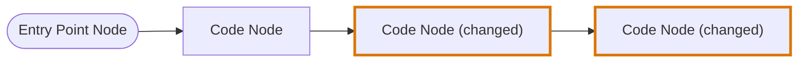
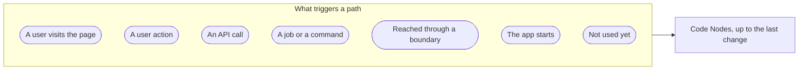
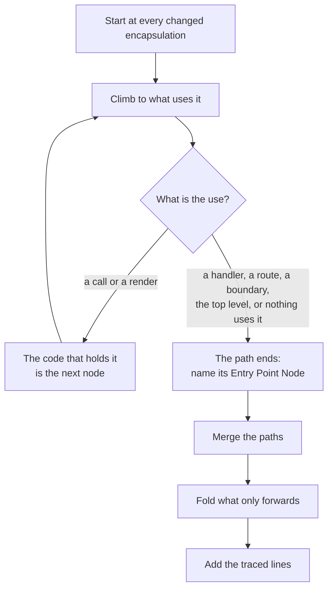
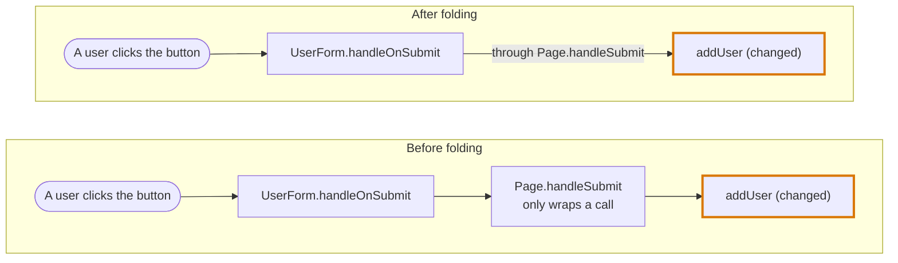
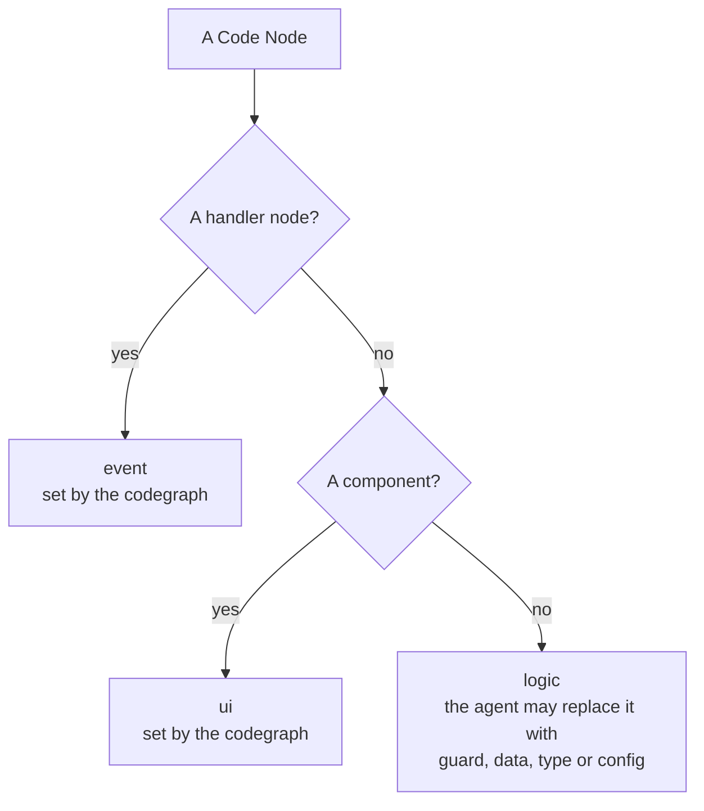

# Journey Flow Diagram

## Definition

The Journey Flow Diagram shows how execution reaches a change. It answers the reviewer's first question about any change: when does this code run, and what leads to it?

The Journey Flow Diagram reads like a debugging trace of the change. It is drawn in the order the code runs, from what triggers it to the changed code:

Every path starts at an Entry Point Node and ends at changed code. The diagram does not continue past the last change on a path; what a change affects afterwards is shown by the [Blast Diagram](blast-diagram.md).

In the diagrams of this entry a rounded node is an Entry Point Node and a thick border marks a changed node.

## How this entry is split

This page holds the rules every language shares. What a language adds, and the examples, have pages of their own:

| Page | What it holds |
|---|---|
| [JavaScript and JSX](codegraph/languages/jsx.md#journey-flow-diagram) | Components and handler nodes, props, hooks, contexts, routes, rendering logic, the returns, the events and the data of a component, and the UI card |
| [TypeScript](codegraph/languages/typescript.md#journey-flow-diagram) | The entry points of code without elements: an API call, an event bus, a command, the start of the app |
| [Vue](codegraph/languages/vue.md#journey-flow-diagram) | The same as JSX, said by a template: `@click`, emitted events, `provide` and `inject`, `v-if` and `v-for` |
| [Python](codegraph/languages/python.md#journey-flow-diagram) | Plain call edges, with no traced lines |
| [Examples in TypeScript](journey-flow-diagram/examples-typescript.md) | Seven examples of paths through plain functions |
| [Examples in JSX](journey-flow-diagram/examples-jsx.md) | Thirteen examples of paths through components |
| [Examples in Vue](journey-flow-diagram/examples-vue.md) | Six of the JSX examples, written as Vue components |

The diagram is traced by the [codegraph](codegraph.md), from the files of one cluster of the [import graph](codegraph/import-graph.md), read as an [AST graph](codegraph/ast-graph.md).

## Nodes

| Node | What it stands for |
|---|---|
| **Entry Point Node** | What triggers a path from outside the code. It has no code of its own. Every path has one. |
| **Code Node** | Code on a path. It is never a single line. |

A Code Node is one of three things:

| Code Node | What it stands for | Named |
|---|---|---|
| An encapsulation | A top-level function, component, hook, class or module-level value. A change inside a nested function belongs to the node of the encapsulation that holds it. | `OrderStatusFilter` |
| A handler | The code a user action runs in a component. See [JavaScript and JSX](codegraph/languages/jsx.md#a-component-has-a-render-node-and-a-node-for-each-handler) and [Vue](codegraph/languages/vue.md#a-component-has-a-render-node-and-a-node-for-each-handler). | `OrderStatusFilter.onClick`, `CartLine.handleRemove` |
| The top level of a file | The changed bare statements of a file. See "Changes outside any encapsulation". | `top level` |

A Code Node has no role such as head or tail. It carries one fact from the diff: it is **changed** or it is not. That fact is stored as `changeType`: `diff` for a changed node, `related` for an unchanged node, which is on the diagram only because it leads to changed code. A traced line keeps a plain `isChanged`. The events and the data listed on a component say more than that about each entry: see [Events and data of a component](codegraph/languages/jsx.md#events-and-data-of-a-component). A change can sit anywhere on a path, and a path can hold several.

## Entry points

The Entry Point Node is named after what sits at the top of the path:

| The top of the path | Entry Point Node |
|---|---|
| A page or route component that nothing renders | A user visits the page |
| A handler on a built-in element, such as `onClick` or `onSubmit` | A user action |
| An `on…` prop on a component the trace cannot open, such as a button of a component library | A user action. The trace ends on that prop |
| A function handed to `addEventListener` | A user action, named after the event and what listens for it |
| A route handler, such as `POST` or `GET` | An API call |
| A job, a command or `main` | That job or command |
| A boundary the trace cannot cross, such as an event bus or a context no component reads | Reached through that boundary |
| An export that nothing uses | Not used yet |
| The top level of a file | The app starts |

An Entry Point Node carries where the trace ended: the file, the line and its source, the event, what the user acts on, and the library when the trace ended on a component from outside the repository. The agent reads it to write the label.

## How the diagram is built

The diagram is built from one group of files: the changed files that import each other, with everything they import and everything that imports them. A change in files that share no import with the group is in a group, and a diagram, of its own.

1. **Start at every change.** Each encapsulation that holds a changed line is a starting point. Several changed lines inside one encapsulation are one node.
2. **Climb to what triggers it.** From each starting point, the trace follows what uses it, then what uses that, until nothing does. What a use is decides the next step: a call or a render makes the code that holds it the next node, and the uses in the table of entry points end the path.
3. **Name the trigger.** The top of each path gets its Entry Point Node from the table above.
4. **Give each user action its handler node.** See [JavaScript and JSX](codegraph/languages/jsx.md#a-component-has-a-render-node-and-a-node-for-each-handler).
5. **Merge the paths.** A Code Node appears once, however many paths cross it. Every path is drawn, however many there are. Changes that are connected share their nodes, and changes that are not connected are separate paths.
6. **Fold what only forwards.** See below.
7. **Add the traced lines.** See below.
8. **Set the category, and list the events and the data of each component.** See "Node categories" and [Events and data of a component](codegraph/languages/jsx.md#events-and-data-of-a-component).
9. **Leave out an entry point with no node under it.** An Entry Point Node is drawn only when it leads to a Code Node. An entry point with one Code Node under it is a path and is drawn.

Nothing is traced downward from a change, so a path ends at its last change.

Because every change is a starting point, a diff that adds a function and also wires it in draws the wiring: the code that calls the function and the code that uses its results are changed too, so each is on a path of its own.

## One trace for every language

One trace serves every language. Nothing in it asks which language a file is written in. A file is traced differently only because of what its syntax says.

| Language | What its syntax adds to the trace |
|---|---|
| [TypeScript](codegraph/languages/typescript.md#journey-flow-diagram) | Calls, values handed over, route registrations, subscriptions and listeners, and the statements that give the traced lines |
| [JavaScript and JSX](codegraph/languages/jsx.md#journey-flow-diagram) | The same, and what an element says: it has handlers, a component renders other components, a value is handed to a context, a route names a page |
| [Python](codegraph/languages/python.md#journey-flow-diagram) | Calls only |
| [Vue](codegraph/languages/vue.md#journey-flow-diagram) | What JSX adds, said by a template and its script blocks: a handler is `@click`, a callback is an emitted event, a context is `provide` and `inject` |

A file without elements has no handlers, renders, contexts or pages, so a function in it is one node and its entry point is an API call, a command, an event bus, the start of the app or "Not used yet".

## Changes outside any encapsulation

A changed line at the top level of a file belongs to no encapsulation. What happens to it depends on what it is:

| The changed line | In the diagram |
|---|---|
| An import | No node. When the imported name matters, its use is changed too, inside an encapsulation, and that is traced. |
| A type or an interface | No node. Nothing that runs is different. |
| A bare statement, such as `app.use(rateLimit())`, `initAnalytics()` or a route registration like `router.post("/users", createUser)` | A Code Node for the top level of that file, marked as changed. Its traced lines are the changed statements. |

A module-level value such as `export const MAX_RETRIES = 5` is an encapsulation, so it is a Code Node like any other and the trace climbs from it to the code that reads it.

## Folding

An unchanged encapsulation that only forwards is not drawn as a node. Its hand-over becomes a step on the edge that passes through it. An encapsulation only forwards when it does one of:

- passes a prop straight on: `<SaveButton onSave={onSave} />`
- re-exports a name
- wraps a call and nothing else: `(user) => addUser(user)`

A changed encapsulation is always drawn, even when it only forwards.

## Traced lines

A Code Node carries its traced lines: the lines of that node the path goes through, in order, as a debugger would step through them.

- **For a changed node**, they run up to its changed lines.
- **For a node the diff did not touch**, they run up to where the path leaves it for the next node.
- **For the node of a handler**, they are what the action runs: the element the user acts on, and the handler declared in the component that the element names. Two buttons of one component are two nodes with different traced lines.

Traced lines are how the inside of a node is shown without more nodes: a branch, a loop or a `.map` of a component is lines of that component, not a node of its own. An edge carries no lines.

Traced lines are lines of the source, with their line numbers, and the lines the diff touched are marked:

- A statement on the way is listed with every line it spans, so a `return (` shows the whole element it returns.
- A branch or a loop the path does not go into is listed by its first line only, without its body.
- A function declared inside the node is listed by its first line, and its body follows only when the path goes through it.
- An element is a unit like a statement. The traced lines step into the elements above the hand-over, lists the elements rendered before it, and stops at it: the elements after it and the closing tags are left out.
- Nothing that runs after the hand-over, or after the changed lines, is listed.

A Python file gives no statements, so its nodes have no traced lines.

## Code views

A Code Node, and each return of a component, carries its code views: the code a reviewer reads beside it. A code view names a file, the lines to show and the exact places to mark on them.

| Node | Code views |
|---|---|
| A component | **Data**: where each value its markup reads is declared, with a mark on the name. A value declared in another file has a view of its own. **Event**: each callback attribute and listener, from the line its element starts on to the end of the attribute, with the handler the component declares for it and a mark on the attribute. Several events share one view. **Render**: its `return` statements. |
| A return of a component | The **Data** and the **Event** on its lines, then **Render**: that return. |
| The node of a handler | **Event**: the element, the attribute with a mark on it, and the handler it runs. |
| Any other node | **Declaration**: its whole root encapsulation, or the changed statements of the top level of a file. |

A view with nothing in it is left out, so a component that reads no value has no Data view.

**On the page.** Choosing a node opens a side panel with its description, then its code views in the order above. Each view shows its lines as the Code Walkthrough shows them, with the removed lines of the diff, and stands the box of the waypoint that explains those lines above them: its title, its position, its reviewed toggle and, when opened, its reading. Lines between two parts of a view are one row that says how many are hidden. A view of a file the change did not touch is read from the head commit and says so.

**Looking a name up.** In every code view and in the Code Walkthrough, a name whose definition is not on the lines shown is underlined, and hovering it shows the definition: the declaration of a function, a component, a variable, a type or an interface in the file that declares it, followed through re-exports. For `data?.children` only `data` is looked up. A name from a library shows its import statement and is not followed.

## When there is no diagram

A change that touches only types, interfaces or import lines changes nothing that runs, so it has no Journey Flow Diagram.

## Node categories

Each Code Node has a visual category, chosen by one test: would a reviewer scanning the board want this told apart at a glance?

| Category | Code |
|---|---|
| `guard` | A validator, gate, permission check or schema check: code whose job is to refuse |
| `logic` | A function or method that transforms. The default. |
| `data` | A query, repository, migration or cache access |
| `type` | An interface, type alias, schema or enum |
| `ui` | A JSX or a Vue component, and nothing else |
| `event` | The handler node of a user action, and nothing else |
| `config` | A constant, flag, environment setting or build setting |

The codegraph gives `ui` to every component, which is a root encapsulation with a capitalised name, or a default export, that holds JSX markup, or a Vue file with a template. It gives `event` to every handler node, such as `OrderStatusFilter.onClick` or `Shortcuts.keydown`. It gives `logic` to every other node: a function, the top level of a file, and a constant that holds markup such as a route table. `ui` and `event` belong to the codegraph: the agent cannot give either to a node, and cannot replace either on a node that has it. The agent can replace `logic` with `guard`, `data`, `type` or `config`.

## Edges

An edge joins two nodes in the order the code runs:

- From an **Entry Point Node** to a **Code Node**: the trigger. It is not code. A user action arrives at the node of the handler it runs, never at the component.
- Between two **Code Nodes**: the left one runs the right one, by calling it, rendering it or running a function handed to it. The hand-overs of any folded encapsulations are listed on the edge.

An edge stores its `kind` (`trigger`, `call`, `value`, `data`), its `certainty` (`proven`, `assumed`) and its `through`. The agent reads them. It does not store the condition a component is rendered under.

**On the page every edge is the same line.** There is one line style, a straight arrow from the left node to the right one, and no line carries a label. A line is never curved: it runs level where it can, and a node is placed level with the port or the node it is connected to, so the nodes of a column follow the order of what leads to them. The kind, the certainty and the folded hand-overs of an edge are not drawn.

On the page the components of a diagram are grouped into UI cards. See [The UI card](codegraph/languages/jsx.md#the-ui-card).

## Who writes what

| Part | Written by |
|---|---|
| Which Code Nodes exist, where they are in the code, how they connect, what is folded and their traced lines | The codegraph |
| The events and the data of a component, with the `changeType` and the lines of each | The codegraph |
| The code views of a node and of a return, and where each name in them is defined | The codegraph |
| The returns of a component, with the statement, the lines, the `changeType` and the rendered nodes of each | The codegraph |
| Which nodes are changed | The diff |
| The kind of each Entry Point Node | The codegraph, from the top of the path |
| Each node's category | The codegraph: `ui` for a component, `event` for a handler node, `logic` for any other node. The agent replaces `logic` where it is wrong, and cannot write or replace `ui` or `event`. |
| Each node's label and description | The agent. Until the agent writes it, a label is the declaration's own name, marked as a draft. A description tells the journey that reaches the node from its Entry Point, not the change. |
| The label and the description of each return of a component | The agent. Until the agent writes it, a label is the return's statement, marked as a draft. |

The agent cannot add, remove or move a Code Node.
