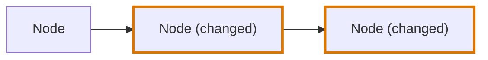
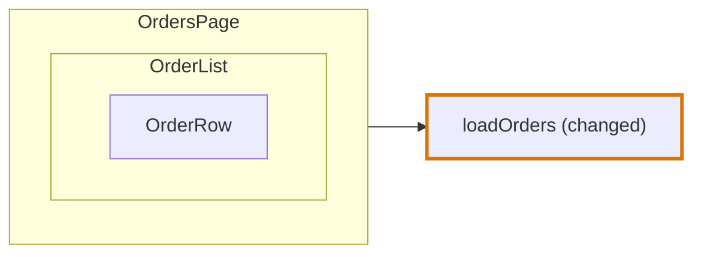

# Journey Flow Diagram

## Definition

The Journey Flow Diagram shows how execution reaches a change. It answers the reviewer's first question about any change: when does this code run, and what leads to it?

The Journey Flow Diagram reads like a debugging trace of the change. It is drawn in the order the code runs, from the code that starts a path to the changed code:



Every path starts at a node nothing leads to and ends at changed code. The diagram does not continue past the last change on a path; what a change affects afterwards is shown by the [Blast Diagram](blast-diagram.md).

In the diagrams of this entry a thick border marks a changed node.

The diagram is drawn by the [codegraph](codegraph.md), from the [chains](codegraph/chains.md) of one group of [code blocks](codegraph/code-blocks.md) that lead to a change of one [segment](codegraph/segments.md).

## The shape

```ts
interface JourneyFlowDiagram {
  astCodeGroup: ASTCodeGroupGraph
  importGraphGroup: ImportGraphGroup
  journeyNodes: JourneyNode[]
  journeyNodeEdges: JourneyNodeEdge[]
}

interface JourneyNode {
  id: string
  type: CodeBlockType
  label: string | null
  description: string | null
  codeBlocks: CodeBlock[]
  diffCodeBlocks: CodeBlock[]
  children: JourneyNode[]
  triggerLabels: TriggerLabel[]
}

interface TriggerLabel {
  label: string | null
  codeBlock: CodeBlock
}

interface JourneyNodeEdge {
  id: string
  from: string
  to: string
}
```

| Field | What it holds |
|---|---|
| `astCodeGroup` | The [group](codegraph/code-blocks.md#the-group) the diagram is drawn from. An alias, not a copy. |
| `importGraphGroup` | The files of the [import graph](codegraph/import-graph.md) that are in that group. An alias. |
| `journeyNodes` | The nodes at the top level of the diagram. A node inside another is in its `children`, not here. |
| `journeyNodeEdges` | Every edge of the diagram, between nodes at any depth |
| `id` of a node | The id of the block the node stands for, such as `src/pricing.ts#function@3:1` |
| `type` | The [type](codegraph/block-types.md) of the block the node stands for |
| `label`, `description` | What the agent writes. `null` until it is written. |
| `codeBlocks` | The blocks of the node: the block it stands for first, then the blocks inside it that a chain passes through or that have a change, in the order they are written. Each is the same object as in `astCodeGroup`. |
| `diffCodeBlocks` | The blocks of `codeBlocks` that have a change. A node with none is only on the way to a change. |
| `children` | The nodes compressed into this one |
| `triggerLabels` | The blocks of the node an agent writes a line about, each with that line |
| `from`, `to` of an edge | The ids of two nodes: the first runs the second |

A node has no position and no size. The page places the nodes and the edges when it draws them.

## Nodes

**A node is a root block on a chain.** Every chain is walked from its top through `nextBlocks`. Each block on the way belongs to the root block it is in, the block at the top level of its file, and each root block that holds a block on a chain is one node. A step that stays inside one root block stays inside its node, so a branch, a loop or an effect of a function is a block of that function's node, not a node of its own.

**A node has the type of its block.** One list says what a block is and what a node is, so a node of a component is a `component`, a node of a constant a `root-variable`, and a node of a statement at the top level of a file a `root-statement`.

| Code | Node |
|---|---|
| A function, a hook or a class with a block on a chain | One node of the type `function`, `hook` or `class` |
| A component | One node of the type `component` |
| A value at the top level of a file, such as `export const MAX_RETRIES = 5` | One node of the type `root-variable` or `state` |
| A statement at the top level of a file, such as `app.use(rateLimit())` | One node of the type `root-statement` |
| A changed import, type or interface | No node. Nothing that runs is different. |

**Nothing stands for what starts a path from outside the code.** A click, a page visit and a request are not code, so they are not nodes. The top of a chain is a block, and it is in the node of its root block like any other: the `render-event` a click starts at is a block of its component's node.

## Edges

An edge joins two nodes in the order the code runs: the first runs the second, by calling it, rendering it or running a function handed to it. There is one edge for every pair of nodes a chain steps between, however many steps join them.

An edge holds its two ends and nothing else. It has no kind and no label, and the page draws every edge as the same line.

## Children

**The components that render each other are one node.** A component on a chain that another component on a chain renders is not at the top level of the diagram: it is in the `children` of the component that renders it, as deep as the rendering goes.



| Rule | Why |
|---|---|
| A component is a child of the first component that reaches it from the top | A component two components render is drawn once |
| The top is a component no other component on a chain renders | It is where the rendering starts |
| Among several tops, the one in a file no other file of the group imports comes first | The import graph says which file is highest |
| The edge between a component and its child stays in `journeyNodeEdges` | The page leaves it out, and an agent still reads it |

Only components are compressed. A function a component calls is a node of its own at the top level, with an edge from the component.

## Trigger labels

A trigger label is a block of a node that an agent writes one line about. The blocks are the events and the data fetches of the node that are on a chain:

| Block type | What the line says |
|---|---|
| `render-event` | What the user does, such as "A shopper clicks Remove" |
| `code-event` | What happens that the code listens for |
| `data-fetch` | What is loaded |

The page draws each trigger label as a row inside its node.

## The diagram of a segment

A group cut into several [segments](codegraph/segments.md) has one diagram per entry segment, and the shared segment has none.

| Segment | What its diagram holds |
|---|---|
| The only segment of a group | Every chain of the group |
| An entry segment | The chains that lead to a change in its own files, and below a changed root block of its own, the steps that lead to a change of the shared segment |
| The shared segment | No diagram. Its changes are drawn on the diagrams that pass through them. |

## When there is no diagram

A change that touches only types, interfaces or import lines changes nothing that runs, so it has no Journey Flow Diagram. Neither has a file no language reads.

## Three forms

The diagram in memory holds references, and two other forms hold ids in their place.

| Form | What it is for | References |
|---|---|---|
| In memory, and in a `.flightplan` file | The review artifact | Aliases. The file is written with [devalue](data-storage.md#the-flightplan-file), which keeps a block two nodes hold as one block. |
| Stored | Snapshots, and comparing two runs | `codeBlockIds`, `diffCodeBlockIds` and `codeBlockId` in place of the blocks, and neither `astCodeGroup` nor `importGraphGroup` |
| Flat | What an agent reads through the MCP tools | The stored form of each node, at any depth, as one entry of a list, with `parentId` in place of `children` |

```ts
interface FlatJourneyNode {
  id: string
  parentId: string | null
  type: CodeBlockType
  label: string | null
  description: string | null
  codeBlockIds: string[]
  diffCodeBlockIds: string[]
  triggerLabels: { label: string | null, codeBlockId: string }[]
}
```

An agent reads and writes one node at a time. A node that carried its children would carry more with every level, so the flat form leaves them out, and a node inside another is read and written by its own id.

## On the page

| What is drawn | From |
|---|---|
| A node, with its type, its label and the path of its file | A `JourneyNode`. A node with no label shows the name of its code, marked as a draft. |
| A node as added or modified | Its `diffCodeBlocks`. A node whose every line is new is added. |
| A node inside another | Its place in `children` |
| A row inside a node | A trigger label, with its label and the name of its code, such as `button.onClick` |
| A row inside a node, above its trigger labels | A listed block: an argument, a state, a hook or an effect among its `codeBlocks`, with the name of its code. A changed one has the border of the change. |
| A small heading above rows of a node | The kind of the listed blocks below it: Args, State, Hooks or Effects. A node with listed blocks also has the heading Triggers above its trigger labels. |
| A line between two nodes | An edge whose ends are not inside each other |
| A line that leaves a row, or ends at one | A step of a chain between the blocks of the two nodes of an edge. The line is joined to the row of the block the step leaves, and to the row of the block it reaches. |
| The side panel of a chosen node | Its description, then the code of the block it stands for, with the box of the waypoint that explains those lines above them |

**A node lists what it holds of four kinds.** The lists are read from the `codeBlocks` of the node, so a block is listed only when a chain passes through it or when it has a change. A node with no such block has no list.

| Kind | The blocks of it | Named |
|---|---|---|
| Args | `root-argument-value` | After the argument, and a member read from one after both: `props.onSave` |
| State | `state`, `derived`, and the declaration of one around an effect on a chain, such as `const total = useCartStore(selectTotal)` whose call a chain passes through | After the declaration |
| Hooks | An `external-value` that keeps the result of a call named `use` and a capital letter | After the hook that is called, such as `useApplyPromo` |
| Effects | `effect`, `component-effect`, `effect-callback`, when no declaration of state is around it | After what it calls, such as `useEffect` |

A block inside a listed block is not listed again: the callbacks of a listed effect, and the effect inside a `derived`, are left out. A [chain does not pass through state](codegraph/chains.md#a-chain-and-state), so a state the chain only writes is not listed. Each listed block is drawn as a row like a trigger label, grouped under the heading of its kind, in the order arguments, state, hooks, effects. Nothing is written about a listed block, and the lists are not in the diagram: the page builds them.

**A line is joined to the row the code steps from.** An edge joins two nodes, and the steps of a chain behind it join blocks of the two. The page draws one line for each pair of rows those steps join. The row of a block is the listed block or the trigger label it is, or the nearest one around it. A block with no row around it is joined at the head of its node, so a call to a function ends at the head of that function. Like the lists, the rows of a line are not in the diagram: the page builds them from the `nextBlocks` of the `codeBlocks` of the two nodes.

The page arranges the diagram itself: a node is one column after the last node that leads to it, the nodes of a column are stacked, and an edge is a straight line from the right edge of one node to the left edge of the next. A line joined to a row is level with that row, and a short line carries it from the edge of the node to the row. Collapsing a node hides the nodes it leads to, and focusing on a node shows only the paths through it. Both re-arrange what is left.

## Who writes what

| Part | Written by |
|---|---|
| Which nodes exist, their type, their blocks, which node is inside which and how they connect | The codegraph |
| Which blocks of a node are trigger labels | The codegraph |
| Which nodes are changed | The diff |
| Each node's label and description | The agent. A description tells how the node is reached and what it runs next, not the change. |
| The label of each trigger label | The agent |

The agent cannot add, remove or move a node, and cannot write an edge.
