# Journey Flow Diagram examples in JSX

Examples of the [Journey Flow Diagram](../journey-flow-diagram.md) over components: page visits, user actions, props, hooks and contexts. See [JavaScript and JSX in the codegraph](../codegraph/languages/jsx.md#journey-flow-diagram) for the rules behind them, and [Examples in TypeScript](examples-typescript.md) for code without elements.

Each example says what it is there to show. `// diff` marks a changed line. In a diagram a rounded node is an Entry Point Node, and a thick border and `(changed)` mark a changed node. A label on an edge lists the hand-overs folded into it.

| Example | Shows |
|---|---|
| [1. A change at the end of a chain](#1-a-change-at-the-end-of-a-chain) | The path stops at the change |
| [2. A change in the middle of a chain](#2-a-change-in-the-middle-of-a-chain) | Nothing unchanged is drawn after the last change |
| [3. A change with its wiring](#3-a-change-with-its-wiring) | Every changed encapsulation is a starting point |
| [4. A page visit and a user action in the same component](#4-a-page-visit-and-a-user-action-in-the-same-component) | The entry point depends on where the use sits |
| [5. A hook](#5-a-hook) | A hook is an encapsulation like any other |
| [6. A forwarder folded into the edge](#6-a-forwarder-folded-into-the-edge) | Folding |
| [7. A prop drilled through several components](#7-a-prop-drilled-through-several-components) | Every forwarder on the way is folded |
| [8. A changed forwarder](#8-a-changed-forwarder) | A changed encapsulation is always drawn |
| [9. A rendering branch written in place](#9-a-rendering-branch-written-in-place) | A branch of built-in elements is traced lines |
| [10. Shared code reached from two places](#10-shared-code-reached-from-two-places) | Every path is drawn |
| [11. A context](#11-a-context) | A function handed to a context |
| [12. A function handed to a library hook](#12-a-function-handed-to-a-library-hook) | Following the result of a hook |
| [13. A change on both sides of a request](#13-a-change-on-both-sides-of-a-request) | The trace does not cross from client to server |

## 1. A change at the end of a chain

**Shows:** the path stops at the change. Code that uses the change's result is not drawn.

```tsx
// page.tsx
const Page = () => {
  const { data, status, execute } = addUser()

  return <UserForm onSubmit={execute} formData={data} status={status} />
}

// addUser.ts
const addUser = () => {                               // diff
  ...
}
```

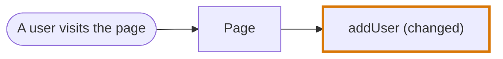

`UserForm` is not drawn. It receives what `addUser` returns, which happens after the change.

## 2. A change in the middle of a chain

**Shows:** the stop rule also cuts off what the changed code calls. Nothing unchanged is drawn after the last change.

```tsx
// page.tsx
const Page = () => {
  const users = loadUsers({ activeOnly: true })       // diff

  return <UserList users={users} />
}

// loadUsers.ts
const loadUsers = (options) => {
  ...
}
```

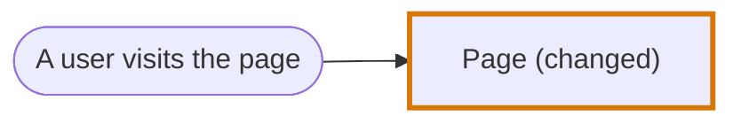

Neither `loadUsers` nor `UserList` is drawn. Both are unchanged and both run after the changed line.

## 3. A change with its wiring

**Shows:** every changed encapsulation is a starting point, so new code is drawn together with the code that wires it in.

```tsx
// addUser.ts
const addUser = () => {                               // diff
  ...
}

// page.tsx
const Page = () => {
  const { data, status, execute } = addUser()         // diff

  return <UserForm onSubmit={execute} formData={data} status={status} />   // diff
}

// UserForm.tsx
const UserForm = (props) => {
  const handleOnSubmit = () => {
    props.onSubmit()                                  // diff
  }

  return <form onSubmit={handleOnSubmit}>...</form>   // diff
}
```

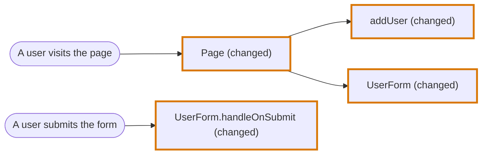

Compare with example 1: the code is the same, and `UserForm` is drawn here only because it is changed. `Page` renders it, and the submit of its form runs its handler, which is a node of its own.

## 4. A page visit and a user action in the same component

**Shows:** the entry point depends on where in the component the use sits. Code in the render body runs on a visit. Code in a handler runs on the action.

```tsx
// users-page.tsx
const UsersPage = () => {
  const users = loadUsers()                           // runs when the page renders

  const handleDelete = (id) => {
    removeUser(id)                                    // runs when the button is clicked
  }

  return <button onClick={() => handleDelete(users[0].id)}>Delete</button>
}
```

When `loadUsers` is changed:

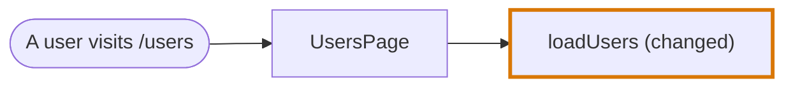

When `removeUser` is changed:

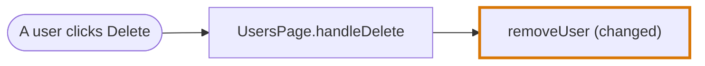

The click leads to the node of the handler, not to `UsersPage`. When both are changed, both paths are in one diagram: `UsersPage` is the node of the visit and `UsersPage.handleDelete` the node of the click.

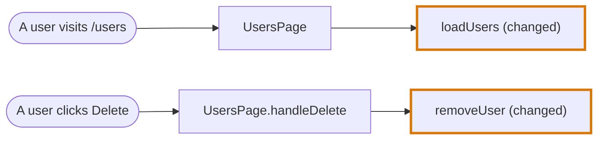

## 5. A hook

**Shows:** a hook is an encapsulation like any other. The component that calls it is its caller.

```tsx
// home.tsx
const Home = () => {
  const users = useUsers()

  return <UserList users={users} />
}

// useUsers.ts
const useUsers = () => {
  return useQuery({ queryKey: ["users"], queryFn: fetchActiveUsers })   // diff
}
```

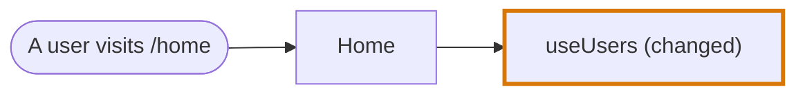

## 6. A forwarder folded into the edge

**Shows:** an unchanged encapsulation that only wraps a call is not a node. Its hand-over is a step on the edge.

```tsx
// UserForm.tsx
const UserForm = (props) => {
  const [firstName, setFirstName] = useState("")

  const handleOnSubmit = () => {
    props.onSubmit({ firstName })
  }

  return <button onClick={handleOnSubmit} />
}

// page.tsx
const Page = () => {
  const handleSubmit = (newUser) => addUser(newUser)

  return <UserForm onSubmit={handleSubmit} />
}

// addUser.ts
const addUser = (user) => {                           // diff
  ...
}
```

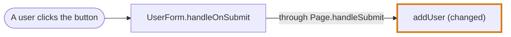

`Page` adds nothing a reviewer needs to read. Two nodes instead of three.

## 7. A prop drilled through several components

**Shows:** every forwarder on the way is folded, however many there are. The handler of the element the user acts on stays, because it is what the entry point triggers.

```tsx
// review-page.tsx
const ReviewPage = () => <Editor onSave={saveReview} />

// editor.tsx
const Editor = ({ onSave }) => <SaveButton onSave={onSave} />

// save-button.tsx
const SaveButton = (props) => <button onClick={props.onSave}>Save</button>

// reviews.ts
const saveReview = () => {                            // diff
  ...
}
```

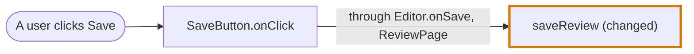

## 8. A changed forwarder

**Shows:** a changed encapsulation is always drawn, even when it only forwards.

Same code as example 7, with the forwarding line in `Editor` changed as well:

```tsx
// editor.tsx
const Editor = ({ onSave }) => <SaveButton onSave={onSave} variant="primary" />   // diff
```

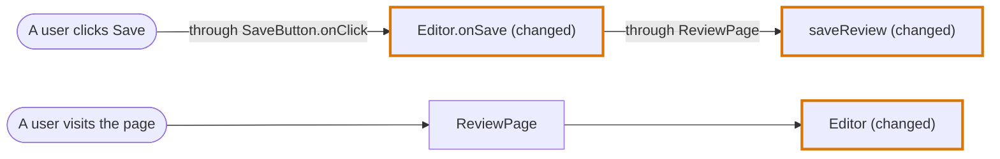

`Editor` is changed on the line that holds both its markup and the prop it passes on, so both of its nodes are drawn: `Editor.onSave` under the click, and `Editor` under the visit that renders it.

## 9. A rendering branch written in place

**Shows:** a branch that renders only built-in elements has no component to be a node. It is traced lines of the component that renders it.

```tsx
// home.tsx
const Home = () => {
  const users = useUsers()

  if (users.length === 0) {
    return <p className="warning">{emptyMessage()}</p>    // diff
  }

  return <UserList users={users} />
}

// emptyMessage.ts
const emptyMessage = () => {
  return "No users yet"                               // diff
}
```

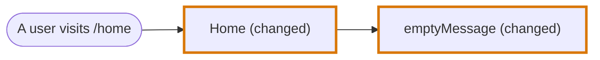

The traced lines of `Home`:

```text
3    const users = useUsers()
5    if (users.length === 0) {
6      return <p className="warning">{emptyMessage()}</p>     changed
```

The `<UserList>` branch is not listed. The change is not inside it. The example under [Rendering logic](../codegraph/languages/jsx.md#rendering-logic) is the other case, where each branch renders a component and each is a node.

## 10. Shared code reached from two places

**Shows:** every path is drawn. The changed node appears once.

```tsx
// cart-page.tsx
const CartPage = () => <span>{formatPrice(cart.total)}</span>

// product-page.tsx
const ProductPage = () => <span>{formatPrice(product.price)}</span>

// formatPrice.ts
const formatPrice = (cents) => {                      // diff
  ...
}
```

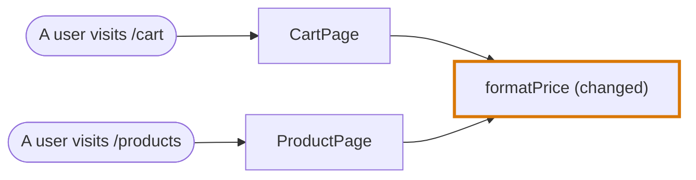

## 11. A context

**Shows:** a function handed to a context is followed to the component that reads it, and to the action that runs it there. When no component reads it, the context is the entry point. The path is never dropped.

```tsx
// app.tsx
const App = () => (
  <SaveContext.Provider value={saveReview}>
    <ReviewPage />
  </SaveContext.Provider>
)

// review-page.tsx
const ReviewPage = () => {
  const save = useContext(SaveContext)
  return <button onClick={save}>Save</button>
}

// reviews.ts
const saveReview = () => {                            // diff
  ...
}
```

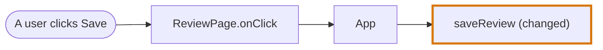

`ReviewPage` reads the context, and `App` hands `saveReview` to it. Without a component that reads `SaveContext`, the path is:

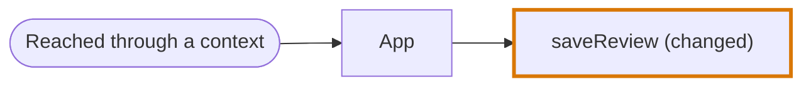

## 12. A function handed to a library hook

**Shows:** when a hook decides when the changed function runs, the entry point comes from where the hook's result is used.

```tsx
// users-page.tsx
const UsersPage = () => {
  const query = useQuery({ queryKey: ["users"], queryFn: fetchUsers })
  const mutation = useMutation({ mutationFn: removeUser })

  return (
    <>
      <UserList users={query.data} />
      <button onClick={() => mutation.mutate(1)}>Delete</button>
    </>
  )
}
```

When `fetchUsers` is changed, `query.data` is read in the render body:

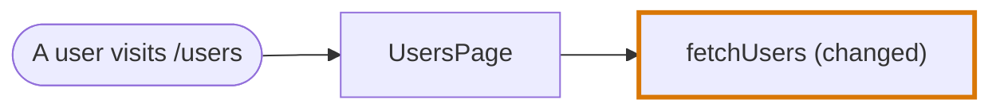

When `removeUser` is changed, `mutation.mutate` is called from the `onClick` of a `<button>`:

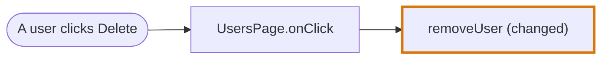

Both hand-overs look the same to the trace: a function passed into a hook from a package. Only following the result tells them apart.

## 13. A change on both sides of a request

**Shows:** the trace does not cross from client to server. Each side is its own diagram with its own entry point.

```tsx
// users-page.tsx
const UsersPage = () => {
  const handleAdd = async (user) => {
    await addUser(user)
  }

  return <form onSubmit={handleAdd}>...</form>
}

// addUser.ts
const addUser = async (user) => {
  await fetch("/api/users", { method: "POST", body: JSON.stringify(user) })   // diff
}

// routes/users.ts
router.post("/api/users", createUser)

// createUser.ts
const createUser = async (request) => {
  return saveUser(parseUser(request.body))
}

// saveUser.ts
const saveUser = async (user) => {                    // diff
  ...
}
```

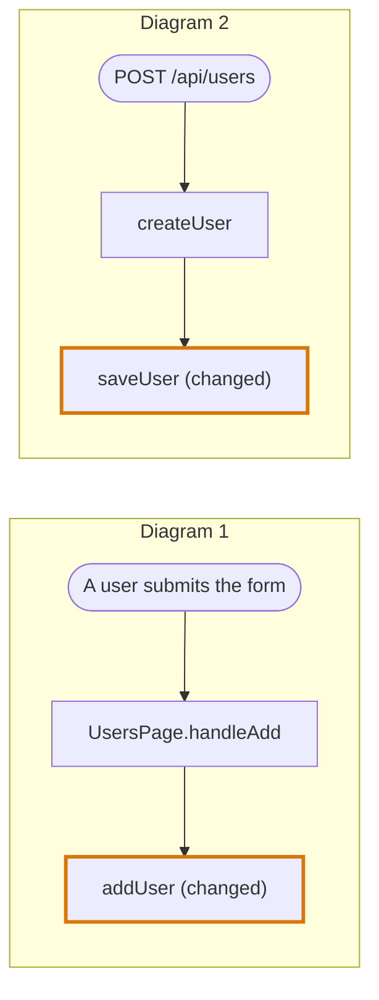
