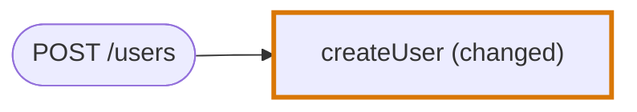
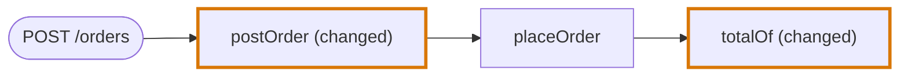
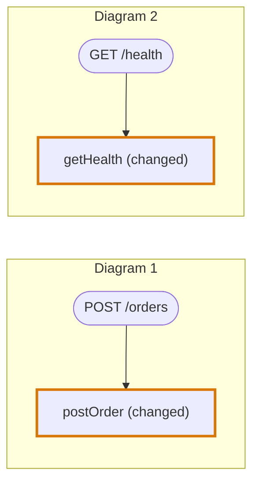
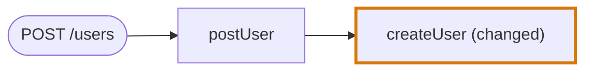
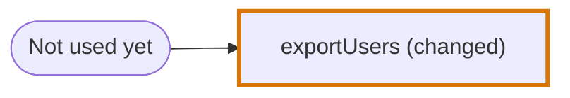
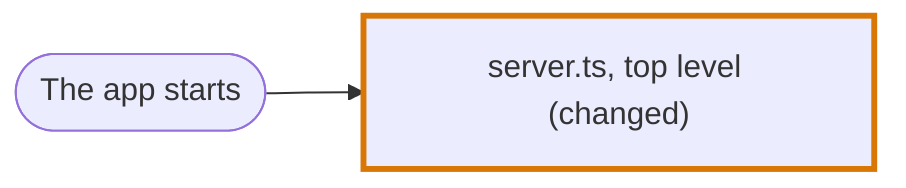

# Journey Flow Diagram examples in TypeScript

Examples of the [Journey Flow Diagram](../journey-flow-diagram.md) over code without elements: every node is a function and every path is a chain of calls. See [TypeScript in the codegraph](../codegraph/languages/typescript.md#journey-flow-diagram) for the rules behind them, and [Examples in JSX](examples-jsx.md) for components.

Each example says what it is there to show. `// diff` marks a changed line. In a diagram a rounded node is an Entry Point Node, and a thick border and `(changed)` mark a changed node.

| Example | Shows |
|---|---|
| [1. An API endpoint](#1-an-api-endpoint) | The entry point of server code |
| [2. Two changes on one path](#2-two-changes-on-one-path-with-unchanged-code-between-them) | Connected changes share one diagram |
| [3. Changes that are not connected](#3-changes-that-are-not-connected) | Separate diagrams |
| [4. Traced lines in detail](#4-traced-lines-in-detail) | Which lines a node lists |
| [5. New code nothing uses yet](#5-new-code-nothing-uses-yet) | A path always has an entry point |
| [6. A bare statement at the top level of a file](#6-a-bare-statement-at-the-top-level-of-a-file) | A change outside every encapsulation |
| [7. A change to types only](#7-a-change-to-types-only) | No diagram |

## 1. An API endpoint

**Shows:** on the server the entry point is the API call, named with its method and path.

```ts
// routes/users.ts
router.post("/users", createUser)

// createUser.ts
const createUser = async (request) => {
  const user = parseUser(request.body)
  await sendWelcome(user)                             // diff
  return save(user)
}
```



## 2. Two changes on one path, with unchanged code between them

**Shows:** connected changes share one diagram, and an unchanged node between two changes is kept because the path runs through it.

```ts
// routes/orders.ts
const postOrder = async (request) => {
  const order = parseOrder(request.body)              // diff
  return placeOrder(order)
}

// placeOrder.ts
const placeOrder = async (order) => {
  await reserveStock(order)
  return save({ ...order, total: totalOf(order) })
}

// totalOf.ts
const totalOf = (order) => roundOnce(sum(order.lines)) // diff
```



One diagram, not two. `placeOrder` is unchanged but it does work on the way, so it is a node and not a fold.

## 3. Changes that are not connected

**Shows:** changes with no path between them get separate diagrams, each with its own entry point.

```ts
// routes/orders.ts
const postOrder = async (request) => { ... }          // diff

// routes/health.ts
const getHealth = () => ({ status: "ok", version })   // diff
```



The two files share no import, so they are two clusters of the [import graph](../codegraph/import-graph.md#clusters) and two segments of the review.

## 4. Traced lines in detail

**Shows:** which lines a node lists. An unchanged node runs up to the hand-over, a changed node up to its changed lines. Nothing after.

```ts
// routes/users.ts
const postUser = async (request) => {
  const input = await request.json()
  if (!input.email) {
    return badRequest()
  }
  const user = await createUser(input)
  return created(user)
}

// createUser.ts
const createUser = async (input) => {
  const user = parseUser(input)
  if (await exists(user.email)) {
    throw new Conflict()
  }
  await sendWelcome(user)                             // diff
  return save(user)
}
```



| Node | Traced lines | Left out |
|---|---|---|
| `postUser`, not changed | `const input = await request.json()`, then `if (!input.email) {` without its body, then `const user = await createUser(input)` | The body of the `if`, since the path does not go into it. `return created(user)`, since it runs after the hand-over to `createUser`. |
| `createUser`, changed | `const user = parseUser(input)`, then `if (await exists(user.email)) {` without its body, then `await sendWelcome(user)` marked as changed | The `throw`, since the change is not inside that branch. `return save(user)`, since it runs after the change. |

The entry point `POST /users` has no lines. What triggers `postUser` is not code.

## 5. New code nothing uses yet

**Shows:** a path always has an entry point, even when nothing in the repository reaches the change.

```ts
// exportUsers.ts
export const exportUsers = () => {                    // diff, a new function with no caller
  ...
}
```



## 6. A bare statement at the top level of a file

**Shows:** a changed statement outside every encapsulation still gets a node, for the top level of its file. A changed import beside it gets none.

```ts
// server.ts
import { rateLimit } from "./rate-limit"              // diff, no node

const app = createApp()

app.use(rateLimit({ perMinute: 60 }))                 // diff
```



The traced lines of the node: `app.use(rateLimit({ perMinute: 60 }))`, marked as changed.

## 7. A change to types only

**Shows:** no diagram at all. Nothing that runs is different.

```ts
// user.ts
export interface User {
  id: string
  nickname?: string                                   // diff
}
```
