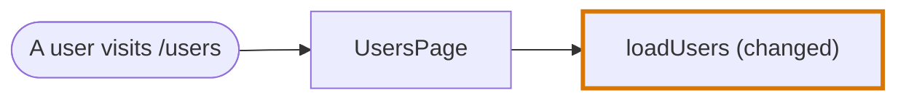
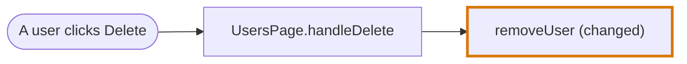
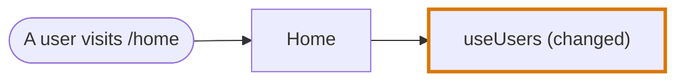
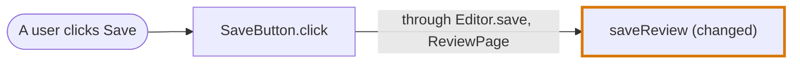
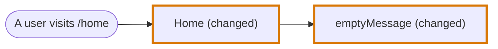
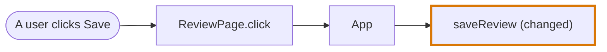
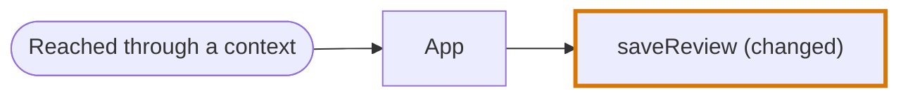
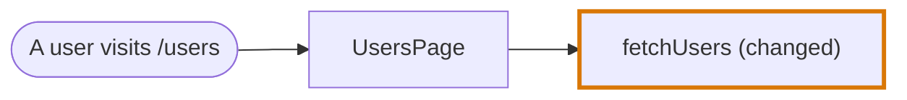
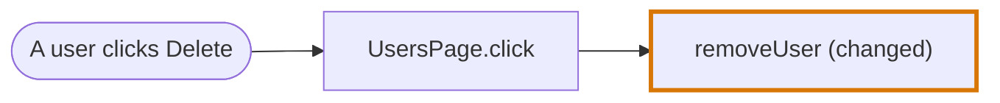

# Journey Flow Diagram examples in Vue

Examples of the [Journey Flow Diagram](../journey-flow-diagram.md) over Vue components. A Vue component is traced like a JSX component, so each example here gives the same diagram as its counterpart in [Examples in JSX](examples-jsx.md). See [Vue in the codegraph](../codegraph/languages/vue.md#journey-flow-diagram) for what says each thing in Vue.

Each example says what it is there to show. `// diff` and `<!-- diff -->` mark a changed line. In a diagram a rounded node is an Entry Point Node, and a thick border and `(changed)` mark a changed node. A label on an edge lists the hand-overs folded into it.

| Example | Shows | In JSX |
|---|---|---|
| [1. A page visit and a user action in the same component](#1-a-page-visit-and-a-user-action-in-the-same-component) | The entry point depends on where the use sits | [Example 4](examples-jsx.md#4-a-page-visit-and-a-user-action-in-the-same-component) |
| [2. A composable](#2-a-composable) | A composable is an encapsulation like any other | [Example 5](examples-jsx.md#5-a-hook) |
| [3. An event emitted through several components](#3-an-event-emitted-through-several-components) | Every forwarder on the way is folded | [Example 7](examples-jsx.md#7-a-prop-drilled-through-several-components) |
| [4. Rendering branches](#4-rendering-branches) | A component under `v-if` is a node, a built-in element is traced lines | [Example 9](examples-jsx.md#9-a-rendering-branch-written-in-place) |
| [5. Provide and inject](#5-provide-and-inject) | A provided function is followed to the component that injects it | [Example 11](examples-jsx.md#11-a-context) |
| [6. A function handed to a library composable](#6-a-function-handed-to-a-library-composable) | Following the result of a composable | [Example 12](examples-jsx.md#12-a-function-handed-to-a-library-hook) |

## 1. A page visit and a user action in the same component

**Shows:** the entry point depends on where in the component the use sits. Code at the top level of the script runs on a visit. Code in a handler runs on the action.

```vue
<!-- UsersPage.vue -->
<script setup lang="ts">
const users = loadUsers()                 // runs when the page renders

const handleDelete = (id: string) => {
  removeUser(id)                          // runs when the button is clicked
}
</script>

<template>
  <button @click="handleDelete(users[0].id)">Delete</button>
</template>
```

When `loadUsers` is changed:



When `removeUser` is changed:



The click leads to the node of the handler, not to `UsersPage`.

## 2. A composable

**Shows:** a composable is an encapsulation like any other. The component that calls it is its caller.

```vue
<!-- Home.vue -->
<script setup lang="ts">
const users = useUsers()
</script>

<template>
  <UserList :users="users" />
</template>
```

```ts
// useUsers.ts
export const useUsers = () => {
  return useQuery({ queryKey: ["users"], queryFn: fetchActiveUsers })   // diff
}
```



## 3. An event emitted through several components

**Shows:** an emitted event is followed like a callback prop. Every component that only emits it on is folded. The handler of the element the user acts on stays, because it is what the entry point triggers.

```vue
<!-- ReviewPage.vue -->
<script setup lang="ts">
import { saveReview } from "./reviews"
</script>

<template>
  <Editor @save="saveReview" />
</template>
```

```vue
<!-- Editor.vue -->
<script setup lang="ts">
const emit = defineEmits<{ save: [] }>()
</script>

<template>
  <SaveButton @save="emit('save')" />
</template>
```

```vue
<!-- SaveButton.vue -->
<script setup lang="ts">
const emit = defineEmits<{ save: [] }>()
</script>

<template>
  <button @click="emit('save')">Save</button>
</template>
```

```ts
// reviews.ts
export const saveReview = () => {                     // diff
  ...
}
```



## 4. Rendering branches

**Shows:** a component rendered under `v-if` is a node like any other, and a branch that renders only built-in elements is traced lines of the component that renders it.

```vue
<!-- Home.vue -->
<script setup lang="ts">
const users = useUsers()
</script>

<template>
  <p v-if="users.length === 0" class="warning">{{ emptyMessage() }}</p>   <!-- diff -->
  <UserList v-else :users="users" />
</template>
```

```ts
// emptyMessage.ts
export const emptyMessage = () => {
  return "No users yet"                               // diff
}
```



The `<p>` is traced lines of `Home`. `UserList` is not drawn: it is unchanged and nothing changed is reached through it. With a change inside `UserList` it would be a node under `Home`.

The root of this template is a `v-if` chain, so `Home` lists two returns: `v-if="users.length === 0"`, which the diff touched, and `v-else`.

## 5. Provide and inject

**Shows:** a function that is provided is followed to the component that injects it, and to the action that runs it there. When no component injects it, the boundary is the entry point. The path is never dropped.

```vue
<!-- App.vue -->
<script setup lang="ts">
import { saveReview } from "./reviews"

provide(saveKey, saveReview)
</script>

<template>
  <ReviewPage />
</template>
```

```vue
<!-- ReviewPage.vue -->
<script setup lang="ts">
const save = inject(saveKey)
</script>

<template>
  <button @click="save">Save</button>
</template>
```

```ts
// reviews.ts
export const saveReview = () => {                     // diff
  ...
}
```



Without a component that injects `saveKey`, the path is:



## 6. A function handed to a library composable

**Shows:** when a composable decides when the changed function runs, the entry point comes from where its result is used.

```vue
<!-- UsersPage.vue -->
<script setup lang="ts">
const query = useQuery({ queryKey: ["users"], queryFn: fetchUsers })
const mutation = useMutation({ mutationFn: removeUser })
</script>

<template>
  <UserList :users="query.data" />
  <button @click="mutation.mutate(1)">Delete</button>
</template>
```

When `fetchUsers` is changed, `query.data` is read in the template:



When `removeUser` is changed, `mutation.mutate` is called from the `@click` of a `<button>`:


