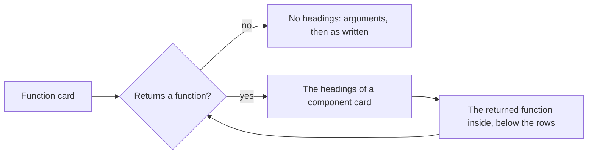

# Function card

The card of a node that runs as one function in a [Journey Flow Diagram](../journey-flow-diagram.md). The rules every card shares, its frame, its rows and its lines, are in [On the page](../journey-flow-diagram.md#on-the-page).

## What is a function card

| Node | Where its card is |
|---|---|
| A `function` or a `hook` at the top level of a file | On the board |
| A `render-event`, a `code-event`, an `effect`, a `component-effect` or an `effect-callback` that is a node of its own | On the board |
| A `method` of a class | Inside the [class card](class-card.md), under Methods |
| The handler of a route | Inside the [route card](route-card.md), under its method |
| A procedure of a tRPC router | Inside the [tRPC router card](libraries/trpc.md), under its procedure type |
| A reducer, a thunk, an extra reducer, a listener or a selector of a Redux slice, and an endpoint of an RTK Query API | Inside the [state card](libraries/redux.md), under its heading |
| A function that a function, a hook or a method returns | Inside the card of the function that returns it, as [Returning a function](#returning-a-function) says |

A function that is a component is a [component card](component-card.md), and a function that a route runs is drawn inside the route card, as [component and route come first](../journey-flow-diagram.md#component-and-route-come-first) says.

## Rows

**A function card has no headings.** Its arguments come first, and every other row follows in the order it is written, its trigger labels among them, so the card reads as the code runs. Each row is one [step](../journey-flow-diagram.md#steps).

```ts
export const renameUser = (param) => {
  const users = getUsers()
  if (!users) throw new Error("no user")
  const user = users.find((u) => u.id === param.id)
  const stored = { id: user.id, name: param.name }
  try {
    saveUser(stored)
  } catch (err) {
    throw err
  }
}
```

```
 ┌ ƒ renameUser ────────────────── services/users/rename.ts ┐
 │ Function                                        Modified │
 │ Renames a user and saves them                            │
 │ ┌──────────────────────────────────────────────────────┐ │
 │ │ param                                                │ │  ← an argument first
 │ └──────────────────────────────────────────────────────┘ │
 │ ┌──────────────────────────────────────────────────────┐ │
 │ │ users                                                │○──▶ getUsers
 │ └──────────────────────────────────────────────────────┘ │
 │ ┌──────────────────────────────────────────────────────┐ │
 │ │ Condition :3                                         │ │
 │ └──────────────────────────────────────────────────────┘ │
 │ ┌──────────────────────────────────────────────────────┐ │
 │ │ user, stored                                         │ │
 │ └──────────────────────────────────────────────────────┘ │
 │ ┌──────────────────────────────────────────────────────┐ │
 │ │ Try :6                                               │○──▶ saveUser
 │ └──────────────────────────────────────────────────────┘ │
 │ ╔══════════════════════════════════════════════════════╗ │
 │ ║ Throw :9                                             ║ │  ← a changed step inside the try
 │ ╚══════════════════════════════════════════════════════╝ │
 └──────────────────────────────────────────────────────────┘
```

## Returning a function

**A function, a hook or a method whose return value is a function is drawn as a component is.** Its rows are grouped under the headings of a [component card](component-card.md#rows), in the same order, and the function it returns is drawn inside it, below its rows, as a function card of its own. The returned function is in the `children` of its node.

A function is returned when it is written in the `return`, or as the body of an arrow function, or when the `return` names a function declared in the body:

| Code | The returned function |
|---|---|
| `const make = (id) => { … return (event) => save(id, event) }` | `(event) => save(id, event)` |
| `const make = (id) => (event) => save(id, event)` | `(event) => save(id, event)` |
| `function make(id) { function handle(event) { … } return handle }` | `handle` |
| `def logged(func):` … `return wrapper` | `wrapper` |

```ts
export const createSaveHandler = (userId, cache) => {
  const key = cacheKey(userId)
  return async (draft) => {
    if (!draft.name) throw new Error("no name")
    await fetch(`/users/${userId}`, { method: "PUT", body: JSON.stringify(draft) })
    cache.delete(key)
  }
}
```

```
 ┌ ƒ createSaveHandler ───────────────── services/users/save.ts ┐
 │ Function                                            Modified │
 │ Makes the handler that saves a user draft                    │
 │ ARGS                                                         │
 │ ┌──────────────────────────────────────────────────────────┐ │
 │ │ userId                                                   │ │
 │ └──────────────────────────────────────────────────────────┘ │
 │ ┌──────────────────────────────────────────────────────────┐ │
 │ │ cache                                                    │ │
 │ └──────────────────────────────────────────────────────────┘ │
 │ CALLS                                                        │
 │ ┌──────────────────────────────────────────────────────────┐ │
 │ │ key                                                      │○──▶ cacheKey
 │ └──────────────────────────────────────────────────────────┘ │
 │ ┌ ƒ (draft) => … ────────────────── services/users/save.ts ┐ │  ← the returned function
 │ │ Function                                        Modified │ │
 │ │ Saves one draft                                          │ │
 │ │ ┌──────────────────────────────────────────────────────┐ │ │
 │ │ │ draft                                                │ │ │
 │ │ └──────────────────────────────────────────────────────┘ │ │
 │ │ ┌──────────────────────────────────────────────────────┐ │ │
 │ │ │ Condition :4                                         │ │ │
 │ │ └──────────────────────────────────────────────────────┘ │ │
 │ │ ╔══════════════════════════════════════════════════════╗ │ │
 │ │ ║ Saves the draft                                      ║○──▶ PUT /users/:id
 │ │ ║ fetch                                                ║ │ │
 │ │ ╚══════════════════════════════════════════════════════╝ │ │
 │ └──────────────────────────────────────────────────────────┘ │
 └──────────────────────────────────────────────────────────────┘
```

**The returned function follows these rules too.** It has no headings, unless it returns a function itself, and then it is grouped and holds the function it returns, as deep as the returning goes.



The edge from a function to the function it returns stays in `journeyNodeEdges`, and the page leaves it out, as it does for a component and its child.
