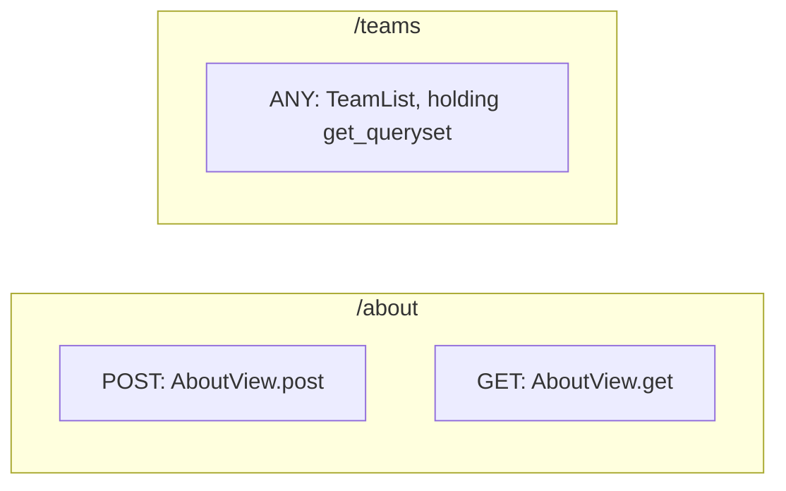
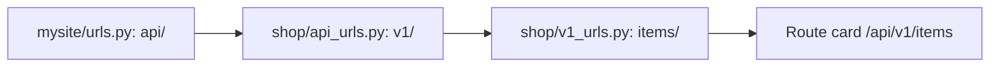

# Route card: Django

The [route card](../route-card.md) of a Django route. The rules every route card shares are on that page.

## Registrations

**Each `path` or `re_path` in a URL list registers the view it names**, for the path in its first argument. The view is the handler; a view written in another file is drawn inside the route card all the same.

| Code | The path of the card |
|---|---|
| `path("users/", user_list)` | `/users`: from the root, with no slash at its end |
| `path("users/<int:pk>/", user_detail)` | `/users/<int:pk>`: converters as written |
| `path("", index)` | `/` |
| `re_path(r"^legacy/(?P<slug>[-\w]+)/$", legacy)` | `/legacy/(?P<slug>[-\w]+)`: the pattern without its `^` and its `$` |

A view is named directly, `user_list`, or through the module it is in, `views.user_list`. **A URL list that only lists routes has no card**: `urlpatterns` adds nothing to the route cards it holds.

## Methods

**A function view sits under the methods its decorators allow**, and under ANY when none says, since Django sends it every method.

| Decorator of the view | Heading |
|---|---|
| None | ANY |
| `@require_GET` | GET |
| `@require_POST` | POST |
| `@require_safe` | GET · HEAD |
| `@require_http_methods(["GET", "POST"])` | `GET · POST` |

The decorator is read wherever it is written among the decorators of the view: `@login_required` above `@require_POST` keeps the view under POST.

```python
# shop/views.py
@require_http_methods(["GET", "POST"])
def user_detail(request, pk):
    return find_user(pk)

# shop/urls.py
urlpatterns = [
    path("users/<int:pk>/", views.user_detail),
]
```

```
 ┌ ⇢ /users/<int:pk> ─────────────────────────────── shop/urls.py ┐
 │ Route                                                 Modified │
 │ Shows and changes a user                                       │
 │ GET · POST                                                     │
 │ ┌ ƒ user_detail ────────────────────────────── shop/views.py ┐ │
 │ │ Function                                          Modified │ │
 │ │ Finds the user                                             │ │
 │ │ ╔════════════════════════════════════════════════════════╗ │ │
 │ │ ║ find_user                                              ║○──▶ find_user
 │ │ ╚════════════════════════════════════════════════════════╝ │ │
 │ └────────────────────────────────────────────────────────────┘ │
 └────────────────────────────────────────────────────────────────┘
```

## View classes

**A class-based view puts each of its methods named after a method of HTTP under the heading of that method.** `UserView.as_view()` in a `path` makes `get`, `post`, `put`, `patch`, `delete`, `head` and `options` of `UserView` the handlers, and the class has no card of its own when every method it has is drawn there. **A view class with none of those methods is the handler itself, under ANY**, as a `ListView` that only sets `get_queryset`: the class card is drawn inside the route card, with its methods.

```python
# shop/views.py
class AboutView(View):
    def get(self, request):
        return show_about()

    def post(self, request):
        return save_about()

class TeamList(ListView):
    def get_queryset(self):
        return active_teams()

# shop/urls.py
urlpatterns = [
    path("about/", AboutView.as_view()),
    path("teams/", TeamList.as_view()),
]
```

```
 ┌ ⇢ /about ──────────────────────────────────────── shop/urls.py ┐
 │ Route                                                 Modified │
 │ Shows and saves the about page                                 │
 │ POST                                                           │
 │ ┌ ƒ AboutView.post ─────────────────────────── shop/views.py ┐ │
 │ │ Method                                            Modified │ │
 │ │ Saves the page                                             │ │
 │ │ ╔════════════════════════════════════════════════════════╗ │ │
 │ │ ║ save_about                                             ║○──▶ save_about
 │ │ ╚════════════════════════════════════════════════════════╝ │ │
 │ └────────────────────────────────────────────────────────────┘ │
 │ GET                                                            │
 │ ┌ ƒ AboutView.get ──────────────────────────── shop/views.py ┐ │
 │ │ Method                                            Modified │ │
 │ │ Shows the page                                             │ │
 │ │ ╔════════════════════════════════════════════════════════╗ │ │
 │ │ ║ show_about                                             ║○──▶ show_about
 │ │ ╚════════════════════════════════════════════════════════╝ │ │
 │ └────────────────────────────────────────────────────────────┘ │
 └────────────────────────────────────────────────────────────────┘
```



## Includes

**An `include` is a mount: its path goes before every path of what it includes.** The `path` that holds it is no route.

| Code | What it includes |
|---|---|
| `path("api/", include("shop.api_urls"))` | The URL lists of the module the text names, `shop/api_urls.py`, in whatever folder of the repository it is |
| `path("api/", include(("shop.api_urls", "api")))` | The same, with a namespace |
| `path("admin/", include(admin_urls))`, with `from shop import admin_urls` | The URL lists of the module imported whole, a relative import among them |
| `path("blog/", include([path("posts/", posts)]))` | The paths written in the list |

An include inside an included module goes below the one above it: `api/` including `shop.api_urls`, which includes `v1/` of `shop.v1_urls`, puts `/api/v1` before the routes of `shop/v1_urls.py`.

```python
# mysite/urls.py
urlpatterns = [
    path("api/", include("shop.api_urls")),
]

# shop/api_urls.py
urlpatterns = [
    path("v1/", include("shop.v1_urls")),
]

# shop/v1_urls.py
urlpatterns = [
    path("items/", items),
]
```


