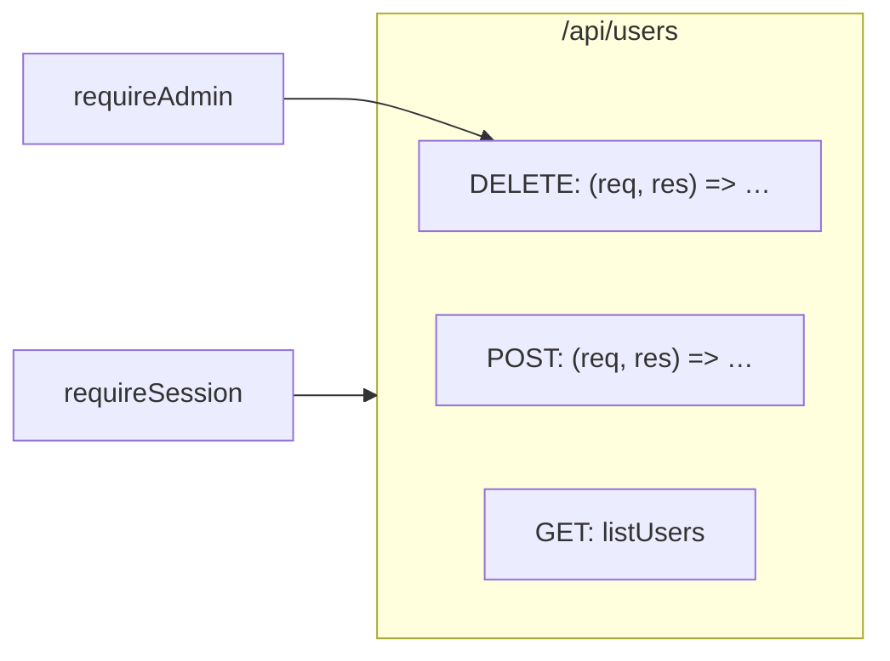

# Route card: Express

The [route card](../route-card.md) of an Express route. The rules every route card shares are on that page.

## Registrations

**A call of a method on an app or a router registers a handler**, for the path in its first argument. The last argument is the handler, and every argument between them is middleware of that registration.

| Code | Heading |
|---|---|
| `router.get(path, …)`, `post`, `put`, `patch`, `delete`, `head`, `options` | The method of the call |
| `router.all(path, …)` | ANY |
| `router.route("/users/:id").get(showUser).delete(removeUser)` | The method of each call, all of them at the path `route` names |

The app is the value `express()` makes, and a router the value `express.Router()` makes, with `express` imported or bound by `require("express")`. A handler written in place is named after its signature, `(req, res) => …`.

```ts
// server/routes/users.ts
import { listUsers } from "../controllers/users"

router.post("/api/users", requireSession, async (req, res) => {
  const user = await db.user.create({ data: req.body })
  res.status(201).json(user)
})
router.get("/api/users", listUsers)
router.delete("/api/users", requireAdmin, async (req, res) => {
  if (!req.body.ids) return res.status(400).end()
  await db.user.deleteMany({ where: { id: { in: req.body.ids } } })
  res.status(204).end()
})

// server/controllers/users.ts
export const listUsers = async (req, res) => {
  const users = await db.user.findMany()
  res.json(users)
}
```

```
 ┌ ⇢ /api/users ──────────────────────── server/routes/users.ts ┐
 │ Route                                               Modified │
 │ Lists, creates and deletes users                             │
 │ POST                                                         │  ← a method heading
 │ ┌ ƒ (req, res) => … ─────────────── server/routes/users.ts ┐ │
 │ │ Callback                                        Modified │ │
 │ │ Creates a user from the form                             │ │
 │ │ ┌──────────────────────────────────────────────────────┐ │ │
 │ │ │ req                                                  │ │ │
 │ │ └──────────────────────────────────────────────────────┘ │ │
 │ │ ╔══════════════════════════════════════════════════════╗ │ │
 │ │ ║ Saves the new user                                   ║○──▶ db.user.create
 │ │ ║ user                                                 ║ │ │
 │ │ ╚══════════════════════════════════════════════════════╝ │ │
 │ └──────────────────────────────────────────────────────────┘ │
 │ GET                                                          │
 │ ┌ ƒ listUsers ──────────────── server/controllers/users.ts ┐ │  ← a named handler from another file
 │ │ Function                                                 │ │
 │ │ Sends every user                                         │ │
 │ │ ┌──────────────────────────────────────────────────────┐ │ │
 │ │ │ users                                                │○──▶ db.user.findMany
 │ │ └──────────────────────────────────────────────────────┘ │ │
 │ └──────────────────────────────────────────────────────────┘ │
 │ DELETE                                                       │
 │ ┌ ƒ (req, res) => … ─────────────── server/routes/users.ts ┐ │
 │ │ Callback                                                 │ │
 │ │ Deletes the users an admin picked                        │ │
 │ │ ┌──────────────────────────────────────────────────────┐ │ │
 │ │ │ req                                                  │ │ │
 │ │ └──────────────────────────────────────────────────────┘ │ │
 │ │ ┌──────────────────────────────────────────────────────┐ │ │
 │ │ │ Condition :9                                         │ │ │
 │ │ └──────────────────────────────────────────────────────┘ │ │
 │ │ ┌──────────────────────────────────────────────────────┐ │ │
 │ │ │ db.user.deleteMany                                   │○──▶ db.user.deleteMany
 │ │ └──────────────────────────────────────────────────────┘ │ │
 │ └──────────────────────────────────────────────────────────┘ │
 └──────────────────────────────────────────────────────────────┘
```

## Mounts

**`use` with a path first mounts what it is handed under that path.** A router handed to `app.use("/api", users)` is no middleware: every route registered on `users` takes `/api` before its path, in whatever file `users` is declared. A router mounted on a router mounted on the app takes both prefixes.

```ts
// server/routes/users.ts
export const users = Router()
users.route("/users/:id").get(listUsers).delete(async (req, res) => { … })

// server/app.ts
app.use(requireSession)
app.use("/api", users)
```

Both handlers are in one route card, `/api/users/:id`.

## Middleware

| Code | Middleware of | Its line |
|---|---|---|
| `requireSession` in `router.post("/api/users", requireSession, …)` | That registration | To the POST handler card |
| `app.use(requireSession)` | The whole app, and every router mounted on it | To each route card of the app |
| `app.use("/admin", requireAdmin)` | The routes of the app below `/admin` | To each of those route cards |
| `router.param("id", loadUser)` | The whole router | To each route card of the router |


