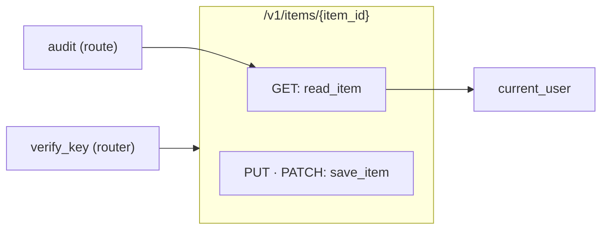

# Route card: FastAPI

The [route card](../route-card.md) of a FastAPI route. The rules every route card shares are on that page.

## Registrations

**A decorator of an app or a router registers the function it decorates**, for the path in its first argument. The function is the registration and its handler.

| Code | Heading |
|---|---|
| `@app.get(path)`, `post`, `put`, `patch`, `delete`, `head`, `options` | The method of the decorator |
| `@app.trace(path)`, `@app.websocket(path)` | ANY |
| `@app.api_route(path, methods=["PUT", "PATCH"])` | One heading of every method it names, `PUT · PATCH` |
| `app.add_api_route(path, read_item, methods=["GET"])` | The method it names, with `read_item` as the handler |

The app is the value `FastAPI()` makes, and a router the value `APIRouter()` makes.

## Routers

**A router's routes take its prefix, and the prefix it is included under.** `APIRouter(prefix="/items")` is the prefix of every route on it, and `app.include_router(router, prefix="/v1")` is a mount that puts `/v1` before them, in whatever file `router` is declared. A route at `"/"` on a router with a prefix is at the prefix itself.

## Dependencies and middleware

**A dependency in `dependencies` is middleware. A dependency of a parameter is a call.**

| Code | Middleware of | Its line |
|---|---|---|
| `Depends(audit)` in `@router.get(path, dependencies=[…])` | That registration | From `audit` to the handler card |
| `Depends(verify_key)` in `APIRouter(dependencies=[…])` | The routes of the router | From `verify_key` to each route card of the router |
| `Depends(verify_key)` in `app.include_router(router, dependencies=[…])` | The routes of the included router | From `verify_key` to each of its route cards |
| `Depends(verify_key)` in `FastAPI(dependencies=[…])` | The whole app | From `verify_key` to each route card of the app |
| `@app.middleware("http")` | The whole app | From the decorated function to each route card of the app |
| `user=Depends(current_user)` in the parameters of a handler | None: the handler calls it | From the handler card to `current_user` |

The call `Depends(…)` is no node: the line goes from the function it names.

```python
# shop/items.py
router = APIRouter(prefix="/items", dependencies=[Depends(verify_key)])

@router.get("/{item_id}", dependencies=[Depends(audit)])
async def read_item(item_id: int, user=Depends(current_user)):
    return find_item(item_id)

@router.api_route("/{item_id}", methods=["PUT", "PATCH"])
async def save_item(item_id: int):
    return save(item_id)

# shop/main.py
app.include_router(router, prefix="/v1")
```

```
 ┌ ⇢ /v1/items/{item_id} ────────────────────────── shop/items.py ┐
 │ Route                                                 Modified │
 │ Shows and saves an item                                        │
 │ GET                                                            │
 │ ┌ ƒ read_item ──────────────────────────────── shop/items.py ┐ │  ◀── audit
 │ │ Function                                          Modified │ │
 │ │ Finds the item for the user                                │ │
 │ │ ┌────────────────────────────────────────────────────────┐ │ │
 │ │ │ item_id                                                │ │ │
 │ │ └────────────────────────────────────────────────────────┘ │ │
 │ │ ╔════════════════════════════════════════════════════════╗ │ │
 │ │ ║ find_item                                              ║○──▶ find_item
 │ │ ╚════════════════════════════════════════════════════════╝ │ │
 │ └────────────────────────────────────────────────────────────┘ │
 │ PUT · PATCH                                                    │
 │ ┌ ƒ save_item ──────────────────────────────── shop/items.py ┐ │
 │ │ Function                                          Modified │ │
 │ │ Saves the item                                             │ │
 │ │ ┌────────────────────────────────────────────────────────┐ │ │
 │ │ │ item_id                                                │ │ │
 │ │ └────────────────────────────────────────────────────────┘ │ │
 │ │ ╔════════════════════════════════════════════════════════╗ │ │
 │ │ ║ save                                                   ║○──▶ save
 │ │ ╚════════════════════════════════════════════════════════╝ │ │
 │ └────────────────────────────────────────────────────────────┘ │
 └────────────────────────────────────────────────────────────────┘
```


