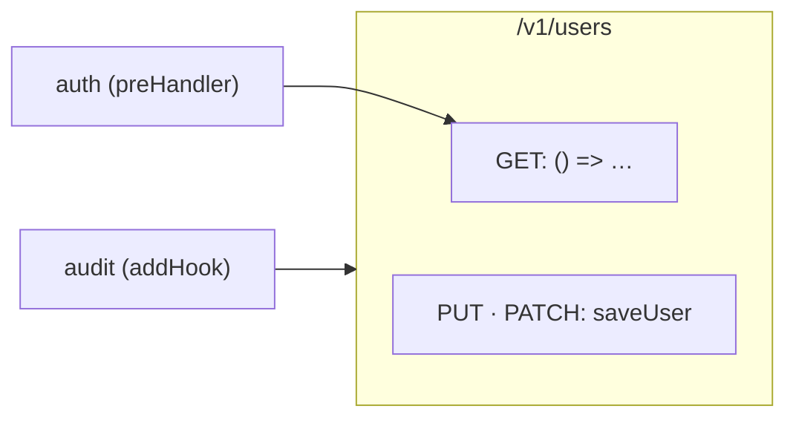

# Route card: Fastify

The [route card](../route-card.md) of a Fastify route. The rules every route card shares are on that page.

## Registrations

**A call of a method on a Fastify instance registers a handler**, for the path in its first argument. The last argument is the handler, and an options object between them can name the hooks of the route.

| Code | Heading |
|---|---|
| `fastify.get(path, handler)`, `post`, `put`, `patch`, `delete`, `head`, `options` | The method of the call |
| `fastify.all(path, handler)` | ANY |
| `fastify.route({ method: "GET", url, handler })` | The method it names |
| `fastify.route({ method: ["PUT", "PATCH"], url, handler })` | One heading of every method it names, `PUT · PATCH` |

The instance is the value `Fastify()` makes. A handler written in place is named after its signature, `() => …`.

## Plugins

**A plugin is a function whose first parameter is an instance.** Its routes are read in each of the ways a plugin is written:

| Plugin | How the codegraph knows its parameter |
|---|---|
| Written in place, `app.register(async (fastify) => { … })` | The call it is written in |
| A function of the same file handed by name, `app.register(userRoutes)` | The call its name is handed to |
| A function of another file, `export default async function userRoutes(fastify)` or `module.exports = userRoutes`, registered through `import`, `const userRoutes = require("./users")` or `app.register(require("./users"))` | The call in the other file that hands it over |
| `async function userRoutes(fastify: FastifyInstance)` | The type of its parameter, wherever it is registered |
| `const userRoutes: FastifyPluginAsync = async (fastify) => …`, and `FastifyPluginCallback` | The type of its declaration |

**A plugin that only registers routes has no card of its own.** `register(plugin, { prefix: "/v1" })` puts `/v1` before every route of the plugin, and a plugin registered inside a plugin takes both prefixes: `app.register(api, { prefix: "/v1" })` above `fastify.register(userRoutes, { prefix: "/users-api" })` puts `/users` at `/v1/users-api/users`. A plugin typed but registered nowhere the group can see has no prefix.

An app written with CommonJS is read as one written with `import`: `const fastify = require("fastify")({ logger: true })` is an instance.

## Middleware

| Code | Middleware of | Its line |
|---|---|---|
| `auth` in `fastify.get("/users", { preHandler: [auth] }, …)` | That registration | To its handler card |
| `onRequest`, `preParsing`, `preValidation` and `preHandler` in the options, alone or in a list, and in the options of `route` | That registration | To its handler card |
| `app.addHook("onRequest", audit)` | The instance it is added on: the app and every plugin registered on it, or the plugin it is added in | To each route card it reaches |

```ts
// server/plugins/users.ts
import type { FastifyInstance } from "fastify"

export default async function userRoutes(fastify: FastifyInstance) {
  fastify.get("/users", { preHandler: [auth] }, async () => {
    return db.user.findMany()
  })
  fastify.route({ method: ["PUT", "PATCH"], url: "/users", handler: saveUser })
}

// server/app.ts
const app = Fastify()
app.addHook("onRequest", audit)
app.register(userRoutes, { prefix: "/v1" })
```

```
 ┌ ⇢ /v1/users ────────────────────────── server/plugins/users.ts ┐
 │ Route                                                 Modified │
 │ Lists and saves users                                          │
 │ GET                                                            │
 │ ┌ ƒ () => … ──────────────────────── server/plugins/users.ts ┐ │  ◀── auth (preHandler)
 │ │ Callback                                          Modified │ │
 │ │ Sends every user                                           │ │
 │ │ ╔════════════════════════════════════════════════════════╗ │ │
 │ │ ║ db.user.findMany                                       ║○──▶ db.user.findMany
 │ │ ╚════════════════════════════════════════════════════════╝ │ │
 │ └────────────────────────────────────────────────────────────┘ │
 │ PUT · PATCH                                                    │  ← a heading of several methods
 │ ┌ ƒ saveUser ─────────────────── server/controllers/users.ts ┐ │
 │ │ Function                                                   │ │
 │ │ Saves the user from the form                               │ │
 │ │ ┌────────────────────────────────────────────────────────┐ │ │
 │ │ │ db.user.upsert                                         │○──▶ db.user.upsert
 │ │ └────────────────────────────────────────────────────────┘ │ │
 │ └────────────────────────────────────────────────────────────┘ │
 └────────────────────────────────────────────────────────────────┘
```



`userRoutes` has no card: it only registers routes.
