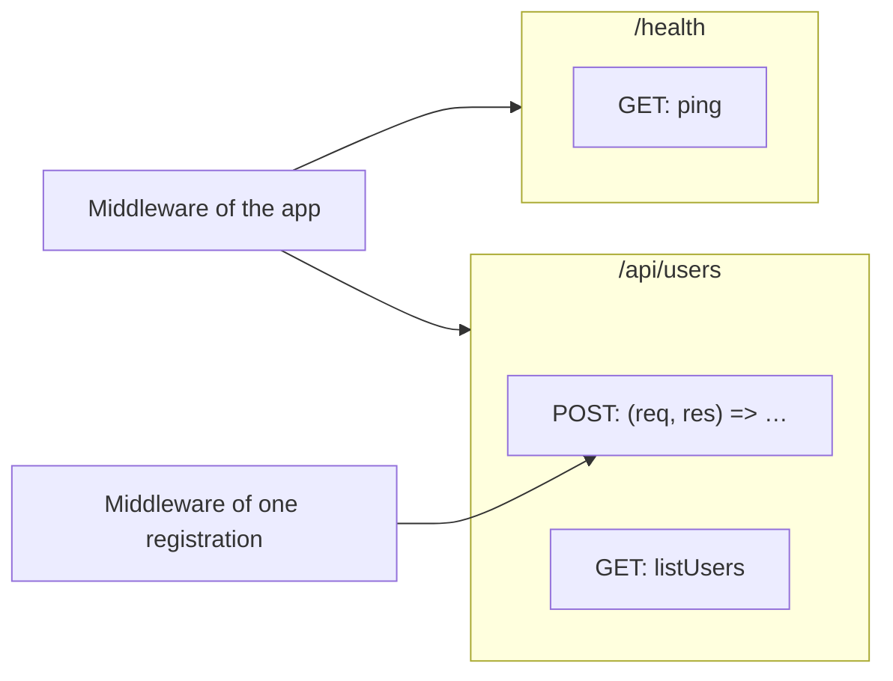
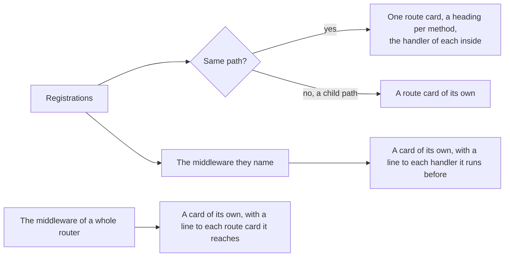

# Route card

The card of a route path in a [Journey Flow Diagram](../journey-flow-diagram.md): the handlers a framework runs when a request reaches one path. This page holds what every route library shares, and is where to start when a library is added. What one library writes and how its routes are read is on the page of that library. The rules every card shares, its frame, its rows and its lines, are in [On the page](../journey-flow-diagram.md#on-the-page).

| Library | Page | Registration |
|---|---|---|
| Express | [libraries/express.md](libraries/express.md) | A call on a router |
| Fastify | [libraries/fastify.md](libraries/fastify.md) | A call on an instance, in a plugin or not |
| Flask | [libraries/flask.md](libraries/flask.md) | A decorator on a function, a call naming a view |
| FastAPI | [libraries/fastapi.md](libraries/fastapi.md) | A decorator on a function |
| Next.js | [libraries/nextjs.md](libraries/nextjs.md) | An export of a file, the path read from its folders |

A route of a framework with no page here has no library file: the catalogue still recognises it with its path and its method, and each registration is a node of its own.

## What is a route card

**A route card stands for one route path, not for one block.** Every registration of a handler for the same path, such as `router.get("/api/users", …)` and `router.post("/api/users", …)`, is one node. The registrations are the blocks of the type `route`, which the [catalogue](../codegraph/catalogue.md) recognises with their path and their method, and the `card` of each says it is one.

| Field | What it holds |
|---|---|
| `id` | The path of the file of the first registration and the route path, as in `server/routes/users.ts#route@/api/users` |
| `type` | `route` |
| `codeBlocks` | The registrations of the path, in the order they are written, then the blocks the registrations hold that are no node |
| `children` | The handler of each registration, as a [function card](function-card.md) |

The head of the card names the route path, `/api/users`, with the path of the file. Its type reads Route.

**Every block a library reads is a part of the route card**, one kind of the `part` of a block's `card`:

| Part | What it is | Where it is drawn |
|---|---|---|
| `holder` | A call that registers a handler for a path and a method | None: it is the card |
| `handler` | The function a registration runs. A decorated function is its own registration and its handler. | A card inside the route card, under the heading of its method |
| `middleware` | A function that runs before a handler, or before every route of a router | A card of its own, with a line to what it runs before |
| `mount` | A call that hands a router or a plugin to another router, under a prefix | Nowhere: its prefix goes before the path of every route below it |
| `page` | A page of a framework whose middleware runs before visits too, with its path as `groupKey`, as a page of Next.js | Its own card, a component card: the part only gives middleware of the whole app a page to reach |
| `server-action` | A function the browser calls with a request at an address the framework makes, with no path, as a server action of Next.js | A card of its own, with no route card around it |

## Methods and handlers

**A route card groups its handlers by method**, in this order:

```
POST · PUT · PATCH · GET · DELETE · HEAD · OPTIONS · ANY
```

A method the path has no registration of has no heading. **A registration that names several methods is under one heading that names them all**, in the order they are written, `GET · POST`, after the headings of one method and before ANY. A registration that names no method, every method, or a method with no heading of its own is under ANY.

**Under each heading is the handler of that method, drawn as a function card inside the route card.** The handler is the function the registration runs:

| A handler | Drawn as |
|---|---|
| Written in place, in the registration | A function card named after its signature, `(req, res) => …` |
| Named by the registration, from its own file or another | Its function card, which keeps the path of its own file |
| A decorated function, or a function a route file exports | Its function card: the function is the registration too |
| A method of a view class the registration names | The card of each method named after a method of HTTP, under the heading of that method |

**A named handler is drawn inside the route card**, wherever it is declared, and has no card of its own on the board. A route comes first, as [component and route come first](../journey-flow-diagram.md#component-and-route-come-first) says, so **a view class has no card of its own** when every method it has is drawn in a route card.

## The path of a route card

**The path of a route card is the path the route answers on.** The prefix of the router a route is registered on goes before its path, and so does the prefix of every mount above that router, outermost first, in any file of the group. `/api` mounted above `/v1` above `/users` is `/api/v1/users`. How the mounts are found is in [The routes below a mount](../codegraph/code-blocks.md#the-routes-below-a-mount).

**A function that only registers routes has no card of its own**, as a plugin of Fastify does: its routes are route cards, and the function adds nothing to them.

## Middleware

**Middleware is a card of its own**, beside the route card, never a row or a card inside it. Where its line goes depends on what it runs before:

| Middleware | Its line |
|---|---|
| Of one registration, named in it before its handler | From the middleware to the head of each handler card it runs before |
| Of a whole app or router | From the middleware to each route card it reaches, one line per route card, not one per handler |
| Of a whole app, by the paths it runs before, as Next.js middleware | From the middleware to each route card and each `page` whose path its patterns reach |

The routes middleware of a whole router reaches are the routes of that router and of every router mounted below it, and only those below its own path when it is mounted at one. The block of such middleware lists them in `card.routePaths`.



## Child routes

**A child route is a card of its own.** `/api/users/:userId` is a route card beside `/api/users`, placed by the page like any other card, with no line from it, and drawn the same way.



The edge from a route card to each handler inside it stays in `journeyNodeEdges`, and the page leaves it out.

## Adding a route library

A route library is added in the folders of its language, one file in each, and nothing outside them changes:

| What | Where | What it holds |
|---|---|---|
| The library file | `packages/codegraph/src/code-blocks/languages/<language>/libraries/<library>.ts`, listed in `TYPESCRIPT_LIBRARIES` or `PYTHON_LIBRARIES` of that folder's `index.ts` | A `Library`: its name, specifiers and documented version, the patterns of its registrations, and `readCards: readRouteCards` from `code-blocks/libraries/route-cards.ts`, with how to name a handler written in place. A registration has a slot that `runs: "route"`, or is a decorator that does, with its `pathAt` and its `method` or `methodAt`; a slot that `runs: "middleware"` is middleware; `prefixAt` on a factory is the prefix of its router, and on a call it makes the call a mount. A library already in the catalogue moves its entry here, and leaves the catalogue. |
| Its fixtures | `packages/codegraph/src/code-blocks/languages/<language>/libraries/__tests__/` | Code each pattern matches and code it rejects, and the `card` each block gets |
| The card file | `packages/codegraph/src/journey-flow-diagram/languages/<language>/libraries/<library>.ts`, listed in `TYPESCRIPT_CARD_RULES` or `PYTHON_CARD_RULES` of `journey-flow-diagram/languages/<language>/index.ts` | A `LibraryCardRules` that extends the shared `route` card, with no rules of its own unless its card does something differently |
| The band | `METHOD_HEADINGS` in `packages/codegraph/src/journey/cards/route.ts` | The one order of the method headings every route library shares |
| Its page | `docs/vocabulary/journey-flow-diagram/libraries/<library>.md`, and a row in the table at the top of this page | How the library registers routes, names handlers, mounts routers and runs middleware, an example of its code and a drawing of its card |

**Start from the page of the closest library.** A library that registers with a call on a router, as Express and Fastify do, writes a `holder`, a `handler` slot and `middleware` slots. A library that registers with a decorator, as Flask and FastAPI do, makes the decorated function the handler, and the slots of the decorator its middleware. A library that registers with the path of a file, as Next.js does, has file patterns whose exports `runs: "route"`, and `readExportCards: readExportRouteCards` makes each function they name a `handler` of the path its folders give. What a pattern cannot say goes in a `readCards` of the library's own, built on `readRouteCards`, as Flask's marks the hooks that run before every route of the app.
