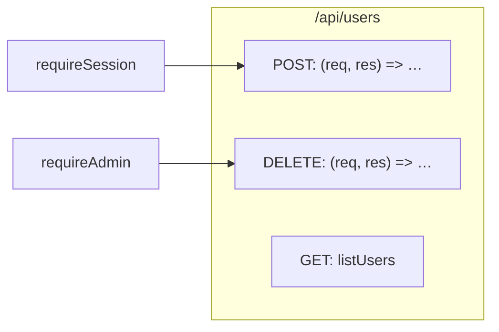
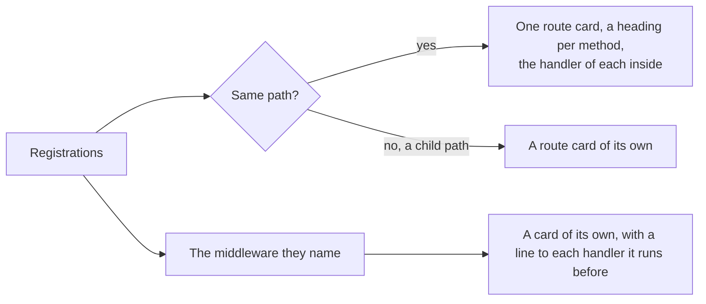

# Route card

The card of a route path in a [Journey Flow Diagram](../journey-flow-diagram.md). The rules every card shares, its frame, its rows and its lines, are in [On the page](../journey-flow-diagram.md#on-the-page).

## What is a route card

**A route card stands for one route path, not for one block.** Every registration of a handler for the same path, such as `router.get("/api/users", …)` and `router.post("/api/users", …)`, is one node. The registrations are the blocks of the type `route`, which the [catalogue](../codegraph/catalogue.md) recognises with their path and their method, and the `card` of each says it is one: the library files of Express, Fastify, Flask and FastAPI write it, with the path below the prefix of the router it is registered on. A route of a framework with no library file is a node of its own, one per registration.

| Field | What it holds |
|---|---|
| `id` | The path of the file of the first registration and the route path, as in `server/routes/users.ts#route@/api/users` |
| `type` | `route` |
| `codeBlocks` | The registrations of the path, in the order they are written, then the blocks the registrations hold that are no node |
| `children` | The handler of each registration, as a [function card](function-card.md) |

The head of the card names the route path, `/api/users`, with the path of the file.

## Methods and handlers

**A route card groups its handlers by method**, in this order:

```
POST · PUT · PATCH · GET · DELETE · HEAD · OPTIONS · ANY
```

A method the path has no registration of has no heading. A registration that names no method, or every method, as `router.all` and a Flask route with a list of methods do, is under ANY.

**Under each heading is the handler of that method, drawn as a function card inside the route card.** The handler is the function the registration runs:

| Registration | Handler |
|---|---|
| `router.post("/api/users", async (req, res) => { … })` | The function written in place |
| `router.get("/api/users", listUsers)` | `listUsers`, from its own file or from another |
| `@app.get("/api/users")` above `def users():` | The decorated function, which is the registration too |

**A named handler is drawn inside the route card**, wherever it is declared, and has no card of its own on the board. Its card keeps the path of its own file. A route comes first, as [component and route come first](../journey-flow-diagram.md#component-and-route-come-first) says.

```ts
// server/routes/users.ts
import { listUsers } from "../controllers/users"

router.post("/api/users", requireSession, async (req, res) => {
  const user = await db.user.create({ data: req.body })
  res.status(201).json(user)
})
router.get("/api/users", listUsers)
router.delete("/api/users", requireAdmin, async (req, res) => {
  if (!req.body.ids) return res.status(400).end()
  await db.user.deleteMany({ where: { id: { in: req.body.ids } } })
  res.status(204).end()
})

// server/controllers/users.ts
export const listUsers = async (req, res) => {
  const users = await db.user.findMany()
  res.json(users)
}
```

```
 ┌ ⇢ /api/users ──────────────────────── server/routes/users.ts ┐
 │ Route                                               Modified │
 │ Lists, creates and deletes users                             │
 │ POST                                                         │  ← a method heading
 │ ┌ ƒ (req, res) => … ─────────────── server/routes/users.ts ┐ │
 │ │ Callback                                        Modified │ │
 │ │ Creates a user from the form                             │ │
 │ │ ┌──────────────────────────────────────────────────────┐ │ │
 │ │ │ req                                                  │ │ │
 │ │ └──────────────────────────────────────────────────────┘ │ │
 │ │ ╔══════════════════════════════════════════════════════╗ │ │
 │ │ ║ Saves the new user                                   ║○──▶ db.user.create
 │ │ ║ user                                                 ║ │ │
 │ │ ╚══════════════════════════════════════════════════════╝ │ │
 │ └──────────────────────────────────────────────────────────┘ │
 │ GET                                                          │
 │ ┌ ƒ listUsers ──────────────── server/controllers/users.ts ┐ │  ← a named handler from another file
 │ │ Function                                                 │ │
 │ │ Sends every user                                         │ │
 │ │ ┌──────────────────────────────────────────────────────┐ │ │
 │ │ │ users                                                │○──▶ db.user.findMany
 │ │ └──────────────────────────────────────────────────────┘ │ │
 │ └──────────────────────────────────────────────────────────┘ │
 │ DELETE                                                       │
 │ ┌ ƒ (req, res) => … ─────────────── server/routes/users.ts ┐ │
 │ │ Callback                                                 │ │
 │ │ Deletes the users an admin picked                        │ │
 │ │ ┌──────────────────────────────────────────────────────┐ │ │
 │ │ │ req                                                  │ │ │
 │ │ └──────────────────────────────────────────────────────┘ │ │
 │ │ ┌──────────────────────────────────────────────────────┐ │ │
 │ │ │ Condition :9                                         │ │ │
 │ │ └──────────────────────────────────────────────────────┘ │ │
 │ │ ┌──────────────────────────────────────────────────────┐ │ │
 │ │ │ db.user.deleteMany                                   │○──▶ db.user.deleteMany
 │ │ └──────────────────────────────────────────────────────┘ │ │
 │ └──────────────────────────────────────────────────────────┘ │
 └──────────────────────────────────────────────────────────────┘
```

## Middleware

**Middleware is a card of its own**, beside the route card, never a row or a card inside it. The middleware a registration names before its handler, such as `requireSession` in `router.post("/api/users", requireSession, …)`, runs before that handler, so **a line runs from the card of the middleware to the head of each handler card it runs before**.



## Child routes

**A child route is a card of its own.** `/api/users/:userId` is a route card beside `/api/users`, placed by the page like any other card, with no line from it, and drawn the same way.



The edge from a route card to each handler inside it stays in `journeyNodeEdges`, and the page leaves it out.
