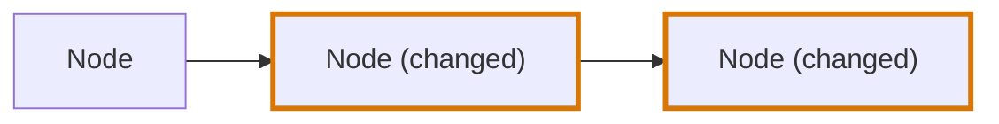
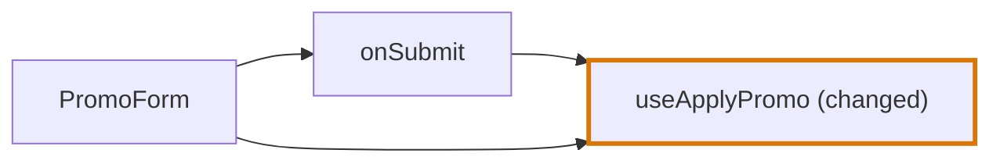
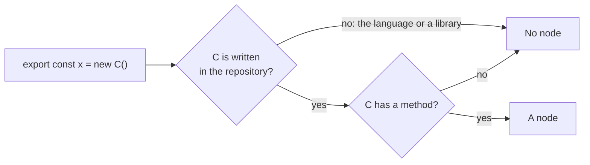

# Trace Diagram

## Definition

The Trace Diagram shows how execution reaches a change. It answers the reviewer's first question about any change: when does this code run, and what leads to it?

The Trace Diagram reads like a debugging trace of the change. It is drawn in the order the code runs, from the code that starts a path to the changed code:



Every path starts at a node nothing leads to and ends at changed code. The diagram does not continue past the last change on a path; what a change affects afterwards is shown by the [Blast Diagram](blast-diagram.md).

In the diagrams of this entry a thick border marks a changed node.

The diagram is drawn by the [codegraph](codegraph.md), from the [chains](codegraph/chains.md) of one group of [code blocks](codegraph/code-blocks.md) that lead to a change of one [segment](codegraph/segments.md).

## Cards

On the page each node is a card. This entry holds the rules every card shares; each kind of card has a page of its own for how it arranges its rows and the cards inside it.

| Card | The node of | Its rows | Cards inside it |
|---|---|---|---|
| [Component card](trace-diagram/component-card.md) | A component | Its parameters as chips under its head, then rows under headings: State, Hooks, Effects, Calls, Triggers, Steps | The components it renders |
| [Function card](trace-diagram/function-card.md) | A function, a hook, a method, an event, an effect, a callback, the handler of a route, a procedure | As written, no headings. Under the headings of a component card when it returns a function. | The function it returns |
| [Class card](trace-diagram/class-card.md) | A class with a method | Under Properties | Its methods, under Methods, then the classes that extend it |
| [Route card](trace-diagram/route-card.md) | A route path | None | The handler of each method, under a heading per method |
| [tRPC router card](trace-diagram/libraries/trpc.md) | A router of procedures, and a [GraphQL resolver of NestJS](trace-diagram/libraries/nestjs.md#graphql-resolvers) | None | Each procedure, under a heading per procedure type |
| [State card](trace-diagram/state.md) | A store of Zustand, Pinia, Redux, MobX, Valtio, XState Store, Nano Stores or Effector, and an API of RTK Query | Under State, and under Getters, Actions and Selectors for the stores drawn rows only | For Redux, its reducers, thunks, extra reducers, listeners and selectors, the cases of an Effector store, and the endpoints of an API |

## The shape

```ts
interface TraceDiagram {
  astCodeGroup: ASTCodeGroupGraph
  importGraphGroup: ImportGraphGroup
  title: string | null
  description: string | null
  traceNodes: TraceNode[]
  traceNodeEdges: TraceNodeEdge[]
}

interface TraceNode {
  id: string
  type: CodeBlockType
  label: string | null
  description: string | null
  codeBlocks: CodeBlock[]
  diffCodeBlocks: CodeBlock[]
  children: TraceNode[]
  triggerLabels: TriggerLabel[]
  blockLabels: BlockLabel[]
  rows?: TraceRow[]
  position?: { x: number, y: number }
}

interface TraceRow {
  id: string
  type: CodeBlockType
  label: string | null
  lineStart: number
  lineEnd: number
}

interface TriggerLabel {
  label: string | null
  codeBlock: CodeBlock
}

interface BlockLabel {
  label: string | null
  codeBlock: CodeBlock
}

interface TraceNodeEdge {
  id: string
  from: string
  to: string
  fromRowId?: string
  toSide?: "left" | "top" | "bottom"
}
```

| Field | What it holds |
|---|---|
| `astCodeGroup` | The [group](codegraph/code-blocks.md#the-group) the diagram is drawn from. An alias, not a copy. |
| `importGraphGroup` | The files of the [import graph](codegraph/import-graph.md) that are in that group. An alias. |
| `traceNodes` | The nodes at the top level of the diagram. A node inside another is in its `children`, not here. |
| `traceNodeEdges` | Every edge of the diagram, between nodes at any depth |
| `id` of a node | The id of the block the node stands for, such as `src/pricing.ts#function@3:1`, or `src/pricing.ts#condition@5:3` for a block inside a function. A route card stands for a route path, and its id is the file of its first registration and the path: `server/routes/users.ts#route@/api/users`. |
| `type` | The [type](codegraph/block-types.md) of the block the node stands for |
| `label`, `description` | What the agent writes. `null` until it is written. |
| `codeBlocks` | The blocks of the node: the block it stands for first, then the blocks inside it that a chain passes through or that have a change, in the order they are written, down to the blocks that have a node of their own. Such a block is the last one listed on its way down: what is inside it is in its own node. Each is the same object as in `astCodeGroup`. |
| `diffCodeBlocks` | The blocks of `codeBlocks` that have a change. A node with none is only on the way to a change. |
| `children` | The nodes drawn inside this one, as [Children](#children) says |
| `triggerLabels` | The blocks of the node an agent writes a line about, each with that line |
| `blockLabels` | The listed blocks of the node, its state, hooks, effects, calls and steps, each with the label an agent writes about it. `null` until it is written. A step of several statements is listed by the block of its first statement. |
| `from`, `to` of an edge | The ids of two nodes: the first runs the second |
| `rows` | The rows of the node as an author chose them, each with its type, its label and its lines. A node without `rows` lists its rows from its `codeBlocks`, as [On the page](#on-the-page) says. |
| `position` | Where an author dragged the node to, on the board. A node without one is placed by the page. |
| `fromRowId`, `toSide` of an edge | Only on a line an author drew: the row the line leaves, and the side of the node it reaches |

A node has no size, and no position until an author drags it. The page places the nodes and the edges when it draws them.

## Nodes

**A node is a unit of behaviour: code that runs on an occasion of its own.** Every chain is walked from its top through `nextBlocks`, and each block on the way, and each block with a change, belongs to the nearest block around it that is a node.

**A root block is a node, but a statement.** The block at the top level of a file that holds a block on a chain is one node. A statement at the top level of a file is none: it has no name to read a node by, and what it runs is a node of its own.

| Code | Node |
|---|---|
| A function or a hook with a block on a chain | One node of the type `function` or `hook`: a [function card](trace-diagram/function-card.md) |
| A component | One node of the type `component`: a [component card](trace-diagram/component-card.md) |
| A class with a method | One node of the type `class`: a [class card](trace-diagram/class-card.md) |
| A value at the top level of a file that is not plain, such as `export const schema = z.object({})` | One node of the type `root-variable` or `state` |
| A value at the top level of a file that holds procedures, such as `export const todoRouter = createTRPCRouter({ … })` | One node: a [tRPC router card](trace-diagram/libraries/trpc.md) |
| The registrations of a route path, such as `router.get("/api/users", …)` | One node for the path: a [route card](trace-diagram/route-card.md) |
| A store, such as `export const useCartStore = create(…)`, `defineStore(…)` or `createSlice(…)`, and an API of RTK Query | One node of the type `state`: a [state card](trace-diagram/state.md) |
| A value that only joins stores, such as `configureStore({ reducer: { cart: cartSlice.reducer } })` | No node, as [Values that join stores](trace-diagram/state.md#values-that-join-stores) says |
| A plain value or a class with no method, such as `export const MAX_RETRIES = 5` | No node. It is a step of every node that reads it, as [Plain code](#plain-code) says. |
| A value at the top level of a file that is not exported and holds no function, such as `const ORDERS_KEY = ["orders"]` | No node. It is a step of every node that reads it, as [Values that are not exported](#values-that-are-not-exported) says. |
| A statement at the top level of a file, such as `app.use(rateLimit())` or `"use client"` | No node, and no edge. A block it runs keeps its own node. |
| A changed import, type or interface | No node. Nothing that runs is different. |

**A node is one root block, but in a component, a class, a function that returns a function, a router, a Redux slice and an API.** A function, a hook and a value at the top level of a file are each one node, whatever is written inside them: an effect, a callback, an event or a route inside one is a row of that node, listed as [On the page](#on-the-page) says, and a line to what it runs leaves from its row. These root blocks hold nodes that are drawn inside their card, as [Children](#children) says:

| Root block | The nodes it holds |
|---|---|
| A class | Each `method`, and nothing inside a method |
| A function, a hook or a method that returns a function | The function it returns |
| A router | Each procedure |
| A Redux slice, and an API of RTK Query | Its reducers, thunks, extra reducers, listeners and selectors, and the endpoints of the API, as [libraries/redux.md](trace-diagram/libraries/redux.md) says |
| A component | The events, effects and callbacks that something triggers, drawn beside it, as the next paragraph says |

**A block inside a component is a node when something triggers it.** An event, an effect and a callback that have a change, or that hold a block on a chain, are each a node of their own: they run on an occasion of their own, after the markup of their component is returned. Every other block stays in the node around it. A block that runs only to produce the markup is part of the render, and the render is one unit. A function or a condition is a step of the node it is written in.

Two other root blocks hold nodes of their own:

| Root block | Why |
|---|---|
| A statement at the top level of a file | It is no node itself, so a route, an effect or a callback it runs keeps a node, as in `app.get("/orders", listOrders)` |
| Any root block, for a block the [catalogue](codegraph/catalogue.md#a-call-that-is-a-node-of-its-own) says is a node of its own | Each procedure of a tRPC router is a node, named after its key, with what is inside it. Nothing inside such a node is a node. A procedure is drawn inside its [router card](trace-diagram/libraries/trpc.md). The actions of a Zustand store are no nodes: they are rows of its [state card](trace-diagram/libraries/zustand.md). |

The table below is for a block inside a component, or inside a statement at the top level of a file.

| A block inside a root block | A node of its own |
|---|---|
| `render-event`, `code-event`, `effect-callback`, `resolver`, `middleware` | Yes. It is triggered. |
| `route` | Yes, with every other registration of its route path: one [route card](trace-diagram/route-card.md) per path |
| The `effect-callback` of a route registration that runs its handler | Yes, drawn inside the route card. When it only names a function, as `listUsers` in `router.get("/api/users", listUsers)`, it is no node, and the function it names is the handler. |
| The `effect-callback` of a route registration that runs a middleware | Yes when the middleware is written in place, a card of its own. When it only names a function, it is no node, and the node of that function is the middleware. |
| `effect`, `component-effect` | Yes. What it is handed runs later. |
| A call the [catalogue](codegraph/catalogue.md) types, such as a `request` or a `data-fetch`, that is handed a callback that does not run `in-place`, such as `api.todo.create.useMutation({ onSuccess })` of a tRPC client | Yes, as an effect is. What it is handed runs later, and a step that calls its result, `createTodo.mutate`, has a line to it. |
| The call that makes a `state` or a `derived`, such as `useCartStore(selectTotal)` in `const total = useCartStore(selectTotal)`, and an `effect-callback` handed to it | No. It is part of the declaration, and runs with the render. An event handed to it, such as an `onChange`, is still a node. |
| An `effect-callback` the [catalogue](codegraph/catalogue.md) says runs `in-place`, such as `select` of `useQuery` | No. It runs with the call, during the render. |
| A `function` written in place of an event or of a callback, such as the arrow function of `onClick={() => save()}` | No. It is the body of that event or callback, so the two are one node. |
| A `function` an event of the same root block is handed by name, such as `submit` in `onSubmit={submit}` | No. It is the body of that event too: the node of the event holds it and what is inside it, and it is no step of the node it is declared in. A call of it from elsewhere leads to the node of the event. |
| `function`, `method`, and a `condition`, `switch`, `switch-case`, `loop`, `try-catch`, `throw`, `data`, `data-fetch`, `cache`, `auth`, `request`, `navigation`, `publish`, `storage`, `telemetry`, `transaction`, `validation`, `config` or `feature-flag` inside one of them, inside a node above or inside a root block that is no component and no hook | No. It is a [step](#on-the-page) of the node it is in: it is invoked or executed there, and it has a row. |
| The same types, directly in the body of a component or of a hook, or inside the markup, a declaration or a component of that body | No. It runs on the way to the `return`. A call the catalogue types that is handed a callback is a node, as the row of `effect` says. |
| `variable`, `property`, `root-argument-value`, `external-value`, `state`, `derived` | No. Declaring a value changes no behaviour: the block that updates it does. |
| `component`, `render-root`, `render`, `render-condition`, `render-loop` | No. It is the render. |
| `deleted` | No. It does not run. |

**A block of another root block is always a node.** A step that runs a function, a hook or a value declared at the top level of a file leads to the node of that root block, with a line from the row of the step. A function a route names as its handler is that node too, drawn inside the route card.

```tsx
export const PromoForm = () => {
  const [code, setCode] = useState("")                 // state: no node
  const { mutate } = useApplyPromo()                   // external-value: no node. useApplyPromo is a node
  const shown = code ? formatCode(code) : null         // a condition in the body: no node
  const submit = () => {                               // handed to onSubmit: the body of that event, no step
    if (code) mutate(code)                             // a condition in it: a step of the event
  }
  return <form onSubmit={submit}>{shown}</form>        // render-event: a node. The markup: no node
}
```



**A node around a node is kept.** A block that is a node has the node of the nearest such block around it, up to its root block, whether or not a chain passes through that one: in a component, `useMutation({ onSuccess })` is a node when a chain starts at its `onSuccess`, and so is `api.todo.create.useMutation({ onSuccess })` of a tRPC client.

**A node has the type of its block.** One list says what a block is and what a node is, so a node of a component is a `component`, a node of a constant a `root-variable`, and a node of a handler a `render-event`.

**Nothing stands for what starts a path from outside the code.** A click, a page visit and a request are not code, so they are not nodes. The top of a chain is a block: the `render-event` a click starts at is a block of its component's node, and a node of its own.

### Plain code

**A root block that is plain is no node.** A value is plain when every value in it, at any depth, is written out as it is. One value made by calling a function anywhere inside it, or one function inside it, makes it a node. A plain value is a step of every node that reads it, as a [value that is not exported](#values-that-are-not-exported) is: each node that reads it lists it as a row.

| Root block | Node | Why |
|---|---|---|
| `export const MAX_RETRIES = 5` | No | A number |
| `export const BASE_URL = "/api"` | No | A string |
| `` export const URL = `${BASE}/users` `` | No | A template string of plain values |
| `export const DEFAULTS = { retries: 3, url: "/api" }` | No | A plain object |
| `export const LIMITS = { page: [10, 20], max: 100 }` | No | Plain all the way down |
| `export enum Role { Admin = "admin", User = "user" }` | No | An enum of plain values |
| `export interface User { … }`, `export type Role = …` | No | A type |
| `CurrentUser = Annotated[User, Depends(current_user)]` in Python | No | An [annotated alias](codegraph/code-blocks.md#a-code-block), a type: each node whose parameter it types holds it, as if written in place there, with the line of what it holds, though it holds a call |
| `export class Point { x = 0; y = 0 }` | No | A class with no method |
| `export const cache = new Map()` | No | `new` of a class of the language |
| `export const redis = new Redis(url)` | No | `new` of a class of a library |
| `export const origin = new Point()` | No | `new` of a class of the repository with no method |
| `export const schema = z.object({})` | Yes | Made by a call. A function of a library is a call too. |
| `export const total = sum(prices)` | Yes | Made by a call |
| `export const config = { key: getKey() }` | Yes | A value made by a call inside |
| `` export const URL = `${prefix()}/users` `` | Yes | A value made by a call inside |
| `export enum Size { Small = 1, Large = scale(2) }` | Yes | A value made by a call inside |
| `export const handlers = { save: () => { … } }` | Yes | A function inside |
| `export const cart = new CartStore()` | Yes | `new` of a class of the repository with a method |
| `export class CartStore { add() { … } }` | Yes | A class with a method |

**`new` is the one call that does not make a value a node on its own.** It makes one only when the class is written in the repository and has a method:



### Component and route come first

**Code that is a component or a route is drawn as that card, never as what it also is in its language.** A component is a function or a class to JavaScript, and the handler of a route is a function, but neither is a function card or a class card:

```
  component · route        ← come first
  ───────────────────
  hook · function · class · method · value
```

| Code | In its language | Card |
|---|---|---|
| `export const PromoForm = () => <form …/>` | A function | [Component card](trace-diagram/component-card.md) |
| `export class Modal extends React.Component { render() { … } }` | A class with methods | Component card, not a class card |
| `router.post("/api/users", async (req, res) => { … })` | A function | The POST handler inside the [route card](trace-diagram/route-card.md) |
| `router.get("/api/users", listUsers)` with `export const listUsers = async (req, res) => { … }` | A function | The GET handler inside the route card, not a function card |
| `update: protectedProcedure.mutation(async ({ input }) => { … })` | A function | The `update` procedure inside the [tRPC router card](trace-diagram/libraries/trpc.md) |

A component is read first: a page component that is a route too, as in Next.js or Remix, is a component card.

### Values that are not exported

**A value that is not exported is a step of the nodes that read it.** A `root-variable` that its file does not export, that holds no function, method, event, effect or callback, and that code in a node reads, is no node of its own. Only its own file can read it, so it says nothing a card would add, and a card for it pulls a line from every node that reads it. Each node with a step into the value holds the value and what of it is shown, and lists the value as a step row, with the lines of its declaration. A step into the value is carried on to what the value leads to, as `const DEFAULT_PRICE = priceOf(sample)` leads to `priceOf()`. A value that no node reads, such as one only a statement at the top level of a file reads, keeps its node. A [plain](#plain-code) value is folded the same way, whether or not its file exports it.

## Edges

An edge joins two nodes in the order the code runs. There is one edge for every pair of nodes, however many steps join them.

| Edge | From | To |
|---|---|---|
| A step of a chain | The node of the block the step leaves | The node the step reaches: the block itself when it is a node, the node around it when it is not |
| A block that is a node inside another | The node around it | The node of the block |
| A middleware that runs before a handler | The node of the middleware | The handler of a [route card](trace-diagram/route-card.md#middleware), or a procedure of a [tRPC router card](trace-diagram/libraries/trpc.md#middleware) |

A step that stays inside one node is no edge. The second kind is what joins a node to the units written inside it: a component to its events and its effects, an effect to its callbacks, a card to the cards drawn inside it.

**A step through a block of a node around is carried on.** An event often runs a function its component declares, and that function a value the component keeps: `onSubmit` runs `submit`, and `submit` calls `mutate`, which `PromoForm` got from `useApplyPromo`. Those steps do not lead back to `PromoForm`. The edge goes from the node that takes the step to the node it ends in, here from `onSubmit` to `useApplyPromo`, so the path keeps running to the right.

An edge holds its two ends and nothing else. It has no kind and no label, and the page draws every edge as the same line.

## Children

**A node drawn inside another is in its `children`, not at the top level of the diagram.** Its card is inside the card of its parent, as deep as the nesting goes, and the page of each card says where:

| Card | Its children | Where they are drawn |
|---|---|---|
| [Component card](trace-diagram/component-card.md#components-inside) | The components it renders, each with the first component that reaches it from the top | Below its rows |
| [Function card](trace-diagram/function-card.md#returning-a-function) | The function it returns | Below its rows |
| [Class card](trace-diagram/class-card.md) | Its methods, then the classes that extend it | Under Methods, then below the methods |
| [Route card](trace-diagram/route-card.md#methods-and-handlers) | The handler of each registration | Under the heading of its method |
| [tRPC router card](trace-diagram/libraries/trpc.md#procedures) | Its procedures | Under the heading of its procedure type |
| [State card](trace-diagram/libraries/redux.md) of a Redux slice or an RTK Query API | Its reducers, thunks, extra reducers, listeners and selectors, or its endpoints | Under the heading of each |

**The edge from a node to a child stays in `traceNodeEdges`.** The page leaves it out, and an agent still reads it.

Nothing else is nested. A function of another root block that a card calls, a block of a component that is a node of its own, a middleware, a child route and a router joined into another are each a card on the board, with a line from the card that leads to them.

## Trigger labels

A trigger label is a block of a node that an agent writes one line about. The blocks are the events and the data fetches among the `codeBlocks` of the node, after the block it stands for:

| Block type | What the line says |
|---|---|
| `render-event` | What the user does, such as "A shopper clicks Remove" |
| `code-event` | What happens that the code listens for |
| `data-fetch` | What is loaded |

The page draws each trigger label as a row inside its node. An event is a node of its own too, so it has a line as a trigger label of the node around it, and a label and a description as a node.

## The diagram of a segment

A group cut into several [segments](codegraph/segments.md) has one diagram per segment. No diagram draws a line of change that belongs to another segment.

| Segment | What its diagram holds |
|---|---|
| The only segment of a group | Every chain of the group |
| An entry segment | The chains that lead to a change in its own files, and below a changed root block of its own, the steps that lead to a change of the shared segment |
| The shared segment, with segments on | The chains that lead to a change in the shared files and pass through no changed file of an entry segment. A shared file above the lines of change is drawn from its start down to itself, and no further. A shared file below them is drawn alone, with the unchanged code that leads to it: the paths through an entry segment are in the diagram of that segment. |

With segments off, the codegraph draws the shared segment into the lines of change (`isSegmented` of `buildCodegraph`): each entry segment's diagram counts the shared files of its group as its own, and the shared segment has no Trace Diagram. An entry segment's diagram starts only from the chains that lead to a change in its own files, and from the chains that start inside a card those chains reach, such as an event of a shared component the line renders. A shared change hangs off the line of change that reaches it, and the diagram of another line does not draw it, nor an unchanged caller that reaches it outside the line. A shared change no line of change reaches is in no diagram. The review has one segment, and when two or more of the segments it would have had each have a Trace Diagram, the band shows them as tabs: one tab per diagram, named after it, the first open. The open tab draws its diagram as a segment's diagram is drawn, with its description, its board and its controls in the Review Navigator. The page data carries them as `traceDiagram.tabs` with `diagram` `null` ([segments off](review-artifact.md#segments-off)); each tab's `id` is the segment the diagram was built for, which an author's edits and a write-up of one of its cards name.

## When there is no diagram

A change that touches only types, interfaces or import lines changes nothing that runs, so it has no Trace Diagram. Neither has a change that touches only statements at the top level of a file, which are no nodes. Neither has a file no language reads.

## Three forms

The diagram in memory holds references, and two other forms hold ids in their place.

| Form | What it is for | References |
|---|---|---|
| In memory, and in a `.flightplan` file | The review artifact | Aliases. The file is written with [devalue](data-storage.md#the-flightplan-file), which keeps a block two nodes hold as one block. |
| Stored | Snapshots, and comparing two runs | `codeBlockIds`, `diffCodeBlockIds` and `codeBlockId` in place of the blocks, and neither `astCodeGroup` nor `importGraphGroup`. It keeps the `description` of the diagram. |
| Flat | What an agent reads through the MCP tools | The stored form of each node, at any depth, as one entry of a list, with `parentId` in place of `children` |

```ts
interface FlatTraceNode {
  id: string
  parentId: string | null
  type: CodeBlockType
  label: string | null
  description: string | null
  codeBlockIds: string[]
  diffCodeBlockIds: string[]
  triggerLabels: { label: string | null, codeBlockId: string }[]
  blockLabels: { label: string | null, codeBlockId: string }[]
}
```

An agent reads and writes one node at a time. A node that carried its children would carry more with every level, so the flat form leaves them out, and a node inside another is read and written by its own id.

## On the page

| What is drawn | From |
|---|---|
| The title of the diagram | The `title` of the diagram: the flow it shows, such as "Submit order flow diagram". When a segment's diagram is the only one on the page it is the heading of the Trace Diagram section, in place of "Trace Diagram". When there are several, the section keeps "Trace Diagram" as its heading and each title is the label of its diagram's tab. A diagram with no title yet keeps "Trace Diagram" as its heading, drawn as a skeleton while an agent is writing, and a tab is named after the code of its changed nodes. The board is named after the title for a screen reader. The section rail and the Review Navigator always say Trace Diagram. |
| The description of the diagram, above the board | The `description` of the diagram: its caption, in five sentences at most. A diagram nobody has described yet says "Not written yet." there. |
| A node, headed by the name of its code and the path of its file, with its type and its label below | A `TraceNode`. The path is cut to its last two folders and its file, such as `routes/orders/index.tsx`. A route card is headed by its route path, a router card reads Router for its type, a NestJS resolver Resolver, and a NestJS controller Controller. A node with no label has its header and its type alone. |
| A node as added or modified | Its `diffCodeBlocks`. A node whose every line is new is added. |
| A node inside another | Its place in `children`, drawn inside the card of its parent, as [Children](#children) says |
| The code of a pressed row | Pressing a row opens the panel of its node with the code focused on the lines of the block of that row: every other line is dimmed, and the first focused line is scrolled into view. Pressing the head of the node shows its code with no line dimmed. |
| A row inside a node | A trigger label, with its label on one line and the name of its code, such as `button.onClick`, on the line below. A trigger label nobody has written yet is a row of one line, with the name of its code alone. |
| A row inside a node | A listed block: a state, a hook, an effect, a call or a step among its `codeBlocks`, with its label on one line and the name of its code on the line below, as a trigger label has. One nobody has written yet is a row of one line, with the name of its code alone. A changed one has the border of the change. |
| A small heading above rows or cards | The group of the rows, or of the cards inside, below it, as the table below says |
| A line between two nodes | An edge whose ends are not inside each other |
| A line that leaves a row, or ends at one | A step of a chain between the blocks of the two nodes of an edge, or a block of the first node that the second node stands for. The line is joined to the row of the block the step leaves, and to the row of the block it reaches. |
| The side panel of a chosen node | Its description, then the code of the block it stands for, with the box of each waypoint above the first line it explains |

**A node lists what it holds of eight kinds.** The lists are read from the `codeBlocks` of the node, so a block is listed only when a chain passes through it or when it has a change. A node with no such block has no list.

| Kind | The blocks of it | Named |
|---|---|---|
| No row | A parameter, `root-argument-value`, and a read through one, such as `props.onSave` or `session.scalars`. The parameters of a function, method, hook or component card are chips under its head, each its name and its type as written, `session: Session`, with a default left out and `self` and `cls` left out. A parameter of a function written in place, such as `event` in `onSubmit={(event) => { … }}`, is no chip either | None |
| Properties | `property` of a class, in a class card | After the property |
| State | `state`, `derived`, and the declaration of one around an effect on a chain, such as `const total = useCartStore(selectTotal)` whose call a chain passes through | After the declaration |
| Hooks | An `external-value` that keeps the result of a call named `use` and a capital letter | After the hook that is called, such as `useApplyPromo` |
| Effects | `effect`, `component-effect`, `effect-callback`, when no declaration of state is around it | After what it calls, such as `useEffect` |
| Calls | A statement that is itself a call out: an `external-value` that is no hook, a block the [catalogue](codegraph/catalogue.md) types, such as a `request` or a `storage`, and a `call` that leads to other code. It is listed whenever a chain passes through it, though its own line did not change. | After the declaration or after what is called: `users`, `saveUser`, `createTodo.mutate` |
| Steps | A function, a method, a condition, a loop or a call that is invoked or executed after the render, as the table of [Nodes](#nodes) says, and any other block with a change that is not markup, each as the [statement](#steps) it is written in | After the block, or after its type and its line: `Condition :8`. A step of several statements is named after the first two, and counts the others: `user, stored +2` |
| Parts | In a [state card](trace-diagram/state.md), a part of the store that is no card of its own: a key of its state, a getter, an action or a selector. Every block written inside a part is folded into its row, and a block that holds parts, such as the call that makes the store, has no row. | After the part: `items`, `addItem`, `selectTotal` |

**Every block with a change is in a row, but markup.** A changed block of one of the first four kinds is in its list, also inside a listed block, a changed event or data fetch is a trigger label, and any other changed block is a step or is folded into one. A row is marked as changed when a block folded into it is.

**Markup has no row**, as the [component card](trace-diagram/component-card.md#rows) says. **Nothing a method reaches through `this` or `self` has a row**, as the [class card](trace-diagram/class-card.md#rows-and-methods) says. **Reading a store has no row, and writing it has one**, as the [state card](trace-diagram/state.md#reading-and-writing-the-store) says.

**A step and a call have a row and no node.** The row is where it is written, in the node around it. A row that runs a block of another root block has a line from its row to the node of that block: the row `Condition :5` of the event `onSubmit` is joined to the node of `useApplyPromo`, and a call on the way to a change always has a row for that line to leave. A step through a value of the same node is carried on to what the value leads to, so the line leaves the row of the step, not only the row of the value.

**A block that is a node of its own has a row in the node around it.** An event has its trigger label for a row, and an effect its row under Effects. A line runs from the row to its node. A block inside a listed block has the row of that block: a `setTimeout` inside a function `retry` of the node has the row `retry`.

A block inside a listed block is not listed again, unless it is a state, a hook or an effect with a change: the callbacks of a listed effect, and the call inside a `state` or a `derived`, are left out, and what is written inside a state, a hook or an effect is folded into its row. A function written in place of an event or a callback, and a function an event is handed by name, is never listed: a change in it marks the trigger label and the node of that event, and pressing that trigger label focuses the lines of the function too. A [chain does not pass through state](codegraph/chains.md#a-chain-and-state), so a state the chain only writes is not listed. Each listed block is drawn as a row like a trigger label. The lists are not in the diagram: the page builds them.

**Each kind of card groups its rows and its cards inside as its page says.** A group with nothing in it has no heading.

| Card | Headings, in order |
|---|---|
| [Component card](trace-diagram/component-card.md#rows) | State, Hooks, Effects, one group per kind of call (Calls for a kept value and a plain call, and the name of its type for a call the catalogue types, such as Request or Storage), Triggers, Steps. None when its only rows are trigger labels. |
| [Function card](trace-diagram/function-card.md#rows) | None: every row in the order it is written, its trigger labels among them. The headings of a component card when it [returns a function](trace-diagram/function-card.md#returning-a-function). |
| [Class card](trace-diagram/class-card.md#rows-and-methods) | Properties, Methods |
| [Route card](trace-diagram/route-card.md#methods-and-handlers) | POST, PUT, PATCH, GET, DELETE, HEAD, OPTIONS, ANY |
| [tRPC router card](trace-diagram/libraries/trpc.md#procedures) | QUERY, MUTATION, SUBSCRIPTION, and FIELD for a [NestJS resolver](trace-diagram/libraries/nestjs.md#graphql-resolvers), then Methods for a method of a resolver with none of them |
| [State card](trace-diagram/state.md#the-shape-of-a-card) | STATE, then for Zustand ACTIONS, SELECTORS; for Pinia GETTERS, ACTIONS; for a Redux slice REDUCERS, THUNKS, EXTRA REDUCERS, LISTENERS, SELECTORS; for `createReducer` CASES. An RTK Query API has QUERY, MUTATION. |

### Steps

The rows under Steps are the [steps](codegraph/steps.md) of the node. That entry has the whole of the folding, and how the children of a waypoint differ.

**A step is a statement, not a block inside one.** Everything written inside a statement is folded into the row of that statement: the properties of an object, the function handed to `.map` or `.filter`, the parameters of that function and a condition inside it. A statement here is a declared value, a property, or a function with no name, and the outermost of them around a block is the one listed, whether or not a chain passes through it. A parameter of the node has no row.

**The statements that follow each other are one step.** A run of statements is one row, listed by the block of its first statement. Pressing it focuses the code from the first line of the run to the last. A run ends at a step that stands alone:

| A step that stands alone | Its row |
|---|---|
| A `condition`, a `switch`, a `switch-case`, a `loop` or a `try-catch` | One row. What is written inside it is folded into that row. |
| A `function` or a `method` with a name | One row, with what is inside it folded into it |
| A statement that calls out: an `external-value`, a block the [catalogue](codegraph/catalogue.md) types, such as a `request` or a `storage`, a block that is a node of its own, or a statement with a block inside it that runs a block of another node | One row for the whole statement, with its line to that node |
| A `throw`, a `deleted` block and any other block that is no statement | One row |

**A step inside a step that stands alone has a row when it has a change.** A condition inside a loop, a statement that calls out inside a condition and a `throw` inside a `try-catch` or a function are listed below the row around them when they, or a block folded into them, changed. A `throw` inside a condition, a switch or a loop is folded into it, and so is a statement that calls nothing out.

```ts
export const renameUser = (param) => {
  const users = getUsers()                             // a step: it calls out
  if (!users) throw new Error("no user")               // a step: the throw is folded into the condition
  const user = users.filter((u) => u.id === param.id)  // one step with the next line: user, stored
  const stored = { id: user.id, name: param.name }     //   the properties are folded into it
  try {                                                // a step: the call it holds leaves this row
    saveUser(user)
  } catch (err) {
    throw err                                          // a step, when it changed
  }
}
```

**A line is joined to the row the code steps from.** An edge joins two nodes, and the steps of a chain behind it join blocks of the two. The page draws one line for each pair of rows those steps join. The row of a block is the listed block or the trigger label it is, the step its statement is folded into, or the nearest one around it. A block with no row around it is joined at the head of its node, so a call to a function ends at the head of that function, and so does the line from a row to the node of its block. Like the lists, the rows of a line are not in the diagram: the page builds them from the `nextBlocks` of the `codeBlocks` of the two nodes.

The page arranges the diagram itself, to be read from left to right:

| What is arranged | How |
|---|---|
| The column of a node | One column after the last node that leads to it. A line that closes a loop, back to a node its own path came through, moves no node. |
| A line that closes a loop | It leaves the right edge of its node, runs below the nodes it passes and reaches the left edge of the node it leads back to |
| The height of a node | Level with what leads to it: its head is at the height of the row, or of the head, the line to it leaves. A node several lines lead to is at the middle of them. The nodes of a column are stacked in that order, and none overlaps another. |
| A line between two columns that follow each other | A straight line from the right edge of one node towards the left edge of the next |
| The end of a line | It bends a short way before the node it reaches and arrives level, so the arrow points straight at the node |
| The lines that reach the same head, or the same row | They arrive apart from each other, around the middle of that head or row, in the order they come from, and never outside it |
| A line that passes a column | It crosses that column in a lane of its own, level, between the nodes of the column and never through one |
| The lines that pass a column to the same node | They run side by side, each in a lane of its own, in the order they come from. No two lines are drawn as one. |
| A line joined to a row | It is level with that row, and a short line carries it from the edge of the node to the row |

Collapsing a node hides the nodes it leads to, and focusing on a node shows only the paths through it. Both re-arrange what is left.

## Who writes what

| Part | Written by |
|---|---|
| Which nodes exist, their type, their blocks, which node is inside which and how they connect | The codegraph |
| Which blocks of a node are trigger labels | The codegraph |
| Which nodes are changed | The diff |
| The title of the diagram | The agent, or the author on their own page. It names the flow the diagram shows, in six words at most, ending in "flow diagram": the action of one flow, two flows joined with "and", or the page or entry that three or more flows start from. Required on every diagram that has a node. |
| The description of the diagram | The agent, or the author on their own page. It tells the diagram as text: where its paths start, what they run through and where they reach the change. Five sentences at most, and required on every diagram that has a node. |
| Each node's label and description | The agent. A description tells how the node is reached and what it runs next, not the change. |
| The label of each trigger label | The agent |

The agent cannot add, remove or move a node, and cannot write an edge.

### Hints

Until the agent writes them, Flight Plan fills the missing parts of a diagram with [hints](code-walkthrough.md#hint): short sentences it writes with no model, from the classifications of the code. A hint is never stored and never counts as a write-up; the page data carries it beside the part, and `null` once the part is written.

| Part with no write-up | Hint, in the page data | Example |
|---|---|---|
| A card's label | `hint` on the node, from the classifications of the node's code blocks and its change, as `hintOf` writes for a waypoint | "Changes plain logic." |
| A trigger label or a listed block | `hint` on the row, from its own block | "No lines changed in an effect, but it uses code that did." |
| The description of the diagram | `descriptionHint` on the diagram: what its cards are, each once, in their order (`traceHintOf`) | "Runs through a component, an effect and plain logic." |

Every card also carries its classification as `classification`, the one its root code block shows in the Code Walkthrough. A card can be [written up on demand](agent-conversation.md#write-up-on-demand) from its side panel, and carries `isBeingWritten` while the agent writes it.

On the page a card names its classification after its type ("Route • API route"), or its type alone when the two are the same. A card with no label shows its hint where the label goes, in secondary ink and regular weight, so it never reads as the agent's. A row with no label keeps the name of its code and shows its hint as a tooltip. A diagram with no description shows its `descriptionHint` where the description goes. In full screen the side panel of a card with no label shows its hint, says "Not explained yet." and offers Explain this card (G), which asks the agent for that card (`review.requestWriteUp` with `{ kind: "trace-node", segmentId, nodeId }`, the segment being the tab's with segments off); G is also in the Review Navigator while the panel is open. While the agent writes the card the panel shows skeleton bars in place of that line, and offers nothing.

## What an author changes

The author of a Flight Plan changes the diagram on their own page. Every change is saved at once, and none of them changes the status of the artifact.

Clearing the diagram and removing it are asked first: the page saves them only once the author confirms.

**No change to the cards or the lines rewrites the title or the description.** They stay as they were written, also after the cards and the lines they tell of changed, until the author edits them.

**A generated diagram is only changed by its author.** Nothing an author does elsewhere generates it again or adds, removes or moves a card: not arranging the segments, not changing the label or the files of a segment, not editing a context. Only the changes of this table change it.

| Change | What is stored |
|---|---|
| Remove the diagram | The `traceDiagram` of the segment is `null` |
| Clear the diagram | The diagram stays, with no nodes, no edges, no title and no description |
| Edit the title and the description | The `title` of the diagram, as plain text, and its `description`, as Markdown, saved together. An empty title or description is refused, and so is a code link to code the Flight Plan does not hold. |
| Add a diagram | A diagram with no nodes, no edges, no title and no description, drawn from no group |
| Drag a card | The `position` of every node at the top level, as drawn at the drop. A node with no `position` beside nodes that have one is stacked to the right of them. |
| Draw a line | An edge with a `fromRowId` and a `toSide`. A line starts at the right of a row and ends at the left, the top or the bottom of another node: the side nearest to where the author drops it on that node. It joins no node to a node inside it. |
| Remove a line | The edge is taken out. A line the codegraph drew is taken out by the two nodes it joins, with every line between their rows. |
| Delete a card | The node, the nodes inside it and every node it leads to, through any number of edges, are taken out with their edges. A node that leads to it stays. |
| Draw a line onto the empty board | Nothing yet. The line ends at a plus on the board, which is not stored. Pressing the plus opens the Add Card dialog, and the card it adds is stored with the line: an edge from the row to the left of the new node, the `position` of the new node where the line was dropped, and the `position` of every other node at the top level as drawn. |
| Add a card | A node of a root block of a file, or of a range of lines of a file. The file is any file of the repository at the commit of the artifact, and is added to the `sources` of the artifact when it is not there. |
| Modify a card | The `label` and the `description` of the node, and its `rows` |

**An added card stands for a block.** A card of a root block holds that block and the blocks inside it, read from the group of the diagram when the file is in it and from the file alone when it is not. A card of a range of lines holds a block made for it, named after its lines, such as `Lines 8 to 12`, and typed as the smallest block around the lines, or as a `file` when there is none. Its id is the path and the lines: `src/pricing.ts#lines@8:12`.

**Its rows are prefilled or left empty.** Prefilled, a card of a block has the rows the page would list for it, and a card of lines has the outermost blocks inside the lines. A component can take the components it renders as its `children`, when they are read with it: those of its own file, and those of the group of the diagram.

**A node with `rows` is drawn from them.** Its rows are in the order of their first line, under no heading. A row is named after the block with its id, or after its lines, and is typed with any block type. A line the codegraph drew still leaves the row whose id is the block the step leaves, or the nearest such block around it, or the head of the node. A line an author drew is taken out when its row is.
