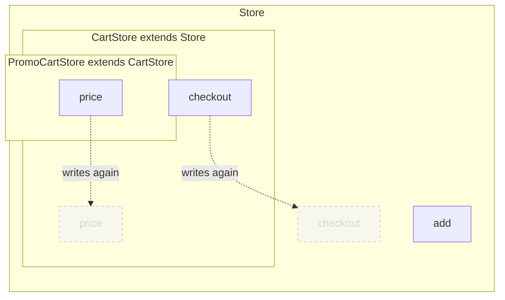

# Class card

The card of a node of the type `class` in a [Trace Diagram](../trace-diagram.md). The rules every card shares, its frame, its rows and its lines, are in [On the page](../trace-diagram.md#on-the-page).

## What is a class card

**A class with a method is a class card.** A class with no method holds only values, so it is [plain](../trace-diagram.md#plain-code) and has no card: it is a row of every card that reads it. A class component is a [component card](component-card.md), as [component and route come first](../trace-diagram.md#component-and-route-come-first) says. **A method drawn in another card is no method of its class card**: a method of a view class or a controller a route registers is a card inside its [route card](route-card.md#methods-and-handlers), and a class whose every method is drawn elsewhere has no card, a constructor that only takes its parameters aside. A [NestJS controller](libraries/nestjs.md#controllers) keeps its card all the same, typed Controller, with a line to each route card of its methods; a [NestJS resolver](libraries/nestjs.md#graphql-resolvers) is a router card.

| Code | Card |
|---|---|
| `export class CartStore { items = []; add(item) { … } }` | Class card |
| `export class Point { x = 0; y = 0 }` | None. A row of the cards that read it. |
| `export class Modal extends React.Component { render() { … } }` | Component card |

## Rows and methods

**A class card groups what it holds under two headings: Properties, then Methods.** A property is a row. A method is a [function card](function-card.md) of its own, drawn inside the class card under Methods, in the order it is written. Each method is in the `children` of the class node.

```ts
export class CartStore {
  items = []
  total = 0
  add(item) {
    this.items.push(item)
  }
  async checkout() {
    if (this.items.length === 0) return
    await api.post("/orders", this.items)
  }
}
```

```
 ┌ {} CartStore ─────────────────────────── store/cart/index.ts ┐
 │ Class                                               Modified │
 │ Holds the cart and sends it as an order                      │
 │ PROPERTIES                                                   │
 │ ┌──────────────────────────────────────────────────────────┐ │
 │ │ items                                                    │ │
 │ └──────────────────────────────────────────────────────────┘ │
 │ ┌──────────────────────────────────────────────────────────┐ │
 │ │ total                                                    │ │
 │ └──────────────────────────────────────────────────────────┘ │
 │ METHODS                                                      │
 │ ┌ ƒ add ────────────────────────────── store/cart/index.ts ┐ │  ← a method: an inner function card
 │ │ Method                                                   │ │
 │ │ Puts an item in the cart                                 │ │
 │ │ ┌──────────────────────────────────────────────────────┐ │ │
 │ │ │ item                                                 │ │ │
 │ │ └──────────────────────────────────────────────────────┘ │ │
 │ └──────────────────────────────────────────────────────────┘ │
 │ ┌ ƒ checkout ───────────────────────── store/cart/index.ts ┐ │
 │ │ Method                                          Modified │ │
 │ │ Sends the cart as an order                               │ │
 │ │ ┌──────────────────────────────────────────────────────┐ │ │
 │ │ │ Condition :8                                         │ │ │
 │ │ └──────────────────────────────────────────────────────┘ │ │
 │ │ ╔══════════════════════════════════════════════════════╗ │ │
 │ │ ║ Posts the items as an order                          ║○──▶ api.post
 │ │ ║ api.post                                             ║ │ │
 │ │ ╚══════════════════════════════════════════════════════╝ │ │
 │ └──────────────────────────────────────────────────────────┘ │
 └──────────────────────────────────────────────────────────────┘
```

**A method card is drawn as every function card is**: its parameters as chips under its head, then its rows as written, grouped and holding the function it returns when it [returns a function](function-card.md#returning-a-function).

**Nothing reached through `this` has a row.** In TypeScript and JavaScript `this`, and in Python `self`, reaches the class itself: its properties are rows under Properties, and its methods are cards under Methods. A statement whose call or whose value is reached through it is no row of the method card, and a line it leads to leaves the head of the method card.

| Statement in a method | Row of the method card |
|---|---|
| `this.items.push(item)` | None |
| `self.items.append(item)` | None |
| `this.save()` | None. The line to the card of `save` leaves the head. |
| `this.usersService.findAll()`, where the constructor takes `private readonly usersService: UsersService` | None. The line to the card of `findAll` of `UsersService` leaves the head. |
| `await api.post("/orders", this.items)` | `api.post`. It calls out, and only reads `this`. |

**A property declared in the constructor is a property of the class.** `self.items = []` in `__init__`, `this.items = []` in a TypeScript `constructor`, and a parameter of a TypeScript `constructor` marked `private`, `protected`, `public` or `readonly`, `constructor(private readonly users: UsersService)`, are rows under Properties of the class card, not rows of the constructor. A parameter with no mark stays an argument of the constructor. A constructor that holds nothing else on the way to a change, and leads to no other card, is not drawn.

```python
class Store:
    def __init__(self, owner):
        self.items = []        # a row under Properties of Store
        self.owner = owner     # a row under Properties of Store
```

A step into the class from another card ends at the card of the method it reaches, or at the head of the class card when it reaches no method.

**A member typed as a class leads to the methods of that class.** A parameter of the constructor marked `private`, `protected`, `public` or `readonly` is a member of the class, and a row under Properties, as a property is, and a call of a method on a member typed as a class of the repository, `this.usersService.findAll()`, reaches `findAll` of that class, or of the class it extends. This is how a NestJS controller reaches the services it is injected with. A constructor that only takes such parameters, and leads to no other card, is not drawn.

## A class that extends another

**Classes that extend each other nest as components that render each other do.** The class that is extended is the outer card, the class that extends it an inner card below its Methods, and a class that extends that one an inner card of the inner card, as deep as it goes. The extending class is in the `children` of the class it extends.

**A method that a class extending it writes again is not drawn.** Of the methods of one name, only the last one written down the line of classes is drawn, in the card of the class that writes it.

```ts
// store/base.ts
export class Store {
  items = []
  add(item) {
    this.items.push(item)
  }
  async checkout() {
    await api.post("/orders", this.items)
  }
}

// store/cart.ts
export class CartStore extends Store {
  discount = 0
  async checkout() {
    if (this.items.length === 0) return
    await api.post("/orders", { items: this.items, discount: this.discount })
  }
  price(item) {
    return item.price
  }
}

// store/promo.ts
export class PromoCartStore extends CartStore {
  code = ""
  price(item) {
    return item.price * 0.9
  }
}
```

```
 ┌ {} Store ───────────────────────────────────────────── store/base.ts ┐  ← the class it extends: the outer card
 │ Class                                                                │
 │ Keeps items and sends them as an order                               │
 │ PROPERTIES                                                           │
 │ ┌──────────────────────────────────────────────────────────────────┐ │
 │ │ items                                                            │ │
 │ └──────────────────────────────────────────────────────────────────┘ │
 │ METHODS                                                              │
 │ ┌ ƒ add ──────────────────────────────────────────── store/base.ts ┐ │  ← Store.checkout is not drawn: CartStore writes it again
 │ │ Method                                                           │ │
 │ │ Puts an item in the store                                        │ │
 │ │ ┌──────────────────────────────────────────────────────────────┐ │ │
 │ │ │ item                                                         │ │ │
 │ │ └──────────────────────────────────────────────────────────────┘ │ │
 │ └──────────────────────────────────────────────────────────────────┘ │
 │ ┌ {} CartStore ───────────────────────────────────── store/cart.ts ┐ │  ← extends Store
 │ │ Class                                                   Modified │ │
 │ │ A store that sends a discount                                    │ │
 │ │ PROPERTIES                                                       │ │
 │ │ ┌──────────────────────────────────────────────────────────────┐ │ │
 │ │ │ discount                                                     │ │ │
 │ │ └──────────────────────────────────────────────────────────────┘ │ │
 │ │ METHODS                                                          │ │
 │ │ ┌ ƒ checkout ─────────────────────────────────── store/cart.ts ┐ │ │  ← CartStore.price is not drawn: PromoCartStore writes it again
 │ │ │ Method                                              Modified │ │ │
 │ │ │ Sends the cart as an order                                   │ │ │
 │ │ │ ┌──────────────────────────────────────────────────────────┐ │ │ │
 │ │ │ │ Condition :4                                             │ │ │ │
 │ │ │ └──────────────────────────────────────────────────────────┘ │ │ │
 │ │ │ ╔══════════════════════════════════════════════════════════╗ │ │ │
 │ │ │ ║ Posts the items as an order                              ║○──▶ api.post
 │ │ │ ║ api.post                                                 ║ │ │ │
 │ │ │ ╚══════════════════════════════════════════════════════════╝ │ │ │
 │ │ └──────────────────────────────────────────────────────────────┘ │ │
 │ │ ┌ {} PromoCartStore ─────────────────────────── store/promo.ts ┐ │ │  ← extends CartStore
 │ │ │ Class                                                        │ │ │
 │ │ │ A cart with a promo code                                     │ │ │
 │ │ │ PROPERTIES                                                   │ │ │
 │ │ │ ┌──────────────────────────────────────────────────────────┐ │ │ │
 │ │ │ │ code                                                     │ │ │ │
 │ │ │ └──────────────────────────────────────────────────────────┘ │ │ │
 │ │ │ METHODS                                                      │ │ │
 │ │ │ ┌ ƒ price ───────────────────────────────── store/promo.ts ┐ │ │ │
 │ │ │ │ Method                                                   │ │ │ │
 │ │ │ │ Takes the promo off a price                              │ │ │ │
 │ │ │ │ ┌──────────────────────────────────────────────────────┐ │ │ │ │
 │ │ │ │ │ item                                                 │ │ │ │ │
 │ │ │ │ └──────────────────────────────────────────────────────┘ │ │ │ │
 │ │ │ └──────────────────────────────────────────────────────────┘ │ │ │
 │ │ └──────────────────────────────────────────────────────────────┘ │ │
 │ └──────────────────────────────────────────────────────────────────┘ │
 └──────────────────────────────────────────────────────────────────────┘
```



A dashed method is not drawn. A class extends another of the diagram when its declaration names it, as `extends Store` and `class CartStore(Store)` do. A class that extends a class of a library or of the language is a card of its own.
