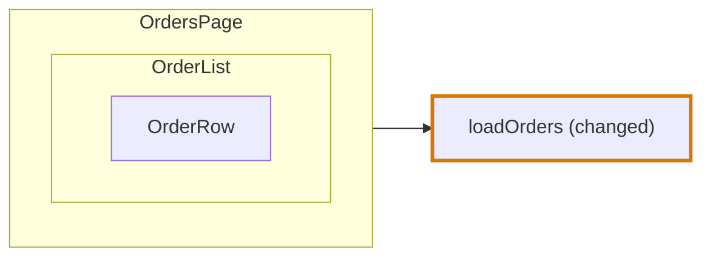

# Component card

The card of a node of the type `component` in a [Trace Diagram](../trace-diagram.md). The rules every card shares, its frame, its rows and its lines, are in [On the page](../trace-diagram.md#on-the-page).

## What is a component card

**Every component is a component card, whatever its language makes it.** A function component is a function, and a class component a class with methods, but [component and route come first](../trace-diagram.md#component-and-route-come-first): neither is drawn as a [function card](function-card.md) or a [class card](class-card.md).

| Code | Card |
|---|---|
| `export const PromoForm = () => <form …/>` | Component card |
| `export class Modal extends React.Component { render() { … } }` | Component card, not a class card with method cards |
| A Vue single-file component | Component card |

## Rows

**A component card lists what it is given, what it keeps, what it calls, what runs later and what it renders, under seven headings**, in this order:

```
PROPS · STATE · EXTERNAL CALLS · MEMOS · EFFECTS · TRIGGERS · RENDERS
```

A heading with nothing under it is not drawn.

| Heading | Its rows |
|---|---|
| PROPS | One row per prop, in the order written: `()` and the prop with its type, `trainerId: number`. A destructured props object is one row per name. The type is the one written beside the name, or the type of that name in the props type written inline, `{ pokemon }: { pokemon: Pokemon }`, or in an interface or a type alias of the same file, `TeamPageProps`. With none, the row is the name alone. An optional prop keeps its `?` as written, `note?: string`. Vue `defineProps<{ … }>()` gives its rows the same way, and an event `defineEmits` declares has no row. Nothing is written on a prop: it has no label. |
| STATE | One row per `state` and `derived` declared in the body of the component that is no memo, in the order written: the name and its starting value as the code writes it. `const [isPublishing, setIsPublishing] = useState(false)` keeps its first name and its argument, `isPublishing = false`. Vue `const isPublishing = ref(false)` is `isPublishing = ref(false)`, and `const members = useSelector(selectMembers)` is `members = useSelector(selectMembers)`. Any other declaration that takes names apart shows its pattern as written, `[bag, addItem, clear] = useUnit([$bag, itemAdded, bagCleared])`, and so does an object pattern. Nothing is written on a state: it has no label. |
| EXTERNAL CALLS | One slim card per callee, each holding one row per call, as the [External calls](function-card.md#external-calls) of a function card are. A hook of the repository is a callee, `useTrainer(trainerId)`, and so is a function, `formatTeamTitle(…)`, and a store, an RTK Query hook, a thunk or a tRPC procedure, as [Calls of values a library made](function-card.md#calls-of-values-a-library-made) says: `useBagStore((state) => state.count)`, `useGetTodosQuery()`, `api.todo.create.useMutation()`. A call the catalogue types that is a node of its own, `api.todo.create.useMutation({ onSuccess })`, is a call row too, and the line to its node leaves that row. A call into a library or the language has no row: `useState(false)`, `useEffect(…)`, `localStorage.setItem(…)`, and neither has a call inside a trigger, `api.todo.list.useQuery()`, whose trigger row holds its line. |
| MEMOS | One row per `useMemo`, `useCallback` and Vue `computed` that is a node, with a line to its [memo card](#effects-and-memos). The code line is the name it is kept in and the call, `teamTypes = useMemo()`. |
| EFFECTS | One row per `useEffect`, Vue `watch`, `watchEffect`, `onMounted` and other effect that is a node, and per `component-effect` handed a callback that is a node, such as `useMutation({ onSuccess })` of TanStack Query, each with a line to its card. The code line is the call, `useEffect()`. A call of a store that is handed only a selector or another callback that runs in place, `useBagStore((state) => state.count)`, is no effect: it is a call row under External calls, with the selector folded into it. |
| TRIGGERS | The [trigger labels](../trace-diagram.md#trigger-labels) of the node, each with a line to the card of its event |
| RENDERS | One return group per `return` of the component, as [Renders](#renders) says |

**A row is changed when its block is, or a block inside it.** It then has the border of the change. A callee card reads Added or Modified when the code it stands for changed.

**A line leaves the row it belongs to.** A call row carries a line only to what its call reaches, as on a [function card](function-card.md#external-calls). A line that leaves through a prop, its type or its default, leaves that prop row. A line to a memo, an effect, an event or a call that is a node of its own leaves its row, and a line to a child drawn in another card leaves its component row.

**Nothing else has a row.** A condition, a loop, an assignment, a declared value that keeps no call of the repository, a function the component declares, a `throw` and a read through a prop are left out. A call such a block holds is still a row under External calls, but in a function an event is handed by name, `onClick={publish}`: that function is the body of the event, and its calls are rows of the event's card. The border of the card says the component changed, and its side panel shows the lines.

### Renders

**A component renders markup or nothing, so its returns are what it renders.** RENDERS holds one return group per `return` statement of the component, early or final, `return null` among them, in the order written. A component whose body is markup, an arrow function such as `=> <form …/>` or the template of a Vue file, has one group for that body.

| Group | Its name | Its label |
|---|---|---|
| An early `return` | Its start as written: `return <p>` | "Renders {what} when {condition}": "Renders a loading line when the trainer is not loaded yet" |
| `return null`, or a return of nothing | `return null` | "Renders nothing when {condition}" |
| The final `return` | `return <section>` | "Renders {what}": "Renders the heading, the types, the badges and the slots of the team" |
| The body of an arrow function | `=> <li>` | "Renders {what}" |
| The template of a Vue file | `<template>` | "Renders {what}" |

**Inside a group are the parts of its markup a reader asks about**, one row each, in the order written. Each row has its own icon and its own label.

| Row | The markup it stands for | Code line | Label |
|---|---|---|---|
| Condition | Markup that renders only sometimes: `{x && <p>…</p>}`, a ternary, Vue `v-if`, `v-else-if`, `v-else` and `v-show` | `{… && <p>}`, `{… ? <p> : …}`, `<p v-if>` | "Renders {what} when {condition}": "Renders a note when the team has no Pokemon" |
| Loop | Markup rendered for each item of a list: `items.map(…)`, Vue `v-for` | `trainer.team.map()`, `<li v-for>` | "Renders {what} for each {item}" |
| Component | An element of a component of the repository: `<TeamSlot pokemon={pokemon} />`, or of a value that wraps one, `observer(…)`, `memo(…)` or `forwardRef(…)`. Every one has a row, also one whose file the diagram does not open and one that is no card on the board. | `<TeamSlot />`, or the code line of the condition or the loop around it: `trainer.team.map()`, `{… ? <Empty> : …}`, `{… ? … : <Team>}`, `<Empty v-if>`, `<Team v-else>` | "Renders `<TeamSlot />` for each Pokemon of the team", or "… when {condition}" |
| Value | An expression whose value is markup a component or a function of the repository draws: `{renderBadges(trainer.badges)}`, `{badges}` | `{renderBadges()}`, `{badges}` | "Renders the badges that renderBadges drew" |

**A component row takes the place of the condition and the loop around it.** `trainer.team.map((pokemon) => <TeamSlot … />)` is one component row, not a loop row and a component row: the label says when or how often the child renders, and the code line is that of the loop. Each branch of a ternary that renders a component is a row of its own, `{… ? <Empty> : …}` and `{… ? … : <Team>}`, and so is each element of a Vue `v-if`, `v-else-if` and `v-else` chain, `<Empty v-if>` and `<Team v-else>`.

**Plain markup has no row.** A plain element, `<section>` or `<h1>`, an element of a library component, `<Button>`, and an expression that is text or a number, `{title}`, are covered by the label of their return.

**A child component is drawn inside its row.** When the component a component row or a value row renders is a node of this component, its card is drawn inside the return group, right below that row, as [Components inside](#components-inside) says. A row whose component is no child of this card holds no card.

```tsx
export function TeamPage({ trainerId, maxSlots }: TeamPageProps) {
  const [isPublishing, setIsPublishing] = useState(false)
  const trainer = useTrainer(trainerId)
  const teamTypes = useMemo(() => listTeamTypes(trainer?.team ?? []), [trainer])

  useEffect(() => {
    localStorage.setItem(LAST_TRAINER_KEY, String(trainerId))
  }, [trainerId])

  if (trainer === null) return <p>Loading the trainer…</p>

  const title = formatTeamTitle(trainer.name, trainer.team.length, maxSlots)

  return (
    <section>
      <h1>{title}</h1>
      {renderBadges(trainer.badges)}
      {trainer.team.length === 0 && <p>No Pokemon in the team yet</p>}
      <ul>
        {trainer.team.map((pokemon) => (
          <TeamSlot key={pokemon.id} pokemon={pokemon} />
        ))}
      </ul>
      <button type="button" disabled={isPublishing} onClick={publish}>Publish the team</button>
    </section>
  )
}
```

```
 ┌ ⊞ TeamPage ─────────────────────────────────── team/TeamPage.tsx ┐
 │ Component                                                  Added │
 │ Shows the team of one trainer with a Publish button              │
 │ PROPS                                                            │
 │ ┌──────────────────────────────────────────────────────────────┐ │
 │ │ () trainerId: number                                         │ │
 │ └──────────────────────────────────────────────────────────────┘ │
 │ ┌──────────────────────────────────────────────────────────────┐ │
 │ │ () maxSlots: number                                          │ │
 │ └──────────────────────────────────────────────────────────────┘ │
 │ STATE                                                            │
 │ ┌──────────────────────────────────────────────────────────────┐ │
 │ │ isPublishing = false                                         │ │
 │ └──────────────────────────────────────────────────────────────┘ │
 │ EXTERNAL CALLS                                                   │
 │ ┌ useTrainer ───────────────────────────────────── Hook • Added ┐│
 │ │ ┌──────────────────────────────────────────────────────────┐ ││
 │ │ │ Calls useTrainer to load the trainer with their team     │○──▶ useTrainer
 │ │ │ useTrainer()                                             │ ││
 │ │ └──────────────────────────────────────────────────────────┘ ││
 │ └───────────────────────────────────────────────────────────────┘│
 │ ┌ ƒ formatTeamTitle ────────────────────────── Function • Added ┐│
 │ │ ┌──────────────────────────────────────────────────────────┐ ││
 │ │ │ Calls formatTeamTitle when the trainer is loaded to …    │○──▶ formatTeamTitle
 │ │ │ formatTeamTitle()                                        │ ││
 │ │ └──────────────────────────────────────────────────────────┘ ││
 │ └───────────────────────────────────────────────────────────────┘│
 │ MEMOS                                                            │
 │ ┌──────────────────────────────────────────────────────────────┐ │
 │ │ Lists each type of the team once                             │○──▶ teamTypes
 │ │ teamTypes = useMemo()                                        │ │
 │ └──────────────────────────────────────────────────────────────┘ │
 │ EFFECTS                                                          │
 │ ┌──────────────────────────────────────────────────────────────┐ │
 │ │ Remembers the trainer id after a render with a new id        │○──▶ useEffect
 │ │ useEffect()                                                  │ │
 │ └──────────────────────────────────────────────────────────────┘ │
 │ TRIGGERS                                                         │
 │ ╔══════════════════════════════════════════════════════════════╗ │
 │ ║ A user clicks Publish the team                               ║○──▶ button.onClick
 │ ║ button.onClick                                               ║ │
 │ ╚══════════════════════════════════════════════════════════════╝ │
 │ RENDERS                                                          │
 │ ↵ return <p>                                                  30 │  ← an early return
 │   Renders a loading line when the trainer is not loaded yet      │
 │ ↵ return <section>                                            40 │  ← the final return
 │   Renders the heading, the badges and the slots of the team      │
 │ ┃ {} Renders the badges that renderBadges drew                   │  ← a value row
 │ ┃    {renderBadges()}                                         44 │
 │ ┃ ┌ ⊞ renderBadges ──────────────────── components/badges.tsx ┐  │
 │ ┃ │ rows …                                                    │  │
 │ ┃ └───────────────────────────────────────────────────────────┘  │
 │ ┃ ⑂ Renders a note when the team has no Pokemon                  │  ← a condition row
 │ ┃   {… && <p>}                                                45 │
 │ ┃ ⊞ Renders <TeamSlot /> for each Pokemon of the team            │  ← a component row, in place of its loop
 │ ┃   trainer.team.map()                                        47 │
 │ ┃ ┌ ⊞ TeamSlot ──────────────────── components/TeamSlot.tsx ┐    │
 │ ┃ │ rows …                                                  │    │
 │ ┃ └─────────────────────────────────────────────────────────┘    │
 └──────────────────────────────────────────────────────────────────┘
```

## Labels

**The agent writes a label on a call, a memo, an effect, a return group and a render row.** A prop and a state show their code as written and have no label. A trigger label is written as every [trigger label](../trace-diagram.md#trigger-labels) is. A row with no label shows its code alone.

| Row | Label |
|---|---|
| A call | "Calls {callee} to {what}", or "Calls {callee} when {condition} to {what}", as on a [function card](function-card.md#labels) |
| A memo | What it works out: "Lists each type of the team once" |
| An effect | What it does and when: "Remembers the trainer id after a render with a new id" |
| A return group | As the table of [Renders](#renders) gives |
| A render row | "Renders {what} when {condition}", "Renders {what} for each {item}", or "Renders {what}" |

**A label is kept by where its code is.** Each label is an entry of the `blockLabels` of the node.

| Row | Its entry |
|---|---|
| A call | The block that holds it and `at`, the line and the column where the code it calls is written, as on a function card |
| A memo, an effect | The block of the memo, the declaration it is kept in, or of the effect, with no `at` |
| A return group | The innermost block around the `return` and `at`, the start of the `return` statement. The body of an arrow function and the template of a Vue file are kept by their `render-root` block, with no `at`. |
| A condition, a loop, a component row | The `render-condition`, the `render-loop` or the `render` block of the element, with no `at` |
| A value row | The block that holds the expression and `at`, where its name is written |

On the page the id of a row kept with `at` is the block and the place, `src/pages/team/TeamPage.tsx#condition@30:3@30:25`, and the id of any other row is its block.

## Cards of its own

**An event, an effect, a memo and a callback of a component are cards of their own**, beside the component card, never inside it. They run on an occasion of their own, after the markup is returned, or are worked out again when what they read changes, as the table of [Nodes](../trace-diagram.md#nodes) says. Each has a row in the component card, its trigger label, its row under Effects or its row under Memos, and a line runs from that row to its card. An event and a callback are each a [function card](function-card.md), with its arguments, its calls and its returns and raises. An effect and a memo are each a card of the kind [Effects and memos](#effects-and-memos) gives. A call handed a callback that is no effect hook, such as `useMutation({ onSuccess })`, lists its rows as written.

### Effects and memos

**An effect hook and a memo are each one card, with the callback they are handed inside it.** The callback of `useEffect`, `watch`, `watchEffect`, `onMounted` and the other effect hooks, and the callback of `useMemo`, `useCallback` and Vue `computed`, is no card of its own: its calls, its returns and its raises are rows of the card of its hook. A callback that a call inside an effect is handed, as `subscribe(() => …)` inside a `useEffect`, is still a card of its own. Nothing inside a memo is a card of its own.

| Card | Its head | Its type |
|---|---|---|
| An effect | The hook it calls: `useEffect`, `watch`, `watchEffect` | Effect |
| A memo | The name it is kept in: `teamTypes`, `title` | Memo |

**An effect or a memo card lists what it reads and what it does, under five headings:** DEPENDENCIES, OUTSIDE VARIABLES, EXTERNAL CALLS, TRIGGERS, then RETURNS AND RAISES. A heading with nothing under it is not drawn.

| Heading | Its rows |
|---|---|
| DEPENDENCIES | One row per name the dependency list reads, as written: `trainerId` of `[trainerId]`. For Vue `watch`, the names its watched source reads, `props.trainerId` of `() => props.trainerId`. Nothing is written on a dependency: it has no label. |
| OUTSIDE VARIABLES | One row per value declared outside the callback that it reads and the dependencies do not name, each once, with what it is: Constant, State, State setter, Prop, Variable, Function or Import. `LAST_TRAINER_KEY` declared at the top level of the file, or at the top of `<script setup>` of a Vue file, is a Constant, `setIsPublishing` a State setter, and a name imported from another file an Import. A value of the language, `String` or `localStorage`, has no row. Nothing is written on an outside variable: it has no label. |
| EXTERNAL CALLS | One slim card per callee, each holding one row per call, as on a [function card](function-card.md#external-calls), a call of a store, a generated RTK Query hook, a thunk or a tRPC procedure among them |
| TRIGGERS | The [trigger labels](../trace-diagram.md#trigger-labels) of the node |
| RETURNS AND RAISES | One row per `return` and per `throw` or `raise` of the callback, as on a function card. The `return` of an effect hands back its cleanup: "Returns a cleanup that stops watching the team". |

**A line leaves a call row only.** A line from the card runs from the row of the call that takes it, as on a function card. A step that only reads a value of the component around it, `trainer` or `title`, ends there: the card has no line to what that value leads to, such as the hook that made it. A call of a function of the component is a call row, with its line.

```
 ┌ ⚡ useEffect ──────────────────────────────── team/TeamPage.tsx ┐
 │ Effect                                                   Added │
 │ Watches the team until the trainer id changes                  │
 │ DEPENDENCIES                                                   │
 │ ┌────────────────────────────────────────────────────────────┐ │
 │ │ trainerId                                                  │ │
 │ └────────────────────────────────────────────────────────────┘ │
 │ EXTERNAL CALLS                                                 │
 │ ┌ ƒ watchTeam ──────────────────────────────── Function • Added ┐
 │ │ ┌────────────────────────────────────────────────────────┐ │ │
 │ │ │ Calls watchTeam to watch the events of the team        │○──▶ watchTeam
 │ │ │ watchTeam()                                            │ │ │
 │ │ └────────────────────────────────────────────────────────┘ │ │
 │ └────────────────────────────────────────────────────────────┘ │
 │ RETURNS AND RAISES                                             │
 │ ┌────────────────────────────────────────────────────────────┐ │
 │ │ Returns a cleanup that stops watching the team             │ │
 │ │ return                                                     │ │
 │ └────────────────────────────────────────────────────────────┘ │
 └────────────────────────────────────────────────────────────────┘
```

**A label on an effect or a memo card is written as on a function card.** Its calls and its returns and raises take the patterns and the `blockLabels` entries of the [Labels](function-card.md#labels) of a function card. A call inside the callback is kept by the block that holds it, so it keeps its label whether the callback is written in place or not.

## Components inside

**The components that render each other are one card.** A component on a chain that another component on a chain renders is drawn inside the card of the component that renders it, as deep as the rendering goes. It is in the `children` of that node.

**A child is drawn inside the render row that renders it.** It sits in its return group, below the component row or the value row that renders it. A child two rows render is drawn below the first. A child no render row holds, such as one rendered by a function the component declares, is drawn after the groups of the card.



| Rule | Why |
|---|---|
| A component is a child of the first component that reaches it from the top | A component two components render is drawn once |
| The top is a component no other component on a chain renders | It is where the rendering starts |
| Among several tops, the one in the file the fewest files of the group import, directly or through other files, comes first | The import graph says which file is highest |
| Components that render each other in a loop are opened at the one in the file the fewest files of the group import | The component that imports another is around it, never inside it |
| The edge between a component and its child stays in `traceNodeEdges` | The page leaves it out, and an agent still reads it |

A component a component row renders that is drawn inside another card, because another component reaches it first, has a line from that row to its card. A function of another root block that a component calls, and a block of a component that is a node of its own, is a card beside it, with a line from the component.
