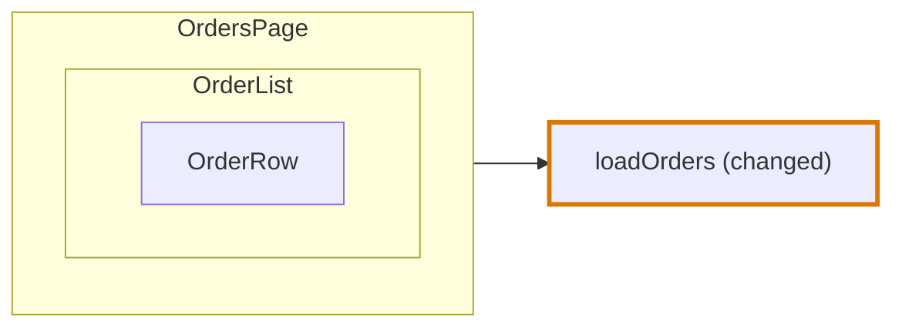

# Component card

The card of a node of the type `component` in a [Trace Diagram](../trace-diagram.md). The rules every card shares, its frame, its rows and its lines, are in [On the page](../trace-diagram.md#on-the-page).

## What is a component card

**Every component is a component card, whatever its language makes it.** A function component is a function, and a class component a class with methods, but [component and route come first](../trace-diagram.md#component-and-route-come-first): neither is drawn as a [function card](function-card.md) or a [class card](class-card.md).

| Code | Card |
|---|---|
| `export const PromoForm = () => <form …/>` | Component card |
| `export class Modal extends React.Component { render() { … } }` | Component card, not a class card with method cards |
| A Vue single-file component | Component card |

## Rows

**A component card shows its parameters as chips under its head, and groups its rows under headings**, in this order:

```
STATE · HOOKS · EFFECTS · CALLS / REQUEST / STORAGE … · TRIGGERS · STEPS
```

A heading names the group of the rows below it. There is one group per kind of call: Calls for a kept value and a plain call, and the name of its type for a call the [catalogue](../codegraph/catalogue.md) types, such as Request or Storage. A group with no row has no heading, and a component whose only rows are trigger labels has no heading at all.

**Markup has no row.** The node of a component holds its markup as one unit, so a changed `render-root`, `render`, `render-condition` or `render-loop` is not listed: the border of the card says the component changed, and its side panel shows the lines.

```
 ┌ ⊞ PromoForm ───────────────────── routes/promo/index.tsx ┐
 │ Component                                       Modified │
 │ The form a shopper types a promo code in                 │
 │ [{ onApplied }]                                          │
 │ STATE                                                    │
 │ ┌──────────────────────────────────────────────────────┐ │
 │ │ The code being typed                                 │ │
 │ │ code                                                 │ │
 │ └──────────────────────────────────────────────────────┘ │
 │ HOOKS                                                    │
 │ ┌──────────────────────────────────────────────────────┐ │
 │ │ useApplyPromo                                        │○──▶ useApplyPromo
 │ └──────────────────────────────────────────────────────┘ │
 │ TRIGGERS                                                 │
 │ ╔══════════════════════════════════════════════════════╗ │
 │ ║ A shopper submits the code                           ║○──▶ onSubmit
 │ ║ form.onSubmit                                        ║ │
 │ ╚══════════════════════════════════════════════════════╝ │
 │ ┌ ⊞ PromoHint ────────────────── routes/promo/hint.tsx ┐ │  ← a component it renders
 │ │ Component                                            │ │
 │ │ rows …                                               │ │
 │ └──────────────────────────────────────────────────────┘ │
 └──────────────────────────────────────────────────────────┘
```

## Cards of its own

**An event, an effect and a callback of a component are cards of their own**, beside the component card, never inside it. They run on an occasion of their own, after the markup is returned, as the table of [Nodes](../trace-diagram.md#nodes) says. Each has a row in the component card, its trigger label or its row under Effects, and a line runs from that row to its card.

## Components inside

**The components that render each other are one card.** A component on a chain that another component on a chain renders is drawn inside the card of the component that renders it, below its rows, as deep as the rendering goes. It is in the `children` of that node.



| Rule | Why |
|---|---|
| A component is a child of the first component that reaches it from the top | A component two components render is drawn once |
| The top is a component no other component on a chain renders | It is where the rendering starts |
| Among several tops, the one in the file the fewest files of the group import, directly or through other files, comes first | The import graph says which file is highest |
| Components that render each other in a loop are opened at the one in the file the fewest files of the group import | The component that imports another is around it, never inside it |
| The edge between a component and its child stays in `traceNodeEdges` | The page leaves it out, and an agent still reads it |

A function of another root block that a component calls, and a block of a component that is a node of its own, is a card beside it, with a line from the component.
