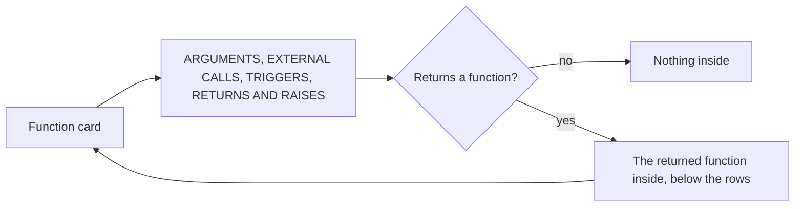

# Function card

The card of a node that runs as one function in a [Trace Diagram](../trace-diagram.md). The rules every card shares, its frame, its rows and its lines, are in [On the page](../trace-diagram.md#on-the-page).

## What is a function card

| Node | Where its card is |
|---|---|
| A `function` or a `hook` at the top level of a file | On the board |
| A `render-event`, a `code-event` or an `effect-callback` that is a node of its own | On the board. The callback of an effect hook or a memo of a component is none: it is part of an [effect card or a memo card](component-card.md#effects-and-memos). |
| A `method` of a class | Inside the [class card](class-card.md), under Methods |
| The handler of a route | Inside the [route card](route-card.md), under its method |
| A reducer, a thunk, an extra reducer, a listener or a selector of a Redux slice, and an endpoint of an RTK Query API | Inside the [state card](libraries/redux.md), under its heading |
| A function that a function, a hook or a method returns | Inside the card of the function that returns it, as [Returning a function](#returning-a-function) says |

A function that is a component is a [component card](component-card.md), and a function that a route runs is drawn inside the route card, as [component and route come first](../trace-diagram.md#component-and-route-come-first) says. An effect hook and a memo of a component, `useEffect`, `watch`, `useMemo` or `computed`, are drawn as an [effect card or a memo card](component-card.md#effects-and-memos), which lists its calls and its returns and raises as a function card does. Any other `effect` or `component-effect`, such as `useMutation({ onSuccess })`, and a `resolver` and a `middleware` that are nodes of their own are drawn in the same frame, but list their rows as written, with no heading, as [Steps](../trace-diagram.md#steps) says: a procedure of a [tRPC router](libraries/trpc.md) is a `resolver`.

## Rows

**A function card lists what goes in and what comes out, under four headings:** ARGUMENTS, EXTERNAL CALLS, TRIGGERS, then RETURNS AND RAISES. A heading with nothing under it is not drawn. Nothing else has a row: a declared value, a condition, a loop, a `try`, an assignment and a read through a parameter are left out, and so is a changed line that is none of these rows. The border of the card says the function changed, and its side panel shows the lines.

| Heading | Its rows |
|---|---|
| ARGUMENTS | One row per parameter, in the order written: `()` and the parameter as written, `name: type`, with a default left out, and `self`, `cls` and `this` left out. The parameters of a function the node is handed by name, such as `submit` in `onSubmit={submit}`, are its arguments too. Nothing is written on an argument row: it has no label. |
| EXTERNAL CALLS | One slim card per callee, in the order of its first call, each holding one row per call, as [External calls](#external-calls) says |
| TRIGGERS | The [trigger labels](../trace-diagram.md#trigger-labels) of the node |
| RETURNS AND RAISES | One row per `return` statement and one per `throw` or `raise`, in the order written. A return row reads `return` below its label. A raise row reads the start of its statement, without its arguments or the error it is raised from: `throw new Error`, `throw error`, `raise ValueError`, `raise`. A function with no `return` statement, such as an arrow function whose body is an expression, has no return row. |

**A row is changed when its line is.** It then has the border of the change. A callee card reads Added or Modified when the code it stands for changed.

```ts
import { TrainerClient } from "./client"
import { createNotifier } from "./notifier"
import { normalizeName } from "./names"

export const renameAll = (renames, log) => {
  const client = new TrainerClient()
  const { notify } = createNotifier(log)
  let renamed = 0
  for (const { id, name } of renames) {
    const trainer = client.load(id)
    if (!trainer) throw new Error("No trainer")
    if (trainer.name === name) {
      notify(name)
      continue
    }
    client.save({ ...trainer, name: normalizeName(name) })
    notify(trainer.name)
    log(name.length)
    renamed += 1
  }
  return renamed
}
```

```
 ┌ ƒ renameAll ─────────────────────────── trainers/rename-all.ts ┐
 │ Function                                              Modified │
 │ Renames each trainer and logs every rename                     │
 │ ARGUMENTS                                                      │
 │ ┌────────────────────────────────────────────────────────────┐ │
 │ │ () renames                                                 │ │
 │ └────────────────────────────────────────────────────────────┘ │
 │ ┌────────────────────────────────────────────────────────────┐ │
 │ │ () log                                                     │ │
 │ └────────────────────────────────────────────────────────────┘ │
 │ EXTERNAL CALLS                                                 │
 │ ┌ {} TrainerClient ──────────────────────── Class • Modified ┐ │  ← one card per callee
 │ │ ┌────────────────────────────────────────────────────────┐ │ │
 │ │ │ Calls TrainerClient to open the trainer store          │ │ │
 │ │ │ TrainerClient()                                        │ │ │
 │ │ └────────────────────────────────────────────────────────┘ │ │
 │ │ ┌────────────────────────────────────────────────────────┐ │ │
 │ │ │ Calls client.load to read the trainer to rename        │ │ │
 │ │ │ client.load()                                          │ │ │
 │ │ └────────────────────────────────────────────────────────┘ │ │
 │ │ ╔════════════════════════════════════════════════════════╗ │ │
 │ │ ║ Calls client.save to store the new name                ║○──▶ TrainerClient.save
 │ │ ║ client.save()                                          ║ │ │
 │ │ ╚════════════════════════════════════════════════════════╝ │ │
 │ └────────────────────────────────────────────────────────────┘ │
 │ ┌ ƒ createNotifier ──────────────────────────────── Function ┐ │
 │ │ ┌────────────────────────────────────────────────────────┐ │ │
 │ │ │ Calls createNotifier to make notify from log           │ │ │
 │ │ │ createNotifier()                                       │ │ │
 │ │ └────────────────────────────────────────────────────────┘ │ │
 │ │ ┌────────────────────────────────────────────────────────┐ │ │
 │ │ │ Calls notify when the name is kept to say so           │ │ │
 │ │ │ notify()                                               │ │ │
 │ │ └────────────────────────────────────────────────────────┘ │ │
 │ │ ┌────────────────────────────────────────────────────────┐ │ │
 │ │ │ Calls notify to tell the old name                      │ │ │
 │ │ │ notify()                                               │ │ │
 │ │ └────────────────────────────────────────────────────────┘ │ │
 │ └────────────────────────────────────────────────────────────┘ │
 │ ┌ ƒ normalizeName ───────────────────────── Function • Added ┐ │
 │ │ ╔════════════════════════════════════════════════════════╗ │ │
 │ │ ║ Calls normalizeName to tidy the new name               ║○──▶ normalizeName
 │ │ ║ normalizeName()                                        ║ │ │
 │ │ ╚════════════════════════════════════════════════════════╝ │ │
 │ └────────────────────────────────────────────────────────────┘ │
 │ ┌ () log ────────────────────────────────────────── Argument ┐ │  ← a parameter it calls
 │ │ ╔════════════════════════════════════════════════════════╗ │ │
 │ │ ║ Calls log to write the length of the name              ║ │ │
 │ │ ║ log()                                                  ║ │ │
 │ │ ╚════════════════════════════════════════════════════════╝ │ │
 │ └────────────────────────────────────────────────────────────┘ │
 │ RETURNS AND RAISES                                             │
 │ ┌────────────────────────────────────────────────────────────┐ │
 │ │ Throws Error when no trainer has the id                    │ │
 │ │ throw new Error                                            │ │
 │ └────────────────────────────────────────────────────────────┘ │
 │ ┌────────────────────────────────────────────────────────────┐ │
 │ │ Returns how many trainers were renamed                     │ │
 │ │ return                                                     │ │
 │ └────────────────────────────────────────────────────────────┘ │
 └────────────────────────────────────────────────────────────────┘
```

### External calls

**A call is grouped under what it calls.** Each callee is a slim card under EXTERNAL CALLS. Its head shows the icon of its type, its name, its type, and Added or Modified when it changed. Inside are its calls, one row per call, in the order written: the label on one line, and the call as written with `()` on the line below, `client.load()`.

| A call of | Its callee card |
|---|---|
| A function or a hook of the repository: `normalizeName(name)`, `useTotals(items)` | That function or hook |
| A class: `new TrainerClient()`, and every method called on what it makes: `client.load(id)`, `this.users.findAll()` | The class, typed Class |
| A function a call returned: `notify(name)` after `const { notify } = createNotifier(log)` | The function whose call returned it, `createNotifier`, holding the row of `createNotifier()` and the row of each `notify()` |
| A parameter of the node, or of a function around it: `log(line)` | The parameter, typed Argument, with `()` for its icon |
| A method of the repository called on a value whose origin is not known: `trainer.hasRoomInTeam()` | The class of the method, typed Class |
| A store, an RTK Query hook, a thunk or a tRPC procedure | The value it reaches, as [Calls of values a library made](#calls-of-values-a-library-made) says |

**A call into a library or the language has no row**: `datetime.now()`, `len(name)`, `name.trim()`, `console.warn(…)`, `useState([])`, `new Date()`. Neither has any other call of a value of the repository: a method of a plain value or a collection, a method of a client a library made, such as an ORM, a Fastify app or a tRPC client call that reaches no procedure, and a member of what a function of the repository returned, unless that member is itself a function or a method of the repository. Neither has a call of a hook of the repository whose file the group did not open, since no card stands for it, nor a call of a method of the card's own class through `this` or `self`, `this.check(limit)`, as the [class card](class-card.md#rows-and-methods) says.

**A card's calls are read from the code its node holds.** That is its own block, and the blocks its node holds outside it: the function an event is handed by name, and a function its handler calls. A value at the top level of a file that is [folded](../trace-diagram.md#values-that-are-not-exported) into the node adds no row. A call written in a decorator of the function, the method or the class, `@UseGuards(AuthGuard)`, is no row either. A call written inside a `throw` or a `raise`, `throw new Conflict(describe(user))`, has none: the raise row stands for the whole statement. A call inside a block that is a trigger of the card, a data fetch or an event, has none: the trigger row holds it and its line.

**A function handed to a method of a collection or a promise runs there.** In TypeScript, `names.map(normalizeName)` and `load().then(save)` are calls of `normalizeName` and `save`, each a row, as [Symbols](../codegraph/symbols.md#where-and-how-a-name-is-used) says of `isRunInPlace`. A parameter handed so, `renames.forEach(log)`, is no call of that parameter and has no row.

**A call written with type arguments, awaited or not, is a call like any other**: `await request<Trainer>(url)` is the row `request()` under `request`.

**Two calls in one statement are two rows**, the outer call first: `client.save({ ...trainer, name: normalizeName(name) })` is the row `client.save()` under `TrainerClient` and the row `normalizeName()` under `normalizeName`.

**A line leaves the row of the call that takes it.** Each call on the way to a change has its own line, from its own row to the card it calls, so two calls of one function are two lines. A call of a parameter has no line: no card stands for it. A call row carries a line only to what its own call reaches: its callee, or the part of it the call names. The row of a hook of a library also carries a line to each value it is handed. A line that leaves through a parameter, its type, its default or a `Depends(…)` written in it, leaves the row of that argument, or the head when no argument row fits, never a call row it does not belong to. A line ends at the most specific row of the card it reaches: a line that reaches a function card ends at its head, or at the row of an argument or a raise when the step reaches that block, and a call row that reaches both the head of a card and one of its rows draws only the line to the row. A line a card rule draws with no step of its own, such as the line from a hook of an RTK Query API to its endpoint, leaves the call row whose callee holds the card it reaches.

### Calls of values a library made

**A call of a value of the repository that a library made is a call row only when that value has a card the call reaches.** The row is kept by its block and `at`, and the line to that card leaves the row. This holds on every card with call rows: a function, a method, a hook, a component, an effect and a memo.

| A call of | Its callee card | Its type |
|---|---|---|
| A store, called by its name: a store card, or a state at the top level of a file that a library makes, with `create` of Zustand, `defineStore` of Pinia, Effector, XState or Valtio: `useBagStore((state) => state.count)`, `useBagStore()` | The store | The type its own card reads, State for a Zustand, XState or Effector store |
| A hook RTK Query generates for an API: `useGetTodosQuery()` | The API. The call is matched to its endpoint by the name of the hook, and its line goes to that endpoint. | API |
| A thunk: `dispatch(loadParty())` | The thunk | Variable |
| A tRPC client hook or a server caller that steps to a procedure: `api.todo.create.useMutation()` | The procedure | Resolver |
| A hook of a library handed such a store, or handed a function of the repository as an argument or as a callback that only names it: `useStore($bag)`, `useSelector(selectMembers)` | The store or the function it is handed | The type its own card reads |
| A member of a store that is a part of its card, an action, a reducer or a getter, matched by its last key, the name of the part, through the block it resolves to or the part of that name: `cart.addItem(product)` after `const cart = useCartStore()` | The store. Its line goes to the row of that part. | The type its own card reads |
| A name taken apart from `useUnit([…])`: `addItem(product)` after `const [bag, addItem] = useUnit([$bag, itemAdded])` | The unit at the same place in the list, `itemAdded`, when it has a card of its own, or else the store. Its one line goes to that unit. | The type its own card reads |

A method the library gives the store object, `set`, `get`, `send` or `setState`, is no part of its card and has no row: `useCartStore.setState(…)`. Neither is a method of the language or of a collection called on the state of the store, `state.memberIds.includes(id)`: its last key names no part. A hook that makes an effect or a memo, `useEffect` or `useMemo`, is never such a row.

**A value declared from such a call is called through it.** `clear()` after `const clear = useBagStore((state) => state.clear)` is a row in the card of the store too, as `notify()` is in the card of `createNotifier`.

**A selector handed to such a call is folded into its row.** A callback that runs in place, handed to a call of such a store or to a hook of a library handed one, as the selector of `useBagStore((state) => state.count)`, is part of the call: neither the call nor the callback is a node, so it has no card and no row under Effects. A call written inside such a callback is never a row. A call handed a callback that runs later keeps its node and its cards, and so does a call of a library handed a function of the repository, `app.register(routes)`.

**A call that is a node of its own is still a call row.** A call the catalogue types that is handed callbacks, such as `api.todo.create.useMutation({ onSuccess })`, a Request, is a node with a card for `onSuccess`. In the [component card](component-card.md#rows) it is written in, it is a call row in the card of what it reaches, the procedure, and the line to its own node leaves that row, as the line to an effect leaves its row.

## Labels

**The agent writes a label only on a call row and on a return or raise row.** An argument row shows the parameter as written, and a trigger label is written as every [trigger label](../trace-diagram.md#trigger-labels) is. A row with no label shows its code alone.

| Row | Label |
|---|---|
| A call | "Calls {callee} to {what}", or "Calls {callee} when {condition} to {what}" when a condition decides it |
| The only return, or the last one | "Returns {what}" |
| Any other return | "Returns {what} when {condition}" |
| A `raise` | "Raises {Error} when {condition}" |
| A `throw` | "Throws {Error} when {condition}" |

**A label is kept by where its code is.** Each label is an entry of the `blockLabels` of the node. A call is kept by the block that holds it and `at`, the line and the column where the code it calls is written, `client` of `client.load(id)`, so the two calls of one statement are two entries. A return is kept by the innermost block around it and `at`, the start of the `return` statement. A raise is kept by its `throw` block, with no `at`. On the page the id of a call or a return row is the block and the place, `src/rename-all.ts#variable@10:5@10:21`, and the id of a raise row is its block.

## Returning a function

**A function, a hook or a method whose return value is a function holds that function.** It lists its own rows as every function card does, and the function it returns is drawn inside it, below RETURNS AND RAISES, with no heading, as a function card of its own. The returned function is in the `children` of its node.

A function is returned when it is written in the `return`, or as the body of an arrow function, or when the `return` names a function declared in the body:

| Code | The returned function |
|---|---|
| `const make = (id) => { … return (event) => save(id, event) }` | `(event) => save(id, event)` |
| `const make = (id) => (event) => save(id, event)` | `(event) => save(id, event)` |
| `function make(id) { function handle(event) { … } return handle }` | `handle` |
| `def logged(func):` … `return wrapper` | `wrapper` |

```ts
import { renameTrainer } from "./rename"
import type { Trainer } from "./trainer"

export function logPrefix(date: Date): string {
  return `[${date.toISOString().slice(0, 10)}]`
}

export const createRenameHandler = (log: (line: string) => void) => {
  const prefix = logPrefix(new Date())
  return (id: number, name: string): Trainer => {
    const cleaned = name.trim()
    if (cleaned === "") throw new Error("A trainer needs a name")
    const renamed = renameTrainer(id, cleaned)
    log(`${prefix} Trainer ${id} is now ${renamed.name}`)
    return renamed
  }
}
```

```
 ┌ ƒ createRenameHandler ───────────────── trainers/rename-handler.ts ┐
 │ Function                                                     Added │
 │ Makes a handler that renames a trainer and logs it                 │
 │ ARGUMENTS                                                          │
 │ ╔════════════════════════════════════════════════════════════════╗ │
 │ ║ () log: (line: string) => void                                 ║ │
 │ ╚════════════════════════════════════════════════════════════════╝ │
 │ EXTERNAL CALLS                                                     │
 │ ┌ ƒ logPrefix ───────────────────────────────── Function • Added ┐ │
 │ │ ╔════════════════════════════════════════════════════════════╗ │ │
 │ │ ║ Calls logPrefix to make the date prefix of every log line  ║○──▶ logPrefix
 │ │ ║ logPrefix()                                                ║ │ │
 │ │ ╚════════════════════════════════════════════════════════════╝ │ │
 │ └────────────────────────────────────────────────────────────────┘ │
 │ RETURNS AND RAISES                                                 │
 │ ╔════════════════════════════════════════════════════════════════╗ │
 │ ║ Returns the rename handler                                     ║ │
 │ ║ return                                                         ║ │
 │ ╚════════════════════════════════════════════════════════════════╝ │
 │ ┌ ƒ Function :10 ──────────────────── trainers/rename-handler.ts ┐ │  ← the returned function
 │ │ Function                                                 Added │ │
 │ │ Renames one trainer and logs the new name                      │ │
 │ │ ARGUMENTS                                                      │ │
 │ │ ╔════════════════════════════════════════════════════════════╗ │ │
 │ │ ║ () id: number                                              ║ │ │
 │ │ ╚════════════════════════════════════════════════════════════╝ │ │
 │ │ ╔════════════════════════════════════════════════════════════╗ │ │
 │ │ ║ () name: string                                            ║ │ │
 │ │ ╚════════════════════════════════════════════════════════════╝ │ │
 │ │ EXTERNAL CALLS                                                 │ │
 │ │ ┌ ƒ renameTrainer ────────────────────── Function • Modified ┐ │ │
 │ │ │ ╔════════════════════════════════════════════════════════╗ │ │ │
 │ │ │ ║ Calls renameTrainer to check and save the new name     ║○──▶ renameTrainer
 │ │ │ ║ renameTrainer()                                        ║ │ │ │
 │ │ │ ╚════════════════════════════════════════════════════════╝ │ │ │
 │ │ └────────────────────────────────────────────────────────────┘ │ │
 │ │ ┌ () log ────────────────────────────────────────── Argument ┐ │ │
 │ │ │ ╔════════════════════════════════════════════════════════╗ │ │ │
 │ │ │ ║ Calls log to write the new name after the date         ║ │ │ │
 │ │ │ ║ log()                                                  ║ │ │ │
 │ │ │ ╚════════════════════════════════════════════════════════╝ │ │ │
 │ │ └────────────────────────────────────────────────────────────┘ │ │
 │ │ RETURNS AND RAISES                                             │ │
 │ │ ╔════════════════════════════════════════════════════════════╗ │ │
 │ │ ║ Throws Error when the name is empty                        ║ │ │
 │ │ ║ throw new Error                                            ║ │ │
 │ │ ╚════════════════════════════════════════════════════════════╝ │ │
 │ │ ╔════════════════════════════════════════════════════════════╗ │ │
 │ │ ║ Returns the renamed trainer                                ║ │ │
 │ │ ║ return                                                     ║ │ │
 │ │ ╚════════════════════════════════════════════════════════════╝ │ │
 │ └────────────────────────────────────────────────────────────────┘ │
 └────────────────────────────────────────────────────────────────────┘
```

**The returned function follows these rules too.** Its calls of a parameter of the function around it, `log`, are calls of an Argument. When it returns a function itself, it holds that one below its own rows, as deep as the returning goes.



The edge from a function to the function it returns stays in `traceNodeEdges`, and the page leaves it out, as it does for a component and its child.
