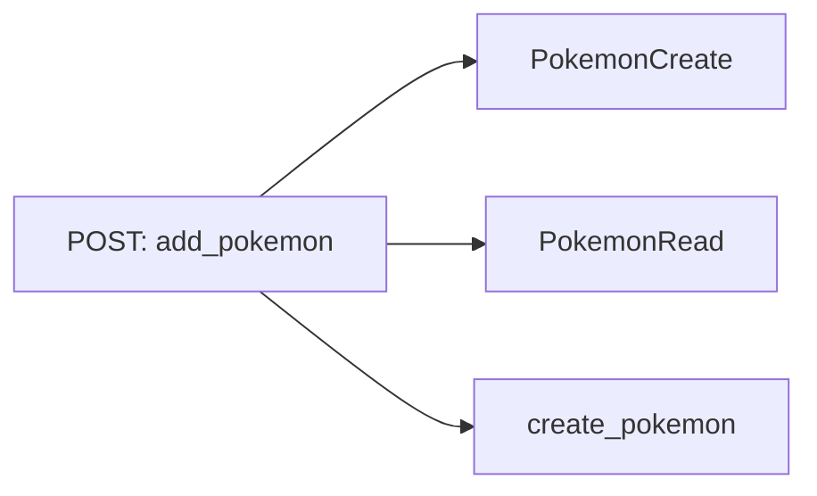
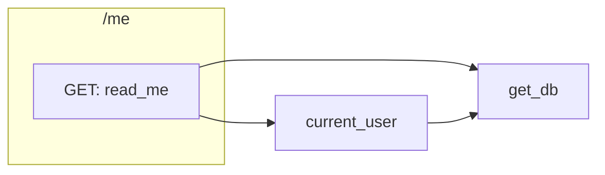
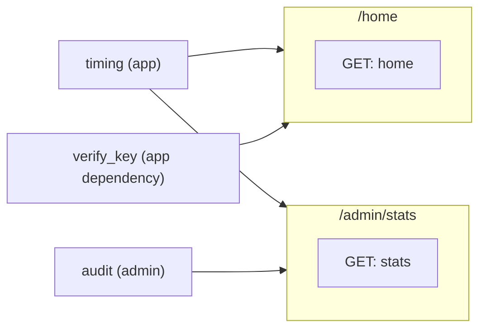
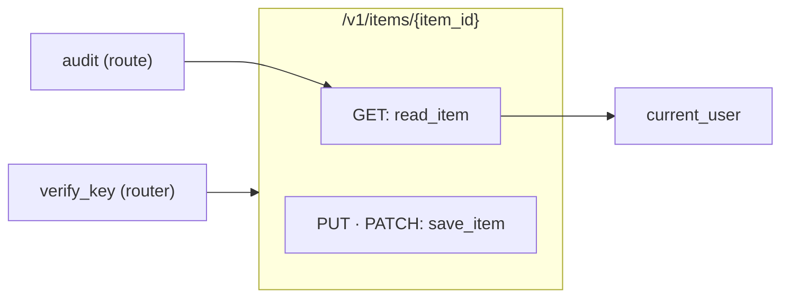

# Route card: FastAPI

The [route card](../route-card.md) of a FastAPI route. The rules every route card shares are on that page.

## Registrations

**A decorator of an app or a router registers the function it decorates**, for the path in its first argument. The function is the registration and its handler.

| Code | Heading |
|---|---|
| `@app.get(path)`, `post`, `put`, `patch`, `delete`, `head`, `options` | The method of the decorator |
| `@app.trace(path)`, `@app.websocket(path)` | ANY |
| `@app.api_route(path, methods=["PUT", "PATCH"])` | One heading of every method it names, `PUT · PATCH` |
| `app.add_api_route(path, read_item, methods=["GET"])` | The method it names, with `read_item` as the handler |

The app is the value `FastAPI()` makes, and a router the value `APIRouter()` makes.

## Routers

**A router's routes take its prefix, and the prefix it is included under.** `APIRouter(prefix="/items")` is the prefix of every route on it, and `app.include_router(router, prefix="/v1")` is a mount that puts `/v1` before them, in whatever file `router` is declared. A route at `"/"` on a router with a prefix is at the prefix itself.

## Dependencies and middleware

**A dependency in `dependencies` is middleware. A dependency of a parameter is a call.**

| Code | Middleware of | Its line |
|---|---|---|
| `Depends(audit)` in `@router.get(path, dependencies=[…])` | That registration | From `audit` to the handler card |
| `Depends(verify_key)` in `APIRouter(dependencies=[…])` | The routes of the router | From `verify_key` to each route card of the router |
| `Depends(verify_key)` in `app.include_router(router, dependencies=[…])` | The routes of the included router | From `verify_key` to each of its route cards |
| `Depends(verify_key)` in `FastAPI(dependencies=[…])` | The whole app | From `verify_key` to each route card of the app |
| `@app.middleware("http")` | The whole app, and the apps it mounts | From the decorated function to each route card of the app |
| `app.add_middleware(TimingMiddleware)` | The whole app, and the apps it mounts | From the class card of `TimingMiddleware` to each route card of the app |
| `user=Depends(current_user)` in the parameters of a handler | None: the handler calls it | From the handler card to `current_user` |
| `user: Annotated[User, Depends(current_user)]` in the parameters of a handler | None: the handler calls it | From the handler card to `current_user` |
| `page: Annotated[Pagination, Depends()]` in the parameters of a handler | None: the handler makes a `Pagination` | From the handler card to the class card of `Pagination` |
| `user: CurrentUser`, with `CurrentUser = Annotated[User, Depends(current_user)]` in any file | None: the handler calls what the alias names | From the handler card to `current_user` |

The call `Depends(…)` is no node: the line goes from the function it names. Nor is an app or a router that only hands its dependencies, `app = FastAPI(dependencies=[Depends(verify_key)])`: the dependency is the card. A dependency of a dependency is a call of it the same way, written as a default or in `Annotated`: `def current_user(db: Annotated[Session, Depends(get_db)])` has a line to `get_db`. `Security(…)` is read as `Depends(…)` is.

## Request bodies and response models

**A handler has a line to the pydantic model FastAPI parses its body into, and to the one it builds its response from.** The chain steps from a handler to the class a parameter is typed by when that class is a pydantic model, a class of `BaseModel` or of a model of the repository that is one, and to a pydantic model the handler names itself, as `response_model=PokemonRead` or `response_model=list[PokemonRead]` of its decorator does. Each model is a card of its own, though it may have no method: no card makes it, FastAPI does. A parameter with a dependency written in it, `Annotated[User, Depends(current_user)]`, is no body, and a class that is no pydantic model draws no line.

```python
@router.post("/", response_model=PokemonRead, status_code=201)
def add_pokemon(draft: PokemonCreate, session: SessionDep):
    return create_pokemon(session, draft)
```



## Aliases

**An alias of `Annotated` is no card.** `CurrentUser = Annotated[User, Depends(current_user)]` stands for a type, and a parameter typed `CurrentUser` is read as if `Annotated[User, Depends(current_user)]` were written there: the handler card holds it, and the line goes from the handler to `current_user`, in whatever file the alias is declared.

```python
# shop/deps.py
SessionDep = Annotated[Session, Depends(get_db)]

def current_user(db: SessionDep):
    return find_user(db)

CurrentUser = Annotated[User, Depends(current_user)]

# shop/routes.py
@router.get("/me")
async def read_me(user: CurrentUser, db: SessionDep):
    return list_me(user, db)
```



## Mounted apps

**A mounted app's routes take the path it is mounted at.** `app.mount("/admin", admin)`, with `admin = FastAPI()`, puts `/admin` before every route of `admin`. The mounted app is an app of its own: the middleware of the outer app runs before its routes, and so has a line to each of them, but the dependencies of the outer app do not, and the middleware of the mounted app reaches only its own routes. A mount of something that is no app of the repository, `app.mount("/static", StaticFiles(directory="static"))`, draws nothing.

```python
app = FastAPI(dependencies=[Depends(verify_key)])
admin = FastAPI()

@app.middleware("http")
async def timing(request, call_next):
    return await time_call(call_next, request)

@admin.middleware("http")
async def audit(request, call_next):
    return record(request)

@admin.get("/stats")
async def stats():
    return read_stats()

@app.get("/home")
async def home():
    return read_home()

app.mount("/admin", admin)
```



```python
# shop/items.py
router = APIRouter(prefix="/items", dependencies=[Depends(verify_key)])

@router.get("/{item_id}", dependencies=[Depends(audit)])
async def read_item(item_id: int, user=Depends(current_user)):
    return find_item(item_id)

@router.api_route("/{item_id}", methods=["PUT", "PATCH"])
async def save_item(item_id: int):
    return save(item_id)

# shop/main.py
app.include_router(router, prefix="/v1")
```

```
 ┌ ⇢ /v1/items/{item_id} ────────────────────────── shop/items.py ┐
 │ Route                                                 Modified │
 │ Shows and saves an item                                        │
 │ GET                                                            │
 │ ┌ ƒ read_item ──────────────────────────────── shop/items.py ┐ │  ◀── audit
 │ │ Function                                          Modified │ │
 │ │ Finds the item for the user                                │ │
 │ │ ┌────────────────────────────────────────────────────────┐ │ │
 │ │ │ item_id                                                │ │ │
 │ │ └────────────────────────────────────────────────────────┘ │ │
 │ │ ╔════════════════════════════════════════════════════════╗ │ │
 │ │ ║ find_item                                              ║○──▶ find_item
 │ │ ╚════════════════════════════════════════════════════════╝ │ │
 │ └────────────────────────────────────────────────────────────┘ │
 │ PUT · PATCH                                                    │
 │ ┌ ƒ save_item ──────────────────────────────── shop/items.py ┐ │
 │ │ Function                                          Modified │ │
 │ │ Saves the item                                             │ │
 │ │ ┌────────────────────────────────────────────────────────┐ │ │
 │ │ │ item_id                                                │ │ │
 │ │ └────────────────────────────────────────────────────────┘ │ │
 │ │ ╔════════════════════════════════════════════════════════╗ │ │
 │ │ ║ save                                                   ║○──▶ save
 │ │ ╚════════════════════════════════════════════════════════╝ │ │
 │ └────────────────────────────────────────────────────────────┘ │
 └────────────────────────────────────────────────────────────────┘
```


