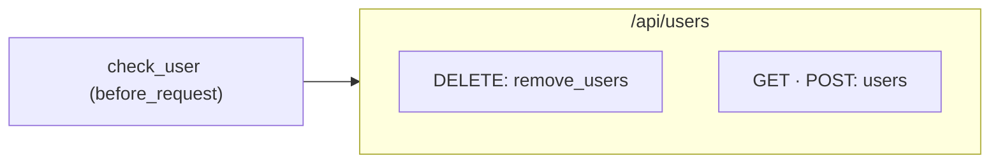

# Route card: Flask

The [route card](../route-card.md) of a Flask route. The rules every route card shares are on that page.

## Registrations

**A decorator of an app or a blueprint registers the function it decorates**, for the path in its first argument. The function is the registration and its handler.

| Code | Heading |
|---|---|
| `@app.get(rule)`, `post`, `put`, `patch`, `delete` | The method of the decorator |
| `@app.route(rule)` | ANY |
| `@app.route(rule, methods=["GET", "POST"])` | One heading of every method it names, `GET · POST` |
| `app.add_url_rule(rule, view_func=index, methods=["GET"])` | The method it names, with `index` as the handler |

The app is the value `Flask(__name__)` makes, and a blueprint the value `Blueprint(name, __name__)` makes. The path keeps the converters it is written with, `/items/<int:id>`.

## View classes

**A view class routed by `add_url_rule` puts each of its methods under the heading of that method.** `get`, `post`, `put`, `patch`, `delete`, `head` and `options` of the class `as_view` is called on are the handlers. The class has no card of its own when every method it has is drawn there.

```python
# shop/views.py
class ItemAPI(MethodView):
    def get(self, id):
        return find_item(id)

    def delete(self, id):
        return remove_item(id)

# shop/main.py
app.add_url_rule("/items/<int:id>", view_func=ItemAPI.as_view("item"))
```

```
 ┌ ⇢ /items/<int:id> ─────────────────────────────── shop/main.py ┐
 │ Route                                                 Modified │
 │ Shows and removes an item                                      │
 │ GET                                                            │
 │ ┌ ƒ ItemAPI.get ────────────────────────────── shop/views.py ┐ │  ← a method of the view class
 │ │ Method                                            Modified │ │
 │ │ Finds the item                                             │ │
 │ │ ARGUMENTS                                                  │ │
 │ │ ┌────────────────────────────────────────────────────────┐ │ │
 │ │ │ () id                                                  │ │ │
 │ │ └────────────────────────────────────────────────────────┘ │ │
 │ │ EXTERNAL CALLS                                             │ │
 │ │ ┌ ƒ find_item ────────────────────── Function • Modified ┐ │ │
 │ │ │ ╔════════════════════════════════════════════════════╗ │ │ │
 │ │ │ ║ Calls find_item to look up the item                ║○──▶ find_item
 │ │ │ ║ find_item()                                        ║ │ │ │
 │ │ │ ╚════════════════════════════════════════════════════╝ │ │ │
 │ │ └────────────────────────────────────────────────────────┘ │ │
 │ │ RETURNS AND RAISES                                         │ │
 │ │ ╔════════════════════════════════════════════════════════╗ │ │
 │ │ ║ Returns the item                                       ║ │ │
 │ │ ║ return                                                 ║ │ │
 │ │ ╚════════════════════════════════════════════════════════╝ │ │
 │ └────────────────────────────────────────────────────────────┘ │
 │ DELETE                                                         │
 │ ┌ ƒ ItemAPI.delete ─────────────────────────── shop/views.py ┐ │
 │ │ Method                                            Modified │ │
 │ │ Removes the item                                           │ │
 │ │ ARGUMENTS                                                  │ │
 │ │ ┌────────────────────────────────────────────────────────┐ │ │
 │ │ │ () id                                                  │ │ │
 │ │ └────────────────────────────────────────────────────────┘ │ │
 │ │ EXTERNAL CALLS                                             │ │
 │ │ ┌ ƒ remove_item ──────────────────── Function • Modified ┐ │ │
 │ │ │ ╔════════════════════════════════════════════════════╗ │ │ │
 │ │ │ ║ Calls remove_item to delete the item               ║○──▶ remove_item
 │ │ │ ║ remove_item()                                      ║ │ │ │
 │ │ │ ╚════════════════════════════════════════════════════╝ │ │ │
 │ │ └────────────────────────────────────────────────────────┘ │ │
 │ │ RETURNS AND RAISES                                         │ │
 │ │ ╔════════════════════════════════════════════════════════╗ │ │
 │ │ ║ Returns what removing the item answers                 ║ │ │
 │ │ ║ return                                                 ║ │ │
 │ │ ╚════════════════════════════════════════════════════════╝ │ │
 │ └────────────────────────────────────────────────────────────┘ │
 └────────────────────────────────────────────────────────────────┘
```

## Blueprints

**A blueprint's routes take its prefix, and the prefix it is registered under.** `Blueprint("users", __name__, url_prefix="/users")` is the prefix of every route on it, and `app.register_blueprint(bp, url_prefix="/api")` is a mount that puts `/api` before them, in whatever file `bp` is declared.

## Middleware

| Code | Middleware of | Its line |
|---|---|---|
| `@bp.before_request`, `@bp.after_request` | The routes of the blueprint | To each route card of the blueprint |
| `@app.before_request`, `@app.after_request` | The whole app, and every blueprint registered on it | To each route card of the app |
| `@bp.before_app_request`, `@bp.after_app_request` | The whole app the blueprint is registered on | To each route card of the app |

```python
# shop/users.py
bp = Blueprint("users", __name__)

@bp.before_request
def check_user():
    return verify_user()

@bp.route("/users", methods=["GET", "POST"])
def users():
    return list_users()

@bp.delete("/users")
def remove_users():
    return clear_users()

# shop/main.py
app.register_blueprint(bp, url_prefix="/api")
```

```
 ┌ ⇢ /api/users ─────────────────────────────────── shop/users.py ┐
 │ Route                                                 Modified │
 │ Lists, creates and clears users                                │
 │ DELETE                                                         │
 │ ┌ ƒ remove_users ───────────────────────────── shop/users.py ┐ │
 │ │ Function                                          Modified │ │
 │ │ Clears every user                                          │ │
 │ │ EXTERNAL CALLS                                             │ │
 │ │ ┌ ƒ clear_users ──────────────────── Function • Modified ┐ │ │
 │ │ │ ╔════════════════════════════════════════════════════╗ │ │ │
 │ │ │ ║ Calls clear_users to delete every user             ║○──▶ clear_users
 │ │ │ ║ clear_users()                                      ║ │ │ │
 │ │ │ ╚════════════════════════════════════════════════════╝ │ │ │
 │ │ └────────────────────────────────────────────────────────┘ │ │
 │ │ RETURNS AND RAISES                                         │ │
 │ │ ╔════════════════════════════════════════════════════════╗ │ │
 │ │ ║ Returns what clearing the users answers                ║ │ │
 │ │ ║ return                                                 ║ │ │
 │ │ ╚════════════════════════════════════════════════════════╝ │ │
 │ └────────────────────────────────────────────────────────────┘ │
 │ GET · POST                                                     │  ← methods=["GET", "POST"]
 │ ┌ ƒ users ──────────────────────────────────── shop/users.py ┐ │
 │ │ Function                                          Modified │ │
 │ │ Lists the users, or adds one                               │ │
 │ │ EXTERNAL CALLS                                             │ │
 │ │ ┌ ƒ list_users ───────────────────── Function • Modified ┐ │ │
 │ │ │ ╔════════════════════════════════════════════════════╗ │ │ │
 │ │ │ ║ Calls list_users to read the users                 ║○──▶ list_users
 │ │ │ ║ list_users()                                       ║ │ │ │
 │ │ │ ╚════════════════════════════════════════════════════╝ │ │ │
 │ │ └────────────────────────────────────────────────────────┘ │ │
 │ │ RETURNS AND RAISES                                         │ │
 │ │ ╔════════════════════════════════════════════════════════╗ │ │
 │ │ ║ Returns the users                                      ║ │ │
 │ │ ║ return                                                 ║ │ │
 │ │ ╚════════════════════════════════════════════════════════╝ │ │
 │ └────────────────────────────────────────────────────────────┘ │
 └────────────────────────────────────────────────────────────────┘
```


