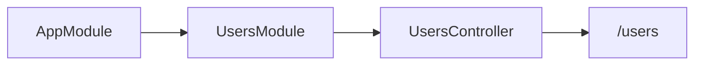
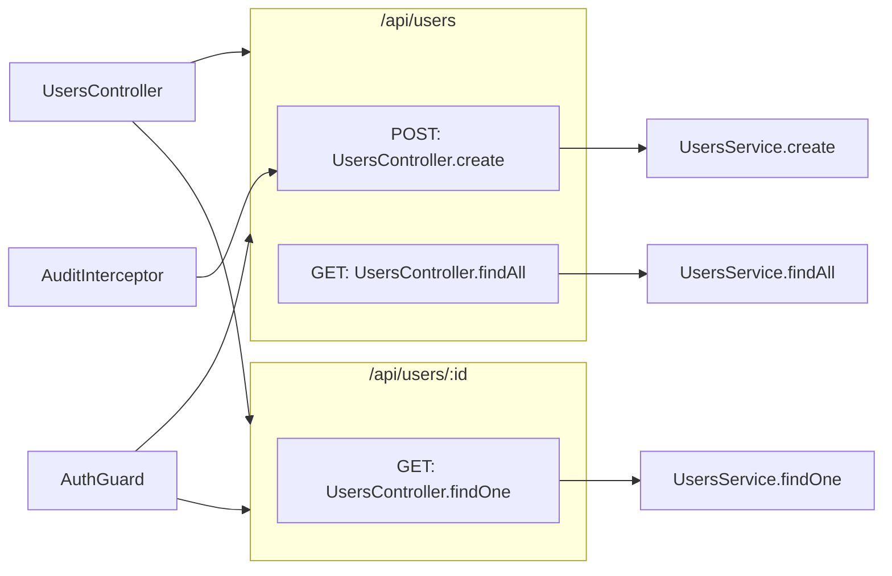

# Route card: NestJS

The [route card](../route-card.md) of a NestJS route. The rules every route card shares are on that page. The library file names the library `Nest`.

## Registrations

**A decorator on a method of a controller registers that method**, for the path in its first argument below the path of its controller. The method is the registration and its handler.

| Code | Heading |
|---|---|
| `@Get(path)`, `@Post`, `@Put`, `@Patch`, `@Delete`, `@Head`, `@Options` | The method of the decorator |
| `@Sse(path)` | GET |
| `@All(path)`, `@Search(path)` | ANY |

A decorator with no path, `@Get()`, registers the path of its controller. A decorator with a list of paths, `@Get(["cats", "kittens"])`, registers the first. **A method is a route whichever order its decorators are written in**: `@UseGuards(…)` above `@Get()` does not hide the route.

## Controllers

**Every controller is a [class card](../class-card.md) whose type reads Controller, with a line to each route card of its methods.** Its route methods are drawn in their route cards, not in it, so a controller whose every method is a route is a card with its head alone. A method that is no route stays in it, under Methods. **What its constructor is injected with is a row under Properties**: a parameter marked `private`, `protected`, `public` or `readonly` declares a property, as every [property declared in the constructor](../class-card.md#rows-and-methods) does, and is a row when it is on the way to a change. A constructor that only takes what is injected, `constructor(private readonly auditService: AuditService) {}`, is not drawn. A [view class](../route-card.md#methods-and-handlers) of another library has no such card: only a class under `@Controller` is a controller.

```ts
// src/users/users.controller.ts
@Controller("users")
export class UsersController {
  constructor(private readonly auditService: AuditService) {}

  @Get()
  findAll() {
    return this.usersService.findAll()
  }

  audit(change: Change) {
    return this.auditService.record(change)
  }
}
```

```
 ┌ {} UsersController ───────────── src/users/users.controller.ts ┐  ──▶ /api/users
 │ Controller                                            Modified │
 │ Serves users and audits what they change                       │
 │ PROPERTIES                                                     │
 │ ┌────────────────────────────────────────────────────────────┐ │
 │ │ auditService                                               │ │
 │ └────────────────────────────────────────────────────────────┘ │
 │ METHODS                                                        │
 │ ┌ ƒ UsersController.audit ──── src/users/users.controller.ts ┐ │  ──▶ AuditService.record
 │ │ Method                                            Modified │ │
 │ │ Records a change                                           │ │
 │ │ ┌────────────────────────────────────────────────────────┐ │ │
 │ │ │ change                                                 │ │ │
 │ │ └────────────────────────────────────────────────────────┘ │ │
 │ └────────────────────────────────────────────────────────────┘ │
 └────────────────────────────────────────────────────────────────┘

 ┌ ⇢ /api/users ─────────────────── src/users/users.controller.ts ┐
 │ Route                                                          │
 │ GET                                                            │
 │ ┌ ƒ UsersController.findAll ── src/users/users.controller.ts ┐ │
 │ └────────────────────────────────────────────────────────────┘ │
 └────────────────────────────────────────────────────────────────┘
```

The line from the controller to a route card stands for the methods the route card holds. A guard or another enhancer of the whole controller has its lines to the route cards, as [Guards, interceptors, pipes, filters and middleware](#guards-interceptors-pipes-filters-and-middleware) says, and none to the controller.

## Modules

**A module is a [class card](../class-card.md) with a line to each module it imports and each controller it lists**, when a change lies down that line. `controllers` and `imports` of `@Module` are mounts: the chain steps from `imports: [UsersModule]` to `UsersModule`, and from `controllers: [UsersController]` to the controller, so the root module leads to the route cards of a new controller. A module has no method, but it is a router and keeps its card, as a controller does. What it hands over that is no router, an entity in `TypeOrmModule.forFeature([User])` or a class in `providers`, has no line from it.

```ts
// src/app.module.ts
@Module({ imports: [UsersModule] })
export class AppModule {}

// src/users/users.module.ts
@Module({ imports: [TypeOrmModule.forFeature([User])], controllers: [UsersController], providers: [UsersService] })
export class UsersModule {}
```



## Request bodies and entities

**A handler has a line to the class Nest fills from its request, and a constructor to the entity of the repository it is injected with.** The chain steps from a handler to the class a parameter decorated with `@Body()`, `@Query()` or `@Param()` of `@nestjs/common` is typed by, and from a constructor to the class `@InjectRepository()` of `@nestjs/typeorm` names. Each class is a card of its own, though it has no method: no card makes it, Nest and TypeORM do. A parameter of a type of the language, `@Param("id", ParseIntPipe) id: number`, and its pipe draw no line, and neither does a class a parameter of a service is only typed by. A plain value the decorators of a DTO read, `ROLES` in `@IsIn(ROLES)`, is a row of its card.

```ts
// src/users/users.controller.ts
@Post()
create(@Body() draft: CreateUserDto) {
  return this.usersService.create(draft)
}

// src/users/users.service.ts
constructor(@InjectRepository(User) private readonly users: Repository<User>) {}
```

```mermaid
flowchart LR
  create["POST: UsersController.create"] --> dto["CreateUserDto"]
  create --> serviceCreate["UsersService.create"]
  constructor["UsersService.constructor"] --> user["User"]
```

**The line to an entity leaves the constructor, not the module.** `@InjectRepository(User)` is where the class takes the repository that every one of its methods reads and writes `User` through, so the constructor is drawn in the class card of the service with that line. `TypeOrmModule.forFeature([User])` only registers the repository in the module, and a module has lines only to the routers it mounts, as [Modules](#modules) says.

**A DTO has a line to the class-validator constraint it names.** `@Validate(NamesDiffer)` on a property of a DTO hands the constraint class to class-validator, which creates it and calls its `validate()` while `ValidationPipe` checks the body. The chain steps from that property to the constraint, so the card of the DTO, which holds the property as a row, has a line to the card of the constraint.

## Paths

**A route's path is, outermost first, the global prefix, the version, the path RouterModule gives its module, the path of its controller, and the path of its decorator.**

| Code | What it puts before the path |
|---|---|
| `@Controller("users")`, `@Controller({ path: "users" })` | `/users` before every route of the controller |
| `RouterModule.register([{ path: "admin", module: AdminModule }])` | `/admin` before every route of the controllers `AdminModule` lists in `@Module({ controllers: […] })`. A module it imports takes nothing from it: only a module under `children` does, with the path of each entry above it, `/admin/metrics`. |
| `app.setGlobalPrefix("api")` | `/api` before every route of the app |
| `app.setGlobalPrefix("api", { exclude: ["health"] })` | Nothing before a route whose path below the other prefixes an excluded path matches |
| `app.setGlobalPrefix("api", { exclude: [{ path: "users", method: RequestMethod.GET }] })` | Nothing before the GET handlers of `/users`. Its other handlers keep the prefix, so the path has two route cards, `/users` and `/api/users`. `RequestMethod.ALL` excludes every method. |
| `app.enableVersioning({ type: VersioningType.URI })` with `@Version("2")` on the method, or `@Controller({ path: "users", version: "1" })` | `/v2`, the version of the method, or else of its controller, or else the `defaultVersion` of `enableVersioning`. `prefix: "version-"` writes `/version-2`, `prefix: false` writes `/2`. A route with no version has no segment. |
| `@Version(["1", "2"])`, `version: ["1", "2"]`, `defaultVersion: ["1", "2"]` | `/v1\|v2`: every version in one segment, so the handler sits in one route card |
| `@Version(VERSION_NEUTRAL)`, `version: VERSION_NEUTRAL` | No segment, whatever the controller or `defaultVersion` say. Beside versions in a list, `[VERSION_NEUTRAL, "2"]`, it is left out: `/v2`. |

`enableVersioning` with no type versions by the path too.

**Versioning by a header or a media type puts the version in the heading, not in the path.** With `VersioningType.HEADER`, `VersioningType.MEDIA_TYPE` or `VersioningType.CUSTOM`, a handler of version 2 sits under `GET v2`, and a list under `GET v1|v2`. A handler with no version, or `VERSION_NEUTRAL`, keeps `GET`. Headings of one method sit together, the one with no version first, then each version in order.

```ts
// src/users/users.controller.ts
@Controller("users")
export class UsersController {
  @Get()
  findAll() {
    return this.usersService.findAll()
  }

  @Version("2")
  @Get()
  findPage(@Query("page") page: number) {
    return this.usersService.findPage(page)
  }
}

// src/main.ts
app.enableVersioning({ type: VersioningType.HEADER, header: "X-API-Version" })
```

```
 ┌ ⇢ /users ─────────────────────── src/users/users.controller.ts ┐
 │ Route                                                 Modified │
 │ GET                                                            │
 │ ┌ ƒ UsersController.findAll ── src/users/users.controller.ts ┐ │
 │ │ Method                                                     │ │
 │ │ Lists every user                                           │ │
 │ └────────────────────────────────────────────────────────────┘ │
 │ GET v2                                                         │
 │ ┌ ƒ UsersController.findPage ─ src/users/users.controller.ts ┐ │
 │ │ Method                                            Modified │ │
 │ │ Lists one page of users                                    │ │
 │ │ ┌────────────────────────────────────────────────────────┐ │ │
 │ │ │ page                                                   │ │ │
 │ │ └────────────────────────────────────────────────────────┘ │ │
 │ └────────────────────────────────────────────────────────────┘ │
 └────────────────────────────────────────────────────────────────┘
```

## Guards, interceptors, pipes, filters and middleware

**Every enhancer and every middleware is middleware of the route card**, a card of its own with a line to what it runs before. A guard, an interceptor, a pipe or a filter is the class it names, `AuthGuard` or `new ValidationPipe()`.

| Code | Middleware of | Its line |
|---|---|---|
| `@UseGuards(AuthGuard)`, `@UseInterceptors`, `@UsePipes`, `@UseFilters` on a method | That method | From the class to the head of the handler card |
| The same decorators on a controller | Every route of the controller | From the class to each route card of the controller |
| `app.useGlobalGuards(new RolesGuard())`, `useGlobalInterceptors`, `useGlobalPipes`, `useGlobalFilters`, `app.use(logger)` | The whole app | From the class or the function to each route card of the app |
| `{ provide: APP_GUARD, useClass: RolesGuard }` in the providers of a module, and `APP_INTERCEPTOR`, `APP_PIPE`, `APP_FILTER` | The whole app | From the class to each route card of the app |
| `consumer.apply(LoggerMiddleware).forRoutes(UsersController)` in `configure` | The routes of the controllers it names | From the middleware to each of their route cards |
| `consumer.apply(LoggerMiddleware).forRoutes("cats/*")` | The routes whose path the paths it names match, below the global prefix and the version | From the middleware to each of those route cards |
| `forRoutes({ path: "cats", method: RequestMethod.GET })` | The routes whose path it matches that have a handler of that method, or of every method (`@All`). `RequestMethod.ALL` names every method. | From the middleware to each of those route cards |
| `.exclude("cats/health")` before `forRoutes` | None of the routes it matches | No line to them |
| `.exclude({ path: "cats", method: RequestMethod.GET })` | None of the routes it matches whose every handler has that method | No line to a route card that holds only GET handlers. A route card with a POST handler too keeps its line. |

A path of `forRoutes` and `exclude` reads `:id` as one segment, `*`, `*splat` and `(.*)` as any path, and `{/:id}` as a part that may be left out. A pipe written as an argument of a parameter decorator, `@Param("id", ParseIntPipe)`, is no middleware.

## Services

**A handler has a line to the method of the service it calls through what the controller is injected with.** `this.usersService.findAll()` reaches `findAll` of the class the constructor parameter `private readonly usersService: UsersService` is typed as, and so does a property typed as a class, `private readonly usersService: UsersService`. As for every method, the call is no row: its line leaves the head of the handler card, as [Rows and methods](../class-card.md#rows-and-methods) says.

## Example

```ts
// src/users/users.controller.ts
@UseGuards(AuthGuard)
@Controller("users")
export class UsersController {
  constructor(private readonly usersService: UsersService) {}

  @Post()
  @UseInterceptors(AuditInterceptor)
  create(@Body() body: CreateUserDto) {
    return this.usersService.create(body)
  }

  @Get()
  findAll(@Query("role") role: string) {
    return this.usersService.findAll(role)
  }

  @Get(":id")
  findOne(@Param("id") id: string) {
    return this.usersService.findOne(id)
  }
}

// src/main.ts
const app = await NestFactory.create(AppModule)
app.setGlobalPrefix("api")
```

```
 ┌ {} UsersController ───────────── src/users/users.controller.ts ┐  ──▶ /api/users
 │ Controller                                                     │  ──▶ /api/users/:id
 └────────────────────────────────────────────────────────────────┘

 ┌ ⇢ /api/users ─────────────────── src/users/users.controller.ts ┐  ◀── AuthGuard
 │ Route                                                 Modified │
 │ Creates and lists users                                        │
 │ POST                                                           │
 │ ┌ ƒ UsersController.create ─── src/users/users.controller.ts ┐ │  ◀── AuditInterceptor   ──▶ UsersService.create
 │ │ Method                                            Modified │ │
 │ │ Creates a user from the body                               │ │
 │ │ ┌────────────────────────────────────────────────────────┐ │ │
 │ │ │ body                                                   │ │ │
 │ │ └────────────────────────────────────────────────────────┘ │ │
 │ └────────────────────────────────────────────────────────────┘ │
 │ GET                                                            │
 │ ┌ ƒ UsersController.findAll ── src/users/users.controller.ts ┐ │  ──▶ UsersService.findAll
 │ │ Method                                            Modified │ │
 │ │ Lists the users of a role                                  │ │
 │ │ ┌────────────────────────────────────────────────────────┐ │ │
 │ │ │ role                                                   │ │ │
 │ │ └────────────────────────────────────────────────────────┘ │ │
 │ └────────────────────────────────────────────────────────────┘ │
 └────────────────────────────────────────────────────────────────┘

 ┌ ⇢ /api/users/:id ─────────────── src/users/users.controller.ts ┐  ◀── AuthGuard
 │ Route                                                          │
 │ GET                                                            │
 │ ┌ ƒ UsersController.findOne ── src/users/users.controller.ts ┐ │  ──▶ UsersService.findOne
 │ │ Method                                            Modified │ │
 │ │ Finds one user                                             │ │
 │ │ ┌────────────────────────────────────────────────────────┐ │ │
 │ │ │ id                                                     │ │ │
 │ │ └────────────────────────────────────────────────────────┘ │ │
 │ └────────────────────────────────────────────────────────────┘ │
 └────────────────────────────────────────────────────────────────┘
```



## What is no route

**A method that NestJS runs for something other than a request stays a method of its class card.** The catalogue says what runs it, and it has no route card. A GraphQL resolver is the one exception, in [GraphQL resolvers](#graphql-resolvers).

| Decorator | Runs on |
|---|---|
| `@SubscribeMessage("events")` of `@nestjs/websockets` | A message of a gateway |
| `@MessagePattern`, `@EventPattern` of `@nestjs/microservices` | A message or an event of a microservice |
| `@Cron`, `@Interval`, `@Timeout` of `@nestjs/schedule` | A schedule |
| `@OnEvent` of `@nestjs/event-emitter` | An event of the app |
| `@Catch(HttpException)` on a class | An exception, as a filter |

## GraphQL resolvers

**A class with a method under `@Query`, `@Mutation`, `@Subscription` or `@ResolveField` of `@nestjs/graphql` is a router card**, drawn as a [tRPC router card](trpc.md) is, and its type reads Resolver. Each such method sits in it under a heading, in this order:

```
QUERY · MUTATION · SUBSCRIPTION · FIELD
```

`@ResolveField` is under FIELD. A method with none of these decorators sits under Methods after them. A constructor that only takes what is injected is not drawn, and the resolver lists no row.

```ts
// src/users/users.resolver.ts
@Resolver(() => User)
export class UsersResolver {
  @Query(() => [User])
  users() {
    return this.usersService.findAll()
  }

  @Mutation(() => User)
  addUser(@Args("name") name: string) {
    return this.usersService.create(name)
  }

  @ResolveField()
  posts(@Parent() user: User) {
    return this.postsService.findByAuthor(user.id)
  }
}
```

```
 ┌ ⇄ UsersResolver ────────────────── src/users/users.resolver.ts ┐
 │ Resolver                                              Modified │
 │ Answers the user queries                                       │
 │ QUERY                                                          │
 │ ┌ ƒ UsersResolver.users ──────── src/users/users.resolver.ts ┐ │
 │ │ Method                                                     │ │
 │ │ Lists the users                                            │ │
 │ └────────────────────────────────────────────────────────────┘ │
 │ MUTATION                                                       │
 │ ┌ ƒ UsersResolver.addUser ────── src/users/users.resolver.ts ┐ │
 │ │ Method                                            Modified │ │
 │ │ Adds a user by name                                        │ │
 │ │ ┌────────────────────────────────────────────────────────┐ │ │
 │ │ │ name                                                   │ │ │
 │ │ └────────────────────────────────────────────────────────┘ │ │
 │ └────────────────────────────────────────────────────────────┘ │
 │ FIELD                                                          │
 │ ┌ ƒ UsersResolver.posts ──────── src/users/users.resolver.ts ┐ │
 │ │ Method                                                     │ │
 │ │ Finds the posts of a user                                  │ │
 │ │ ┌────────────────────────────────────────────────────────┐ │ │
 │ │ │ user                                                   │ │ │
 │ │ └────────────────────────────────────────────────────────┘ │ │
 │ └────────────────────────────────────────────────────────────┘ │
 └────────────────────────────────────────────────────────────────┘
```
