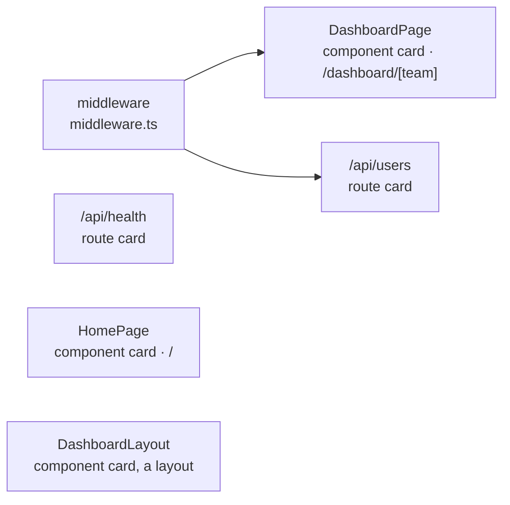

# Route card: Next.js

The [route card](../route-card.md) of a Next.js route. The rules every route card shares are on that page.

## Registrations

**A Next.js route is registered by where its file is, not by a call.** A file pattern of Next.js says which exports of a file are handlers, and the folders of the file give the path. The exported function is the registration and its handler, as a decorated function is in Flask, so a route of Next.js has no `holder`.

| File | Export | Heading |
|---|---|---|
| `app/**/route.{js,ts}`, or under `src/app` | `GET`, `POST`, `PUT`, `PATCH`, `DELETE`, `HEAD`, `OPTIONS` | The method the export is named after |
| `app/**/route.{js,ts}`, or under `src/app` | One function exported under several methods, `export { handler as GET, handler as POST }` | One heading of every method it is exported under, `GET · POST` |
| `pages/api/**/*.{js,ts}`, or under `src/pages/api` | `default` | ANY |

**The path is the folders of the file below `app` or `pages`.** `app/api/users/[id]/route.ts` is `/api/users/[id]`, and `pages/api/posts/[id].ts` is `/api/posts/[id]`. A folder in brackets, `(shop)`, is left out, and so is a file named `index`: `pages/api/posts/index.ts` is `/api/posts`. A dynamic segment keeps its brackets.

**A file pattern matches only when the nearest `package.json` above the file lists `next`.** Without it, a `route.ts` is plain code, and its exports are function cards.

```ts
// app/api/users/[id]/route.ts
export async function GET(request, { params }) {
  const user = await db.user.find(params.id)
  return Response.json(user)
}

export const DELETE = async (request, { params }) => {
  await db.user.delete(params.id)
  return new Response(null, { status: 204 })
}
```

```
 ┌ ⇢ /api/users/[id] ──────────────── app/api/users/[id]/route.ts ┐
 │ Route                                                 Modified │
 │ Shows and removes one user                                     │
 │ GET                                                            │
 │ ┌ ƒ GET ──────────────────────── app/api/users/[id]/route.ts ┐ │    ← export async function GET
 │ │ Function                                          Modified │ │
 │ │ Sends the user                                             │ │
 │ │ ╔════════════════════════════════════════════════════════╗ │ │
 │ │ ║ Finds the user                                         ║ │ │
 │ │ ║ user                                                   ║○──▶ db.user.find
 │ │ ╚════════════════════════════════════════════════════════╝ │ │
 │ └────────────────────────────────────────────────────────────┘ │
 │ DELETE                                                         │
 │ ┌ ƒ DELETE ───────────────────── app/api/users/[id]/route.ts ┐ │    ← export const DELETE = …
 │ │ Function                                          Modified │ │
 │ │ Removes the user                                           │ │
 │ │ ╔════════════════════════════════════════════════════════╗ │ │
 │ │ ║ db.user.delete                                         ║○──▶ db.user.delete
 │ │ ╚════════════════════════════════════════════════════════╝ │ │
 │ └────────────────────────────────────────────────────────────┘ │
 └────────────────────────────────────────────────────────────────┘
```

```ts
// app/api/auth/route.ts
const handler = async (request) => {
  const session = await auth(request)
  return Response.json(session)
}

export { handler as GET, handler as POST }
```

```
 ┌ ⇢ /api/auth ──────────────────────────── app/api/auth/route.ts ┐
 │ Route                                                 Modified │
 │ Signs a user in and out                                        │
 │ GET · POST                                                     │    ← export { handler as GET, handler as POST }
 │ ┌ ƒ handler ────────────────────────── app/api/auth/route.ts ┐ │
 │ │ Function                                          Modified │ │
 │ │ Answers every request of the sign-in                       │ │
 │ │ ╔════════════════════════════════════════════════════════╗ │ │
 │ │ ║ session                                                ║○──▶ auth
 │ │ ╚════════════════════════════════════════════════════════╝ │ │
 │ └────────────────────────────────────────────────────────────┘ │
 └────────────────────────────────────────────────────────────────┘
```

```ts
// pages/api/posts/[id].ts
export default async function handler(req, res) {
  const post = await db.post.find(req.query.id)
  res.json(post)
}
```

```
 ┌ ⇢ /api/posts/[id] ──────────────────── pages/api/posts/[id].ts ┐
 │ Route                                                 Modified │
 │ Sends one post                                                 │
 │ ANY                                                            │    ← the default export answers every method
 │ ┌ ƒ handler ──────────────────────── pages/api/posts/[id].ts ┐ │
 │ │ Function                                          Modified │ │
 │ │ Finds the post and sends it                                │ │
 │ │ ┌────────────────────────────────────────────────────────┐ │ │
 │ │ │ req.query                                              │ │ │
 │ │ └────────────────────────────────────────────────────────┘ │ │
 │ │ ╔════════════════════════════════════════════════════════╗ │ │
 │ │ ║ post                                                   ║○──▶ db.post.find
 │ │ ╚════════════════════════════════════════════════════════╝ │ │
 │ └────────────────────────────────────────────────────────────┘ │
 └────────────────────────────────────────────────────────────────┘
```

Every handler of one path is one route card, in whichever file of the group it is exported.

## Server actions

**A function a `"use server"` directive names is a server action**: every exported function of a file that starts with the directive, or the one function that starts with it. Next.js calls it from the browser with a `POST` request, at an address it makes, so it has no path.

**A server action is a card of its own, with no route around it.** It is drawn as a [function card](../function-card.md) whose type reads Server action. Its `card` has the part `server-action`, the heading POST and no `groupKey`, so no route card groups it.

```ts
// app/actions.ts
"use server"

export async function createUser(formData) {
  await db.user.create(formData)
}
```

```
 ┌ ƒ createUser ────────────────────────── app/actions.ts ┐    ← a card of its own, with no route around it
 │ Server action                                 Modified │
 │ Saves the user a form sends                            │
 │ ╔════════════════════════════════════════════════════╗ │
 │ ║ Saves the user                                     ║ │
 │ ║ db.user.create                                     ║○──▶ db.user.create
 │ ╚════════════════════════════════════════════════════╝ │
 └────────────────────────────────────────────────────────┘
```

**A page that hands an action to a form has a line to it.** `<form action={createUser}>` and `<button formAction={renameUser}>` are events, as `onSubmit` is: each is a Triggers row of the component, `form.action` and `button.formAction`, with a line to the server action it names, in its own file or another.

**An action written inside a component is rows of that component.** The component is the card, as [component and route come first](../../trace-diagram.md#component-and-route-come-first) says.

## Pages

**The default export of a page is a page of the path its folders give**: `app/**/page.{js,jsx,ts,tsx}` and the pages of `pages/**`, but a file whose name starts with `_`. Its `card` has the part `page` and the path as its `groupKey`, and it is still drawn as a [component card](../component-card.md): the part only says which path the page answers on, so [middleware](#middleware) can reach it. A layout, a template, a loading or an error file is no page, and `getServerSideProps` or `getStaticProps` is not either.

## Middleware

**`middleware` of `middleware.ts`, and `proxy` of `proxy.ts` since Next.js 16, is middleware of the whole app.** Next.js runs it before every request, a visit to a page as much as a call to a route, so it is a card of its own with a line to each route card **and each page** it runs before. No other route library draws a line to a page: there, a page is a route.

**`config.matcher` says which paths it runs before.** Each entry is a path pattern, a string or the `source` of an object, read as Next.js reads it:

| Written | Reaches |
|---|---|
| `/about` | `/about` |
| `/:slug` | One segment, `/about`, `/dashboard` |
| `/dashboard/:path*` | `/dashboard` and every path below it |
| `/api/:path+` | Every path below `/api`, not `/api` itself |
| `/((?!api\|_next/static).*)` | A group is a regular expression: every path but those under `/api` and `/_next/static` |

A route or a page with a dynamic segment, `/dashboard/[team]`, is reached as if the segment were a word, `/dashboard/team`. **With no matcher, or a matcher it cannot read** (a value that is no string, a group in braces), the middleware reaches every route card and every page. The `has` and `missing` of an object entry are not read, so the middleware may reach a path those would leave out.

```ts
// middleware.ts
export function middleware(request) {
  return checkSession(request)
}

export const config = { matcher: ["/dashboard/:path*", "/api/users"] }
```



`/api/health` and `/` are not in the matcher, and a layout is no page, so they have no line.
