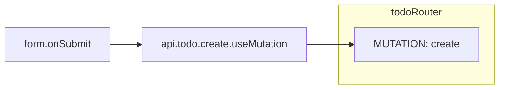
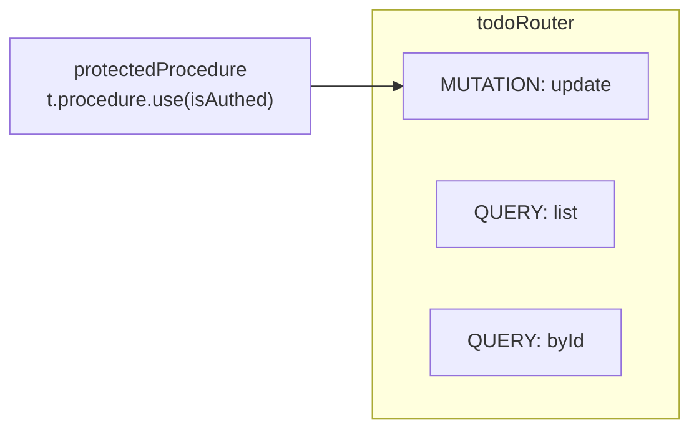

# tRPC router card

The card of a tRPC router in a [Trace Diagram](../../trace-diagram.md). The rules every card shares, its frame, its rows and its lines, are in [On the page](../../trace-diagram.md#on-the-page).

## What is a tRPC router card

A [GraphQL resolver of NestJS](nestjs.md#graphql-resolvers) is drawn as this card too, its type reading Resolver.

**A value at the top level of a file that holds procedures is a router card.** A procedure is a call the [catalogue](../../codegraph/catalogue.md#a-call-that-is-a-node-of-its-own) says is a node of its own: `query`, `mutation` and `subscription` of `initTRPC.create`, written as the value of a key. The card is named after the value, `todoRouter`, and its type reads Router.

A router card is drawn as a [route card](../route-card.md) is:

| Route card | tRPC router card |
|---|---|
| A route path, `/api/users` | A router, `todoRouter` |
| A heading per method, `POST` | A heading per procedure type, `MUTATION` |
| The handler of each method, a function card inside | Each procedure, a function card inside, named after its key |
| Middleware, `requireSession`: a card of its own | Middleware, the `use` of the procedure it is built on: a card of its own |
| A child route, `/api/users/:userId`: a card of its own | A router joined into another: a card of its own |

## Procedures

**A router card groups its procedures by type**, in this order:

```
QUERY · MUTATION · SUBSCRIPTION
```

A type the router has no procedure of has no heading. **Under each heading is each procedure of that type, drawn as a [function card](../function-card.md) inside the router card**, from the function it is handed, and named after the key it is written under. Each procedure is in the `children` of the router node.

```ts
// server/api/routers/todo.ts
export const todoRouter = createTRPCRouter({
  list: publicProcedure.query(({ ctx }) => ctx.db.query.todos.findMany()),
  byId: publicProcedure
    .input(z.object({ id: z.string() }))
    .query(({ ctx, input }) => ctx.db.query.todos.findFirst({ where: eq(todos.id, input.id) })),
  update: protectedProcedure
    .input(updateTodoInput)
    .mutation(async ({ ctx, input }) => {
      if (!input.title) throw new TRPCError({ code: "BAD_REQUEST" })
      await ctx.db.update(todos).set(input).where(eq(todos.id, input.id))
    }),
})
```

```
 ┌ ⇄ todoRouter ──────────────────── server/api/routers/todo.ts ┐
 │ Router                                              Modified │
 │ Reads and edits todos                                        │
 │ QUERY                                                        │  ← a procedure type heading
 │ ┌ ƒ list ────────────────────── server/api/routers/todo.ts ┐ │  ← a procedure, named after its key
 │ │ Resolver                                                 │ │
 │ │ Sends every todo                                         │ │
 │ │ ┌──────────────────────────────────────────────────────┐ │ │
 │ │ │ ctx                                                  │ │ │
 │ │ └──────────────────────────────────────────────────────┘ │ │
 │ │ ┌──────────────────────────────────────────────────────┐ │ │
 │ │ │ ctx.db.query.todos.findMany                          │○──▶ db
 │ │ └──────────────────────────────────────────────────────┘ │ │
 │ └──────────────────────────────────────────────────────────┘ │
 │ MUTATION                                                     │
 │ ┌ ƒ update ──────────────────── server/api/routers/todo.ts ┐ │
 │ │ Resolver                                        Modified │ │
 │ │ Saves an edited todo                                     │ │
 │ │ ┌──────────────────────────────────────────────────────┐ │ │
 │ │ │ input                                                │ │ │
 │ │ └──────────────────────────────────────────────────────┘ │ │
 │ │ ┌──────────────────────────────────────────────────────┐ │ │
 │ │ │ Condition :9                                         │ │ │
 │ │ └──────────────────────────────────────────────────────┘ │ │
 │ │ ╔══════════════════════════════════════════════════════╗ │ │
 │ │ ║ Writes the todo                                      ║○──▶ db
 │ │ ║ ctx.db.update                                        ║ │ │
 │ │ ╚══════════════════════════════════════════════════════╝ │ │
 │ └──────────────────────────────────────────────────────────┘ │
 └──────────────────────────────────────────────────────────────┘
```

## Calls from a client

**A call on a tRPC client has a line to the procedure it names.** `api.todo.create.useMutation(…)` in a component leads to the `create` procedure of `todoRouter`, as [A chain across a boundary](../../codegraph/chains.md#a-chain-across-a-boundary) says, so the line runs from the node of the call to the procedure card inside the router card. A `useMutation` handed a callback is a node of its own, and the line leaves it; a query handed none is a row of its component, and the line leaves that row.



## Middleware

**The middleware of a procedure is a card of its own.** A procedure is built on another, as `update` is built on `protectedProcedure`, and the `use` of that one, such as `t.procedure.use(isAuthed)`, runs before it. The node that holds that `use` is a card beside the router card, and a line runs from it to the head of each procedure card built on it.



## Routers joined into another

**A router joined into another is a card of its own**, beside it, with no line from it. A router that only joins other routers holds no procedure, so it has no card:

```ts
export const appRouter = createTRPCRouter({ todo: todoRouter, user: userRouter })
```

`appRouter` has no card, and `todoRouter` and `userRouter` are each a router card.

The edge from a router card to each procedure inside it stays in `traceNodeEdges`, and the page leaves it out.
