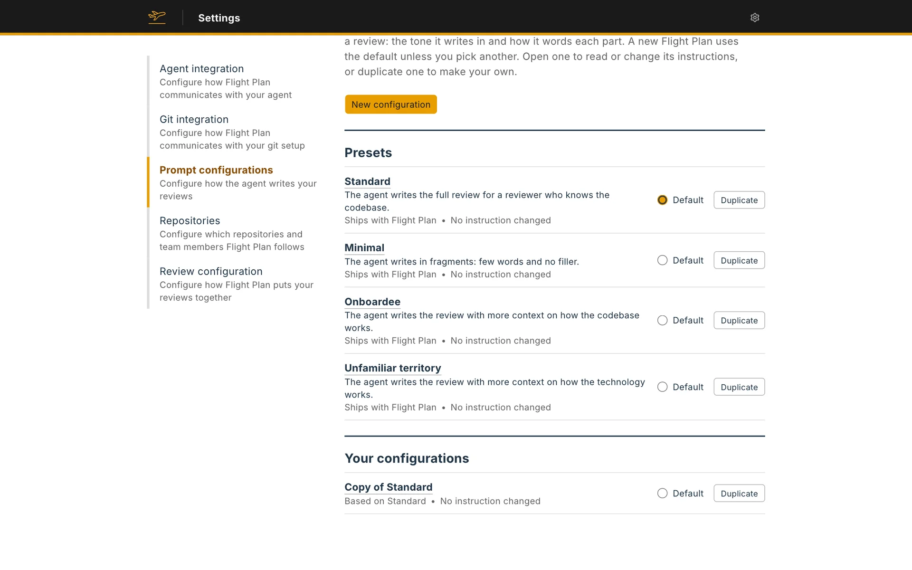
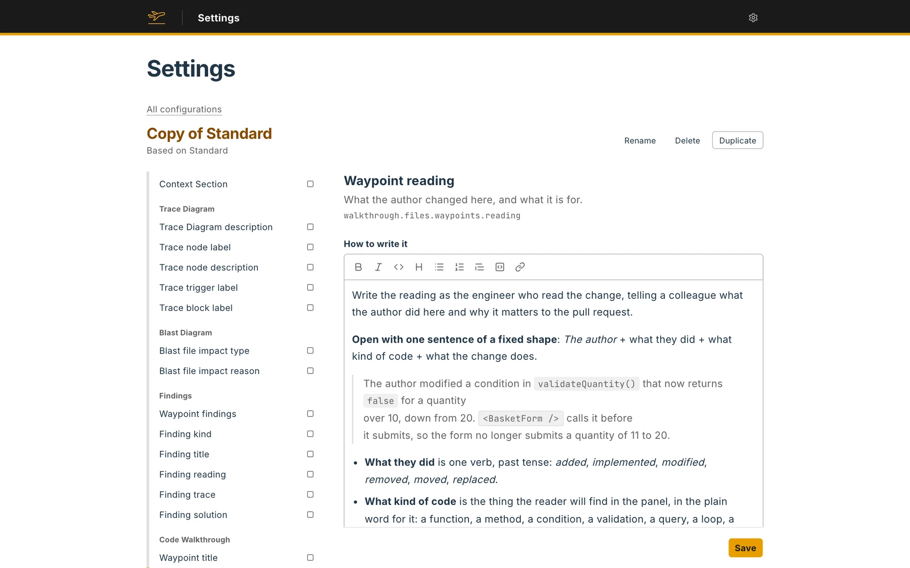

A prompt configuration is the set of instructions the agent follows when it writes a review: the tone it writes in, how it words each part, and which sections it includes. Flight Plan builds the same structure whichever you pick.

## The presets

| Preset | Best for | What changes |
|---|---|---|
| **Standard** | General pull requests | The full review, for a reviewer who knows the codebase. Every section is on. |
| **Minimal** | Saving tokens | The agent writes in fragments: few words and no filler. Trace Diagrams, the Blast Diagram and the findings are off. |
| **Onboardee** | Engineers new to the company and the codebase | The full review, with more about how the codebase works. Hovering a name in the code shows what it is, what it does and where the codebase uses it. |
| **Unfamiliar territory** | A language or framework you don't know well | The full review, with more about how the technology works. Hovering a name shows what it is, for the repository's code, the libraries it imports and the language itself. |

The Context Section and the Code Walkthrough are always written. A section a configuration leaves out shows a **Generate** button on the review, so you can have the agent write it when you need it.

## How Standard writes

Standard writes in a plain, technical style: one idea per sentence, active voice, present tense, plain words. Each part has its own instruction. For example, the Context Section opens with a short paragraph with no code names in it, then lists what happens when the change runs, then what changed and where, with a link to the code for each change.

Minimal rewrites every instruction in a fragment style. Onboardee and Unfamiliar territory use Standard's instructions and add the descriptions behind the names you hover.

## Picking a configuration

- **For one review:** choose it under **Configuration** when you start the review. The default comes first.
- **As the default:** choose a preset in the [Prompt configuration](/docs/setup/prompt-configuration/) step of setup. Later, under **Settings → Prompt configurations**, mark any configuration as **Default**, a preset or one of your own.
- **For a review you already have:** **Update the Flight Plan** and **Regenerate from scratch** let you pick another one. A different configuration means a full rewrite.

## Your own configurations

**Settings → Prompt configurations** lists the **Presets** and **Your configurations**. Open one to read its instructions.

To make your own, use **Duplicate** on any configuration, or **New configuration** to name it and choose what it starts from. A new configuration is a copy, with the same sections and the same instructions as its source.

Each configuration has two kinds of setting:

- **Sections.** Switch the Trace Diagrams, the Blast Diagram and the findings on or off, and pick which kinds of name the agent describes for [context code blocks](/docs/review-artifacts/parts/context-code-blocks/): **Code of the repository**, **Libraries** and **Language**.
- **Fields.** The index on the left lists every part the agent writes, grouped under **Voice**, **Context**, **Trace Diagram**, **Blast Diagram**, **Findings**, **Code Walkthrough** and **Context code blocks**. Open a field to edit **How to write it**, and for a field with fixed options, what each option means. Marks in the index show which fields you changed.

A changed field shows the instruction it started from, and a button to reset it. Your own configurations can be renamed and deleted. You can change a preset too, but a release of Flight Plan can overwrite what you change in it, so duplicate it to keep your changes.

Your configuration appears in the review form as **Your configuration, based on** its preset. A review keeps the configuration it was written with. If you delete that configuration later, the agent follows the preset it was based on.
