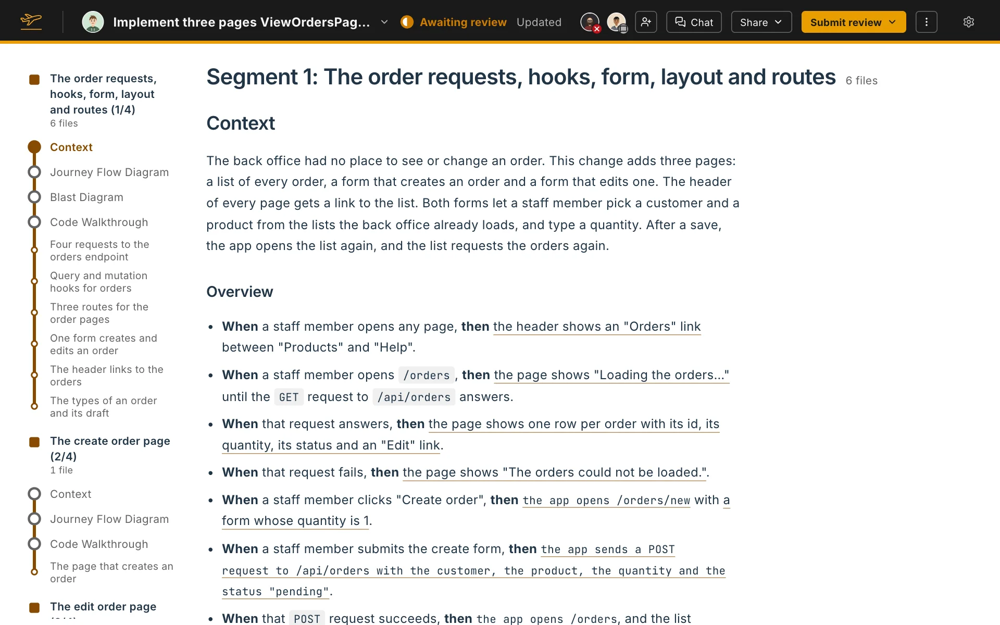

A review artifact is the review your agent writes for one pull request or branch. Flight Plan shows it on the review page next to the code it describes. It answers four questions a diff leaves open: why the change exists, how it runs, what it can affect, and where to look.

## Parts of the artifact

| Part | What it answers | Who decides what's in it |
|---|---|---|
| [Segments](/docs/review-artifacts/parts/segments/) | How the change splits into parts you can read one at a time | Flight Plan |
| [Context](/docs/review-artifacts/parts/context/) | Why the change exists | The agent |
| [Journey Flow Diagram](/docs/review-artifacts/parts/journey-flow-diagram/) | How execution reaches the changed code | Flight Plan draws it, the agent labels it |
| [Blast Diagram](/docs/review-artifacts/parts/blast-diagram/) | What the change can affect outside itself | Flight Plan draws it, the agent judges each file |
| [Code Walkthrough](/docs/review-artifacts/parts/code-walkthrough/) | Where to look, in what order | Flight Plan picks the files and lines, the agent explains them |
| [Findings](/docs/review-artifacts/parts/findings/) | What might be wrong | The agent |
| [Context code blocks](/docs/review-artifacts/parts/context-code-blocks/) | What a name in the code is | Flight Plan finds the names, the agent describes them |

Flight Plan works out the structure from the code: which files, lines, nodes and edges a review covers. The agent writes only the prose, so it can't leave a file or a caller out. The Code Walkthrough states how many changed files it covers.

## Around the artifact

The review page also lets you work on the pull request itself:

- [Comments and threads](/docs/review-artifacts/features/comments-and-threads/) on lines of the change.
- [Reviewed marks](/docs/review-artifacts/features/reviewed-marks/) that hide what you've read.
- [Submitting a review](/docs/review-artifacts/features/submitting-a-review/) with a verdict.
- [Agent chat](/docs/review-artifacts/features/agent-chat/) with the agent that wrote the review.
- [Sharing](/docs/review-artifacts/features/sharing/) a review in the pull request or as a Claude artifact.
- [Git features](/docs/review-artifacts/features/git-features/): branch status, switching pull requests, and updating a review.
- [Your own Flight Plan](/docs/review-artifacts/features/your-own-flight-plan/) for a pull request or branch you wrote.

## Finding your way around

The rail on the left lists each segment with its Context, diagrams and Code Walkthrough, and every file in it. Click an entry to jump to it.

While the agent is writing, the page shows its progress, such as **12 of 40 parts written**, and each part appears as it is written. A part that isn't written yet says **Not written yet.**
