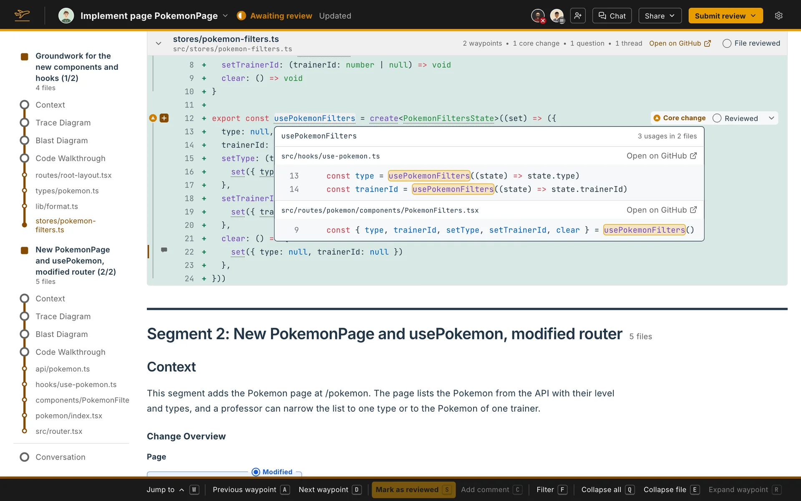

Context code blocks explain the names in the code you read. When a configuration asks for them, names in the code are underlined. Hover one to open a card with its description and its code.

## Kinds

| Kind | Which names | Configurations that ask for it |
|---|---|---|
| **Code of the repository** | Functions, components and other declarations from other files of the repository | Onboardee, Unfamiliar territory |
| **Libraries** | Names imported from a library | Unfamiliar territory |
| **Language** | Names that are neither imported nor declared, so they belong to the language | Unfamiliar territory |

Flight Plan finds the names and the code behind each one. The agent writes the description: what the code is, what it does and, for the repository's code, where the codebase uses it.

## The card

The card shows where the name is defined, the agent's description, then the code. A library name says the import is shown and not followed. A language name says it is assumed to be part of the language. A language name is underlined only once its description is written.
