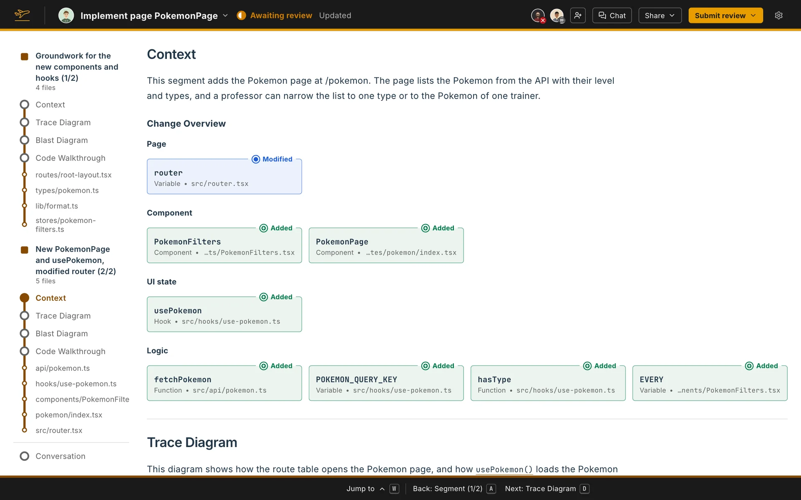

The Context comes first in each segment, unless you moved it in your display arrangement. It holds your agent's summary of the change, then the [Change Overview](/docs/review-artifacts/parts/change-overview/) Flight Plan builds under it.

## What your agent writes

With the Standard configuration, the summary is one or two sentences that say what the segment's change does, with no code names, paths or links in them. With segments off, it covers the whole change. The Change Overview under it already lists every piece of code the change adds, modifies and deletes.

Until your agent writes it, the Context says **Not written yet.**

## On your own Flight Plan

On your own Flight Plan, **Edit** opens the Context in an editor with formatting buttons. **Code link** inserts a link to code: pick a file, select the lines (click a line number, then shift-click another) and name the link. Hover a code link to see the code it points at, and click it to open that code in the walkthrough.
