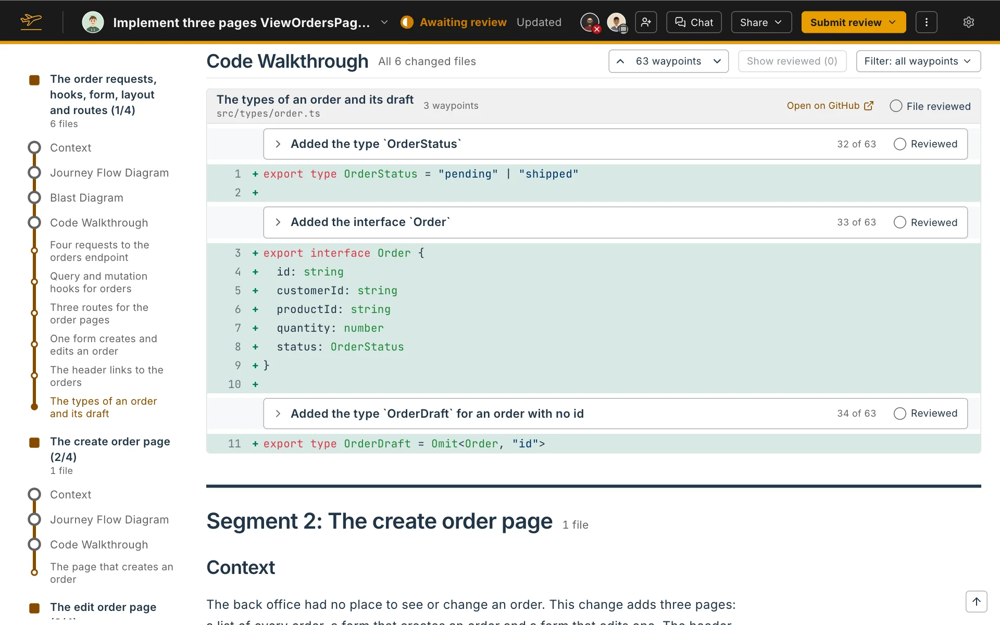

A large change is easier to read one path at a time. Flight Plan splits the change into segments, and each segment gets its own Context, Trace Diagram, Blast Diagram and Code Walkthrough.

## How the change is split

Flight Plan works out the split from the code:

- An **entry segment** is one path through the change: a changed file, and the changed files that only it leads to.
- The **shared segment** holds the code that several paths use, plus changed files no supported language reads, such as a migration or a stylesheet.

Every changed file is in exactly one segment. Test and story files are left out. A small change usually has a single segment, and then the page shows no segment headings at all.

The agent writes a title and a Context for each segment. The page shows them as **Segment 1: Title**, with the number of files beside it.

## Blast Diagrams per segment

The shared segment always has a Blast Diagram, and so does a review with one segment. An entry segment has one only when code outside the change uses what it changed.

## On your own Flight Plan

On a Flight Plan for your own pull request or branch, you can change the split:

- **Edit segment** changes a segment's label and its files.
- **Add a segment** at the end of the page starts a new, empty one.
- **Arrange** in the rail moves segments up and down.

A changed file you take out of every segment is flagged: the header says how many files are in no segment, and a reader is told so when they open the Flight Plan.
