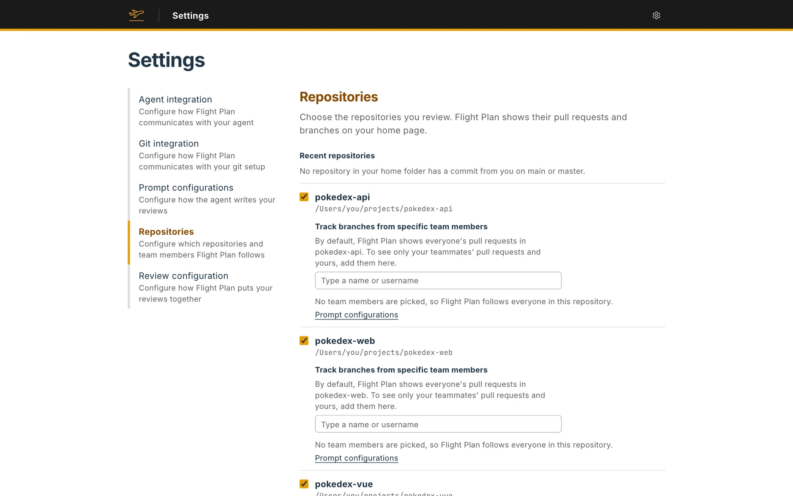

Pick the repositories you want to review. Flight Plan lists the pull requests and branches of each one on your home page.

## Recent repositories

Flight Plan looks through your home folder for the repositories where you made the last commit on `main` or `master`, and lists the ten most recent. Check a repository to follow it. It's saved at once, and unchecking it stops following it.

## Add a repository

If your repository isn't in the list, **Add repository** opens a dialog. Type the full path of a folder that holds a git repository, or search for it by name. The search needs at least three characters and looks through your home folder, skipping hidden folders, `node_modules`, `Library`, `Applications` and `AppData`. **Browse folders** lets you open folders one by one instead.

Flight Plan refuses a folder that isn't a git repository, a folder already on the list, and a second repository with the same name.

Once you pick a folder, the dialog also asks for the branch to compare with. It's set to the repository's main branch, and Flight Plan saves that one unless you pick another.

## Choose the branch to compare with

A checked repository opens its fields under its name. One of them sets the branch your work gets compared with. The field starts on the repository's main branch: the one `origin/HEAD` points to, or else `main` or `master`. Change it if your team branches off something else, like `develop`. Type part of a name to search your local and `origin` branches. Each one shows when it last got a commit.

A new review of a branch starts on this branch, and so does a review of a pull request when your forge doesn't say which branch the pull request merges into. You can pick another one when you create the review. Each review shows what its branch changed since it split from the branch it compares with. Flight Plan only lists branches that the repository's branch doesn't contain yet. If the branch is deleted later, the repository shows a problem that names the missing branch.

## Choose who to follow

Flight Plan knows you from your git config. It reads the repository's config first, and your global config (`git config --global user.email`) when the repository sets no email. If it finds no email, it asks you to pick yourself from the people who committed to the repository.

**Track branches from specific team members** picks the people whose work you review. Search by name or email, or by username on a code hosting site. You don't need to add yourself: as soon as you track anyone, your own work is listed too.

With nobody tracked, what a repository lists depends on how Flight Plan reaches it:

- On GitHub, GitLab or Bitbucket, everyone's pull requests.
- With local git, only the branches you add yourself. See [Local git](/docs/git-connection/local-git/).

**Save and continue** waits for at least one repository. When you finish setup, Flight Plan matches each repository's remote to one of your connections. See [Git connection](/docs/git-connection/).

## Later

**Settings → Repositories** shows the same list, and each change is saved as you make it. On the home page, **Configure** beside a repository changes its branch to compare with and the team members you track in it, and **Remove repository** takes it off the list and leaves its folder on disk alone.
